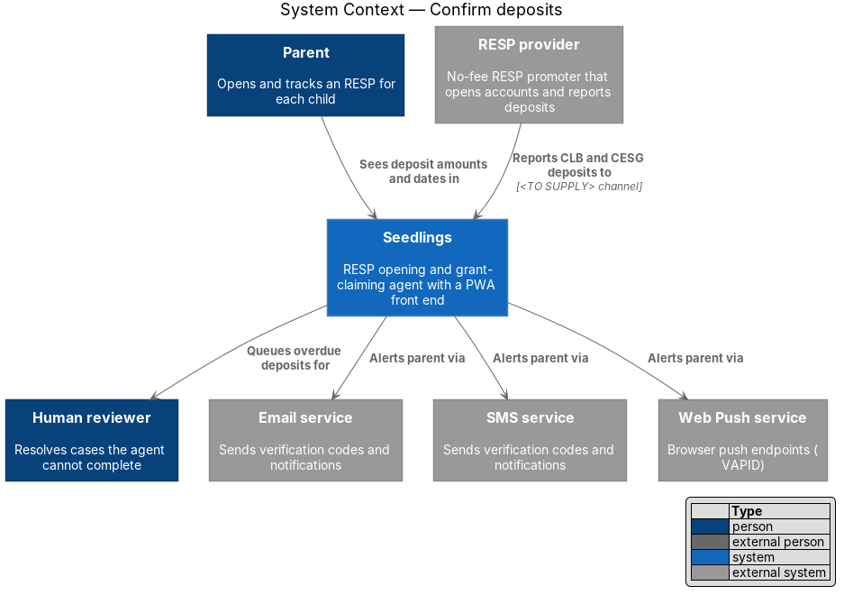
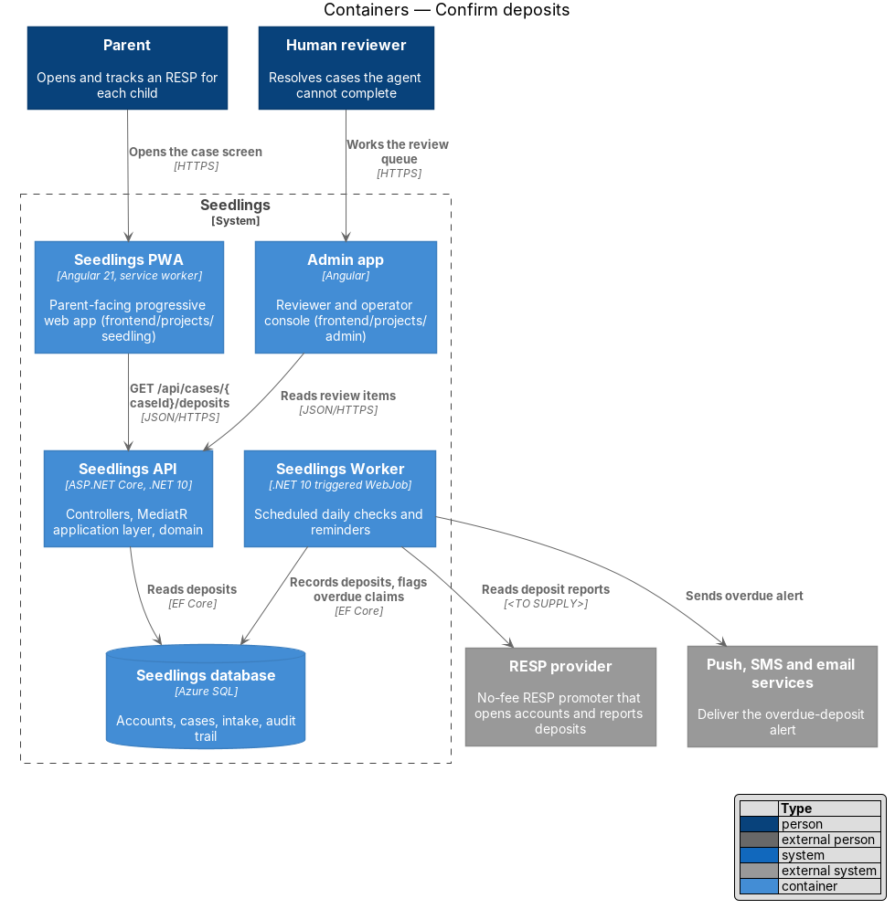
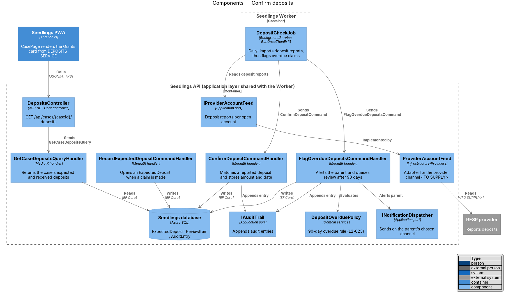
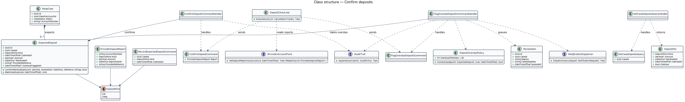
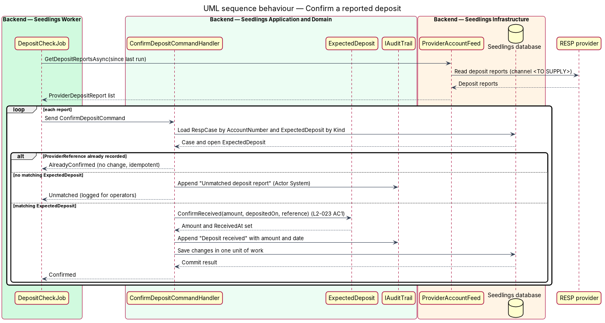
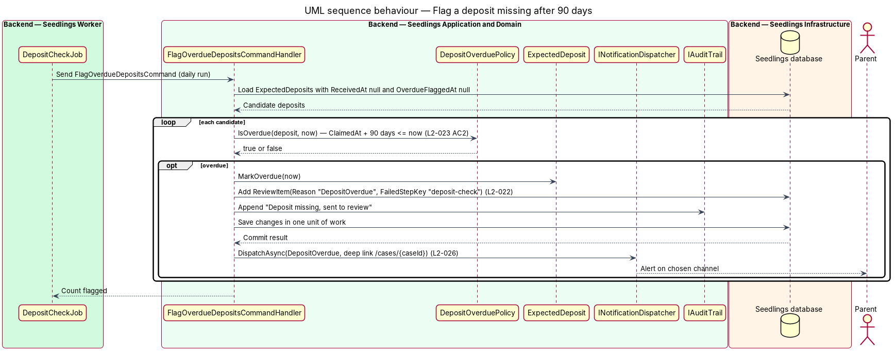
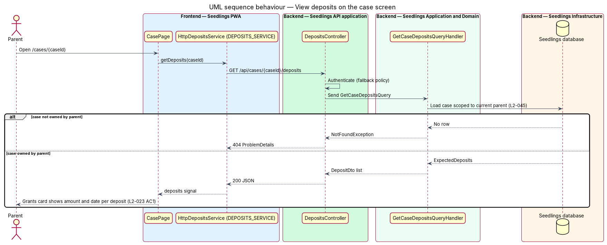

# Confirm deposits

## Overview

Seedlings is an installable progressive web app (PWA) and agent that opens a Registered Education
Savings Plan (RESP) for each child and claims the federal grants on the family's behalf. Two grants
matter here:

- **Canada Learning Bond (CLB)** — federal payment into a child's RESP for lower-income families, paid
  without any family contribution
- **Canada Education Savings Grant (CESG)** — federal matching grant paid on contributions the family
  makes into the RESP

Once the RESP is open and the bond is claimed, money does not arrive at once. The RESP provider
receives the deposit from Employment and Social Development Canada (ESDC) some time later and reports
it. This feature closes that loop. It belongs to the `account-care` subsystem, which looks after a case
after the account is open.

The feature does three things. It records an **expected deposit** when a grant is claimed. It confirms
the deposit when the provider reports it, so the case screen shows the amount and the date. It runs a
**daily check** that alerts the parent and sends the case to human review when a deposit is still
missing 90 days after the claim.

- **expected deposit** — record of a grant Seedlings has claimed for a case and expects the provider to
  report as received
- **deposit report** — statement from the RESP provider that a grant amount landed in a named account on
  a named date
- **overdue deposit** — expected deposit with no matching deposit report 90 days after its claim date
- **daily check** — scheduled run of `DepositCheckJob` in Seedlings Worker, deployed as an App Service
  triggered WebJob

The case screen is `docs/mocks/pages/case.html` (the Where it's at timeline, Bond paid row, and the
Grants card). The dashboard card in `docs/mocks/pages/dashboard.html` reads the same received totals.

## Description

### Backend — Domain

- **`ExpectedDeposit`** (`Seedling.Domain/Entities/`) — one row per claimed grant. Fields: `Id`,
  `CaseId`, `Kind` (`DepositKind`), `ClaimedAt`, `Amount?`, `ReceivedAt?` (`DateOnly`),
  `ProviderReference?`, `OverdueFlaggedAt?`. `ConfirmReceived(amount, receivedOn, reference)` sets the
  amount, date and reference once and returns `false` when the same reference was already applied.
  `MarkOverdue(now)` stamps `OverdueFlaggedAt` once.
- **`DepositKind`** (`Seedling.Domain/Enums/`) — `Clb`, `Cesg`.
- **`DepositOverduePolicy`** (domain service) — `IsOverdue(deposit, now)` returns `true` when
  `ReceivedAt` is null and `ClaimedAt` plus 90 calendar days is at or before `now`, compared in UTC.
  The 90-day figure comes from L2-023 and lives in this one class.

### Backend — Application

- **`RecordExpectedDepositCommand`** and handler — opens an `ExpectedDeposit` for a case. The
  track-submission feature (`case-agent/track-submission`) sends it with `Kind = Clb` when the case
  moves to `BondClaimed`. The handler is idempotent: a second command for the same case and kind
  returns the existing row. The trigger for CESG expected deposits (which contribution, and which
  amount) is `<TO SUPPLY>`; the CESG matching figures are not stated in the specs.
- **`ConfirmDepositCommand`** and **`ConfirmDepositCommandHandler`** — carries one
  `ProviderDepositReport` (`AccountNumber`, `Kind`, `Amount`, `DepositedOn`, `ProviderReference`). The
  handler finds the case by `AccountNumber`, finds its open `ExpectedDeposit` of that kind, calls
  `ConfirmReceived`, appends an `AuditEntry` (`Actor = System`, action "Deposit received") through
  `IAuditTrail`, and saves in one unit of work. A report whose `ProviderReference` was already applied
  changes nothing. A report with no matching expected deposit is audited and logged for operators;
  it does not create a deposit.
- **`FlagOverdueDepositsCommand`** and **`FlagOverdueDepositsCommandHandler`** — loads every
  `ExpectedDeposit` with `ReceivedAt` and `OverdueFlaggedAt` both null, asks `DepositOverduePolicy`,
  and for each overdue one calls `MarkOverdue`, adds a `ReviewItem` (`Reason = "DepositOverdue"`,
  `FailedStepKey = "deposit-check"`) owned by `case-agent/human-review-handoff`, appends an audit
  entry, saves, and then calls `INotificationDispatcher` with `NotificationKind.DepositOverdue` and the
  deep link `/cases/{caseId}`. `OverdueFlaggedAt` keeps a later run from alerting twice. The case
  status shown while the review item is open follows L2-022 and L2-021, owned by human-review-handoff.
- **`GetCaseDepositsQuery`** and handler — returns `DepositDto` (`Kind`, `Amount?`, `ReceivedAt?`,
  `ClaimedAt`, `Overdue`) for one case, scoped to the current parent (L2-045).
- **`IProviderAccountFeed`** (port) — `GetDepositReportsAsync(since)` returns deposit reports. The
  contribution-room-reminder feature adds a contribution read to the same port.
- **`INotificationDispatcher`** and **`IAuditTrail`** — shared ports; the dispatcher is designed in
  `account-care/notification-channels`.

### Backend — Infrastructure and Worker

- **`ProviderAccountFeed`** (`Seedling.Infrastructure/Providers/`) — implements `IProviderAccountFeed`.
  The provider's deposit-report channel (API, file drop or webhook), its format, and its
  authentication are `<TO SUPPLY>`. Until that is supplied, the adapter is the only unknown; the rest of
  the slice runs against a fake feed in tests.
- **`DepositCheckJob`** (`Seedling.Worker/Jobs/`) — `BackgroundService` registered in
  `Seedling.Worker/Program.cs`. One run reads reports since the last successful run (stored as a
  `JobRun` watermark, `Name = "deposit-check"`), sends one `ConfirmDepositCommand` per report, then
  sends `FlagOverdueDepositsCommand`. Confirmation runs first so a deposit reported on day 90 is not
  flagged. With `Seedling:DepositCheck:RunOnceThenExit = true` it runs once and exits.
- **`backend/deploy/webjobs/deposit-check/`** — `run.sh` starts the published `Seedling.Worker` with
  the run-once switch; `settings.job` holds a daily NCRONTAB schedule in UTC whose time of day is
  `<TO SUPPLY>`; `README.md` documents an on-demand run. `deploy.yml` publishes the Worker beside
  `run.sh`.
- **`AppDbContext`** — adds `DbSet<ExpectedDeposit>` with a unique index on
  `(CaseId, Kind, ClaimedAt)` and a filtered unique index on `ProviderReference`.

### API

| Method | Path | Result |
|--------|------|--------|
| `GET` | `/api/cases/{caseId}/deposits` | `200` with `DepositDto[]`; `404` `ProblemDetails` for a case the parent does not own |

`DepositsController` requires authentication through the fallback policy. There is no public write
endpoint: deposits enter only through the Worker.

### Frontend

- **`DepositsService`** interface, **`DEPOSITS_SERVICE`** token and **`HttpDepositsService`**
  (`frontend/projects/api/src/lib/services/`) — `getDeposits(caseId)`. `app.config.ts` binds the token.
- **`CasePage`** (`app-case`, owned by `case-agent/case-status-dashboard`) — reads `DEPOSITS_SERVICE`
  into a `deposits` signal. The Grants card renders one row per deposit with the kind, the received
  date and the amount, as in `case.html` (Canada Learning Bond, Deposited 2 Sep 2026, $600). A deposit
  not yet received shows its expected state. The timeline's Bond paid step reads the same data.
- The mock labels a received bond "Bond paid", which is not one of the eight L2-021 statuses; this
  feature does not change `CaseStatus`, and the chip wording is `<TO SUPPLY>` by
  case-status-dashboard.

### Implementation slices

1. **Record a claimed bond** — `ExpectedDeposit`, `RecordExpectedDepositCommand`, migration; API test
   that a `BondClaimed` case holds one expected CLB deposit. Prepares L2-023 AC1.
2. **Confirm a reported deposit** — `ConfirmDepositCommand` with a fake `IProviderAccountFeed`;
   integration test that a report sets amount and date and that a repeated report changes nothing.
   L2-023 AC1 (backend).
3. **Show amount and date** — `GET /api/cases/{caseId}/deposits`, `DEPOSITS_SERVICE`, Grants card in
   `CasePage`; Playwright test through the case page object. L2-023 AC1.
4. **Flag after 90 days** — `DepositOverduePolicy`, `FlagOverdueDepositsCommand`, `ReviewItem`,
   dispatcher call; integration test with `IDateTimeProvider` set to claim date plus 90 days, and a
   negative test at 89 days. L2-023 AC2.
5. **Schedule the daily check** — `DepositCheckJob`, run-once switch, `deploy/webjobs/deposit-check/`;
   test that one run confirms before it flags. L2-023 AC1 and AC2.
6. **Provider channel** — `ProviderAccountFeed` against the real channel once `<TO SUPPLY>` is
   resolved.

## Requirements

| L2 ID | Refines (L1) | Requirement |
|-------|--------------|-------------|
| `L2-023` | `L1-014` | Seedlings shall record expected CLB and CESG deposits and confirm them when they arrive. |

## Diagrams

### System context

The parent reads deposit results in Seedlings. The RESP provider reports deposits over a channel still
`<TO SUPPLY>`, and Seedlings alerts the parent and the human reviewer when one is missing.

### Containers

Seedlings Worker runs the daily check against the provider and the database. The PWA reads deposits
through the Seedlings API, and the admin app shows the resulting review items.

### Components

`DepositCheckJob` reads reports through `IProviderAccountFeed` and sends the confirm and flag commands.
`DepositsController` serves the case screen through `GetCaseDepositsQueryHandler`.

### Class structure

A `RespCase` owns zero or more `ExpectedDeposit` rows. The two command handlers mutate them, and
`DepositOverduePolicy` holds the 90-day rule.

### Behaviour — confirm a reported deposit

For each provider report, the handler matches the case by account number and sets the amount and date
once (L2-023 AC1). Repeated and unmatched reports change no deposit.

### Behaviour — flag a deposit missing after 90 days

The daily run marks each deposit still missing 90 days after its claim, queues a review item, and
alerts the parent on the chosen channel (L2-023 AC2).

### Behaviour — view deposits on the case screen

The case page reads deposits for a case the parent owns and shows each amount and date in the Grants
card. A case owned by another parent returns `404`.

