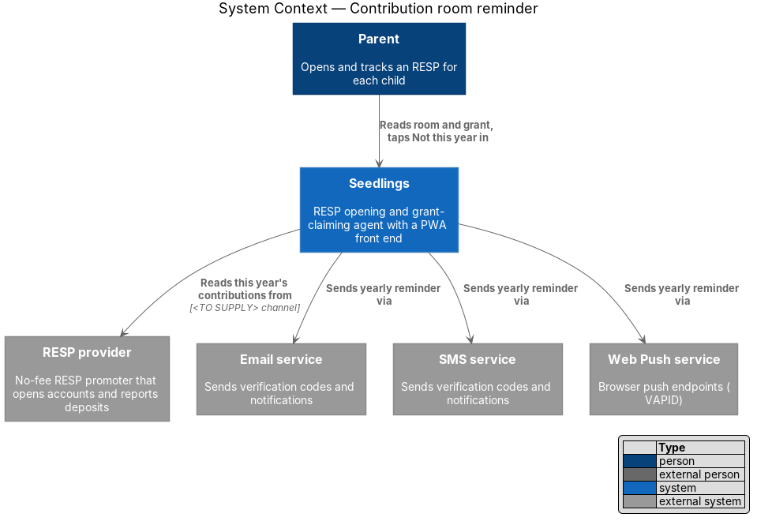
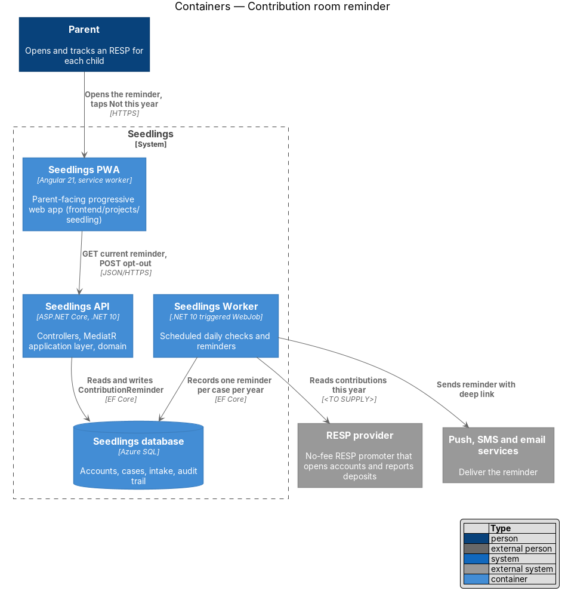
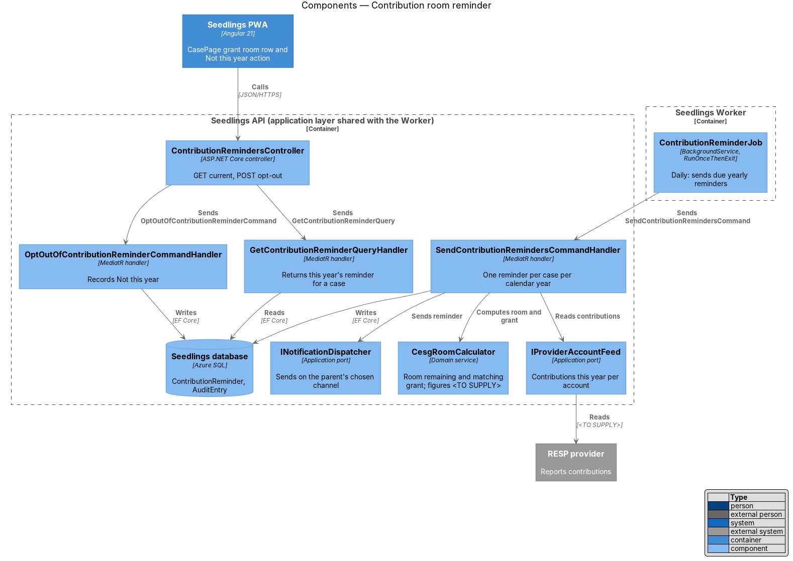
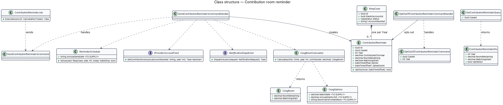
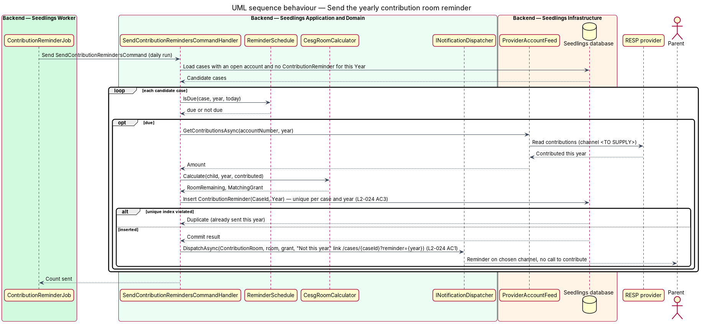
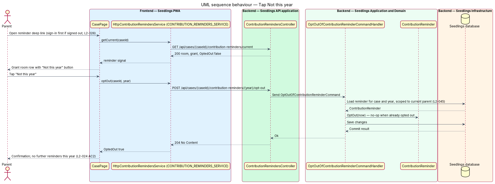

# Contribution room reminder

## Overview

Seedlings opens a Registered Education Savings Plan (RESP) for each child and then keeps the account
on track. The Canada Education Savings Grant (CESG) adds a federal match to money the family puts into
the RESP, up to a yearly limit. Families who contribute nothing still receive the Canada Learning Bond
when eligible, so a contribution is never a condition of using Seedlings.

This feature, in the `account-care` subsystem, sends each open account one reminder per calendar year.
The reminder states how much CESG room remains for the child and the grant that room would earn. It
carries a one-tap "Not this year" option and asks for nothing. The wording informs, without pressure on
families who cannot contribute (L1-014).

- **CESG room** — amount the family may still contribute in a year and receive the CESG match on
- **matching grant** — CESG amount the remaining room would earn if contributed in full
- **contribution room reminder** — yearly message to the parent that states the CESG room and the
  matching grant for one case
- **opt-out** — parent's "Not this year" choice, which stops contribution reminders for that case
  until the next calendar year

The CESG match rate, the yearly grant limit and the carry-forward rule for unused room are
`<TO SUPPLY>`. The case screen mock `docs/mocks/pages/case.html` shows a Grant room this year row
("Save $2,500 to get the full $500 grant"); those figures illustrate layout only and are not a source
for the rules.

## Description

### Backend — Domain

- **`ContributionReminder`** (`Seedling.Domain/Entities/`) — one row per case per calendar year.
  Fields: `Id`, `CaseId`, `Year`, `ContributedThisYear`, `RoomRemaining`, `MatchingGrant`, `SentAt`,
  `OptedOutAt?`. A unique index on `(CaseId, Year)` holds the once-per-year rule (L2-024 AC3) in the
  database, not only in code. `OptOut(now)` sets `OptedOutAt` once; a second call changes nothing.
- **`CesgRoomCalculator`** (domain service) — `Calculate(child, year, contributed)` returns a
  `CesgRoom` (`RoomRemaining`, `MatchingGrant`). It reads `CesgOptions` (`MatchRate`,
  `AnnualGrantLimit`, carry-forward rule), bound from configuration section `Seedling:Cesg`. Every value
  is `<TO SUPPLY>`; the calculator has no built-in defaults, and the job does not send when the
  options are absent.
- **`ReminderSchedule`** (domain service) — `IsDue(case, year, today)` returns `true` when the case
  account is open, `today` is on or after the yearly send date, and no reminder exists for that year.
  The yearly send date (`Seedling:ContributionReminder:AnnualSendDate`) is `<TO SUPPLY>`. A daily run
  with an on-or-after rule catches up after a missed day.

### Backend — Application

- **`SendContributionRemindersCommand`** and handler — loads cases with an open account and no
  `ContributionReminder` for the current year, asks `ReminderSchedule`, reads the contribution total
  through `IProviderAccountFeed.GetContributionsAsync(accountNumber, year)`, computes the room through
  `CesgRoomCalculator`, inserts the reminder, commits, and then calls `INotificationDispatcher` with
  `NotificationKind.ContributionRoom`. A unique-index violation means the reminder was already sent, and
  the handler skips the case. The insert commits before dispatch, so a crash after commit never sends a
  second reminder; the cost is that such a crash may send none that year, and the job logs it.
- **Message content** — the notification states the room remaining and the matching grant in dollars,
  and the deep link `/cases/{caseId}?reminder={year}`. The parent-facing wording, in English and French
  at a Grade 6 reading level (L2-028), is `<TO SUPPLY>`. It contains no call to contribute and no
  deadline language.
- **`OptOutOfContributionReminderCommand`** (`CaseId`, `Year`) and handler — loads the reminder scoped
  to the current parent (L2-045), calls `OptOut`, and saves. The command is idempotent. An opted-out
  reminder suppresses any further contribution reminder for that case and year (L2-024 AC2).
- **`GetContributionReminderQuery`** and handler — returns `ContributionReminderDto` (`Year`,
  `RoomRemaining`, `MatchingGrant`, `OptedOut`) for the current year, or `404` when none was sent.
- **`IProviderAccountFeed`** — the port introduced by `account-care/confirm-deposits`, extended with
  `GetContributionsAsync`. The provider channel for contribution totals is `<TO SUPPLY>`.

### Backend — Worker

- **`ContributionReminderJob`** (`Seedling.Worker/Jobs/`) — `BackgroundService` that sends
  `SendContributionRemindersCommand` once per run and honours
  `Seedling:ContributionReminder:RunOnceThenExit`.
- **`backend/deploy/webjobs/contribution-reminder/`** — `run.sh`, `settings.job` with a daily NCRONTAB
  schedule in UTC (time of day `<TO SUPPLY>`), and `README.md`.

### API

| Method | Path | Result |
|--------|------|--------|
| `GET` | `/api/cases/{caseId}/contribution-reminders/current` | `200` `ContributionReminderDto`; `404` when none this year or the case is not the parent's |
| `POST` | `/api/cases/{caseId}/contribution-reminders/{year}/opt-out` | `204`; repeat calls return `204` |

`ContributionRemindersController` requires authentication through the fallback policy.

### Frontend

- **`ContributionRemindersService`** interface, **`CONTRIBUTION_REMINDERS_SERVICE`** token and
  **`HttpContributionRemindersService`** (`frontend/projects/api/src/lib/services/`) — `getCurrent` and
  `optOut`.
- **`CasePage`** (`app-case`, owned by `case-agent/case-status-dashboard`) — when the route carries
  `?reminder={year}` or a current reminder exists, the Grants card's Grant room this year row shows the
  room, the matching grant and a quiet `sl-button` labelled "Not this year". After the tap, the row
  shows a short confirmation and the button is gone.
- **One tap** — for a signed-in parent the deep link opens the case with the button in view, so the
  opt-out is one tap. A signed-out parent signs in first (L2-026 AC3). Push action buttons that opt out
  from the notification itself are out of scope.
- **Mock gap** — `case.html` has no "Not this year" button and no reminder state. The mock for the
  reminder state and for the reminder message is `<TO SUPPLY>` and precedes implementation.

### Implementation slices

1. **Once per year** — `ContributionReminder`, unique index, `SendContributionRemindersCommand` with a
   fake feed and fixed `CesgOptions`; integration test that two runs in one year send one reminder.
   L2-024 AC3.
2. **Room and grant in the message** — `CesgRoomCalculator` and dispatcher call; test that a $0
   contributor's reminder carries room, grant and the opt-out link. L2-024 AC1 (figures from test
   configuration until `<TO SUPPLY>` is resolved).
3. **Not this year** — opt-out endpoint, `CONTRIBUTION_REMINDERS_SERVICE`, button on `CasePage`;
   Playwright test through the case page object, plus an API test that a later run sends nothing.
   L2-024 AC2.
4. **Schedule** — `ContributionReminderJob`, `deploy/webjobs/contribution-reminder/`.
5. **Provider contributions** — `ProviderAccountFeed.GetContributionsAsync` against the real channel
   once `<TO SUPPLY>` is resolved.

## Requirements

| L2 ID | Refines (L1) | Requirement |
|-------|--------------|-------------|
| `L2-024` | `L1-014` | Once per calendar year Seedlings shall tell the parent the CESG room remaining and the grant it would earn, without pressure to contribute. |

## Diagrams

### System context

Seedlings reads the year's contributions from the RESP provider and sends the parent one reminder on
the chosen channel. The parent answers in Seedlings.

### Containers

Seedlings Worker sends the reminder; the PWA and the Seedlings API serve the reminder state and the
opt-out.

### Components

`ContributionReminderJob` drives `SendContributionRemindersCommandHandler`, which uses the feed, the
calculator and the dispatcher. `ContributionRemindersController` serves the read and the opt-out.

### Class structure

Each `RespCase` holds at most one `ContributionReminder` per year. `CesgRoomCalculator` reads
`CesgOptions`, whose values are `<TO SUPPLY>`.

### Behaviour — send the yearly reminder

The daily run sends at most one reminder per case per year; the unique index rejects a second
(L2-024 AC3). The message states room and grant and links to the opt-out (L2-024 AC1).

### Behaviour — tap Not this year

The parent opens the deep link and taps "Not this year". The API records the opt-out once, and no
further reminder for that year goes out (L2-024 AC2).

