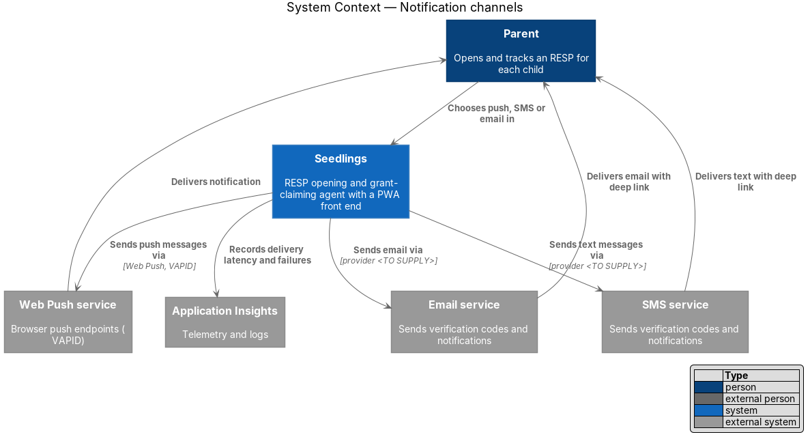
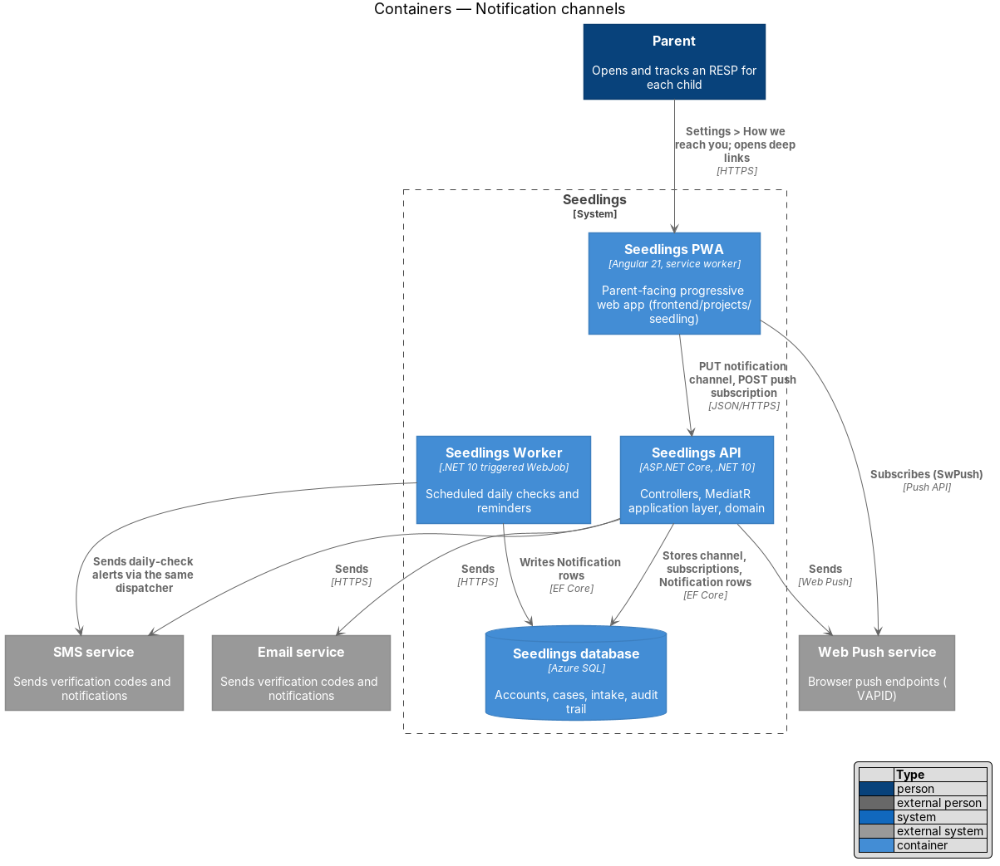
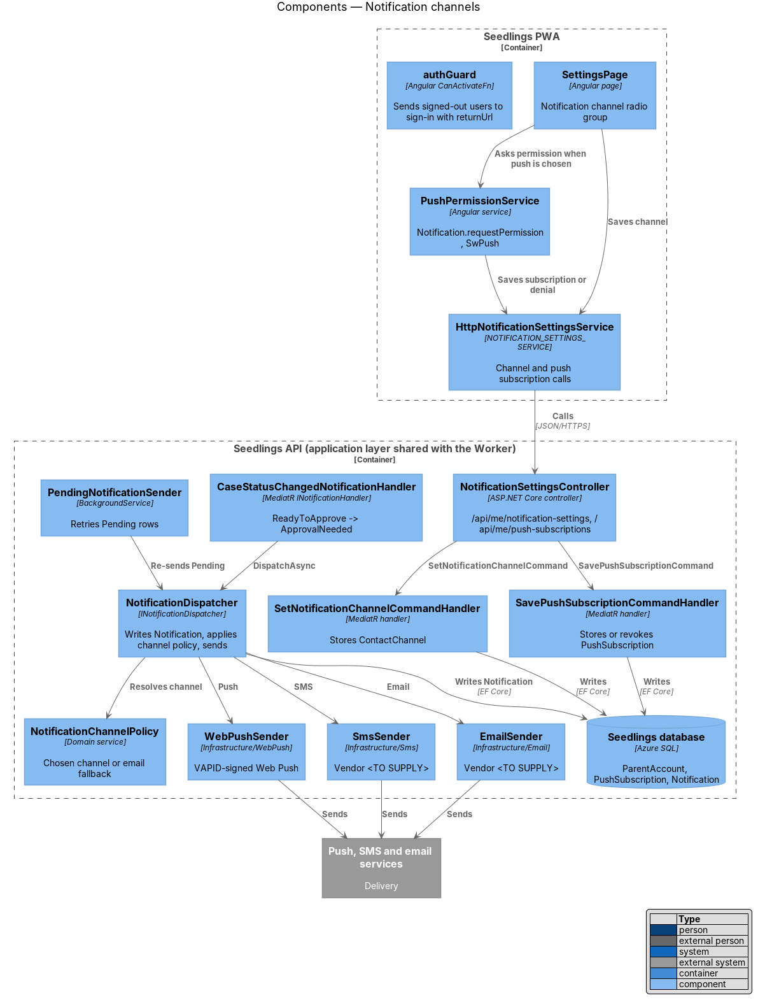
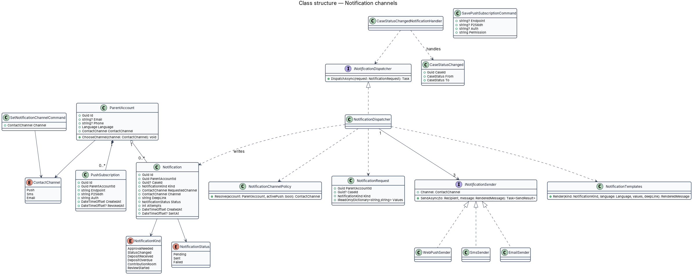
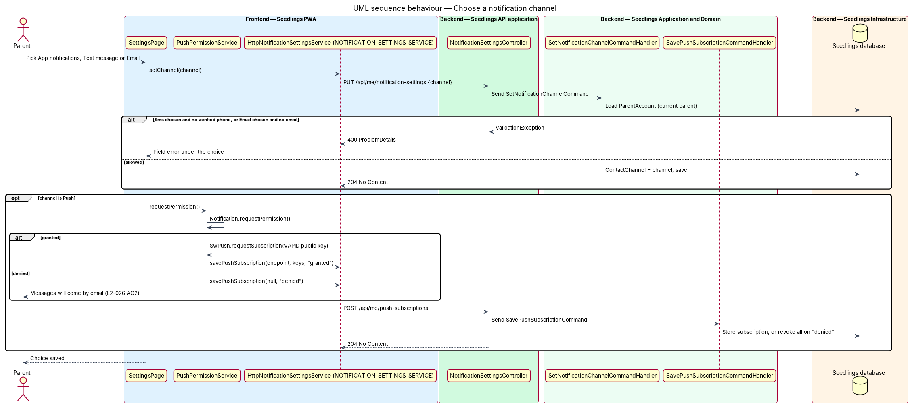
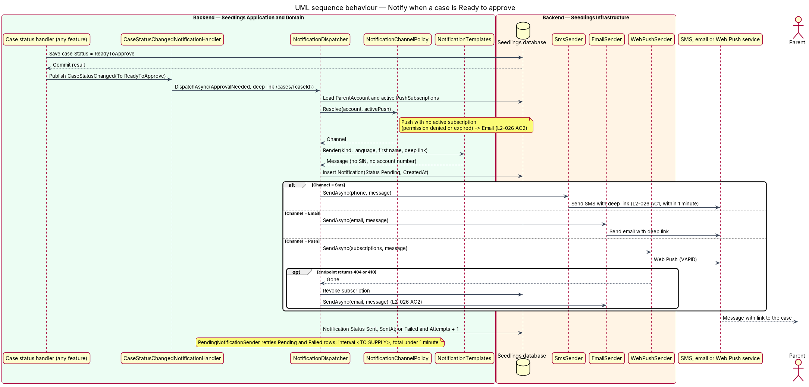
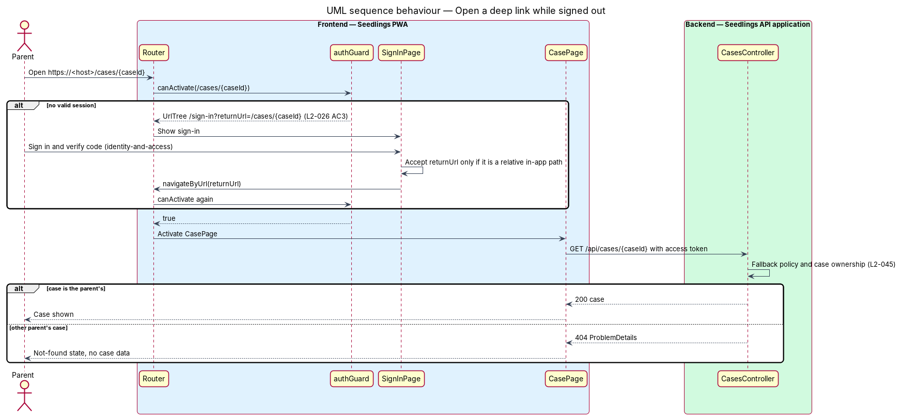

# Notification channels

## Overview

Seedlings works on the parent's behalf in the background: it submits forms, waits for the RESP
provider and the government, and runs daily checks. Four kinds of event call for the parent's
attention: a case becomes ready to approve, a deposit lands, a deposit goes missing, the yearly grant
room reminder is due. This feature, in the `account-care` subsystem, carries those messages to the
parent on the channel the parent picks (L1-016).

The parent picks exactly one channel in Settings: app notifications (Web Push to the installed PWA),
text message (SMS) or email. Each message carries a deep link to the case it concerns. The other
account-care features and the case-agent features send through the one dispatcher this feature
defines, so channel choice, fallback and timing live in one place.

- **notification channel** — delivery route the parent chose for messages from Seedlings: `Push`,
  `Sms` or `Email` (`ContactChannel`)
- **deep link** — URL into the PWA that opens one case, of the form `/cases/{caseId}`
- **email fallback** — delivery by email of a message whose chosen channel is push, used when the
  browser has no active push subscription because permission was denied or the subscription expired
- **dispatcher** — `NotificationDispatcher`, the application service that picks the channel, renders
  the message, records it and sends it

The settings screen is `docs/mocks/pages/settings.html`, section `#notifications` ("Notification
channel" radio group with values `push`, `sms` and `email`).

## Description

### Frontend

- **`SettingsPage`** (`app-settings`, `frontend/projects/seedling/src/app/pages/settings/`) — the
  notifications card renders the mock's `fieldset` with a visually hidden legend and three `choice`
  radios. The descriptions show the parent's phone and email, as in the mock. A change saves at once
  through `NOTIFICATION_SETTINGS_SERVICE`; a `400` shows the error under the choice.
- **`PushPermissionService`** (`frontend/projects/seedling/src/app/shared/`) — when the parent picks
  push, calls `Notification.requestPermission()`. On `granted` it calls
  `SwPush.requestSubscription({ serverPublicKey })` with the VAPID public key from `environment.ts`
  and posts the subscription. On `denied` it posts the denial and the page states that messages will
  come by email. On a later app start it re-checks `Notification.permission` and reports a change.
- **`NotificationSettingsService`** interface, **`NOTIFICATION_SETTINGS_SERVICE`** token and
  **`HttpNotificationSettingsService`** (`frontend/projects/api/src/lib/services/`) — `get()`,
  `setChannel(channel)`, `savePushSubscription(subscription | null, permission)`.
- **`authGuard`** (`frontend/projects/api/src/lib/auth/`, owned by `identity-and-access`) — guards
  `/cases/:caseId`. A signed-out visitor goes to `/sign-in?returnUrl=/cases/{caseId}`. After sign-in,
  `SignInPage` navigates to `returnUrl` only when it is a relative in-app path, which blocks open
  redirects (L2-026 AC3).
- **Service worker** — `notificationclick` opens or focuses the PWA at the message's deep link.

### Backend — Domain

- **`ParentAccount`** — existing shared entity; this feature uses `ContactChannel` and adds
  `ChooseChannel(channel)`, which rejects `Sms` without a verified phone and `Email` without an email.
- **`PushSubscription`** — `Id`, `ParentAccountId`, `Endpoint`, `P256dh`, `Auth`, `CreatedAt`,
  `RevokedAt?`. A parent may hold one subscription per device.
- **`Notification`** — `Id`, `ParentAccountId`, `CaseId?`, `Kind` (`NotificationKind`),
  `RequestedChannel`, `Channel` (the one used), `DeepLink`, `Status` (`Pending`, `Sent`, `Failed`),
  `Attempts`, `CreatedAt`, `SentAt?`. `CreatedAt` and `SentAt` together measure the 1-minute target of
  L2-026 AC1.
- **`NotificationChannelPolicy`** (domain service) — `Resolve(account, activePush)` returns the chosen
  channel, except that `Push` with no active subscription resolves to `Email` (L2-026 AC2). The
  fallback for a parent with push chosen, push unavailable and no email on file is `<TO SUPPLY>`.

### Backend — Application

- **`SetNotificationChannelCommand`** and handler — stores the channel for the current parent.
- **`SavePushSubscriptionCommand`** and handler — stores a subscription on `granted`; on `denied` it
  revokes every active subscription of the parent, which makes the policy fall back to email.
- **`INotificationDispatcher`** / **`NotificationDispatcher`** — `DispatchAsync(NotificationRequest)`
  loads the account and its active subscriptions, resolves the channel, renders the message through
  `NotificationTemplates`, inserts a `Pending` `Notification`, calls the `INotificationSender` for that
  channel, and records `Sent` or `Failed`. A Web Push endpoint answering `404` or `410` is revoked and
  the message goes by email.
- **`NotificationTemplates`** — renders by `NotificationKind` and the parent's `Language` (English or
  French). Messages carry the child's first name, a short status line and the deep link, and never a
  SIN, document or account number. Template text at a Grade 6 reading level (L2-028) is `<TO SUPPLY>`.
- **`CaseStatusChangedNotificationHandler`** — MediatR `INotificationHandler<CaseStatusChanged>`. Any
  handler that changes `RespCase.Status` publishes `CaseStatusChanged` after commit. A change to
  `ReadyToApprove` dispatches `ApprovalNeeded` with the deep link to that case (L2-026 AC1). The
  mapping for the other statuses follows L1-016 (status changes, approvals needed, deposits received).
- **`PendingNotificationSender`** — `BackgroundService` in the API that re-sends `Pending` and `Failed`
  rows. Its polling interval and attempt limit are `<TO SUPPLY>`; together with the first attempt they
  shall keep delivery to the SMS service within 1 minute of the status change. A process stop between
  the case commit and the `Notification` insert loses that message; whether to write the row in the
  same unit of work as the status change (a transactional outbox) is an open decision for an ADR,
  `<TO SUPPLY>`.

### Backend — Infrastructure

- **`WebPushSender`** (`Seedling.Infrastructure/WebPush/`) — sends VAPID-signed Web Push messages. The
  VAPID key pair is an application secret set through `eng/infra/main.bicep` app settings; its storage
  location is `<TO SUPPLY>`.
- **`SmsSender`** (`Seedling.Infrastructure/Sms/`) and **`EmailSender`** (`Seedling.Infrastructure/Email/`)
  — the SMS and email vendors, their APIs and credentials are `<TO SUPPLY>`. The same senders deliver
  sign-up verification codes (`identity-and-access/sign-up-and-verify`).
- **Telemetry** — each send logs kind, channel, outcome and latency to Application Insights, with
  phone numbers and email addresses redacted (L2-047).

### API

| Method | Path | Result |
|--------|------|--------|
| `GET` | `/api/me/notification-settings` | `200` channel, masked phone and email, `hasActivePush` |
| `PUT` | `/api/me/notification-settings` | `204`; `400` `ProblemDetails` for a channel without a contact |
| `POST` | `/api/me/push-subscriptions` | `204`; stores or revokes subscriptions |

`NotificationSettingsController` requires authentication through the fallback policy and acts only on
the current parent.

### Implementation slices

1. **Choose a channel** — `SettingsPage` notifications card, `PUT` endpoint, `ChooseChannel` rule;
   Playwright test through the settings page object that the choice persists after reload. L2-026
   groundwork.
2. **SMS on Ready to approve** — `CaseStatusChanged`, `NotificationDispatcher`, `SmsSender` behind a
   fake; API test that a case moving to `ReadyToApprove` records a `Sent` SMS with the case deep link and
   `SentAt - CreatedAt` under 1 minute. L2-026 AC1.
3. **Email fallback for denied push** — `PushPermissionService`, push-subscription endpoint,
   `NotificationChannelPolicy`; API test that push chosen with permission denied sends email, and a
   Playwright test with notification permission denied in Chromium. L2-026 AC2.
4. **Deep link while signed out** — `authGuard` on `/cases/:caseId` and the `returnUrl` check;
   Playwright test that opening the link signed out shows sign-in and then the case. L2-026 AC3.
5. **Retry** — `PendingNotificationSender` with a sender that fails once.
6. **Real vendors** — `SmsSender`, `EmailSender` and VAPID keys once `<TO SUPPLY>` is resolved.

## Requirements

| L2 ID | Refines (L1) | Requirement |
|-------|--------------|-------------|
| `L2-026` | `L1-016` | The parent shall choose push, SMS or email for notifications. |

## Diagrams

### System context

The parent chooses a channel in Seedlings. Seedlings sends through the Web Push service, the SMS
service or the email service, and records delivery telemetry in Application Insights.

### Containers

The PWA stores the choice and the push subscription through the Seedlings API. The API and the Worker
both send through the same dispatcher.

### Components

`SettingsPage` and `PushPermissionService` save the choice; `NotificationDispatcher` resolves the
channel with `NotificationChannelPolicy` and calls one of three senders.

### Class structure

A `ParentAccount` holds its `ContactChannel`, its push subscriptions and its notifications.
`NotificationDispatcher` uses three `INotificationSender` implementations.

### Behaviour — choose a channel

The parent picks a channel and the API stores it. Picking push asks the browser for permission; a
denial revokes subscriptions, so later messages go by email (L2-026 AC2).

### Behaviour — notify when a case is Ready to approve

A status change to `ReadyToApprove` dispatches an `ApprovalNeeded` message with the case deep link.
SMS delivery falls within 1 minute (L2-026 AC1), and push without a subscription falls back to email
(L2-026 AC2).

### Behaviour — open a deep link while signed out

`authGuard` sends a signed-out visitor to sign-in with the deep link as `returnUrl` and shows the case
only after sign-in (L2-026 AC3). The API still checks case ownership (L2-045).

