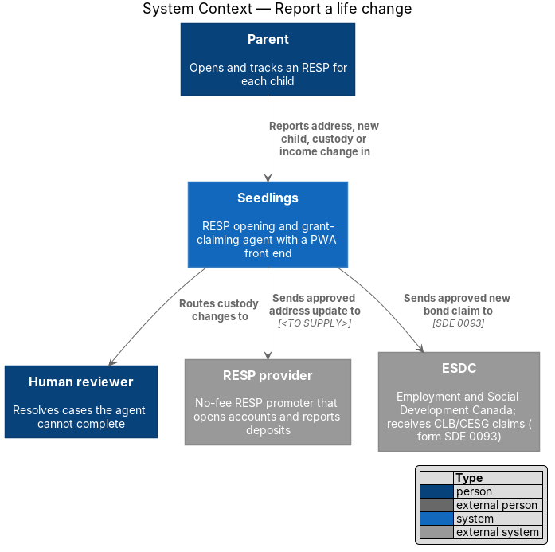
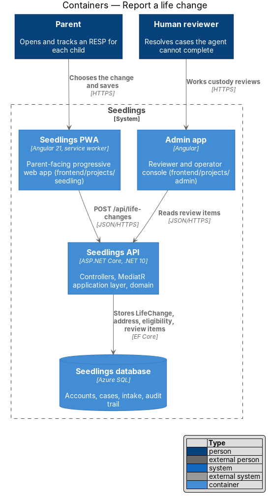
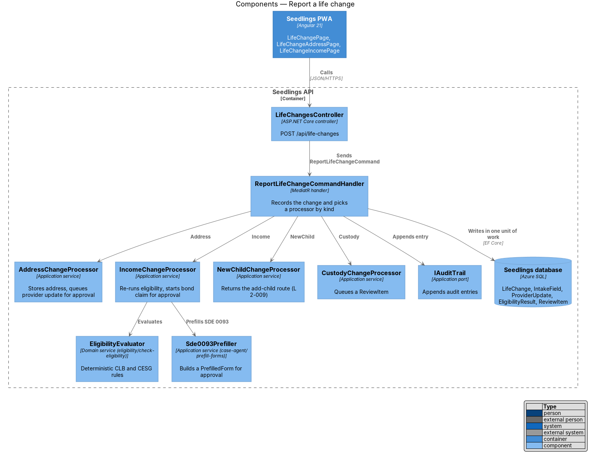
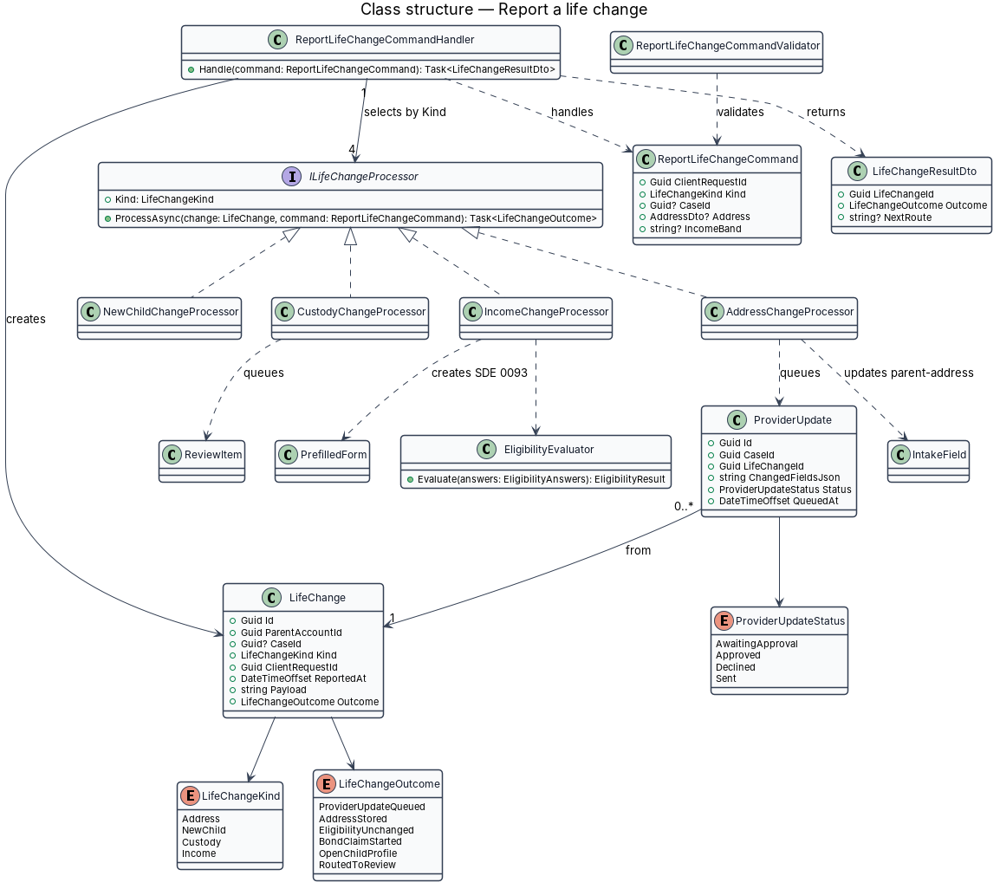
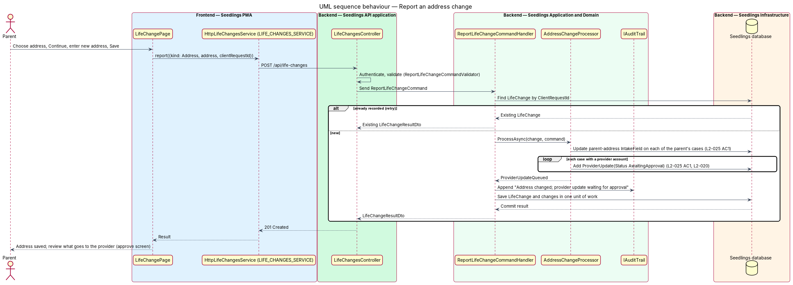
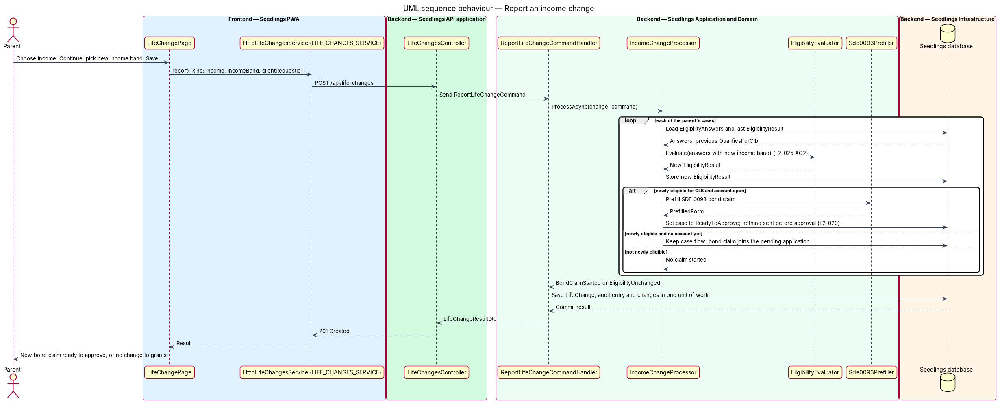
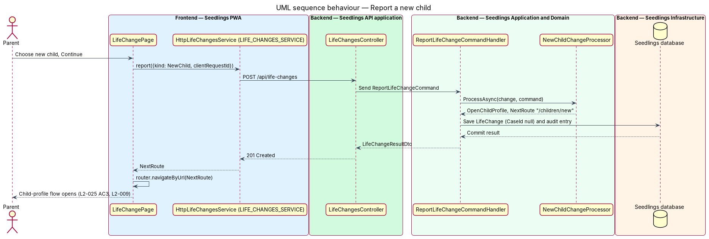
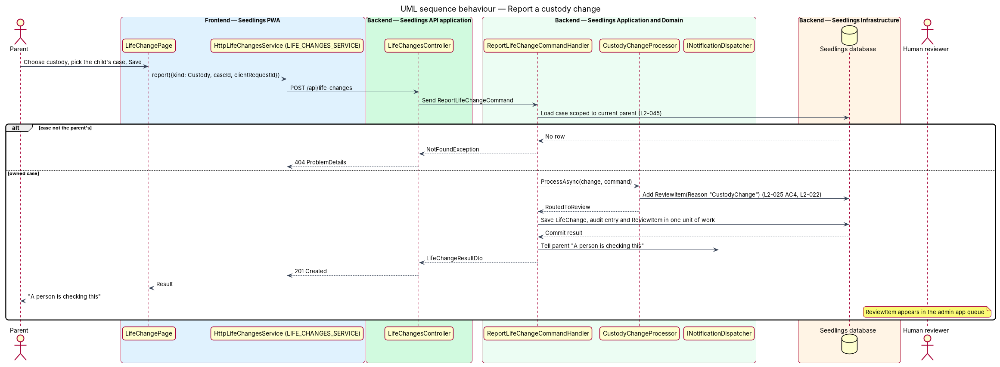

# Report a life change

## Overview

Seedlings opens a Registered Education Savings Plan (RESP) for each child, claims the Canada Learning
Bond (CLB) and the Canada Education Savings Grant (CESG), and then keeps each account on track. Family
circumstances change after the account is open, and some changes alter what the RESP provider holds or
what the child can receive. This feature, in the `account-care` subsystem, lets the parent report such
a change and has Seedlings act on it (L1-015).

Four kinds of change are in scope. Each one leads to a different follow-up:

| Kind | Follow-up | L2-025 criterion |
|------|-----------|------------------|
| Address | Store the new address on the parent's cases; queue a provider update that waits for approval | AC1 |
| Income | Re-run eligibility; when a child becomes newly eligible for the CLB, start a bond claim that waits for approval | AC2 |
| New child | Open the child-profile flow of `eligibility/add-child` (L2-009) | AC3 |
| Custody | Route the case to human review | AC4 |

- **life change** — event in the family, reported by the parent, that can affect a case or its claims
- **provider update** — set of changed fields Seedlings prepares for the RESP provider and sends only
  after the parent approves it (L2-020)
- **newly eligible** — eligibility result in which the child qualifies for the CLB where the previous
  stored result did not

The screen is `docs/mocks/pages/life-change.html`: a radio group of four choices and a Continue button.
The dashboard (`docs/mocks/pages/dashboard.html`) links to it with "Report a life change". L2-025 places
the report on the case screen, and `docs/mocks/pages/case.html` has no such link yet; that entry point
is a mock gap, `<TO SUPPLY>`.

## Description

### Frontend

- **`LifeChangePage`** (`app-life-change`, `frontend/projects/seedling/src/app/pages/life-change/`) —
  route `/life-change`, with an optional `?case={caseId}` when opened from a case. It renders the four
  choices with the mock's `choice` BEM classes and `name="change"` values `address`, `child`, `custody`
  and `income`, in one `fieldset` with a legend. Continue goes to the next screen for the chosen kind.
- **`LifeChangeAddressPage`** (`app-life-change-address`, route `/life-change/address`) — reuses the
  address form of the intake step (`intake.parent-address.html`: postal-code lookup, then the address).
  Save calls `LIFE_CHANGES_SERVICE`.
- **`LifeChangeIncomePage`** (`app-life-change-income`, route `/life-change/income`) — asks the income
  band question from `wizard.eligibility.html` (Family income last year, five bands). No mock exists for
  this screen in the life-change flow; it is `<TO SUPPLY>`.
- **Child pick for custody** — a custody change applies to one case. With `?case=` present, that case
  is used. From the dashboard with more than one child, the page asks which child; that screen's mock
  is `<TO SUPPLY>`.
- **`LifeChangesService`** interface, **`LIFE_CHANGES_SERVICE`** token and **`HttpLifeChangesService`**
  (`frontend/projects/api/src/lib/services/`) — `report(request)` returns `LifeChangeResult`. The client
  generates `clientRequestId` once per report so a retry returns the same result.
- **After save** — the page follows `NextRoute` when present (`/children/new` for a new child, the
  approve screen of `case-agent/approve-and-submit` for a queued provider update or bond claim).
  Otherwise it shows the outcome text, for custody "A person is checking this" (L2-022).

### Backend — Domain

- **`LifeChange`** (`Seedling.Domain/Entities/`) — `Id`, `ParentAccountId`, `CaseId?`, `Kind`
  (`LifeChangeKind`: `Address`, `NewChild`, `Custody`, `Income`), `ClientRequestId` (unique per parent),
  `ReportedAt`, `Payload` (JSON of the submitted values), `Outcome` (`LifeChangeOutcome`). `CaseId` is
  null for parent-level changes: address, income and new child.
- **`ProviderUpdate`** — `Id`, `CaseId`, `LifeChangeId`, `ChangedFieldsJson`, `Status`
  (`AwaitingApproval`, `Approved`, `Declined`, `Sent`), `QueuedAt`. Approval and sending belong to
  `case-agent/approve-and-submit`; nothing leaves Seedlings while the status is `AwaitingApproval`
  (L2-020). The provider's change-of-address channel is `<TO SUPPLY>`. The life-change mock also
  promises an update to the government; whether ESDC receives address changes, and through which
  channel, is `<TO SUPPLY>`.
- **`EligibilityEvaluator`** — deterministic domain service owned by `eligibility/check-eligibility`;
  this feature calls it and adds no rules of its own.

### Backend — Application

- **`ReportLifeChangeCommand`** — `ClientRequestId`, `Kind`, `CaseId?`, `Address?` (`AddressDto`),
  `IncomeBand?`.
- **`ReportLifeChangeCommandValidator`** (FluentValidation, run by `ValidationBehavior`) — `Kind` is
  defined; `Address` is present and complete for `Address`; `IncomeBand` is one of the eligibility bands
  for `Income`; `CaseId` is present for `Custody`. Failures return `400` `ProblemDetails` (L2-046).
- **`ReportLifeChangeCommandHandler`** — returns the stored result when `ClientRequestId` was already
  seen. Otherwise it checks any `CaseId` against the current parent (L2-045), creates the `LifeChange`,
  selects the `ILifeChangeProcessor` registered for the kind, appends an `AuditEntry`
  (`Actor = Parent`) through `IAuditTrail`, and saves everything in one unit of work. It returns
  `LifeChangeResultDto` (`LifeChangeId`, `Outcome`, `NextRoute?`).
- **`AddressChangeProcessor`** — writes the new address to the `parent-address` `IntakeField` rows of
  every case of the parent. For each case with a `ProviderId` and an `AccountNumber`, it adds a
  `ProviderUpdate` in `AwaitingApproval`. Outcome `ProviderUpdateQueued`, or `AddressStored` when no
  case has an open account (a case still in intake uses the new address in its forms).
- **`IncomeChangeProcessor`** — for each case, replaces the income band in `EligibilityAnswers`, calls
  `EligibilityEvaluator`, and stores the new `EligibilityResult`. When the child is newly eligible and
  the account is open, it asks `Sde0093Prefiller` (`case-agent/prefill-forms`) for a bond-claim
  `PrefilledForm`, moves the case to `ReadyToApprove`, and records an `ExpectedDeposit` only after
  submission (see `account-care/confirm-deposits`). A case without an open account keeps its flow, and
  the claim travels with the pending application. A result that loses eligibility is stored and starts
  no claim; what happens to claims already made in that case is `<TO SUPPLY>`.
- **`NewChildChangeProcessor`** — returns `OpenChildProfile` with `NextRoute = "/children/new"`, the
  add-child route of `eligibility/add-child`.
- **`CustodyChangeProcessor`** — adds a `ReviewItem` (`Reason = "CustodyChange"`) through the
  review queue of `case-agent/human-review-handoff`. After commit the handler tells the parent through
  `INotificationDispatcher`. The expected response time shown to the parent comes from that feature.

### API

| Method | Path | Result |
|--------|------|--------|
| `POST` | `/api/life-changes` | `201` `LifeChangeResultDto`; `200` with the same body for a repeated `clientRequestId`; `400` or `404` `ProblemDetails` |

`LifeChangesController` requires authentication through the fallback policy and holds no rules.

### Implementation slices

1. **Choose a change** — `LifeChangePage` from the mock, dashboard link, page object; Playwright test
   that each choice leads to its next screen. Groundwork for L2-025 AC1–AC4.
2. **New child** — endpoint, `LifeChange`, `NewChildChangeProcessor`; Playwright test that saving opens
   the add-child flow. L2-025 AC3.
3. **Custody to review** — `CustodyChangeProcessor`, `ReviewItem`, case pick from `?case=`; API test
   that the case gets a review item and a test for another parent's case returning `404`. L2-025 AC4.
4. **Address stored, update queued** — `LifeChangeAddressPage`, `AddressChangeProcessor`,
   `ProviderUpdate`; API test that the address is stored and one update waits for approval, and that a
   retried request creates no second update. L2-025 AC1.
5. **Income re-check** — `LifeChangeIncomePage`, `IncomeChangeProcessor`; API tests for newly eligible
   (bond claim ready to approve) and for unchanged eligibility. L2-025 AC2.
6. **Case-screen entry** — link from `CasePage` once the case mock carries it (`<TO SUPPLY>`).

## Requirements

| L2 ID | Refines (L1) | Requirement |
|-------|--------------|-------------|
| `L2-025` | `L1-015` | The parent shall report an address change, new child, custody change or income change from the case screen. |

## Diagrams

### System context

The parent reports a change in Seedlings. Seedlings routes custody changes to the human reviewer and
sends approved updates to the RESP provider and approved bond claims to ESDC.

### Containers

The PWA posts the report to the Seedlings API, which stores the change and its follow-up in the
database. Custody reviews surface in the admin app.

### Components

`ReportLifeChangeCommandHandler` records the change and hands it to one of four processors. The income
processor reuses `EligibilityEvaluator` and `Sde0093Prefiller` from their owning features.

### Class structure

The handler creates a `LifeChange` and selects one `ILifeChangeProcessor` by kind. An address change
yields zero or more `ProviderUpdate` rows.

### Behaviour — report an address change

The address lands on every case of the parent, and each open account gets a provider update that waits
for approval (L2-025 AC1). A retried request returns the first result.

### Behaviour — report an income change

Eligibility runs again for each case with the new income band. A newly eligible child with an open
account gets a prefilled bond claim waiting for approval (L2-025 AC2).

### Behaviour — report a new child

Saving records the change and returns the add-child route, which the page opens (L2-025 AC3).

### Behaviour — report a custody change

The case enters the review queue and the parent sees "A person is checking this" (L2-025 AC4). A case
owned by another parent returns `404`.

