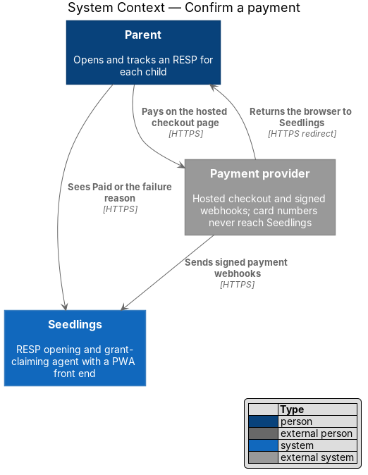
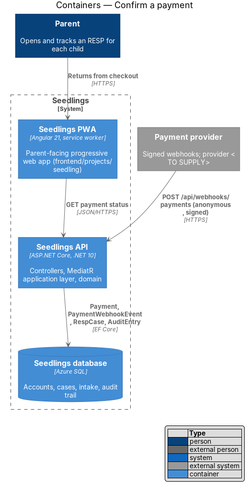
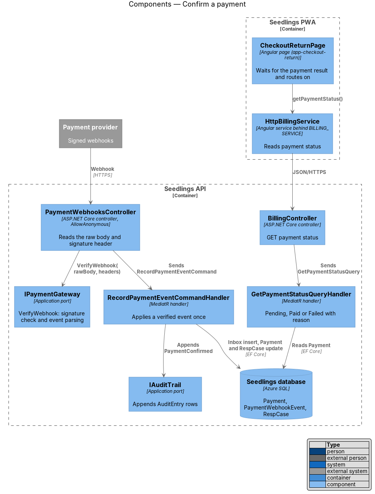
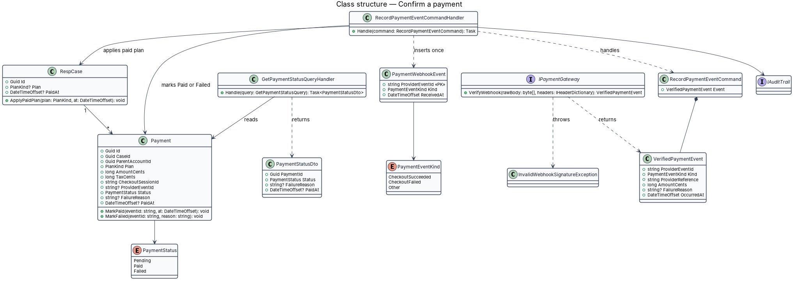
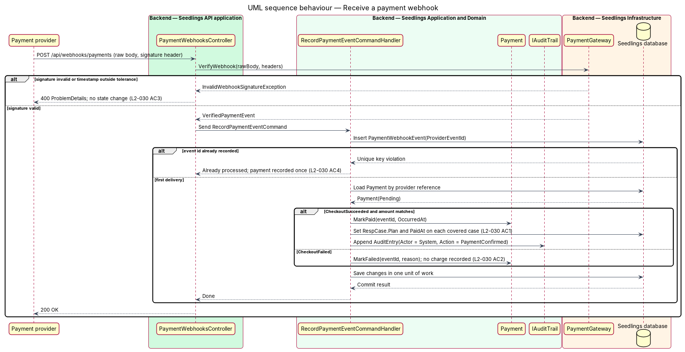
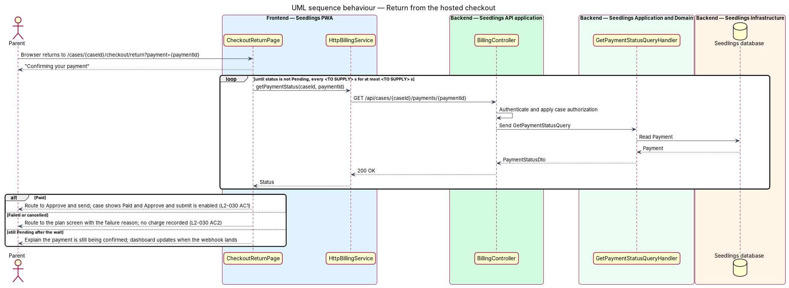

# Confirm a payment

## Overview

Seedlings charges for doing the RESP work on the parent's behalf through a one-time launch fee or an
annual care plan. The parent pays on a hosted checkout page run by the payment provider, which
[select-plan](../select-plan/README.md) opens. Seedlings never sees the card number, so it learns the
outcome only from the payment provider.

This feature records that outcome. The payment provider sends a signed webhook to the Seedlings API.
A valid success event marks the payment Paid and unlocks submission; a failure leaves no charge
recorded and returns the parent to the plan screen with the reason. Signatures are verified before
anything changes, and an event delivered twice is applied once.

- **webhook** — HTTPS request the payment provider sends to Seedlings when a checkout changes state
- **webhook signature** — value in a request header, computed by the provider over the raw body with a shared secret, that proves the request came from the provider unchanged
- **provider event id** — identifier the provider gives each webhook event; the same id on every redelivery
- **webhook inbox** — table of provider event ids already processed, used to apply each event once
- **paid plan** — plan recorded on a case once its payment is confirmed

The return screen after checkout has no mock of its own. Its outcomes use existing mocks: success
lands on `approve.html` with Approve and send enabled, and failure lands on `plan.html` with the
reason shown.

## Description

### Frontend

- **`CheckoutReturnPage`** (`app-checkout-return`,
  `frontend/projects/seedling/src/app/pages/checkout-return/`, route
  `/cases/:caseId/checkout/return?payment=`) is the return URL given to the provider. It shows
  "Confirming your payment" in an `aria-live` region and polls the payment status. On `Paid` it
  routes to Approve and send. On `Failed` or a cancelled checkout it routes to `PlanPage` with the
  failure reason. The poll interval and the maximum wait are `<TO SUPPLY>`; after the wait it
  explains that confirmation is still in progress and the case updates when it arrives.
- **`HttpBillingService.getPaymentStatus`** (behind `BILLING_SERVICE`) calls the status endpoint.
- The case and the approve screen show "Paid" from `RespCase.PaidAt`, and
  [approve-and-submit](../../case-agent/approve-and-submit/README.md) enables Approve and submit when
  the case has a paid plan. That control's own rules belong to approve-and-submit.

### Backend

- **`PaymentWebhooksController`** (`Seedling.Api/Controllers/`) exposes `POST
  /api/webhooks/payments` with `[AllowAnonymous]`, one of the anonymous endpoints the brief allows.
  It buffers the raw request body, because signature verification needs the exact bytes, and calls
  `IPaymentGateway.VerifyWebhook`. Request logging records the event id and type only
  ([log-redaction](../../privacy-and-security/log-redaction/README.md)).
- **`IPaymentGateway.VerifyWebhook(rawBody, headers)`** (`Seedling.Application/Abstractions/`),
  implemented by **`PaymentGateway`** in `Seedling.Infrastructure/Payments/`, checks the signature
  with the webhook secret and rejects a timestamp outside the replay tolerance. It returns a
  **`VerifiedPaymentEvent`** or throws **`InvalidWebhookSignatureException`**, which the controller
  answers with `400` `ProblemDetails` before any read or write (L2-030 AC3). The signature scheme
  and tolerance depend on the provider and are `<TO SUPPLY>`. The webhook secret is an application
  secret configured through `eng/infra/main.bicep`.
- **`RecordPaymentEventCommand`** / **`RecordPaymentEventCommandHandler`** apply a verified event in
  one unit of work:
  1. insert a **`PaymentWebhookEvent`** with the provider event id as primary key; an id already
     present ends the handler with no change, and the key also guards two concurrent deliveries (L2-030 AC4);
  2. load the `Payment` by the provider reference set at checkout (the payment id);
  3. on `CheckoutSucceeded` with an amount equal to `AmountCents + TaxCents`, call
     `Payment.MarkPaid`, then `RespCase.ApplyPaidPlan(plan, paidAt)` on each case the payment covers,
     and append an `AuditEntry` (`Actor = System`, `Action = PaymentConfirmed`) through `IAuditTrail` (L2-030 AC1);
  4. on `CheckoutFailed`, call `Payment.MarkFailed` with the provider's reason; no `PaidAt` is set and
     no plan is applied, so no charge is recorded (L2-030 AC2).
  An amount mismatch leaves the payment `Pending` and raises a review item through
  [human-review-handoff](../../case-agent/human-review-handoff/README.md).
- **`Payment`** (`Seedling.Domain/Entities/`) owns its transitions: only `Pending` moves to `Paid` or
  `Failed`, and `ProviderEventId` records the settling event under a unique index.
- **`GetPaymentStatusQuery`** / **`GetPaymentStatusQueryHandler`** return **`PaymentStatusDto`**
  (`Status`, `FailureReason`, `PaidAt`) for a payment of a case the parent owns.
- The controller answers `200` for every verified event, including duplicates and event kinds it
  ignores, so the provider stops redelivering.

### API

| Method and path | Auth | Result |
|---|---|---|
| `POST /api/webhooks/payments` | anonymous, signed | `200` processed or duplicate; `400` invalid signature |
| `GET /api/cases/{caseId}/payments/{paymentId}` | parent, case-authorized | `200` `PaymentStatusDto`; `404` outside the tenant |

### Implementation slices

1. **Success webhook marks Paid** — webhook endpoint, `VerifyWebhook` with a test signer,
   `RecordPaymentEventCommandHandler` success path, `RespCase.PaidAt`; covers L2-030 AC1.
2. **Reject an invalid signature** — `InvalidWebhookSignatureException` to `400`, no state change;
   covers L2-030 AC3.
3. **Apply a duplicate once** — `PaymentWebhookEvent` inbox; covers L2-030 AC4.
4. **Failure returns to the plan screen** — failure event, status endpoint, `CheckoutReturnPage`
   routing with the reason; covers L2-030 AC2.

## Requirements

| L2 ID | Refines (L1) | Requirement |
|-------|--------------|-------------|
| `L2-030` | `L1-018` | A successful payment shall unlock submission. |

## Diagrams

### System context

The parent pays on the provider's page. The provider then tells Seedlings the outcome through a
signed webhook and returns the parent's browser to Seedlings.

### Containers

The webhook reaches the API anonymously and is trusted only after signature verification. The PWA
reads the resulting payment status from the API.

### Components

`PaymentWebhooksController` verifies through `IPaymentGateway` and dispatches to
`RecordPaymentEventCommandHandler`. `CheckoutReturnPage` reads status through `BillingController`.

### Class structure

`Payment` owns its status transitions, `PaymentWebhookEvent` keys the inbox by provider event id, and
`RespCase.ApplyPaidPlan` records the paid plan that unlocks submission.

### Behaviour — receive a payment webhook

An invalid signature ends with `400` and no change. A repeated event id ends with `200` and no
change. A first success marks the payment Paid and the covered cases paid in one unit of work.

### Behaviour — return from the hosted checkout

The return page polls the payment status, then routes to Approve and send when Paid, or to the plan
screen with the failure reason when the checkout failed.

