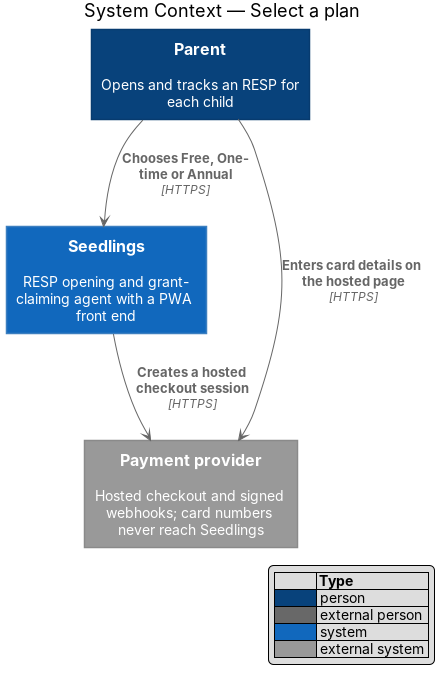
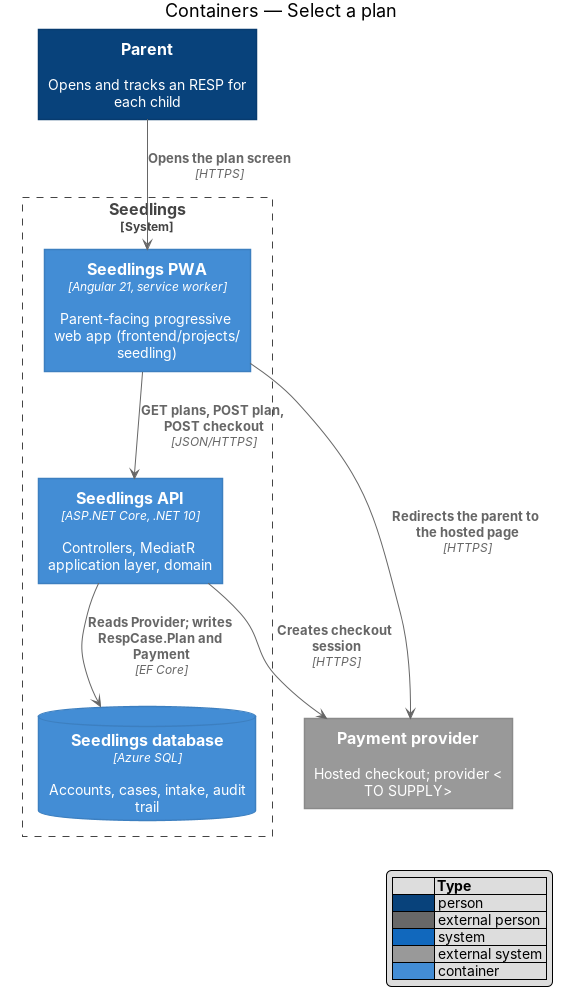
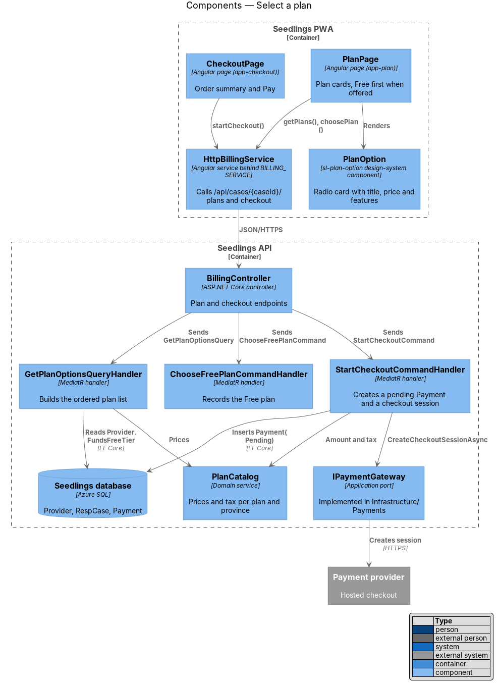
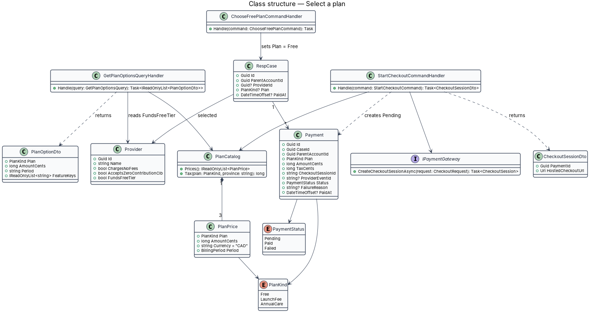
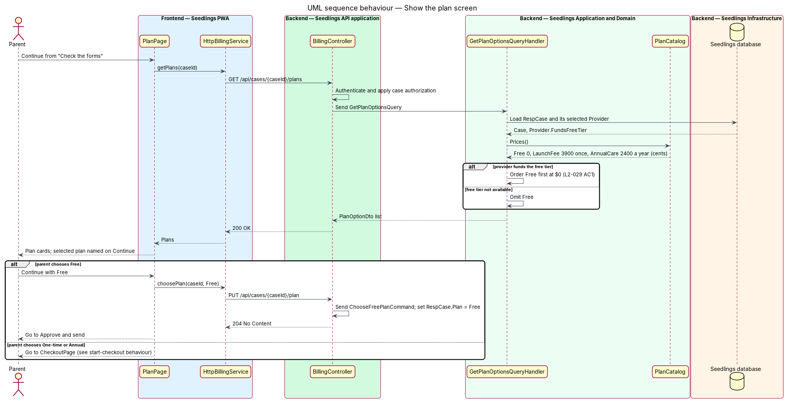
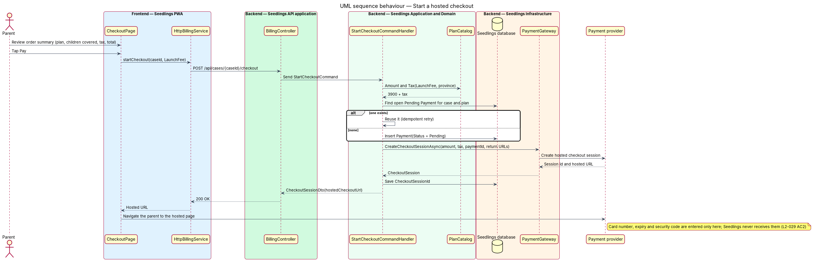

# Select a plan

## Overview

Seedlings opens a Registered Education Savings Plan (RESP) for each child and claims the Canada
Learning Bond (CLB) and Canada Education Savings Grant (CESG). The grants are the same whatever the
parent pays; the price covers Seedlings doing the work. L1-018 defines three ways to pay: a free tier
funded by provider referral fees, a one-time launch fee, and an optional annual care plan.

This feature is the plan screen in the "Review and send" group of the roadmap (step 3 of 4, mock
`plan.html`) and the order summary that launches payment (mock `checkout.html`). The parent chooses
a plan before submission. A paid plan opens a hosted checkout run by the payment provider, so
Seedlings never receives a card number. Recording the result of that checkout belongs to
[confirm-payment](../confirm-payment/README.md).

- **plan** — level of service the parent pays for: `Free`, `LaunchFee` (shown as "One-time") or `AnnualCare` (shown as "Annual")
- **free tier** — plan at $0, offered only when the selected RESP provider funds it through a referral fee
- **hosted checkout** — payment page served by the payment provider, where the parent enters card details
- **checkout session** — provider-side record of one hosted checkout, identified by a session id

The mocks state the prices, so they are not `<TO SUPPLY>`:

| Plan | Mock label | Price | Features from `plan.html` |
|---|---|---|---|
| `Free` | Free | $0 | Eligibility check and amounts; pre-filled forms to print and send yourself; reminders |
| `LaunchFee` | One-time | $39 once | Everything in Free; Seedlings sends the forms for all children; follow-up with the provider and the government |
| `AnnualCare` | Annual | $24 a year | Everything in One-time; yearly check that every grant arrived; life changes handled |

`checkout.html` shows HST at 13% for an Ontario parent ($39.00 + $5.07 = $44.07) and one plan covering
both children ("Maya and Theo").

## Description

### Frontend

- **`PlanPage`** (`app-plan`, `frontend/projects/seedling/src/app/pages/plan/`, route
  `/cases/:caseId/plan`) implements `plan.html`. It renders one `sl-plan-option` per returned plan in
  API order inside a `fieldset` of radio inputs. The Continue label names the selection ("Continue
  with One-time"). Free routes straight to Approve and send; a paid plan routes to `CheckoutPage`.
  When the parent returns from a failed checkout, the page shows the failure reason from
  confirm-payment.
- **`CheckoutPage`** (`app-checkout`, route `/cases/:caseId/checkout?plan=`) implements
  `checkout.html`: the "Change plan" back link, the heading "Pay $39 for the One-time plan", the
  summary rows (plan and children covered, tax, total) and the refund note. Pay calls
  `startCheckout` and navigates to the returned hosted URL. The mock draws the hosted page inside a
  region of the screen; whether the provider's page is embedded or reached by redirect depends on
  the provider, which is `<TO SUPPLY>`. Either way, card fields belong to the provider's page.
- **`PlanOption`** (`sl-plan-option`, `frontend/projects/components/src/lib/plan-option/`) is a new
  design-system component for the mock's `choice` + `plan` card: title, optional chip ("Most
  chosen"), price with period, and a feature list.
- **`BillingService`** interface, **`BILLING_SERVICE`** token and **`HttpBillingService`**
  (`frontend/projects/api/src/lib/services/billing/`) wrap the endpoints below.

### Backend

- **`PlanKind`** (`Seedling.Domain/Enums/`) has `Free`, `LaunchFee` and `AnnualCare`.
- **`PlanCatalog`** (`Seedling.Domain/Services/`) is a deterministic domain service. It returns a
  **`PlanPrice`** per plan (amount in cents, `CAD`, period) bound from configuration with the mock
  prices as values. `Tax(plan, province)` returns the sales tax; the 13% Ontario HST comes from the
  mock, and rates for other provinces, or delegation of tax to the payment provider, are `<TO SUPPLY>`.
- **`Provider.FundsFreeTier`** is a field this feature adds to the `Provider` rules-base entry
  ([select-provider](../../case-agent/select-provider/README.md)).
- **`BillingController`** (`Seedling.Api/Controllers/`) exposes the plan and checkout endpoints with
  authentication and [case-authorization](../../identity-and-access/case-authorization/README.md).
- **`GetPlanOptionsQuery`** / **`GetPlanOptionsQueryHandler`** load the case and its provider and
  return `PlanOptionDto` items. When the provider funds the free tier, `Free` comes first at $0
  (L2-029 AC1); otherwise `Free` is omitted.
- **`ChooseFreePlanCommand`** / **`ChooseFreePlanCommandHandler`** set `RespCase.Plan = Free` on every
  open case of the parent and append an `AuditEntry` through `IAuditTrail`. The command is rejected
  with `409` code `free_tier_unavailable` when the provider does not fund it.
- **`StartCheckoutCommand`** / **`StartCheckoutCommandHandler`** price the plan, insert a
  **`Payment`** with `Status = Pending` (or reuse the open pending one, so a retried Pay does not
  create a second payment), and call **`IPaymentGateway.CreateCheckoutSessionAsync`** with the
  amount, tax, payment id as the provider reference, and success and cancel return URLs. The
  handler saves the returned `CheckoutSessionId` and answers with the hosted URL.
- **`PaymentGateway`** (`Seedling.Infrastructure/Payments/`) implements `IPaymentGateway` against
  the payment provider, which is `<TO SUPPLY>`. Its API key comes from the Web App configuration set
  by `eng/infra/main.bicep`.
- **`Payment`** follows the shared model and adds `ParentAccountId`, `AmountCents`, `TaxCents`,
  `CheckoutSessionId` and `FailureReason`. A paid plan covers every case the parent holds when the
  payment starts, as `checkout.html` shows; confirm-payment applies it to those cases.

The mock describes Free as forms "to print and send yourself", while L1-018 describes a free tier
funded by provider referral fees. Whether a Free case lets the agent submit, and how
[approve-and-submit](../../case-agent/approve-and-submit/README.md) treats it, is `<TO SUPPLY>`.
Annual renewals, plan switching and the cancel-and-refund flow on `billing.html` sit outside L2-029
and L2-030 and are `<TO SUPPLY>`.

### API

| Method and path | Body | Result |
|---|---|---|
| `GET /api/cases/{caseId}/plans` | none | `200` `PlanOptionDto[]` |
| `PUT /api/cases/{caseId}/plan` | `{ plan: "Free" }` | `204`; `409` `free_tier_unavailable` |
| `POST /api/cases/{caseId}/checkout` | `{ plan }` | `200` `{ paymentId, hostedCheckoutUrl, amountCents, taxCents }` |

### Implementation slices

1. **Plan list** — `PlanCatalog`, `GET` plans, `PlanPage` with `sl-plan-option`; covers L2-029 AC1
   (free tier first at $0 when offered).
2. **Choose Free** — `ChooseFreePlanCommand`; extends L2-029 to the free path.
3. **Start a hosted checkout** — `Payment(Pending)`, `IPaymentGateway` with a fake in tests,
   `CheckoutPage` redirect; covers L2-029 AC2 (hosted checkout; no card number reaches Seedlings).

## Requirements

| L2 ID | Refines (L1) | Requirement |
|-------|--------------|-------------|
| `L2-029` | `L1-018` | The parent shall choose the free tier, the one-time launch fee or the annual plan before submission. |

## Diagrams

### System context

The parent chooses a plan in Seedlings. For a paid plan, Seedlings creates a checkout session and the
parent enters card details only on the payment provider's page.

### Containers

The PWA reads plans and starts checkout through the API. The API records the plan and the pending
payment in the Seedlings database and creates the session with the payment provider.

### Components

`PlanPage` and `CheckoutPage` call `HttpBillingService`. Three handlers in the API list plans, record
the free plan and start checkout, with `PlanCatalog` as the single source of prices.

### Class structure

`PlanCatalog` holds one `PlanPrice` per `PlanKind`. A `RespCase` has many `Payment` rows, and
`StartCheckoutCommandHandler` depends on the `IPaymentGateway` port.

### Behaviour — show the plan screen

The handler orders Free first at $0 when the selected provider funds it and omits it otherwise.
Choosing Free records the plan without payment.

### Behaviour — start a hosted checkout

Pay creates or reuses a pending payment, asks the provider for a checkout session, and sends the
parent to the hosted page where card details are entered.

