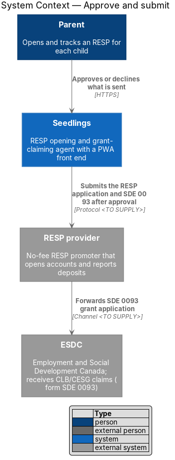
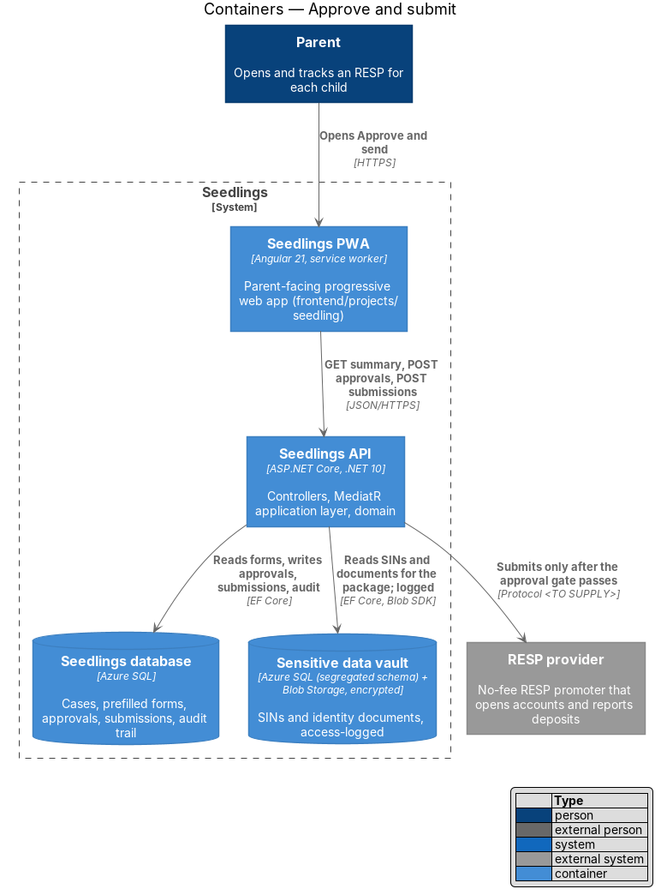
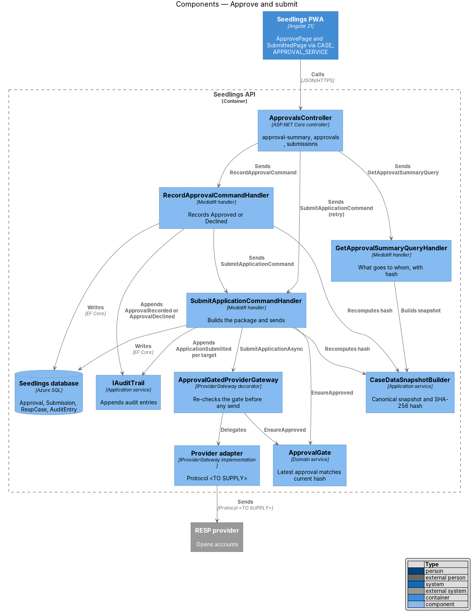
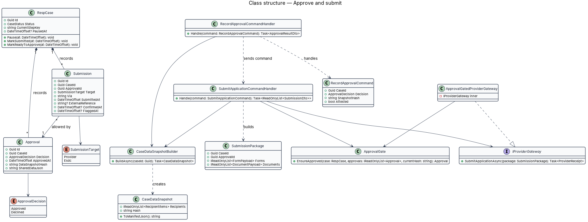
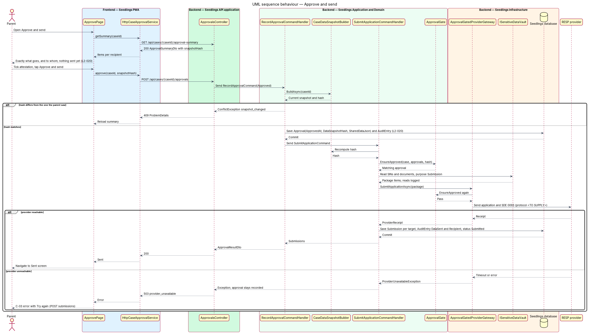
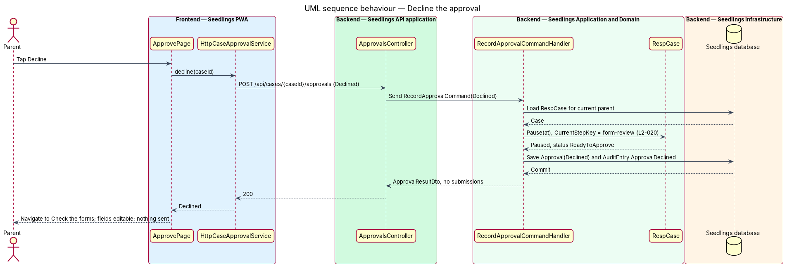
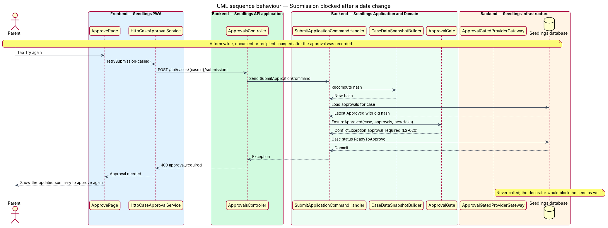

# Approve and submit

## Overview

Seedlings is an installable progressive web app (PWA) that works as the interface to an agent. The
agent opens a Registered Education Savings Plan (RESP) for a child and claims the Canada Learning
Bond (CLB) and the Canada Education Savings Grant (CESG) for the family. Each child has one case.

The agent prepares everything, but it never acts for the parent without consent. This feature is the
approval gate: the last step of the "Review and send" stage, and the only door through which case
data leaves Seedlings. The parent sees exactly what goes to whom, confirms it, and taps "Approve and
send". Only then does the agent submit the RESP application to the provider and the grant form
toward Employment and Social Development Canada (ESDC). The parent may instead tap "Decline", which
pauses the case and returns the parent to the forms.

An approval covers one exact set of data. When any approved value changes afterwards, the approval
no longer matches, and the gate blocks submission until the parent approves again.

Terms used in this design:

- **approval gate** — check that allows an outbound submission, account opening or data share only when a recorded parent approval matches the data about to leave Seedlings
- **data snapshot** — canonical, ordered description of every item that would be shared: each recipient, each form and field value, and each document
- **snapshot hash** — SHA-256 digest of the canonical data snapshot, used to tell whether the data changed after approval
- **approval** — record of the parent's decision (`Approved` or `Declined`) with its timestamp, the snapshot hash and the shared-data manifest
- **shared-data manifest** — the exact data shared, stored as JSON: non-sensitive values verbatim and SINs and documents as vault references, so the vault remains the only store of sensitive values
- **submission** — record of one outbound send to one target (`Provider` or `Esdc`)

The parent-facing screens are `docs/mocks/pages/approve.html` ("Approve what we'll send", Review and
send step 4 of 4) and `docs/mocks/pages/submitted.html` ("Sent"). The error state C-03 ("We couldn't
reach …") in `docs/mocks/pages/system-states.html` covers an unreachable provider. Step 3 of 4,
plan selection, belongs to the billing design; whether a paid plan blocks submission until payment
is confirmed is `<TO SUPPLY>` there.

## Description

### Frontend

- **`ApprovePage`** (`app-approve`) — routed page in
  `frontend/projects/seedling/src/app/pages/approve/`. It loads the approval summary and groups the
  items by recipient ("To <provider>", "To the Government of Canada"). It shows the attestation
  checkbox and the "Decline" and "Approve and send" buttons. "Approve and send" stays disabled until
  the attestation is ticked. The page sends the snapshot hash it displayed, so the parent approves
  what they saw.
- **`SubmittedPage`** (`app-submitted`) — routed page in `pages/submitted/` showing the send time and
  the "what happens next" timeline from `submitted.html`. The timeline durations in the mock ("3 to 5
  business days", "up to 6 weeks") are provider and ESDC facts; their source is `<TO SUPPLY>`.
- **`CASE_APPROVAL_SERVICE`** / **`CaseApprovalService`** — token and interface in
  `frontend/projects/api/src/lib/services/` with `getSummary(caseId)`,
  `approve(caseId, snapshotHash)`, `decline(caseId)` and `retrySubmission(caseId)`.
  **`HttpCaseApprovalService`** implements it.
- Design-system components: `sl-card`, `sl-checkbox`, `sl-button` and the C-03 error state component.

### Backend

- **`ApprovalsController`** (`Seedling.Api/Controllers/`) — the endpoints in the API table. It
  only sends MediatR requests.
- **`GetApprovalSummaryQuery`** / handler — builds the `CaseDataSnapshot` through
  `CaseDataSnapshotBuilder` and returns `ApprovalSummaryDto`: recipients, items per recipient,
  page and image counts, the amount claimed, and `snapshotHash`. SIN values appear masked only.
- **`CaseDataSnapshotBuilder`** (`Seedling.Application/CaseAgent/Approval/`) — reads the
  `PrefilledForm` rows, the accepted provider and the identity-document references. It produces a
  canonical snapshot with a stable field order and computes the SHA-256 snapshot hash. SIN values
  enter the hash through a keyed digest supplied by `ISensitiveDataVault`, so the builder never
  holds a SIN in plaintext. A change to any form value, document or recipient changes the hash.
- **`RecordApprovalCommand`** / **`RecordApprovalCommandHandler`** — carries `CaseId`, `Decision`,
  `SnapshotHash` and `Attested`.
  - `Approved`: the handler rejects `Attested = false` with `400`. It recomputes the snapshot and
    answers `409 snapshot_changed` when the hash differs from the one the parent saw. It saves an
    `Approval` with `ApprovedAt`, `DataSnapshotHash` and `SharedDataJson`, appends an `AuditEntry`
    (`Actor = Parent`, `Action = ApprovalRecorded`), and sends `SubmitApplicationCommand`
    (L2-020 criterion 2). A repeated approval with the same hash reuses the existing `Approval`.
  - `Declined`: the handler saves an `Approval` with `Decision = Declined` and calls
    `RespCase.Pause(at)`. The case keeps status `ReadyToApprove` with `PausedAt` set, and
    `CurrentStepKey` returns to `form-review`. It appends an `AuditEntry` (`ApprovalDeclined`).
    Nothing is sent (L2-020 criterion 3).
- **`ApprovalGate`** (`Seedling.Domain/Services/`) — `EnsureApproved(RespCase, IReadOnlyList<Approval>,
  string currentHash)`. It passes only when the latest decision is `Approved` and its
  `DataSnapshotHash` equals `currentHash`. Otherwise it throws
  `ConflictException("approval_required")` and the case moves back to `ReadyToApprove`
  (L2-020 criterion 4).
- **`SubmitApplicationCommand`** / **`SubmitApplicationCommandHandler`** — recomputes the hash and
  calls `ApprovalGate`. It then builds a `SubmissionPackage`, reading vault items with purpose
  `Submission` (each read logged). It calls `IProviderGateway.SubmitApplicationAsync` and records
  one `Submission` per target. It appends one `AuditEntry` per target with `DataSent` and
  `Recipient` (L2-035) and moves the case to `Submitted`. It is idempotent: a case that already
  holds a confirmed send for the same approval returns the existing submissions.
- **`IProviderGateway`** (`Seedling.Application/Abstractions/`) — outbound port to the RESP provider.
  The integration protocol (API, email or portal), payload format and authentication are
  `<TO SUPPLY>`. The adapter lives in `Seedling.Infrastructure/Providers/`.
- **`ApprovalGatedProviderGateway`** (`Seedling.Infrastructure/Providers/`) — decorator registered
  around every `IProviderGateway` implementation in `DependencyInjection.cs`. It calls
  `ApprovalGate` again before any outbound call. A code path that bypasses the handler therefore
  still cannot send unapproved data (L2-020 criterion 1).
- **ESDC channel** — the mock states that the provider sends SDE 0093 to ESDC. Whether Seedlings also
  sends it directly, and through which channel, is `<TO SUPPLY>`. Until supplied, the `Esdc`
  submission records the form as handed to the provider with `Via = Provider`.
- **`Approval`** (`Seedling.Domain/Entities/`) — `Id`, `CaseId`, `Decision`, `ApprovedAt`,
  `DataSnapshotHash`, `SharedDataJson`. Append-only.
- **`Submission`** (`Seedling.Domain/Entities/`) — `Id`, `CaseId`, `ApprovalId`, `Target`, `Via`,
  `SubmittedAt`, `ExternalReference?`, `ConfirmedAt?`, `FlaggedAt?`.

An unreachable provider raises `ProviderUnavailableException`. The middleware maps it to
`503 provider_unavailable` `ProblemDetails`. The approval stays recorded, and the C-03 "Try again"
button calls the retry endpoint, which passes the gate again.

### Data

`Approval` and `Submission` are new tables in the Seedlings database. `RespCase` gains `PausedAt?`.
The `Approval` table accepts inserts only; the API exposes no update or delete for it.

### API

| Method and path | Body | Success | Errors |
|---|---|---|---|
| `GET /api/cases/{caseId}/approval-summary` | none | `200 ApprovalSummaryDto` | `401`, `404` |
| `POST /api/cases/{caseId}/approvals` | `{ decision, snapshotHash, attested }` | `200 ApprovalResultDto` with submissions | `400`, `401`, `404`, `409 snapshot_changed`, `503 provider_unavailable` |
| `POST /api/cases/{caseId}/submissions` | none | `200` existing or new submissions | `401`, `404`, `409 approval_required`, `503 provider_unavailable` |

### Implementation slices

1. **Nothing leaves without approval** — `ApprovalGate`, `ApprovalGatedProviderGateway` and a fake
   `IProviderGateway` that records calls; API test proves no outbound call before approval
   (L2-020 criterion 1).
2. **Record the approval** — `CaseDataSnapshotBuilder`, `RecordApprovalCommand`, `Approval`; API test
   proves the timestamp and shared-data manifest are stored (L2-020 criterion 2).
3. **Submit after approval** — `SubmitApplicationCommand`, `Submission`, audit entries and status
   `Submitted` (L2-020 criterion 2).
4. **Decline pauses the case** — the `Declined` branch and form editing afterwards (L2-020 criterion 3).
5. **Change after approval blocks submission** — hash mismatch answers `409 approval_required`
   (L2-020 criterion 4).
6. **Approve and Sent screens** — `ApprovePage`, `SubmittedPage`, Playwright specs with page objects
   against `approve.html` and `submitted.html` (L2-020 criteria 2 and 3).

## Requirements

| L2 ID | Refines (L1) | Requirement |
|-------|--------------|-------------|
| `L2-020` | `L1-011` | No submission, account opening or third-party data share shall occur without a recorded parent approval. |

Acceptance criteria from `docs/specs/L2.md`:

1. Given the forms are pre-filled, when the parent has not tapped Approve and submit, then no data
   shall leave Seedlings.
2. Given the parent taps Approve and submit, when the action completes, then the approval shall be
   logged with its timestamp and the exact data shared.
3. Given the parent taps Decline, when the action completes, then the case shall pause and the parent
   shall be able to edit the forms.
4. Given the data changes after approval, when a submission is attempted, then it shall be blocked
   until the parent approves again.

## Diagrams

### System context

The parent approves inside Seedlings. Only after that approval does Seedlings send the application
to the RESP provider; the SDE 0093 form reaches ESDC through a channel that is `<TO SUPPLY>`.

### Containers

The API reads the forms from the Seedlings database and the SINs and documents from the vault. It
then calls the provider; each vault read is access-logged.

### Components

`ApprovalGate` sits in two places: in the submit handler and in the decorator around the provider
gateway. Both compare the latest approval with the current snapshot hash.

### Class structure

A `RespCase` holds many append-only `Approval` records and many `Submission` records. Each
submission references the approval that allowed it.

### Behaviour — approve and send

The handler records the approval with its hash and manifest, then submits through the gated
gateway. An unreachable provider leaves the approval in place for a retry.

### Behaviour — decline

Declining records the decision, pauses the case and returns the parent to the forms. The provider
receives nothing.

### Behaviour — submission blocked after a change

A submission attempt recomputes the snapshot hash. When it differs from the approved hash, the gate
blocks the send and the case returns to Ready to approve.

