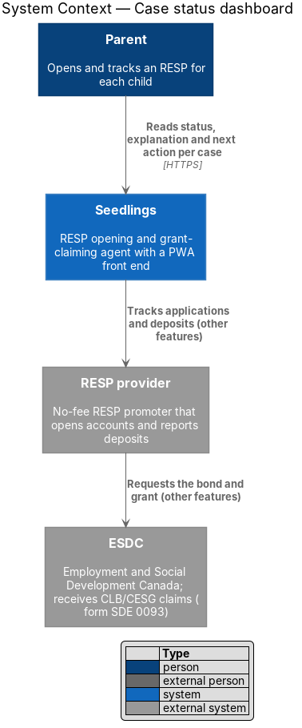
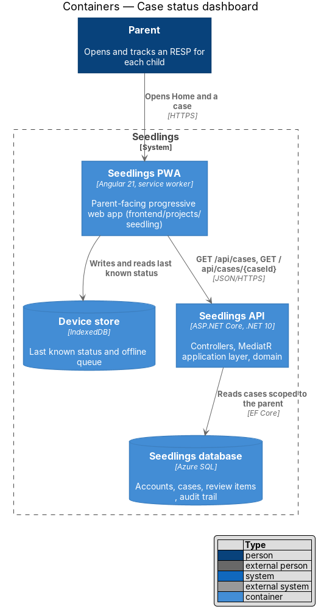
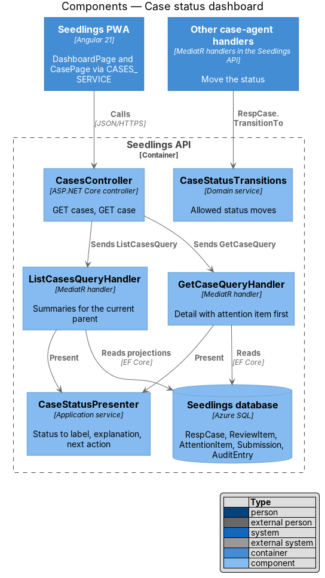
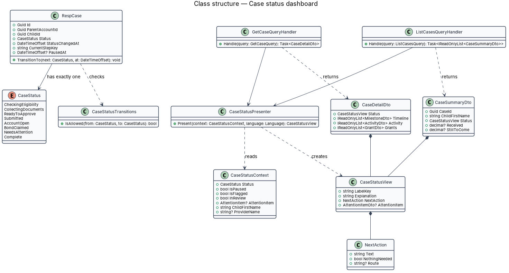
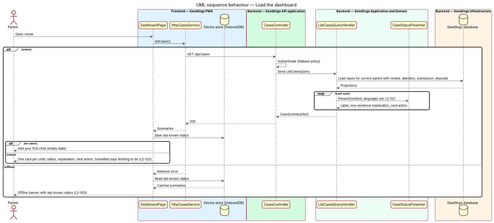
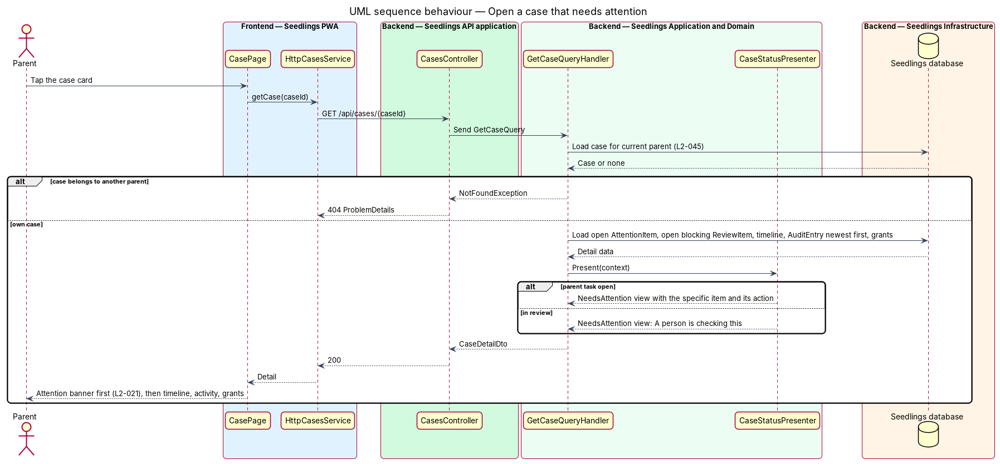

# Case status dashboard

## Overview

Seedlings is an installable progressive web app (PWA) that works as the interface to an agent. The
agent opens a Registered Education Savings Plan (RESP) for a child and claims the Canada Learning
Bond (CLB) and the Canada Education Savings Grant (CESG) for the family. Each child has one case,
and the agent works each case through several steps that take days or weeks.

A parent needs to know at any moment where each case stands and whether anything is waiting on them.
This feature gives every case exactly one status from a fixed list of eight, a one-sentence
explanation in plain language, and the next action for the parent. The dashboard ("Home") shows
this for every child. The case screen shows the same status with the timeline, the activity list and
the grants. When a case needs attention, the case screen shows the specific item needed before
anything else.

The status is a single field on the case that the other case-agent features move. This feature
defines that field, the transitions it allows, and how each status turns into words for the parent.

Terms used in this design:

- **case status** — one of `CheckingEligibility`, `CollectingDocuments`, `ReadyToApprove`, `Submitted`, `AccountOpen`, `BondClaimed`, `NeedsAttention`, `Complete`; shown as Checking eligibility, Collecting documents, Ready to approve, Submitted, Account open, Bond claimed, Needs attention, Complete
- **status explanation** — one sentence that says what is happening on the case now
- **next action** — the one thing the parent should do next, or a statement that nothing is needed
- **attention item** — the specific thing a `NeedsAttention` case waits for: a parent task (such as a retaken photo) or a person checking the case
- **status view** — the label, explanation, next action and optional attention item computed for one case

Parent-facing screens: `docs/mocks/pages/dashboard.html` (Home with children),
`dashboard.empty.html` (no children yet), `dashboard.offline.html` (last known status offline),
`case.html` (one case) and `case.attention.html` (a case that needs the parent).

## Description

### Frontend

- **`DashboardPage`** (`app-dashboard`) — routed page in
  `frontend/projects/seedling/src/app/pages/dashboard/`. It loads the case summaries and renders the
  family hero ("Grants claimed for your family" with an `sl-meter`) and one `sl-child-card` per case.
  Each card carries the status chip, the explanation, the `sl-next-action` block and its link. With no
  cases it renders the empty state from `dashboard.empty.html`.
- **`CasePage`** (`app-case`) — routed page in `pages/case/` for `/cases/:caseId`. It renders the
  attention banner first when present (`sl-banner`), then "Where it's at" (`sl-timeline`), "Activity"
  (`sl-activity`) and "Grants".
- **`CASES_SERVICE`** / **`CasesService`** — token and interface in
  `frontend/projects/api/src/lib/services/` with `listCases()` and `getCase(caseId)`.
  **`HttpCasesService`** implements it.
- **Last known status** — after each successful load, the page hands the summaries to the device
  store (IndexedDB). Offline, it shows them with the offline banner, as in `dashboard.offline.html`.
  The offline-status-and-queue design (L2-003) owns the store.
- The pages keep the mocks' BEM class names (`child-card`, `next-action`, `timeline`, `activity`,
  `banner`) for the Playwright locators.

### Backend

- **`CasesController`** (`Seedling.Api/Controllers/`) — `GET /api/cases` and
  `GET /api/cases/{caseId}`, behind the fallback authentication policy.
- **`ListCasesQuery`** / **`ListCasesQueryHandler`** (`Seedling.Application/CaseAgent/CaseStatus/`) —
  loads the current parent's cases with child, provider name, open blocking review item, open
  attention item and flagged submission. It maps each case through `CaseStatusPresenter` and returns
  `CaseSummaryDto[]`. The grant amounts on the card ("Received", "Still to come", "Can get") come from
  the eligibility result and the expected deposits of the account-care designs.
- **`GetCaseQuery`** / **`GetCaseQueryHandler`** — returns `CaseDetailDto`: the status view with the
  attention item first, the timeline milestones, the activity list (from `AuditEntry`, newest first,
  owned by the audit-trail design, L2-035) and the grants. A case of another parent answers 404
  (L2-045).
- **`CaseStatusPresenter`** (`Seedling.Application/CaseAgent/CaseStatus/`) — pure function from a
  `CaseStatusContext` to a `CaseStatusView`. Text comes from resource keys in English and French
  (language-and-reading-level design, L2-027 and L2-028); the English drafts below are reviewed there
  for a Grade 6 reading level.

  | Status | Explanation (draft) | Next action (draft) |
  |---|---|---|
  | `CheckingEligibility` | Seedlings is checking what <child> can get. | Answer the next question. |
  | `CollectingDocuments` | Seedlings needs a few details and photos to open the RESP. | Continue where you left off. |
  | `ReadyToApprove` | The forms are filled in and nothing has been sent. | Approve <child>'s forms. |
  | `ReadyToApprove`, paused | You declined the forms, so the claim is paused. | Check the forms and approve when ready. |
  | `Submitted` | <provider> is opening the RESP. | Nothing to do. |
  | `Submitted`, flagged | It is taking longer than usual, so Seedlings is following up. | Nothing to do. |
  | `AccountOpen` | The RESP is open and the bond has been requested. | Nothing to do. |
  | `BondClaimed` | The bond is paid into the RESP. | Nothing to do. |
  | `NeedsAttention`, parent task | The attention item message. | The attention item action (for example "Retake photo"). |
  | `NeedsAttention`, in review | A person is checking this. | Nothing to do. Expected response time `<TO SUPPLY>`. |
  | `Complete` | `<TO SUPPLY>` | `<TO SUPPLY>` |

  For `Submitted` the next action states that nothing is needed from the parent (L2-021 criterion 3).
  For `NeedsAttention` the view carries the attention item, which the case screen shows first
  (L2-021 criterion 2).
- **`CaseStatus`** (`Seedling.Domain/Enums/`) — the eight values above and no others.
  `RespCase.Status` is a single non-null column, so a case always holds exactly one status.
- **`CaseStatusTransitions`** (`Seedling.Domain/Services/`) — the allowed moves; `RespCase.TransitionTo`
  throws `ConflictException("invalid_status_transition")` for any other move and sets
  `StatusChangedAt`.

  | From | To | Moved by |
  |---|---|---|
  | `CheckingEligibility` | `CollectingDocuments` | eligibility and intake designs |
  | `CollectingDocuments` | `ReadyToApprove` | prefill-forms |
  | `ReadyToApprove` | `Submitted` | approve-and-submit |
  | `Submitted` | `ReadyToApprove` | approve-and-submit (approval gate blocked) |
  | `Submitted` | `AccountOpen` | track-submission |
  | `AccountOpen` | `BondClaimed` | confirm-deposits (account-care) |
  | `BondClaimed` | `Complete` | condition `<TO SUPPLY>` |
  | any except `Complete` | `NeedsAttention` | human-review-handoff |
  | `NeedsAttention` | the status of the resumed step | human-review-handoff |

### Data

No new table. `RespCase` holds `Status`, `StatusChangedAt`, `CurrentStepKey` and `PausedAt`. The
queries read `ReviewItem`, `AttentionItem`, `Submission`, `AuditEntry` and `ExpectedDeposit` from
the designs that own them. The list query uses one round trip with projections, within the API
response budget of the performance-budget design (L2-048).

### API

| Method and path | Success | Errors |
|---|---|---|
| `GET /api/cases` | `200 CaseSummaryDto[]` (empty array with no children) | `401` |
| `GET /api/cases/{caseId}` | `200 CaseDetailDto` | `401`, `404` |

### Open points

- The mocks label statuses "Bond paid", "Needs you" and "Paused · needs you". L2-021 names them "Bond
  claimed" and "Needs attention". The label set shown to parents is `<TO SUPPLY>`; this design follows
  L2-021 until the mock or the requirement changes.
- The condition that moves a case to `Complete` is `<TO SUPPLY>`.

### Implementation slices

1. **One status per case** — `CaseStatus`, `CaseStatusTransitions`, `GET /api/cases` returning status,
   explanation and next action; API test (L2-021 criterion 1).
2. **Submitted says nothing is needed** — presenter rule; API test (L2-021 criterion 3).
3. **Dashboard screen** — `DashboardPage`, `CASES_SERVICE`, Playwright spec with a `DashboardPage`
   page object against `dashboard.html` and `dashboard.empty.html` (L2-021 criteria 1 and 3).
4. **Needs attention shows the item first** — `GET /api/cases/{caseId}`, `CasePage` attention banner;
   Playwright spec against `case.attention.html` (L2-021 criterion 2).
5. **Case timeline, activity and grants** — the rest of `case.html`.

## Requirements

| L2 ID | Refines (L1) | Requirement |
|-------|--------------|-------------|
| `L2-021` | `L1-012` | Each case shall show exactly one of: Checking eligibility, Collecting documents, Ready to approve, Submitted, Account open, Bond claimed, Needs attention, Complete. |

Acceptance criteria from `docs/specs/L2.md`:

1. Given any case, when the dashboard loads, then its status, a one-sentence explanation and the next
   action for the parent shall be shown.
2. Given a case's status is Needs attention, when the parent opens the case, then the specific item
   needed shall be shown first.
3. Given a case's status is Submitted, when the dashboard loads, then the next action shall state that
   nothing is needed from the parent.

## Diagrams

### System context

The parent reads the status of each child's case in Seedlings. The status reflects work the agent
did with the provider and ESDC.

### Containers

The PWA reads case summaries and detail from the API and keeps the last known status in the device
store for offline use.

### Components

`CasesController` sends two queries. Both queries use `CaseStatusPresenter`, so the dashboard and the
case screen always show the same words for a status.

### Class structure

`RespCase` holds one `CaseStatus`, and `CaseStatusTransitions` guards changes to it.
`CaseStatusPresenter` turns a `CaseStatusContext` into a `CaseStatusView` with an optional attention
item.

### Behaviour — load the dashboard

The dashboard lists every case with status, explanation and next action (L2-021 criteria 1 and 3).
Offline, it shows the last known status from the device store.

### Behaviour — open a case that needs attention

The case screen receives the attention item in the status view and renders it before the timeline
(L2-021 criterion 2).

