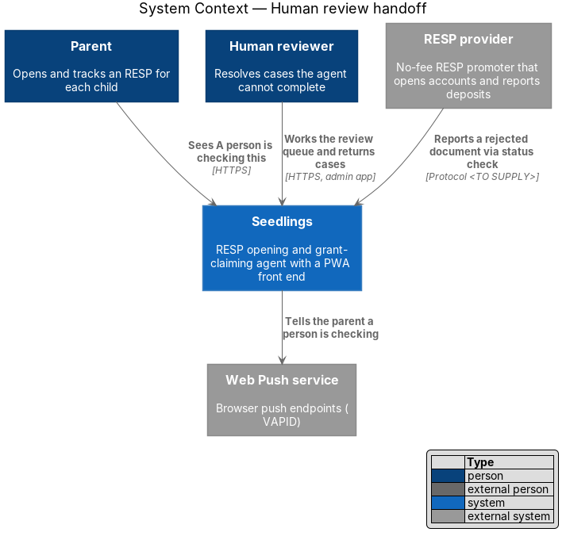
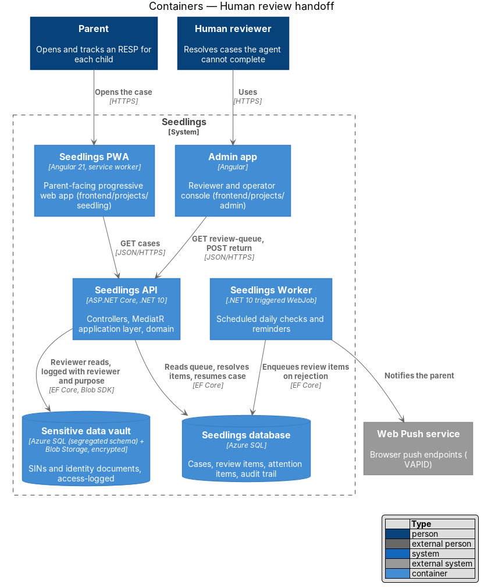
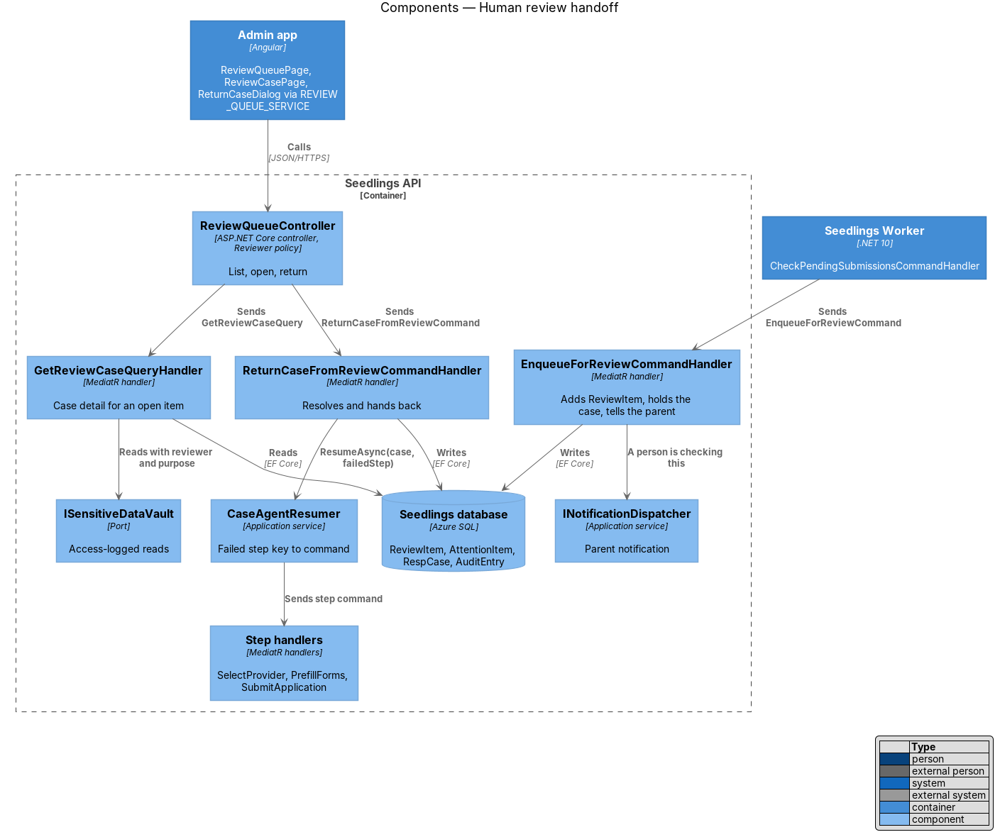
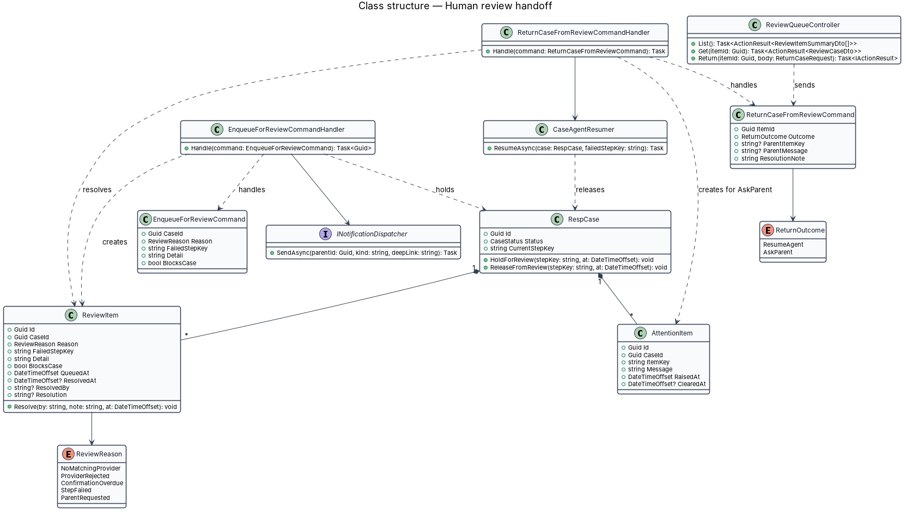
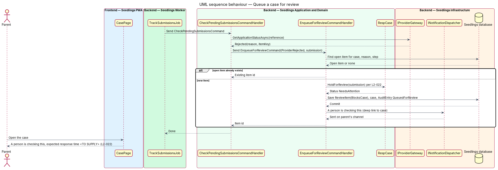
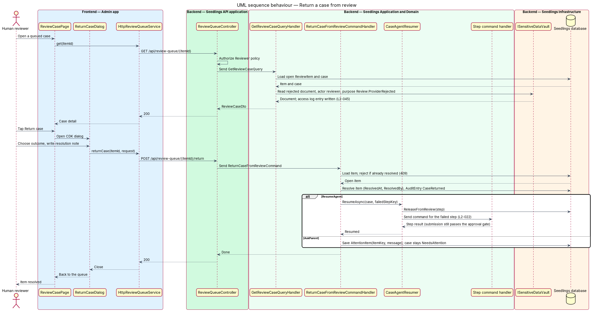

# Human review handoff

## Overview

Seedlings is an installable progressive web app (PWA) that works as the interface to an agent. The
agent opens a Registered Education Savings Plan (RESP) for a child and claims the Canada Learning
Bond (CLB) and the Canada Education Savings Grant (CESG) for the family. Each child has one case.

The agent completes most cases without help, but some steps fail in ways a rule cannot fix. A
provider may reject a document. No provider in the rules base may fit the family. A submission may
stay unconfirmed for weeks. In each of these cases the agent stops and hands the case to a person.
This feature is that handoff. The case enters a review queue, and the parent is told that "A person
is checking this", with the expected response time. A human reviewer works the queue in the admin
app. When the reviewer returns the case, the agent resumes from the step that failed rather than
starting over.

Terms used in this design:

- **review queue** — ordered list of open review items, oldest first, that human reviewers work through in the admin app
- **review item** — entry in the review queue for one case: the reason, the failed step, when it was queued and how it was resolved
- **failed step** — key of the agent step that could not complete: `provider-selection`, `form-prefill`, `submission` or `confirmation-tracking`
- **blocking review item** — review item that stops the agent on the case until it is resolved; a non-blocking item (for example an overdue confirmation) lets the case keep its status
- **return** — reviewer action that resolves a review item and hands the case back, either to the agent to resume, or to the parent with one specific item to fix

Parent-facing screens: `docs/mocks/pages/case.attention.html` shows a paused case with the specific item
first and a "Talk to a person" button. No mock shows the "A person is checking this" state; that mock
is `<TO SUPPLY>`. The admin app has no mocks yet; the review queue and review case screens are
`<TO SUPPLY>` in `docs/mocks/` before implementation, as `AGENTS.md` requires.

## Description

### Admin app (frontend)

- **`ReviewQueuePage`** (`app-review-queue`) — routed page in
  `frontend/projects/admin/src/app/pages/review-queue/`, behind the `requireAuth` and `requireAdmin`
  guards named in the admin `app.routes.ts`. It lists open review items, oldest first, with the reason,
  the failed step and the time in queue.
- **`ReviewCasePage`** (`app-review-case`) — routed page in `pages/review-case/`. It shows the case
  summary, the failure detail, the prefilled forms and, for a document rejection, the rejected
  document.
- **`ReturnCaseDialog`** (`app-return-case`) — CDK dialog in `admin/src/app/dialogs/return-case/`. The
  reviewer chooses "Resume the agent" or "Ask the parent". For "Ask the parent" the reviewer also picks
  the item key and writes the parent-facing message. A resolution note is required in both cases.
- **`REVIEW_QUEUE_SERVICE`** / **`ReviewQueueService`** — token and interface in
  `frontend/projects/api/src/lib/services/` with `list()`, `get(itemId)` and
  `returnCase(itemId, request)`. **`HttpReviewQueueService`** implements it.

### Seedlings PWA (frontend)

The PWA adds no page. The case status dashboard design renders the open blocking review item as the
attention item: "A person is checking this" and the expected response time. The expected response
time is not stated in the requirements and is `<TO SUPPLY>`. The behaviour of "Talk to a person" in
`case.attention.html` is `<TO SUPPLY>`; when supplied, it sends `EnqueueForReviewCommand` with reason
`ParentRequested`.

### Backend

- **`EnqueueForReviewCommand`** / **`EnqueueForReviewCommandHandler`**
  (`Seedling.Application/CaseAgent/HumanReview/`) — carries `CaseId`, `Reason`, `FailedStepKey`,
  `Detail` and `BlocksCase` (default `true`). Three designs send it: select-provider
  (`NoMatchingProvider`), track-submission (`ProviderRejected`, `ConfirmationOverdue`) and any agent
  step that raises an unrecoverable error (`StepFailed`). The handler:
  1. returns the existing item when an open item with the same case, reason and step exists;
  2. adds a `ReviewItem`;
  3. for a blocking item, calls `RespCase.HoldForReview(stepKey, at)`, which sets status `NeedsAttention`;
  4. appends an `AuditEntry` (`Actor = Agent`, `Action = QueuedForReview`);
  5. for a blocking item, notifies the parent through `INotificationDispatcher` that a person is checking the case (L2-022 criterion 1).
- **`ReviewQueueController`** (`Seedling.Api/Controllers/`) — routes under `api/review-queue`, with
  `[Authorize(Policy = "Reviewer")]` in place of the parent fallback policy. How reviewer accounts
  are provisioned and which claim grants the policy are `<TO SUPPLY>`; identity-and-access owns
  sign-in.
- **`GetReviewQueueQuery`** / handler — open items, oldest first, without personal data in the list.
- **`GetReviewCaseQuery`** / handler — loads the case for an open item. A reviewer reaches a case only
  through an open review item; any other case answers 404. Each vault read records the reviewer and
  the purpose (`Review:<reason>`) in the vault access log (L2-045 criterion 3).
- **`ReturnCaseFromReviewCommand`** / **`ReturnCaseFromReviewCommandHandler`** — carries `ItemId`,
  `Outcome` (`ResumeAgent` or `AskParent`), `ParentItemKey?`, `ParentMessage?` and `ResolutionNote`.
  It sets `ResolvedAt`, `ResolvedBy` and `Resolution`, and appends an `AuditEntry` (`Actor = Reviewer`,
  `Action = CaseReturned`). Then:
  - `ResumeAgent` — calls `CaseAgentResumer.ResumeAsync(case, FailedStepKey)` (L2-022 criterion 2);
  - `AskParent` — records an `AttentionItem` with the item key and message. The dashboard shows it
    first (L2-021 criterion 2), as in `case.attention.html`. The parent's fix, such as a retaken
    photo, then resumes the agent at the failed step.
- **`CaseAgentResumer`** (`Seedling.Application/CaseAgent/HumanReview/`) — maps a failed step key to
  the command that runs it:

  | Failed step | Command sent |
  |---|---|
  | `provider-selection` | `SelectProviderCommand` |
  | `form-prefill` | `PrefillFormsCommand` |
  | `submission` | `SubmitApplicationCommand` (passes the approval gate; changed data needs a new approval, L2-020) |
  | `confirmation-tracking` | none; the next daily check resumes tracking |

  Before sending, it calls `RespCase.ReleaseFromReview(stepKey, at)`, which restores the status that
  step implies.
- **`ReviewItem`** (`Seedling.Domain/Entities/`) — `Id`, `CaseId`, `Reason` (`ReviewReason`),
  `FailedStepKey`, `Detail`, `BlocksCase`, `QueuedAt`, `ResolvedAt?`, `ResolvedBy?`, `Resolution?`.
- **`AttentionItem`** (`Seedling.Domain/Entities/`) — `Id`, `CaseId`, `ItemKey`, `Message`, `RaisedAt`,
  `ClearedAt?`. It is the parent-facing "specific item needed" that the dashboard reads.

### Data

`ReviewItem` and `AttentionItem` are new tables in the Seedlings database. An index on
(`ResolvedAt`, `QueuedAt`) serves the queue. A filtered unique index on (`CaseId`, `Reason`,
`FailedStepKey`) where `ResolvedAt` is null enforces one open item per cause.

### API

| Method and path | Caller | Success | Errors |
|---|---|---|---|
| `GET /api/review-queue` | Reviewer | `200 ReviewItemSummaryDto[]` | `401`, `403` |
| `GET /api/review-queue/{itemId}` | Reviewer | `200 ReviewCaseDto` | `401`, `403`, `404` |
| `POST /api/review-queue/{itemId}/return` | Reviewer | `200` | `400`, `401`, `403`, `404`, `409 already_resolved` |

### Implementation slices

1. **Queue a rejected document** — `EnqueueForReviewCommand` sent from the daily check with a fake
   gateway; API test proves the queued item, `NeedsAttention` and the parent notification
   (L2-022 criterion 1).
2. **Parent sees "A person is checking this"** — dashboard attention item with the expected response
   time once supplied; Playwright spec (L2-022 criterion 1).
3. **Review queue in the admin app** — `ReviewQueueController`, Reviewer policy, `ReviewQueuePage`,
   `ReviewCasePage` with vault access logging (L2-045 criterion 3).
4. **Return and resume** — `ReturnCaseFromReviewCommand` and `CaseAgentResumer`; API test proves the
   agent re-runs the failed step (L2-022 criterion 2).
5. **Ask the parent** — `AttentionItem` and the `case.attention.html` state (L2-022 criterion 2 with
   L2-021 criterion 2).

## Requirements

| L2 ID | Refines (L1) | Requirement |
|-------|--------------|-------------|
| `L2-022` | `L1-013` | When the agent cannot complete a step, the case shall enter a review queue and the parent shall be told. |

Acceptance criteria from `docs/specs/L2.md`:

1. Given a provider rejects a document, when the rejection is received, then the case shall be queued
   for review and the parent shall see "A person is checking this" with the expected response time.
2. Given a reviewer resolves the issue, when they return the case, then the agent shall resume from
   the failed step.

## Diagrams

### System context

The agent hands cases it cannot finish to a human reviewer, who works in the admin app. The parent
hears about the handoff and the return through Seedlings.

### Containers

The Worker and the API both enqueue review items in the Seedlings database. The admin app reads and
resolves them through the API. Vault reads by a reviewer are access-logged.

### Components

`EnqueueForReviewCommandHandler` is the single entry point into the queue. `CaseAgentResumer` is the
single way back to the agent.

### Class structure

A `RespCase` holds many `ReviewItem` and `AttentionItem` records. `CaseAgentResumer` turns a failed
step key back into the command for that step.

### Behaviour — queue a case for review

A provider rejection found by the daily check queues a blocking item and moves the case to Needs
attention. The parent is told a person is checking (L2-022 criterion 1).

### Behaviour — return the case

The reviewer opens the case, which logs each vault read with the reviewer and purpose. The reviewer
then returns it, and the agent resumes from the failed step (L2-022 criterion 2).

