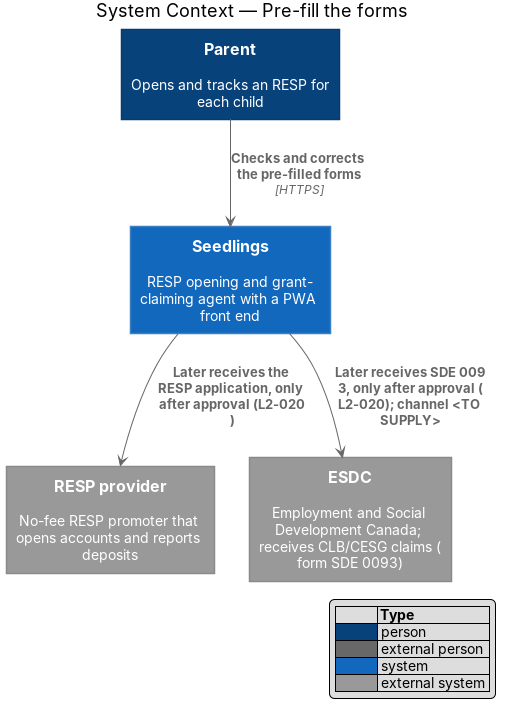
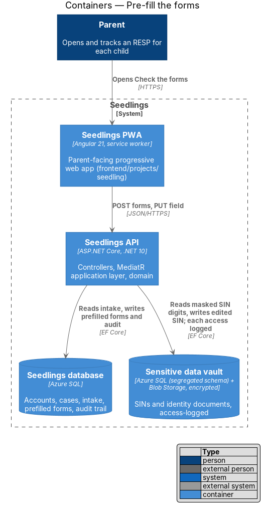
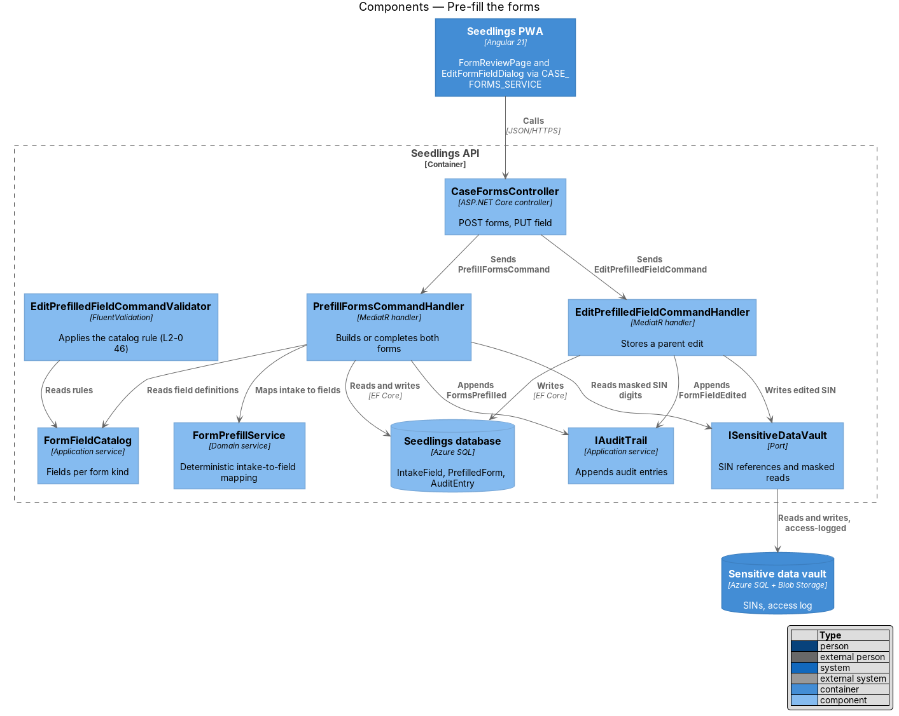
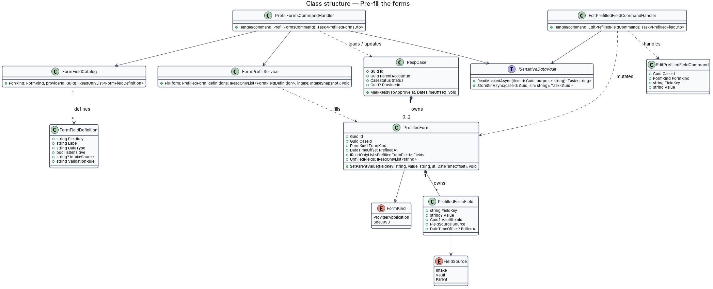
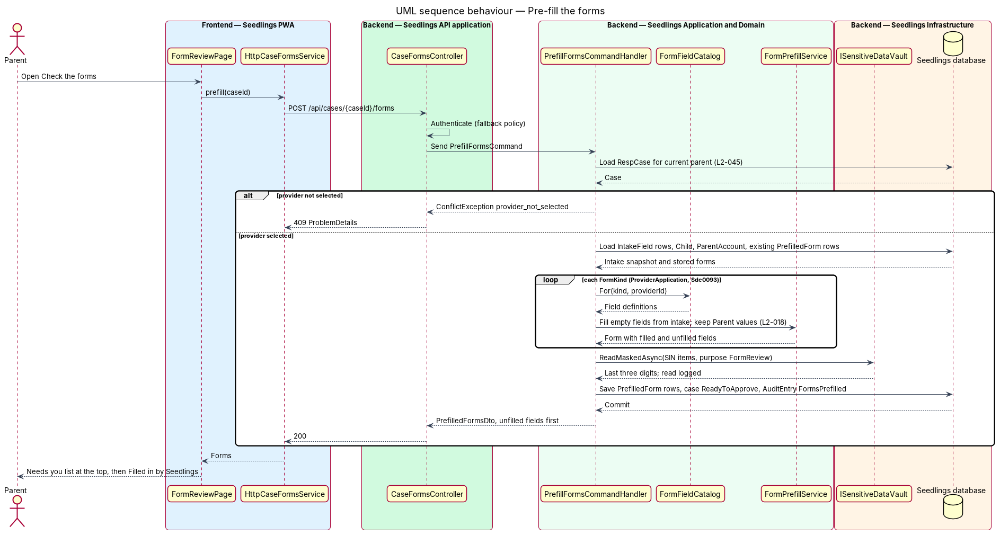
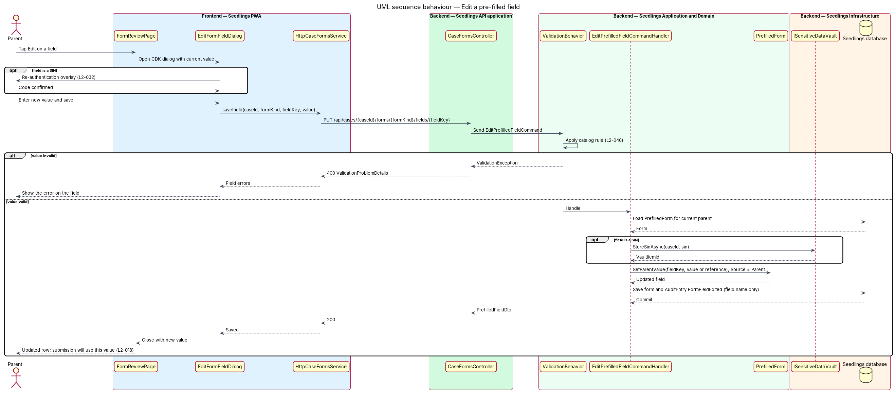

# Pre-fill the forms

## Overview

Seedlings is an installable progressive web app (PWA) that works as the interface to an agent. The
agent opens a Registered Education Savings Plan (RESP) for a child and claims the Canada Learning
Bond (CLB) and the Canada Education Savings Grant (CESG) for the family. Each child has one case.

Opening the account takes two forms. The RESP provider needs its own account application. The
Government of Canada needs form SDE 0093, the application for the CLB and the CESG, which
Employment and Social Development Canada (ESDC) receives. A parent has already answered every
question these forms ask during intake, so this feature has the agent fill both forms from those
answers. The parent then checks the result, answers the few fields the agent could not fill, and
corrects any value.

This feature is step 2 of 4 of the "Review and send" stage. It follows provider selection and
precedes plan selection and the approval gate. Nothing leaves Seedlings during this step; the forms
stay inside Seedlings until the parent approves them (approve-and-submit design, L2-020).

Terms used in this design:

- **prefilled form** — copy of one form held by Seedlings with each field's value and where the value came from
- **form kind** — which form a prefilled form represents: `ProviderApplication` (the provider's RESP application) or `Sde0093` (ESDC form SDE 0093)
- **unfilled field** — form field that intake data does not cover and the parent answers on the review screen
- **field source** — origin of a field value: `Intake` (copied from intake answers), `Vault` (a reference to a SIN or document held in the sensitive data vault) or `Parent` (typed or changed by the parent on the review screen)
- **field catalog** — definition of the fields each form kind contains, with label, data type, validation rule and intake source

The parent-facing screen is `docs/mocks/pages/form-review.html` ("Check the forms"). It shows a tab per
form, a "Needs you" section with the unfilled fields at the top, and a "Filled in by Seedlings" list
with an Edit button per field.

## Description

### Frontend

- **`FormReviewPage`** (`app-form-review`) — routed page in
  `frontend/projects/seedling/src/app/pages/form-review/`, split into `.ts`, `.html`, `.scss` and
  `.spec.ts`. It requests the prefilled forms on load, renders one segmented tab per form kind, lists
  the unfilled fields first under "Needs you · N", and lists filled fields under "Filled in by
  Seedlings". The "Needs you" inputs are the step's own questions, as in the mock; "Continue" saves
  them and is disabled while any remains empty.
- **`EditFormFieldDialog`** (`app-edit-form-field`) — CDK dialog in
  `frontend/projects/seedling/src/app/dialogs/edit-form-field/`. Each Edit button opens it; the page
  holds no inline edit form. Editing a SIN field first opens the re-authentication overlay (C-02 in
  `docs/mocks/pages/system-states.html`), owned by the sensitive data vault design (L2-032).
- **`CASE_FORMS_SERVICE`** / **`CaseFormsService`** — token and interface in
  `frontend/projects/api/src/lib/services/` with `prefill(caseId)` and
  `saveField(caseId, formKind, fieldKey, value)`. **`HttpCaseFormsService`** implements it.
- **`PrefilledFormsDto`** — model with `forms` (one entry per form kind) and, per form, `unfilled`
  and `filled` field lists. A filled sensitive field carries a masked display value (`••• ••• 219`)
  and never the full value.
- Design-system components: `sl-segments`, `sl-card`, `sl-field`, `sl-input`, `sl-select` and
  `sl-button`.

### Backend

- **`CaseFormsController`** (`Seedling.Api/Controllers/`) — `POST /api/cases/{caseId}/forms` and
  `PUT /api/cases/{caseId}/forms/{formKind}/fields/{fieldKey}`.
- **`PrefillFormsCommand`** / **`PrefillFormsCommandHandler`**
  (`Seedling.Application/CaseAgent/PrefillForms/`):
  1. loads the `RespCase` for the current parent (404 otherwise, L2-045);
  2. answers `409 provider_not_selected` while `RespCase.ProviderId` is empty;
  3. loads `IntakeField` rows, the `Child`, the `ParentAccount` and the vault references for the case;
  4. asks `FormPrefillService` to build or complete both `PrefilledForm` records;
  5. saves them, appends an `AuditEntry` (`Actor = Agent`, `Action = FormsPrefilled`) and moves the case to `ReadyToApprove`;
  6. returns `PrefilledFormsDto` with unfilled fields first.

  A repeated call returns the stored forms. It fills only fields that are still empty and never
  overwrites a value whose source is `Parent`.
- **`FormFieldCatalog`** (`Seedling.Application/CaseAgent/PrefillForms/`) — field definitions per form
  kind: `FieldKey`, `Label`, `DataType`, `IsSensitive`, `IntakeSource` (step key and field key, or a
  vault item kind) and a validation rule. The SDE 0093 field list follows the published ESDC form;
  its exact version is `<TO SUPPLY>`. The provider application field list depends on the provider
  and its integration protocol, both `<TO SUPPLY>`.
- **`FormPrefillService`** (`Seedling.Domain/Services/`) — deterministic mapping. For each catalog
  field it copies the intake value, stores a vault reference for a sensitive field, or marks the
  field unfilled. It makes no Claude call, so the same intake always yields the same forms.
- **`EditPrefilledFieldCommand`** / **`EditPrefilledFieldCommandHandler`** — validates the value with
  the catalog rule through `EditPrefilledFieldCommandValidator` (FluentValidation, run by the existing
  `ValidationBehavior`; L2-046), stores it with `Source = Parent` and `EditedAt`, and appends an
  `AuditEntry` (`Action = FormFieldEdited`) that names the field but not the value. A SIN edit writes
  the new SIN to the vault through `ISensitiveDataVault` and keeps only the reference on the form.
- **`ISensitiveDataVault`** — port from the sensitive data vault design. This feature reads the last
  three digits of a SIN for display with purpose `FormReview`; the vault logs each read.
- **`PrefilledForm`** (`Seedling.Domain/Entities/`) — `Id`, `CaseId`, `FormKind`, `Fields`
  (owned collection of `PrefilledFormField`), `PrefilledAt`, and `UnfilledFields` as a computed list.
  **`PrefilledFormField`** — `FieldKey`, `Value?`, `VaultItemId?`, `Source`, `EditedAt?`.

The submission and the approval snapshot (approve-and-submit design) read the stored
`PrefilledForm` values. A parent edit therefore reaches the submission (L2-018 criterion 2), and it
changes the snapshot hash, which requires a fresh approval (L2-020 criterion 4).

### Data

`PrefilledForm` is a new table with one row per case and form kind, unique on (`CaseId`,
`FormKind`). `PrefilledFormField` rows are owned by the form. Sensitive values never sit in these
tables; they hold `VaultItemId` only.

### API

| Method and path | Body | Success | Errors |
|---|---|---|---|
| `POST /api/cases/{caseId}/forms` | none | `200 PrefilledFormsDto` | `401`, `404`, `409 provider_not_selected` |
| `PUT /api/cases/{caseId}/forms/{formKind}/fields/{fieldKey}` | `{ value }` | `200 PrefilledFieldDto` | `400` validation `ProblemDetails`, `401`, `403 reauthentication_required` for a SIN, `404` |

### Implementation slices

1. **Fill the SDE 0093 form from intake** — catalog for `Sde0093`, `FormPrefillService`,
   `PrefillFormsCommand`; API test proves every covered field is populated (L2-018 criterion 1).
2. **Fill the provider application** — catalog for `ProviderApplication` once its field list is
   supplied (L2-018 criterion 1).
3. **List unfilled fields first** — DTO ordering and the "Needs you" section; Playwright spec with a
   `FormReviewPage` page object against `form-review.html` (L2-018 criterion 1).
4. **Edit a field** — `EditPrefilledFieldCommand`, `EditFormFieldDialog`; API test proves the edited
   value is the one the submission snapshot reads (L2-018 criterion 2).
5. **Edit a SIN** — vault write and re-authentication (L2-018 criterion 2 with L2-032).

## Requirements

| L2 ID | Refines (L1) | Requirement |
|-------|--------------|-------------|
| `L2-018` | `L1-010` | The agent shall pre-fill the provider's RESP application and ESDC form SDE 0093 from intake data. |

Acceptance criteria from `docs/specs/L2.md`:

1. Given intake is complete, when the parent opens the review screen, then every field on both forms
   that intake data covers shall be populated, and any field the agent could not fill shall be listed
   at the top.
2. Given the parent edits a pre-filled field, when they save, then the edited value shall be used in
   the submission.

## Diagrams

### System context

The parent checks the forms inside Seedlings. During this step no data goes to the provider or ESDC;
both appear only as the future recipients of the forms.

### Containers

The PWA calls the Seedlings API. The API reads intake answers from the Seedlings database and SIN
references from the sensitive data vault.

### Components

`CaseFormsController` sends two commands. The prefill handler uses the field catalog and the
deterministic `FormPrefillService`, and the edit handler validates against the same catalog.

### Class structure

Each `RespCase` owns up to two `PrefilledForm` records, one per `FormKind`. Each form owns its
`PrefilledFormField` values, and each field records its `FieldSource`.

### Behaviour — pre-fill the forms

Opening the review screen builds both forms once, from intake data and vault references. The
response lists unfilled fields first (L2-018 criterion 1).

### Behaviour — edit a pre-filled field

The Edit dialog saves one field. The handler validates it, stores it with source `Parent`, and the
submission later reads that value (L2-018 criterion 2).

