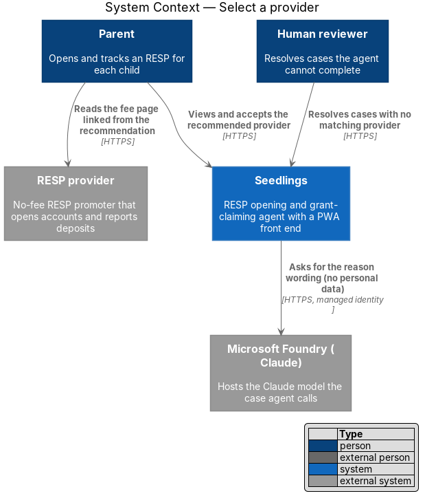
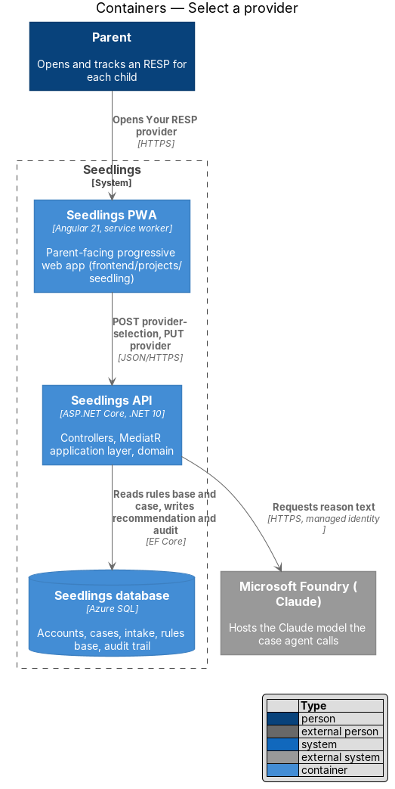
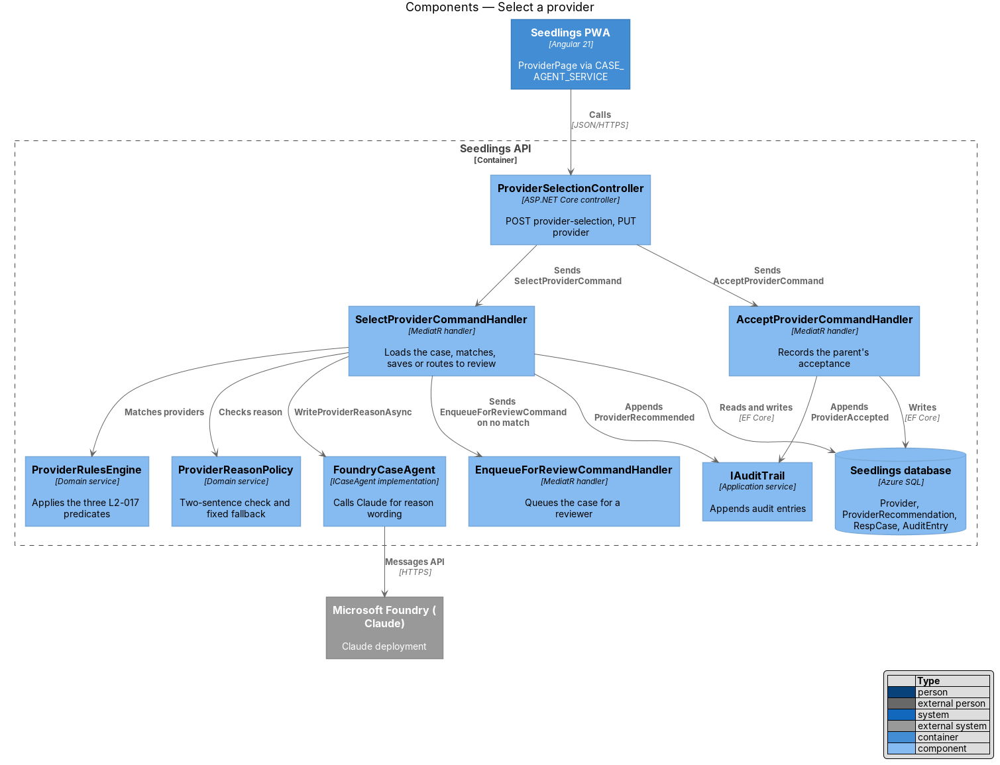
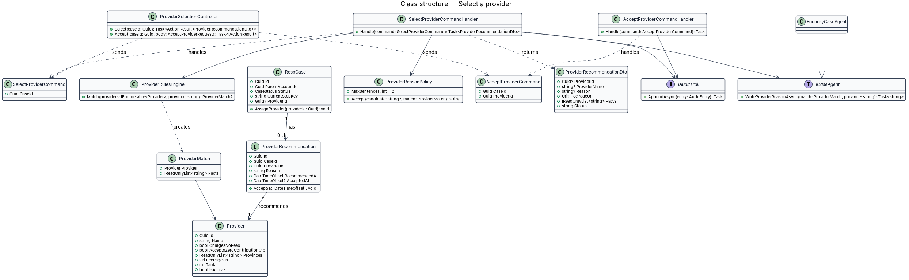
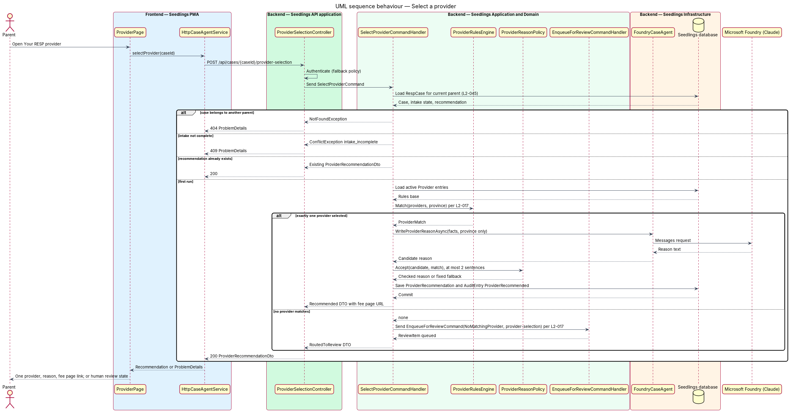
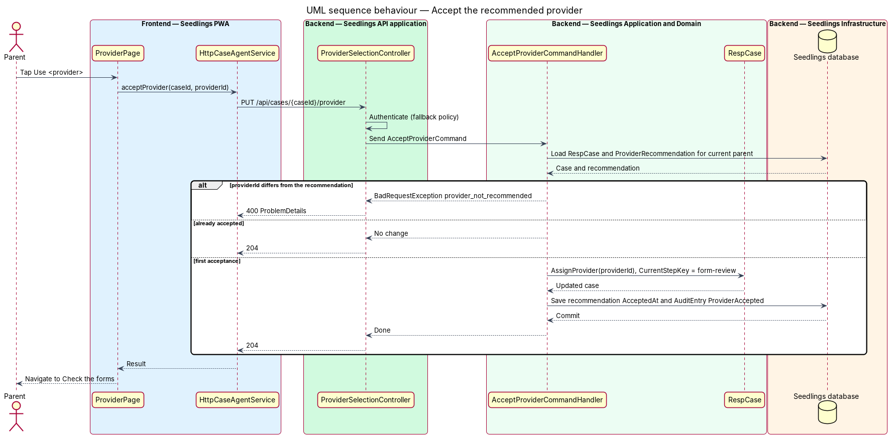

# Select a provider

## Overview

Seedlings is an installable progressive web app (PWA) that works as the interface to an agent. The
agent opens a Registered Education Savings Plan (RESP) for a child and claims the Canada Learning
Bond (CLB) and the Canada Education Savings Grant (CESG) for the family. Each child has one case, and
the agent works that case from intake to an open, funded account.

This feature is the first step of the "Review and send" stage of a case. Once intake is complete, the
agent chooses the RESP provider that will hold the child's account and explains the choice to the
parent. The parent then accepts the recommendation before the agent pre-fills any forms.

The choice is a rule, not a judgement call. A provider qualifies only when it charges no account
fees, accepts an account funded only by the CLB with no family contribution, and serves the parent's
province. When no provider in the rules base qualifies, the case goes to a person instead of to a
guess.

Terms used in this design:

- **RESP provider** — financial institution that promotes RESPs and opens the account for the child
- **rules base** — curated list of RESP providers and the facts the agent matches against: whether the provider charges fees, whether it accepts zero-contribution CLB accounts, the provinces it serves and its public fee page
- **zero-contribution CLB account** — RESP opened with a $0 deposit whose only money comes from the Canada Learning Bond
- **provider recommendation** — the single provider the agent proposes for a case, with a short reason and a link to the provider's fee page
- **review queue** — list of cases waiting for a human reviewer, described in the human review handoff design

The parent-facing screen is `docs/mocks/pages/provider.html` ("Your RESP provider", Review and send
step 1 of 4). The provider name in the mock is placeholder content; the real provider list is
`<TO SUPPLY>`.

## Description

The slice runs from the provider screen in the PWA, through the Seedlings API, to a deterministic
matching service in the domain and a single language call to Claude in Microsoft Foundry for the
wording of the reason.

### Frontend

- **`ProviderPage`** (`app-provider`) — routed page in `frontend/projects/seedling/src/app/pages/provider/`,
  split into `provider.page.ts`, `.html`, `.scss` and `.spec.ts`. On load it asks for the case's
  recommendation and renders the provider name, the reason, the fee facts, a link to the fee page and
  the primary action "Use <provider>". It keeps the mock's BEM class names and the "Agent pick" badge.
- **`CASE_AGENT_SERVICE`** / **`CaseAgentService`** — injection token and interface in
  `frontend/projects/api/src/lib/services/`. Methods: `selectProvider(caseId)` and
  `acceptProvider(caseId, providerId)`. **`HttpCaseAgentService`** implements it over `API_BASE_URL`.
  The page depends only on the token; `app.config.ts` binds the implementation.
- **`ProviderRecommendationDto`** — model in `frontend/projects/api/src/lib/models/` holding
  `providerId`, `providerName`, `reason`, `feePageUrl`, `facts` and `status`
  (`Recommended` or `RoutedToReview`).
- Design-system components from `frontend/projects/components`: `sl-card`, `sl-badge`, `sl-button`
  and the flow step header. The page does not re-implement any of them.
- The "Show other options" link appears in the mock. L2-017 calls for exactly one recommendation, so
  the content and behaviour of "other options" are `<TO SUPPLY>`; the first slices omit the link.

### Backend

- **`ProviderSelectionController`** (`Seedling.Api/Controllers/`) — exposes
  `POST /api/cases/{caseId}/provider-selection` and `PUT /api/cases/{caseId}/provider`. It requires
  authentication through the fallback policy and only sends MediatR requests.
- **`SelectProviderCommand`** (`Seedling.Application/CaseAgent/SelectProvider/`) — carries `CaseId`.
  **`SelectProviderCommandHandler`**:
  1. loads the `RespCase` scoped to the current parent (a case of another parent answers 404, L2-045);
  2. rejects the request with `ConflictException("intake_incomplete")` when intake is not complete;
  3. returns the existing `ProviderRecommendation` when one exists, so a retry does not re-run the agent;
  4. calls `ProviderRulesEngine` with the parent's province;
  5. on a match, asks `ICaseAgent` for the reason text, checks it, saves the recommendation and appends an audit entry;
  6. on no match, sends `EnqueueForReviewCommand` with reason `NoMatchingProvider` and failed step `provider-selection`.
- **`AcceptProviderCommand`** / **`AcceptProviderCommandHandler`** — records the parent's acceptance,
  sets `RespCase.ProviderId`, moves `CurrentStepKey` to `form-review`, and appends an audit entry. A
  repeated acceptance of the same provider returns the existing state.
- **`ProviderRulesEngine`** (`Seedling.Domain/Services/`) — deterministic domain service. It filters
  the active `Provider` entries on three predicates: `ChargesNoFees`, `AcceptsZeroContributionClb`
  and `Provinces` contains the parent's province. It returns exactly one `ProviderMatch` or none.
  When more than one provider qualifies, the tie-break rule is `<TO SUPPLY>`; until it is supplied
  the engine orders by `Provider.Rank` (an integer curated in the rules base) and then by `Name`.
- **`Provider`** (`Seedling.Domain/Entities/`) — rules-base entry: `Id`, `Name`, `ChargesNoFees`,
  `AcceptsZeroContributionClb`, `Provinces`, `FeePageUrl`, `Rank`, `IsActive`. The rules-base
  contents and the process that curates them are `<TO SUPPLY>`. Seed data loads the entries through
  `seedling seed` and is idempotent.
- **`ProviderRecommendation`** (`Seedling.Domain/Entities/`) — `Id`, `CaseId`, `ProviderId`,
  `Reason`, `RecommendedAt`, `AcceptedAt?`. One per case.
- **`ICaseAgent`** (`Seedling.Application/Abstractions/`) — the case agent port. This feature uses
  `WriteProviderReasonAsync(ProviderMatch match, string province)`, which returns the reason text.
  **`FoundryCaseAgent`** (`Seedling.Infrastructure/Foundry/`) implements it by calling the Claude
  deployment defined in `eng/foundry/claude.bicep` with the Web App managed identity.
- **`ProviderReasonPolicy`** (`Seedling.Domain/Services/`) — checks that a reason has at most two
  sentences and names no fact that is absent from the match. When the model reply fails the check,
  times out or errors, the policy returns a fixed two-sentence template built from the match facts.
  The parent never waits on a retry loop.
- **`IAuditTrail`** — appends `AuditEntry` rows with `Actor = Agent` and actions
  `ProviderRecommended` and, for acceptance, `Actor = Parent`, `ProviderAccepted`.

The prompt to Claude carries the provider facts and the province only. It carries no name, date of
birth, SIN or document, so the call shares no parent data with any party (L2-020).

### Data

`Provider` and `ProviderRecommendation` are new tables in the Seedlings database, configured under
`Seedling.Infrastructure/Persistence/Configurations/`. `IAppDbContext` gains `DbSet<Provider>` and
`DbSet<ProviderRecommendation>`. `RespCase.ProviderId` references `Provider.Id`.

### API

| Method and path | Body | Success | Errors |
|---|---|---|---|
| `POST /api/cases/{caseId}/provider-selection` | none | `200 ProviderRecommendationDto` (existing or new) | `401`, `404` other parent's case, `409 intake_incomplete` |
| `PUT /api/cases/{caseId}/provider` | `{ providerId }` | `204` | `400` provider differs from the recommendation, `401`, `404` |

When the case is routed to review, the `POST` answers `200` with `status = RoutedToReview` and no
provider, and the page shows the human review state from the human review handoff design.

### Implementation slices

1. **Rules engine match** — `Provider`, seed data and `ProviderRulesEngine` with exactly one match;
   API integration test covers L2-017 criterion 1 (one provider, fee page link).
2. **Reason within two sentences** — `ICaseAgent.WriteProviderReasonAsync` behind a fake in tests,
   `ProviderReasonPolicy` fallback; covers the "at most two sentences" part of L2-017 criterion 1.
3. **No match routes to review** — `EnqueueForReviewCommand` on no match; covers L2-017 criterion 2.
4. **Provider screen** — `ProviderPage`, `CASE_AGENT_SERVICE`, Playwright spec with a `ProviderPage`
   page object against `provider.html`; covers L2-017 criterion 1 end to end.
5. **Accept the provider** — `AcceptProviderCommand` and the "Use <provider>" action moving to the
   form review step.

## Requirements

| L2 ID | Refines (L1) | Requirement |
|-------|--------------|-------------|
| `L2-017` | `L1-010` | The agent shall pick a provider from the rules base that charges no account fees, accepts CLB-only accounts with zero contribution, and serves the parent's province. |

Acceptance criteria from `docs/specs/L2.md`:

1. Given intake is complete, when the agent runs provider selection, then exactly one recommended
   provider shall be shown with a reason of at most two sentences and a link to the provider's fee
   page.
2. Given no provider in the rules base matches, when selection runs, then the case shall be routed to
   human review.

## Diagrams

### System context

The parent reaches the provider recommendation through Seedlings. Seedlings calls Claude in Microsoft
Foundry to word the reason and links the parent to the provider's own fee page.

### Containers

The PWA calls the Seedlings API, which reads the rules base from the Seedlings database and calls
Foundry for the reason text.

### Components

Inside the API, the controller sends the command to its handler. The handler uses the deterministic
`ProviderRulesEngine` for the decision and `ICaseAgent` only for wording.

### Class structure

`ProviderSelectionController` sends the command, and the handler depends on the rules engine, the
reason policy, the case agent port and the audit trail. `RespCase` holds at most one
`ProviderRecommendation`, which references one `Provider`.

### Behaviour — select a provider

The handler returns an existing recommendation unchanged. Otherwise it applies the three L2-017
predicates and either saves a recommendation with a checked reason or routes the case to review.

### Behaviour — accept the provider

The parent taps "Use <provider>". The API records the acceptance, sets the case provider and moves the
case to the form review step.

