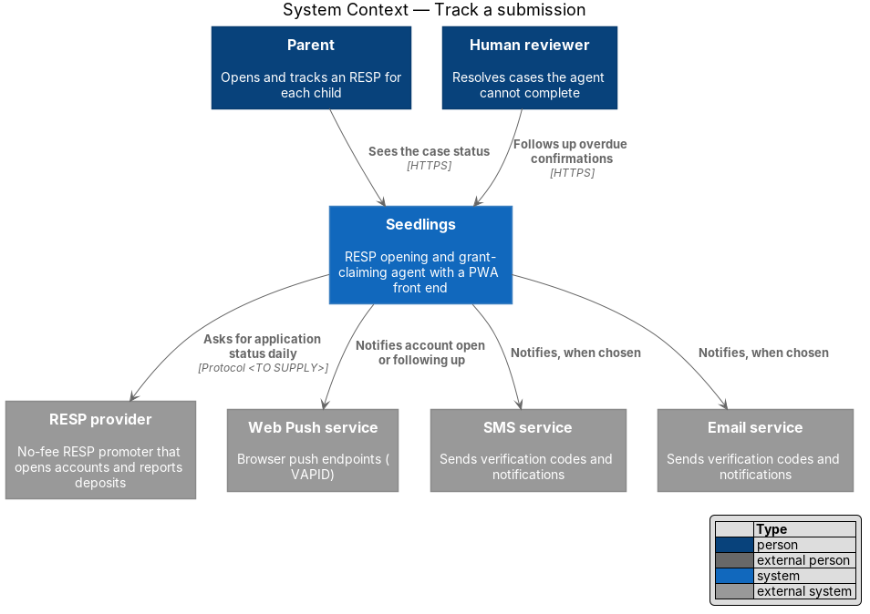
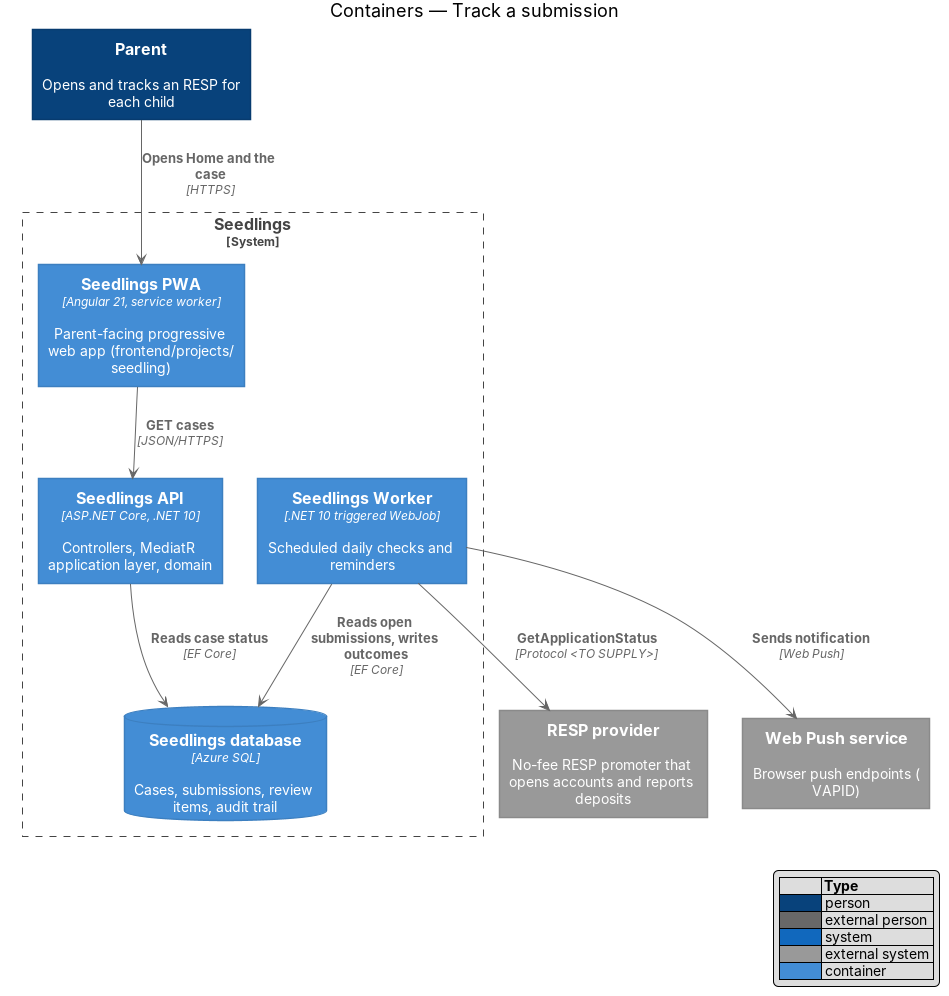
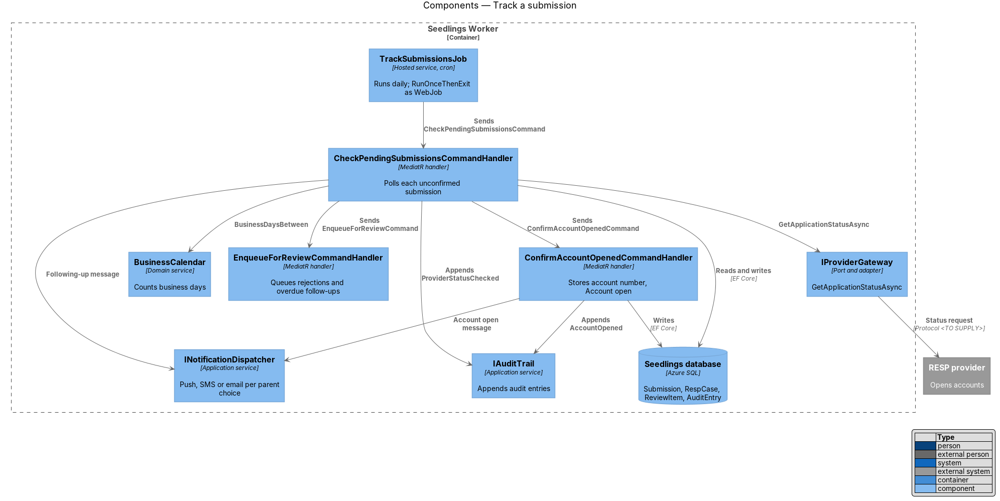
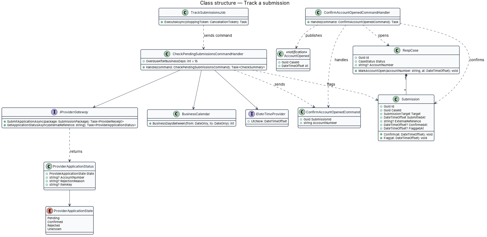
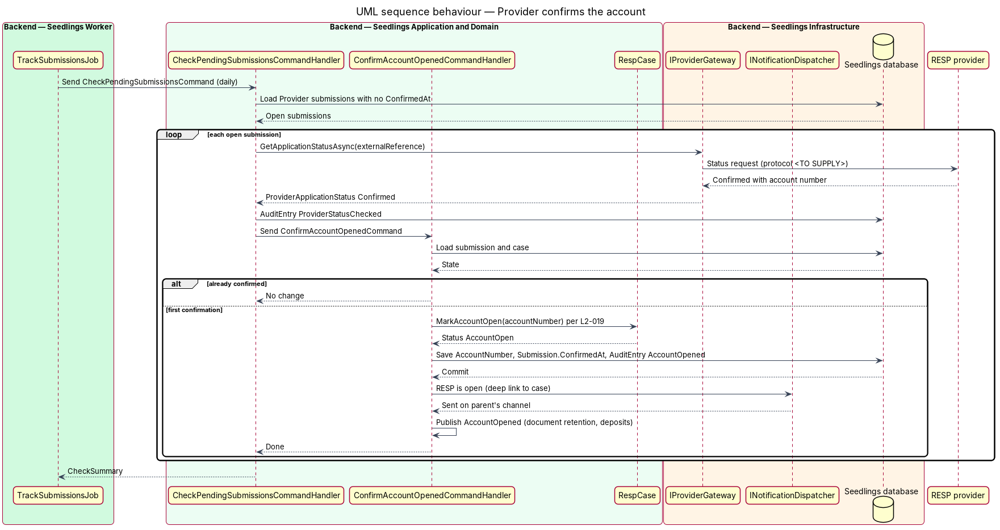
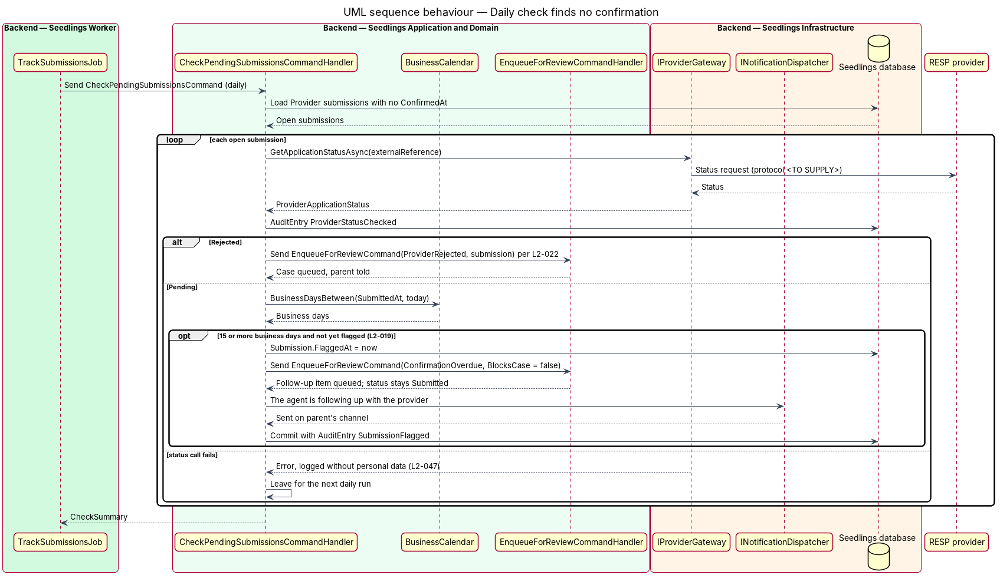

# Track a submission

## Overview

Seedlings is an installable progressive web app (PWA) that works as the interface to an agent. The
agent opens a Registered Education Savings Plan (RESP) for a child and claims the Canada Learning
Bond (CLB) and the Canada Education Savings Grant (CESG) for the family. Each child has one case.

After the parent approves and the agent submits the RESP application (approve-and-submit design),
the RESP provider opens the account. Until it does, the case is in status `Submitted` and the
parent has nothing to do. This feature has the agent follow each submission until the provider
confirms the account number. It also catches the submissions that stall.

A daily check runs in the Seedlings Worker. For each unconfirmed submission it asks the provider for
the application status. A confirmation stores the account number and moves the case to `Account open`.
A rejection hands the case to a person (human-review-handoff design). After 15 business days with no
confirmation, the agent flags the submission and tells the parent it is following up.

Terms used in this design:

- **daily check** — scheduled run of the Seedlings Worker that polls the provider for every unconfirmed submission
- **confirmation** — provider statement that the RESP is open, carrying the account number
- **account number** — identifier the provider assigns to the child's RESP; stored encrypted and shown to the parent by its last four digits only
- **business day** — calendar day that is neither a Saturday, a Sunday nor a statutory holiday in the holiday calendar the design uses
- **flagged submission** — submission with no confirmation after 15 business days, marked for follow-up

Parent-facing screens: `docs/mocks/pages/case.html` shows the confirmed state ("RESP opened … account
ending 3307") and the activity entry "Seedlings checked <provider>'s status". `docs/mocks/pages/submitted.html`
shows the waiting timeline. No mock shows the flagged "following up" state; that mock is `<TO SUPPLY>`.

## Description

### Worker

- **`TrackSubmissionsJob`** (`Seedling.Worker/Jobs/`) — hosted service registered in
  `Seedling.Worker/Program.cs`. It reads its cron schedule from `Seedling:TrackSubmissions:Schedule`
  and honours `RunOnceThenExit`, as the Worker scaffold describes. It sends one
  `CheckPendingSubmissionsCommand` per run. The time of day of the run is `<TO SUPPLY>`.
- **`backend/deploy/webjobs/track-submissions/`** — `run.sh`, `settings.job` (daily schedule) and
  `README.md`, published beside the API as a triggered WebJob.

### Backend

- **`CheckPendingSubmissionsCommand`** / **`CheckPendingSubmissionsCommandHandler`**
  (`Seedling.Application/CaseAgent/TrackSubmission/`) — loads every `Submission` with
  `Target = Provider` and no `ConfirmedAt`. For each one it calls
  `IProviderGateway.GetApplicationStatusAsync(externalReference)` and appends an `AuditEntry`
  (`Actor = Agent`, `Action = ProviderStatusChecked`). It then acts on the result:
  - `Confirmed(accountNumber)` — sends `ConfirmAccountOpenedCommand` (L2-019 criterion 1);
  - `Rejected(reason, itemKey)` — sends `EnqueueForReviewCommand` with reason
    `ProviderRejected` and failed step `submission` (L2-022);
  - `Pending` — asks `BusinessCalendar` how many business days have passed since `SubmittedAt`. At 15
    or more, with `FlaggedAt` empty, it flags the submission (L2-019 criterion 2).

  One failed status call does not stop the run. It is logged without personal data (L2-047), and the
  next run retries it.
- **`ConfirmAccountOpenedCommand`** / **`ConfirmAccountOpenedCommandHandler`** — stores the account
  number on `RespCase.AccountNumber` and sets `Submission.ConfirmedAt`. It moves the case to
  `AccountOpen` and appends an `AuditEntry` (`AccountOpened`). It then sends a notification through
  `INotificationDispatcher` and publishes the `AccountOpened` MediatR notification. Handlers in
  other designs consume that notification: document retention (L2-033) and deposit confirmation
  (L2-023). A second confirmation for the same submission changes nothing.
- **Flag handling** — sets `Submission.FlaggedAt` and sends the parent a notification that the agent
  is following up. It queues a non-blocking `ReviewItem` with reason `ConfirmationOverdue`, so a
  reviewer chases the provider while the case keeps status `Submitted`. The follow-up action
  depends on the provider integration protocol and is `<TO SUPPLY>`.
- **`BusinessCalendar`** (`Seedling.Domain/Services/`) — `BusinessDaysBetween(DateOnly from,
  DateOnly to)` excludes Saturdays, Sundays and holidays. The holiday set (federal, provincial or the
  provider's) and the time zone that fixes the calendar date are `<TO SUPPLY>`. `IDateTimeProvider`
  supplies "today", so tests pin the date.
- **`IProviderGateway.GetApplicationStatusAsync`** — added to the port from the approve-and-submit
  design. The status call is not a new data share, so it does not pass the approval gate. It sends
  only the provider's own reference. The protocol (API, email or portal) is `<TO SUPPLY>`. A protocol
  in which the provider pushes confirmations to Seedlings would need an anonymous endpoint, and
  L2-045 does not list one. That option therefore needs a requirement change first; this design
  polls.
- **`RespCase.AccountNumber`** — encrypted at rest with the rest of the database (L2-031). The case
  detail shows only the last four digits.

### Data

`Submission.ConfirmedAt` and `Submission.FlaggedAt` exist from the approve-and-submit design. This
feature writes them. `ReviewItem` gains `BlocksCase` (bool), defined in the human-review-handoff
design.

### API

No new parent-facing endpoint. The parent sees the outcome through the case status dashboard
(`GET /api/cases`, `GET /api/cases/{caseId}`).

### Implementation slices

1. **Confirmation stores the account number** — `ConfirmAccountOpenedCommand` with a fake
   `IProviderGateway`; integration test proves status `AccountOpen` and the stored number
   (L2-019 criterion 1).
2. **Daily check** — `CheckPendingSubmissionsCommand` and `TrackSubmissionsJob` with
   `RunOnceThenExit` (L2-019 criterion 1).
3. **Business-day count** — `BusinessCalendar` once the holiday set is supplied (L2-019 criterion 2).
4. **Flag after 15 business days** — flag, notification and non-blocking review item
   (L2-019 criterion 2).
5. **WebJob packaging** — `backend/deploy/webjobs/track-submissions/`.

## Requirements

| L2 ID | Refines (L1) | Requirement |
|-------|--------------|-------------|
| `L2-019` | `L1-010` | The agent shall record each submission and track it until the provider confirms it. |

Acceptance criteria from `docs/specs/L2.md`:

1. Given an application is submitted, when the provider confirms the account number, then the case
   status shall move to Account open and the account number shall be stored.
2. Given 15 business days pass with no confirmation, when the daily check runs, then the case shall
   be flagged and the parent shall be told the agent is following up.

## Diagrams

### System context

The Seedlings Worker asks the provider for the status of each open submission. It tells the parent
about the outcome through the parent's chosen channel.

### Containers

The Worker shares the Infrastructure composition with the API. It reads and writes the Seedlings
database, calls the provider and dispatches notifications.

### Components

`TrackSubmissionsJob` sends one command per run. The handler branches on the provider status to
confirm, route to review or flag.

### Class structure

The check handler depends on the provider gateway, the business calendar and the clock.
`ProviderApplicationStatus` names the four outcomes the gateway returns.

### Behaviour — provider confirms the account

The daily check reads a confirmation, stores the account number and moves the case to Account open
(L2-019 criterion 1).

### Behaviour — daily check finds no confirmation

A pending submission older than 15 business days is flagged once. The parent is told the agent is
following up (L2-019 criterion 2). A rejection goes to the review queue instead.

