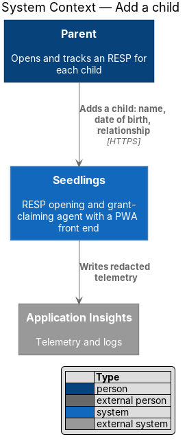
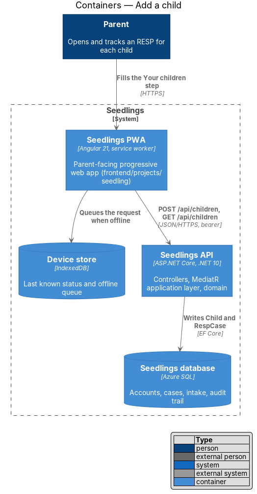
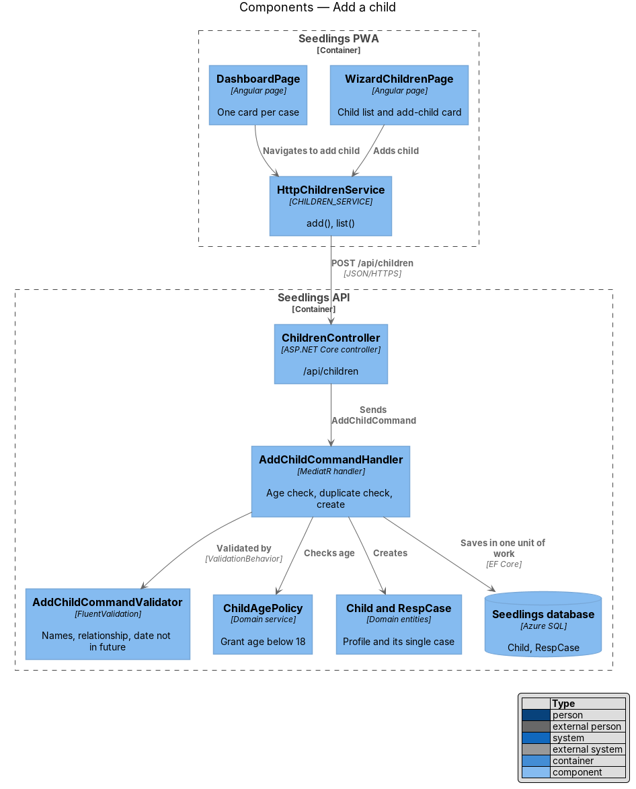
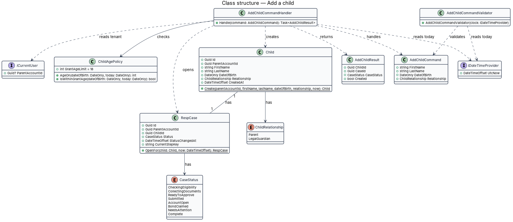
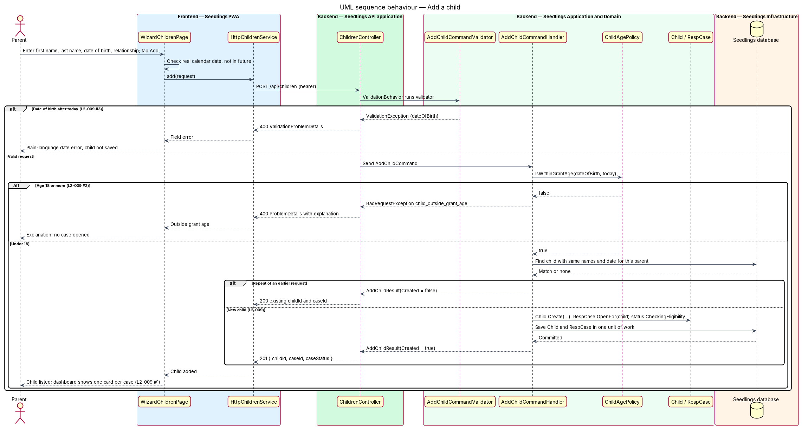

# Add a child

## Overview

Seedlings works one child at a time: each child gets a separate Registered Education Savings Plan
(RESP) case, its own status and its own grant claims. Before the eligibility check can say what a
child can get, Seedlings needs to know who the child is. This feature lets a signed-in parent add a
child with first name, last name, date of birth and relationship, and opens one case for that child.

The feature is the first step of the eligibility subsystem. It appears in two places: the
children step of the onboarding wizard, and the Add a child action on the dashboard. Both use the
same screen and the same endpoint.

Two dates stop a child from being added. A date of birth in the future is a typing error and is
refused with a field message. A child aged 18 or older is outside RESP grant eligibility, so
Seedlings explains this and opens no case. The Canada Learning Bond (CLB) and the Canada Education
Savings Grant (CESG) are paid only for younger beneficiaries, so a case for an adult child would
have nothing to claim.

Terms used below:

- **child profile** — the `Child` record: first name, last name, date of birth and relationship to
  the parent
- **case** — the `RespCase` record that tracks opening one child's RESP and claiming that child's
  grants; exactly one per child
- **grant age** — age below 18 on the day the child is added
- **relationship** — the parent's legal relationship to the child: `Parent` or `LegalGuardian`

## Description

### Frontend

The slice implements `docs/mocks/pages/wizard.children.html` and the Add a child entry points on
`docs/mocks/pages/dashboard.html` and `docs/mocks/pages/dashboard.empty.html`. The mock shows a first
name field, a day-month-year date of birth and the relationship choice, but no last name field.
`L2-009` requires a last name, so the mock update is `<TO SUPPLY>` and precedes implementation.

- **`WizardChildrenPage`** (`app-wizard-children`,
  `frontend/projects/seedling/src/app/pages/wizard-children/wizard-children.page.ts`) — lists the
  children already added, holds the add-child card, and offers Continue with the child count. It
  validates locally that the date is a real calendar date and not in the future before calling the
  API, and shows the server's plain-language message when the API refuses the child.
- **Outside grant age message** — on the `child_outside_grant_age` error the page replaces the card
  with the explanation from the ProblemDetails `detail` and keeps the parent on the step. The copy
  follows the reading-level rules of web-experience/language-and-reading-level.
- **`CHILDREN_SERVICE` / `ChildrenService` / `HttpChildrenService`**
  (`frontend/projects/api/src/lib/services/children.service.ts`) — `list()` and `add(request)`.
- **Dashboard** — `DashboardPage` (case-agent/case-status-dashboard) lists one card per case, so a
  second child appears as a second card with its own status (`L2-009` criterion 1).
- **Design-system components** — `sl-card`, `sl-field`, `sl-choice` and `sl-avatar`; the date of
  birth uses the `field-row--dob` layout from the mock.
- **Out of scope** — the mock shows an edit button per child. No L2 requirement covers editing a
  child yet; that requirement is `<TO SUPPLY>`.

### API

| Method and route | Body | Success | Errors |
|---|---|---|---|
| `POST /api/children` | `{ firstName, lastName, dateOfBirth, relationship }` | `201` `{ childId, caseId, caseStatus }`; `200` with the same body for a repeat | `400` validation, `400` `child_outside_grant_age` |
| `GET /api/children` | — | `200` list of `ChildDto` | — |

`dateOfBirth` is an ISO 8601 calendar date (`yyyy-MM-dd`). Both endpoints require a bearer token
and are tenant-scoped by case-authorization (`L2-045`).

### Application and domain

- **`AddChildCommand`** (`FirstName`, `LastName`, `DateOfBirth`, `Relationship`) and
  **`AddChildCommandValidator`** — requires both names and a relationship, and rejects a date of
  birth after today with a plain-language message keyed on `dateOfBirth` (`L2-009` criterion 3).
  Name length and character rules follow privacy-and-security/input-validation (`L2-046`).
- **`AddChildCommandHandler`** — computes the child's age through `ChildAgePolicy`. An age of 18 or
  more throws `BadRequestException` with code `child_outside_grant_age`; nothing is saved
  (`L2-009` criterion 2). Otherwise it creates the `Child` and its `RespCase` in one unit of work.
  `ParentAccountId` comes from `ICurrentUser`, never from the request.
- **Idempotent create** — a retry from the offline queue or a double tap repeats the request. When
  the parent already has a child with the same first name, last name and date of birth (names
  compared case-insensitively), the handler returns that child and its case with `200` and creates
  nothing.
- **`ChildAgePolicy`** (domain service) — `AgeOn(dateOfBirth, today)` counts completed years; a
  child turns 18 on the 18th birthday. `IsWithinGrantAge` is true below 18. "Today" is the calendar
  date of `IDateTimeProvider.UtcNow` in a configured time zone, whose value is `<TO SUPPLY>`.
- **`Child`** (entity) — `Create(parentAccountId, firstName, lastName, dateOfBirth, relationship)`.
- **`RespCase`** (entity) — `OpenFor(child, now)` starts the case at status `CheckingEligibility` with
  `StatusChangedAt` set; check-eligibility moves it on.
- **Wizard estimate** — onboarding/start-wizard reads the child count to size the roadmap
  (`L2-036` criterion 2); this feature adds no wizard logic of its own.

### Data

| Entity | Fields used here |
|---|---|
| `Child` | `Id`, `ParentAccountId`, `FirstName`, `LastName`, `DateOfBirth` (`DateOnly`), `Relationship`, `CreatedAt` |
| `RespCase` | `Id`, `ParentAccountId`, `ChildId` (unique), `Status`, `StatusChangedAt`, `CurrentStepKey` |

A unique index on `RespCase.ChildId` enforces one case per child. An index on (`ParentAccountId`,
`DateOfBirth`) serves the duplicate check.

### Implementation slices

1. **Add the first child** — `POST /api/children`, `Child`, `RespCase`, `WizardChildrenPage` with the
   last name field from the updated mock. Covers `L2-009` (main statement).
2. **Second child, second case** — the list on the step and a second card on the dashboard. Covers
   `L2-009` criterion 1.
3. **Future date of birth** — validator and field message. Covers `L2-009` criterion 3.
4. **Outside grant age** — `ChildAgePolicy`, the `child_outside_grant_age` response and its
   explanation. Covers `L2-009` criterion 2.
5. **Repeat request** — idempotent create. Supports the offline queue of
   web-experience/offline-status-and-queue.

## Requirements

| L2 ID | Refines (L1) | Requirement |
|-------|--------------|-------------|
| `L2-009` | `L1-005` | A parent shall add a child with first name, last name, date of birth and relationship, creating one case per child. |

## Diagrams

### System context

Adding a child involves only the parent and Seedlings; no external system is called.

### Containers

The PWA posts the child profile to the Seedlings API, which writes the child and its case to the
Seedlings database.

### Components

`ChildrenController` dispatches `AddChildCommand`. The handler consults `ChildAgePolicy` and creates
`Child` and `RespCase` together.

### Class structure

A `Child` has exactly one `RespCase`, and the handler creates both. `ChildAgePolicy` decides grant
age from the date of birth.

### Behaviour — add a child

Validation refuses a future date, the age policy refuses an adult child, a repeat returns the
existing case, and a new child gets a new case.

