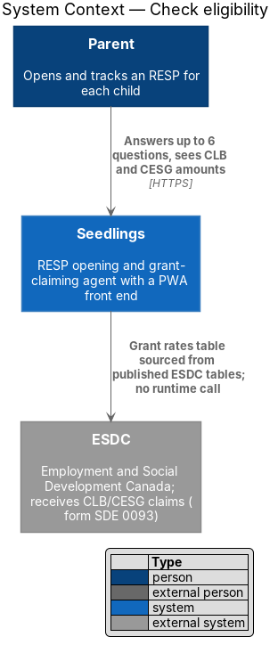
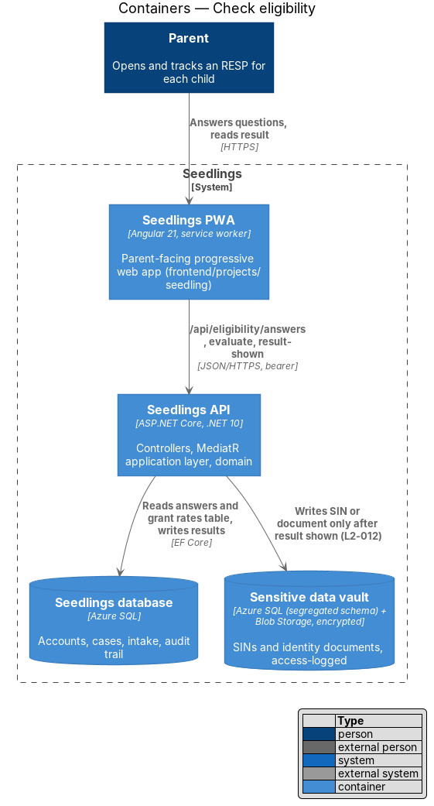
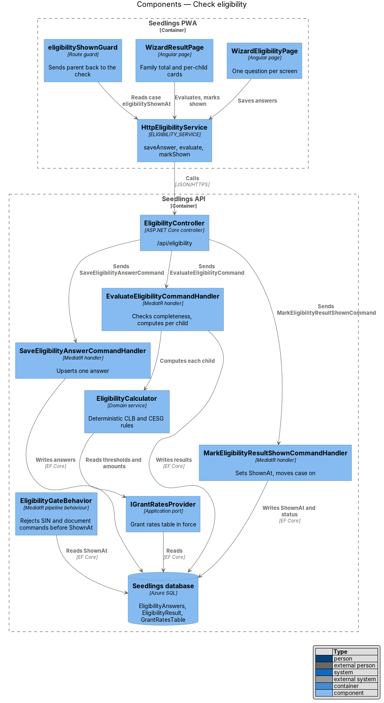
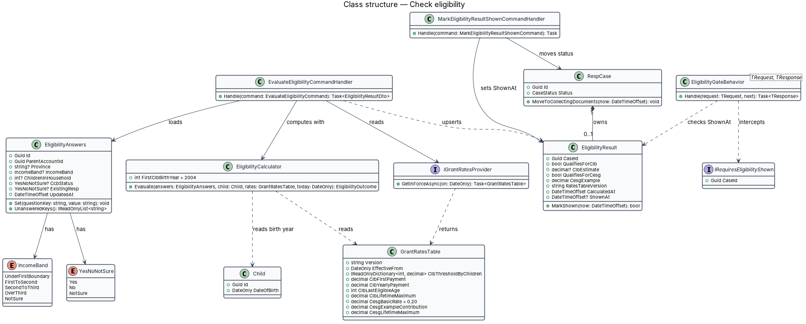
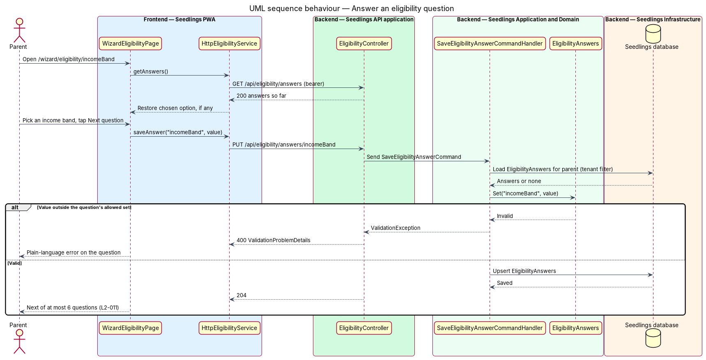
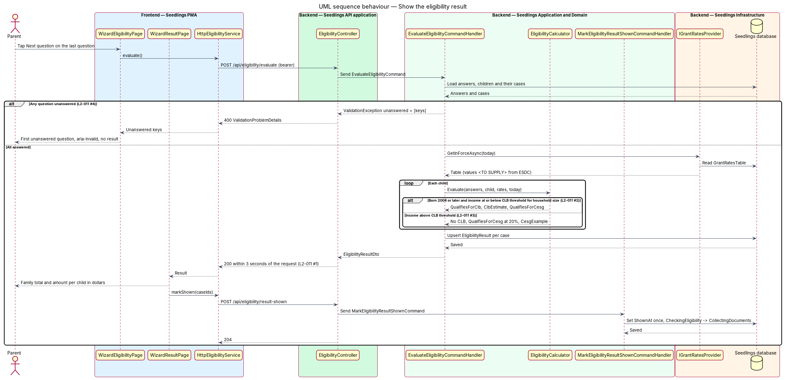
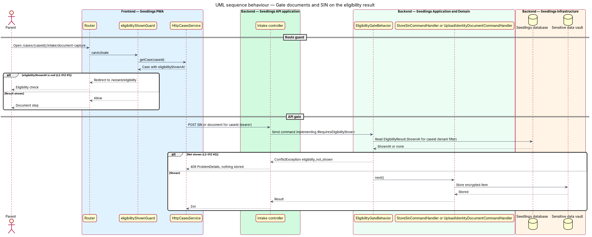

# Check eligibility

## Overview

Two federal programs put money into a Registered Education Savings Plan (RESP) for a child. The
Canada Learning Bond (CLB) is paid to children of lower-income families and needs no contribution
from the family. The Canada Education Savings Grant (CESG) adds 20% to what the family contributes.
Employment and Social Development Canada (ESDC) sets the income thresholds and the amounts for both
programs and publishes them in tables that change over time.

Parents are more willing to share documents once they know what is at stake. This feature asks at
most 6 short questions, tells the parent whether each child qualifies for the CLB and the CESG, and
shows the dollar amount before Seedlings asks for any identity document or Social Insurance Number
(SIN). The order is a hard rule: the API refuses a document or SIN for a case whose result the
parent has not seen.

The feature sits in the eligibility subsystem after add-child, and inside the onboarding wizard as
the Eligibility questions and What they can get steps. The calculation is a deterministic domain
service, not a call to the language model, so the same answers always give the same result.

Terms used below:

- **eligibility answers** — the parent's answers to the 6 questions, saved one at a time
- **income band** — range of household adjusted net income that the parent picks instead of an exact
  figure
- **CLB threshold** — ESDC's adjusted net income limit for the CLB, which depends on the number of
  children in the household
- **grant rates table** — the configured copy of the ESDC thresholds and amounts that the calculator
  reads, versioned by the period it applies to
- **eligibility result** — per-case outcome: whether the child qualifies for the CLB and the CESG,
  the CLB estimate and a CESG example amount
- **result shown** — the moment the PWA has displayed the result to the parent, recorded as
  `EligibilityResult.ShownAt`

## Description

### Frontend

The slice implements `docs/mocks/pages/wizard.eligibility.html` (one question per screen, numbered
"Question n of 6") and `docs/mocks/pages/wizard.result.html` (the family total and one card per
child).

- **`WizardEligibilityPage`** (`app-wizard-eligibility`,
  `frontend/projects/seedling/src/app/pages/wizard-eligibility/wizard-eligibility.page.ts`) — renders
  the question named by the `:questionKey` route parameter. Each answer saves when the parent taps
  Next question. The questions, in the order `L2-011` lists them:
  1. `birthYear` — each child's birth year, prefilled from the child profile for the parent to
     confirm;
  2. `province` — the parent's province or territory;
  3. `incomeBand` — household income band, with an I'm not sure option;
  4. `childrenInHousehold` — number of children in the household;
  5. `ccbStatus` — whether the family receives the Canada Child Benefit (CCB): yes, no or not sure;
  6. `existingResp` — whether an RESP already exists: yes, no or not sure.
- **Unanswered questions** — when the API answers `400` with `unanswered` keys, the page routes to
  the first unanswered question and marks it with `aria-invalid="true"` and a plain-language message.
  No result is shown (`L2-011` criterion 4).
- **`WizardResultPage`** (`app-wizard-result`, `pages/wizard-result/wizard-result.page.ts`) — shows
  the family total, one card per child, and the CESG explanation. CLB copy expands the acronym on
  first use as `L2-042` requires. Once the content renders, the page calls `markShown(caseIds)`.
- **`ELIGIBILITY_SERVICE` / `EligibilityService` / `HttpEligibilityService`**
  (`frontend/projects/api/src/lib/services/eligibility.service.ts`) — `saveAnswer`, `getAnswers`,
  `evaluate` and `markShown`.
- **`eligibilityShownGuard`** (`frontend/projects/seedling/src/app/shared/eligibility-shown.guard.ts`)
  — guards the intake document and SIN routes. When the case has no `eligibilityShownAt`, it
  redirects to the first eligibility question (`L2-012` criterion 1).
- **Mock amounts** — the result mock shows illustrative figures for the CLB schedule and the CESG
  limit. The page displays only values returned by the API, and those values come from the grant
  rates table, not from the mock.

### API

| Method and route | Body | Success | Errors |
|---|---|---|---|
| `PUT /api/eligibility/answers/{questionKey}` | `{ value }` | `204` | `400` validation |
| `GET /api/eligibility/answers` | — | `200` answers so far | — |
| `POST /api/eligibility/evaluate` | `{}` | `200` `EligibilityResultDto` | `400` with `unanswered` |
| `POST /api/eligibility/result-shown` | `{ caseIds }` | `204` | `404` for a foreign case |

`EligibilityResultDto` holds `familyClbTotal` and one entry per case: `caseId`, `childFirstName`,
`qualifiesForClb`, `clbEstimate`, `qualifiesForCesg` and `cesgExample`, with amounts in Canadian
dollars. Every endpoint requires a bearer token and is tenant-scoped (`L2-045`).

### Application and domain

- **`SaveEligibilityAnswerCommand`** and handler — validates the value against the question's allowed
  set and upserts the field on the parent's `EligibilityAnswers`.
- **`EvaluateEligibilityCommand`** and handler — loads the answers and every case in
  `CheckingEligibility` or with a result. Missing answers throw `ValidationException` keyed
  `unanswered`. Otherwise it calls `EligibilityCalculator` per child, upserts one `EligibilityResult`
  per case, and returns the DTO. The work is in-process with no external call, so the result fits
  inside the 3-second limit of `L2-011` criterion 1.
- **`EligibilityCalculator`** (domain service) — applies the rules for one child:
  - born in 2004 or later, and the income band at or below the CLB threshold for
    `childrenInHousehold`: qualifies for the CLB, with `clbEstimate` from the grant rates table
    (`L2-011` criterion 2);
  - income band above the threshold: does not qualify for the CLB, qualifies for the CESG at 20%,
    with `cesgExample` from the table (`L2-011` criterion 3);
  - every child under 18 qualifies for the CESG, so `qualifiesForCesg` is true for each case.
- **Undecided rules** — the specifications do not say how to decide when an income band straddles a
  CLB threshold, or how `ccbStatus` decides the outcome when the parent picks I'm not sure for income.
  Both rules are `<TO SUPPLY>`. Province plays no part in this calculation; provincial grants are
  outside `L2-011`.
- **`IGrantRatesProvider`** and **`GrantRatesTable`** — the calculator reads the table in force on the
  evaluation date. Every value is sourced from ESDC tables and is `<TO SUPPLY>`:

  | Value | Source |
  |---|---|
  | CLB income threshold for each number of children | `<TO SUPPLY>` (ESDC) |
  | Income band boundaries, aligned to those thresholds | `<TO SUPPLY>` |
  | CLB first payment amount | `<TO SUPPLY>` (ESDC) |
  | CLB yearly payment amount and the last eligible age | `<TO SUPPLY>` (ESDC) |
  | CLB lifetime maximum per child | `<TO SUPPLY>` (ESDC) |
  | CESG basic rate | 20% (`L2-011` criterion 3) |
  | Contribution used for the CESG example | `<TO SUPPLY>` |
  | CESG lifetime maximum per child | `<TO SUPPLY>` (ESDC) |
  | First eligible birth year for the CLB | 2004 (`L2-011` criterion 2) |

  `clbEstimate` is the first payment plus the yearly payments for the child's remaining eligible
  years, capped at the lifetime maximum. Where the table lives (seed data or configuration) and who
  updates it are `<TO SUPPLY>`.
- **`MarkEligibilityResultShownCommand`** and handler — sets `ShownAt` on each named result the first
  time only, and moves each case from `CheckingEligibility` to `CollectingDocuments`.
- **`IRequiresEligibilityShown`** and **`EligibilityGateBehavior`** — a marker interface and a
  MediatR pipeline behaviour. The SIN and document commands of intake/capture-document and
  privacy-and-security/sensitive-data-vault carry the marker. The behaviour runs before their
  handlers and throws `ConflictException` with code `eligibility_not_shown` when the case has no
  `ShownAt`. The API answers `409`, and no byte reaches the vault (`L2-012` criterion 2).

### Data

| Entity | Fields used here |
|---|---|
| `EligibilityAnswers` | `Id`, `ParentAccountId`, `Province`, `IncomeBand`, `ChildrenInHousehold`, `CcbStatus`, `ExistingResp`, `UpdatedAt` |
| `EligibilityResult` | `CaseId` (key), `QualifiesForClb`, `ClbEstimate`, `QualifiesForCesg`, `CesgExample`, `RatesTableVersion`, `CalculatedAt`, `ShownAt` |
| `RespCase` | `Status`, `StatusChangedAt` |

The birth year is read from `Child.DateOfBirth`, so it is not stored twice. `IncomeBand` is an enum
of the bands in the mock plus `NotSure`. `RatesTableVersion` records which table produced each
result. `existingResp` feeds the intake existing-RESP step and does not change the result.

### Implementation slices

1. **Answer one question** — `PUT /api/eligibility/answers/{questionKey}`, `WizardEligibilityPage`
   for one question, answers restored on return. Prerequisite for the result.
2. **Unanswered question blocks the result** — the `unanswered` error and the highlight. Covers
   `L2-011` criterion 4.
3. **CLB result** — `EligibilityCalculator` for the CLB branch, `WizardResultPage`, test table
   values in the API tests until the real values are supplied. Covers `L2-011` criteria 1 and 2.
4. **CESG-only result** — the above-threshold branch and the CESG example. Covers `L2-011`
   criterion 3.
5. **Result shown and the route guard** — `result-shown`, the status change and
   `eligibilityShownGuard`. Covers `L2-012` criterion 1.
6. **API gate** — `EligibilityGateBehavior` on the SIN and document commands. Covers `L2-012`
   criterion 2.

## Requirements

| L2 ID | Refines (L1) | Requirement |
|-------|--------------|-------------|
| `L2-011` | `L1-007` | The eligibility check shall ask at most 6 questions: the child's birth year, the parent's province, the household's approximate adjusted net income band, the number of children, Canada Child Benefit status, and whether an RESP already exists. |
| `L2-012` | `L1-007` | No document or SIN shall be requested until the eligibility result has been shown. |

## Diagrams

### System context

The check runs entirely inside Seedlings. ESDC appears only as the publisher of the thresholds and
amounts held in the grant rates table; Seedlings does not call ESDC to compute a result.

### Containers

The PWA saves answers and asks for the result. The Seedlings API computes it from the answers and the
grant rates table in the Seedlings database, and the vault stays untouched until the result is shown.

### Components

`EligibilityController` dispatches three commands. `EligibilityCalculator` reads the grant rates
table, and `EligibilityGateBehavior` protects the SIN and document commands owned by other features.

### Class structure

`EligibilityAnswers` belongs to the parent and `EligibilityResult` to each case. The calculator
combines the answers, the child's birth year and a `GrantRatesTable` into a result.

### Behaviour — answer a question

Each answer saves on Next question, so the check resumes where the parent stopped on any device.

### Behaviour — show the result

The API refuses to evaluate while a question is unanswered. A complete set of answers gives one
result per child, and the PWA records the moment it shows them.

### Behaviour — gate documents and SIN

The route guard sends the parent back to the check, and the pipeline behaviour rejects any SIN or
document for a case whose result has not been shown.

