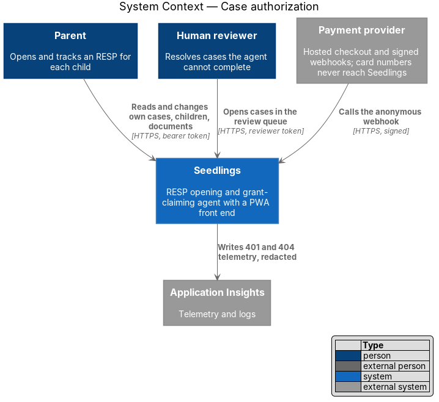
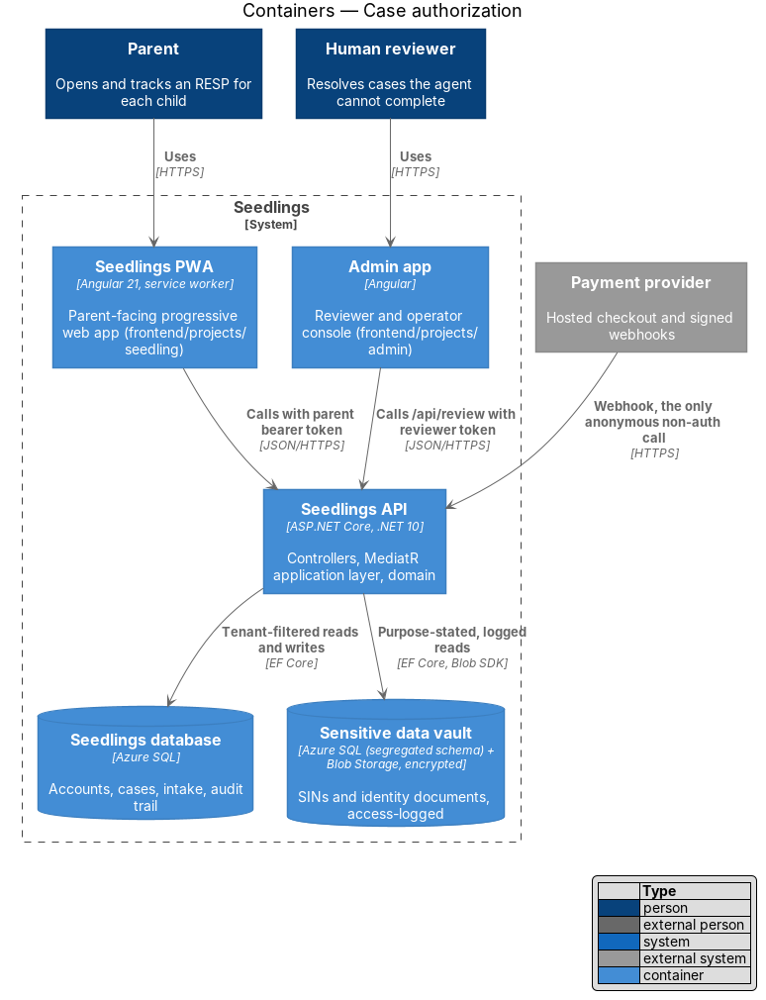
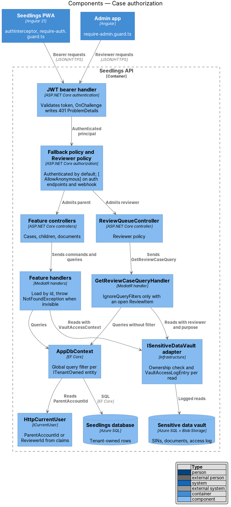
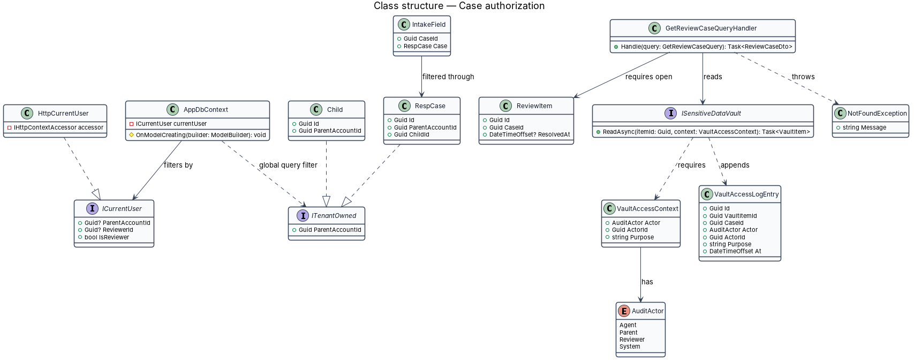
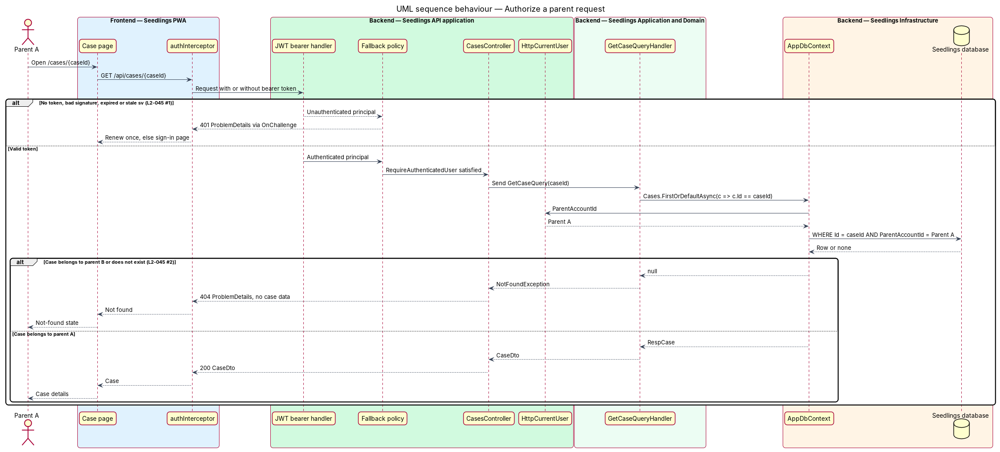
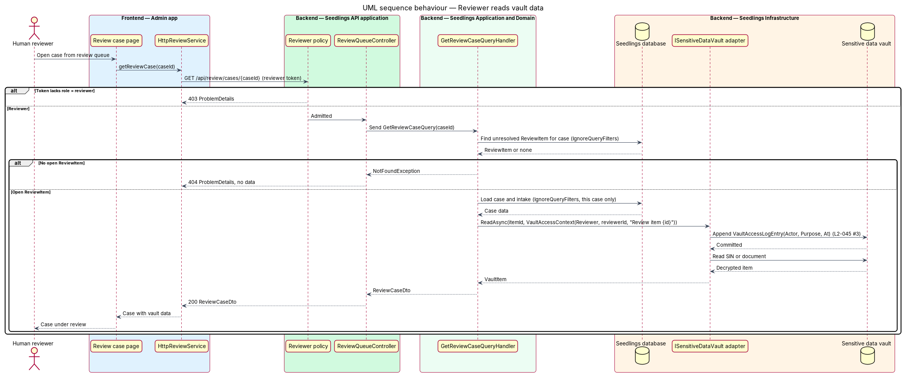

# Case authorization

## Overview

Seedlings holds sensitive family data: children's names and birth dates, intake answers, Social
Insurance Numbers (SINs) and photos of identity documents. Each parent account is a tenant, and a
parent's cases, children and documents belong to that tenant alone. This feature makes two
guarantees for the whole API. First, a request without a valid access token reaches nothing but the
sign-in endpoints and the payment webhook. Second, a signed-in parent reaches only their own data,
and a request for anyone else's data looks the same as a request for data that does not exist.

The feature also covers the one sanctioned way across tenant lines: a human reviewer who opens a case
from the review queue in the admin app. That access is deliberate, scoped to the case under review,
and written to the vault access log with the reviewer and the purpose.

This feature has almost no user interface. It is a set of cross-cutting rules in the API host, the
application layer and the persistence layer, which every other feature inherits.

Terms used below:

- **tenant** — one parent account and everything it owns
- **tenant-owned entity** — entity whose rows belong to exactly one parent account, directly through
  `ParentAccountId` or through the `RespCase` it hangs from
- **fallback policy** — authorization policy that ASP.NET Core applies to every endpoint carrying no
  policy of its own
- **global query filter** — Entity Framework Core predicate applied to every query of an entity type
- **vault** — the segregated, encrypted store for SINs and identity documents (privacy-and-security
  /sensitive-data-vault)
- **review purpose** — the recorded reason a reviewer reads vault data, tied to one `ReviewItem`

## Description

### API host (`Seedling.Api`)

- **Authentication** — `Program.cs` replaces the placeholder `AddAuthentication()` with the JWT bearer
  scheme. Validation uses the existing `Seedling:Jwt` issuer, audience and signing key
  (`SEEDLING_JWT_SIGNING_KEY`). `SessionVersionValidator` from the sessions-and-devices design runs in
  `OnTokenValidated`.
- **Fallback policy** — `AddAuthorization` sets `FallbackPolicy` to
  `RequireAuthenticatedUser()`. Every controller action therefore requires a valid token unless it
  carries `[AllowAnonymous]` (`L2-045` criterion 1).
- **Anonymous endpoints** — exactly these carry `[AllowAnonymous]`: `POST /api/auth/codes` (sign-up
  and sign-in), `POST /api/auth/codes/{challengeId}/verify` (code verification), `POST /api/auth/refresh`
  (sign-in renewal) and the payment webhook from billing/confirm-payment. The existing
  `PingController` is also anonymous for the deploy smoke check and returns no personal data; whether
  it stays anonymous under `L2-045` is `<TO SUPPLY>`.
- **401 body** — `JwtBearerEvents.OnChallenge` writes a `401` `application/problem+json` body in the
  same shape `ExceptionHandlingMiddleware` produces, so the PWA handles one error format.
- **Pipeline order** — unchanged from the current `Program.cs`: request logging, then
  `ExceptionHandlingMiddleware`, then Swagger (outside production), HTTPS redirection, CORS,
  `UseAuthentication`, `UseAuthorization` and the controllers. Swagger stays ahead of authentication.
- **`HttpCurrentUser`** (`Seedling.Api/Authentication/HttpCurrentUser.cs`) — implements `ICurrentUser`
  from the token claims through the registered `IHttpContextAccessor`.
- **`Reviewer` policy** — requires the `role` claim value `reviewer`. `ReviewQueueController`
  (`/api/review/...`) carries it. How reviewer accounts are provisioned and how reviewers sign in to
  the admin app is `<TO SUPPLY>`; the design assumes their tokens carry `sub` (the reviewer identifier)
  and `role` = `reviewer`.

### Application and domain

- **`ICurrentUser`** (`Seedling.Application/Abstractions/ICurrentUser.cs`) — `ParentAccountId`
  (null for a reviewer), `ReviewerId` (null for a parent) and `IsReviewer`.
- **`ITenantOwned`** (`Seedling.Domain`) — marker interface exposing `Guid ParentAccountId`.
  `Child`, `RespCase`, `WizardProgress`, `EligibilityAnswers`, `Notification`, `Payment` and
  `DataRequest` implement it.
- **Ownership on create** — handlers set `ParentAccountId` from `ICurrentUser`. No request DTO
  carries a `ParentAccountId`, so a client cannot write into another tenant.
- **Not found, never forbidden** — handlers load by identifier through the filtered context. A row
  outside the caller's tenant is invisible, the load returns null, and the handler throws the
  existing `NotFoundException`. The API answers `404` with no data, identical to an unknown
  identifier (`L2-045` criterion 2).
- **`GetReviewCaseQuery`** and handler — the one handler that calls `IgnoreQueryFilters()`. It first
  requires an unresolved `ReviewItem` for the case; without one it throws `NotFoundException`.
- **`ISensitiveDataVault.ReadAsync(itemId, VaultAccessContext)`** — the vault port from
  privacy-and-security/sensitive-data-vault. `VaultAccessContext` carries the actor and the purpose,
  so no caller can read the vault without stating both. For a reviewer the purpose names the
  `ReviewItem` identifier.

### Infrastructure (`Seedling.Infrastructure`)

- **`AppDbContext` query filters** — `OnModelCreating` registers a filter on every `ITenantOwned`
  entity: `e.ParentAccountId == currentUser.ParentAccountId`. Case-owned entities without their own
  `ParentAccountId` (`IntakeField`, `ConsentRecord`, `PrefilledForm`, `Approval`, `Submission`,
  `AuditEntry`, `ExpectedDeposit`, `LifeChange`) filter through `e.Case.ParentAccountId`. A reviewer
  token has a null `ParentAccountId`, so filtered queries return no rows for it.
- **Vault access log** — the vault adapter appends a `VaultAccessLogEntry` (`Actor`, `Purpose`, `At`)
  in the same transaction as the read and returns data only after the entry commits
  (`L2-045` criterion 3). Vault documents carry a `CaseId`, and the adapter checks case ownership for
  a parent caller before any read.

### Frontend

- **Seedlings PWA** — `authInterceptor` and `require-auth.guard.ts` from sessions-and-devices handle
  `401`. Case, child and document routes show a not-found state on `404`. The static design reference
  has no not-found screen; that mock is `<TO SUPPLY>`.
- **Admin app** — `require-admin.guard.ts` (`frontend/projects/api/src/lib/auth/`) admits reviewers
  only. The review queue screens belong to case-agent/human-review-handoff; `docs/mocks` has no admin
  screens yet, which is `<TO SUPPLY>`.

### Data

| Entity | Fields used here |
|---|---|
| `VaultAccessLogEntry` | `Id`, `VaultItemId`, `CaseId`, `Actor`, `ActorId`, `Purpose`, `At` (append-only) |
| `ReviewItem` | `Id`, `CaseId`, `ResolvedAt` (read only) |
| every `ITenantOwned` entity | `ParentAccountId`, indexed |

### Implementation slices

1. **Authentication by default** — bearer scheme, fallback policy, `[AllowAnonymous]` on the auth
   endpoints, and the `401` ProblemDetails body. Covers `L2-045` criterion 1.
2. **Tenant filter for children and cases** — `ICurrentUser`, `ITenantOwned`, the global filters and
   `404` on a foreign identifier, proven with two parents in the API tests. Covers `L2-045`
   criterion 2 for cases and children.
3. **Tenant filter for documents** — ownership check through the case before any vault read. Covers
   `L2-045` criterion 2 for documents.
4. **Reviewer vault read** — `Reviewer` policy, `GetReviewCaseQuery`, and the access log entry with
   reviewer and purpose. Covers `L2-045` criterion 3.

## Requirements

| L2 ID | Refines (L1) | Requirement |
|-------|--------------|-------------|
| `L2-045` | `L1-019` | Every endpoint except sign-up, sign-in, code verification and the payment webhook shall require authentication, and a parent shall reach only their own cases, children and documents. |

## Diagrams

### System context

Parents reach only their own data through the PWA. Human reviewers reach a case under review through
the admin app, and the payment provider calls the one anonymous webhook.

### Containers

The Seedlings API enforces every rule. The Seedlings database holds tenant-owned rows, and the
sensitive data vault holds SINs, documents and the access log.

### Components

The bearer handler and the fallback policy run before any controller. `HttpCurrentUser` feeds the
tenant filter in `AppDbContext`, and the vault adapter logs every read.

### Class structure

`AppDbContext` depends on `ICurrentUser` to filter every `ITenantOwned` entity. `VaultAccessContext`
makes the actor and purpose part of every vault read.

### Behaviour — authorize a parent request

A request without a valid token stops at `401`. A valid token reaches the handler, and a foreign
identifier resolves to `404` with no data.

### Behaviour — reviewer reads vault data

The reviewer policy admits the request, the handler confirms an open review item, and the vault
records the reviewer and the purpose before it returns any data.

