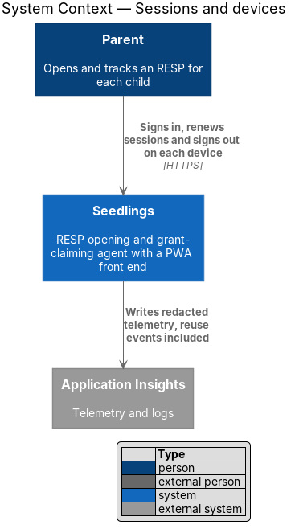
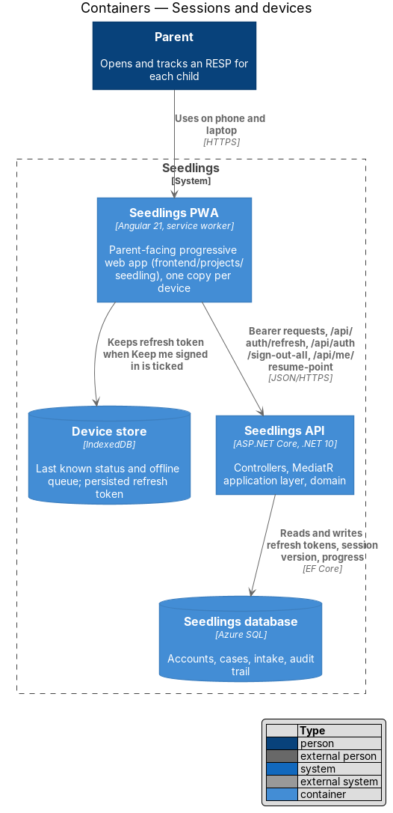
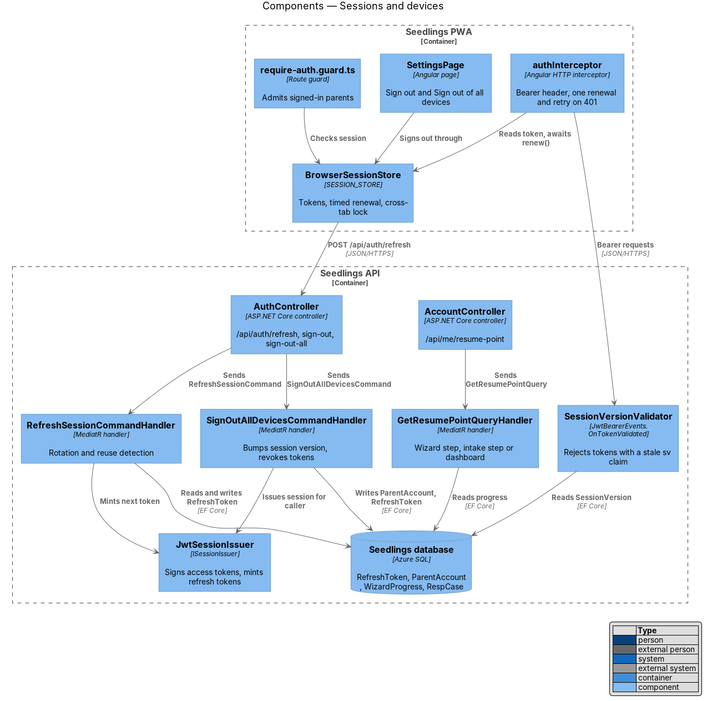
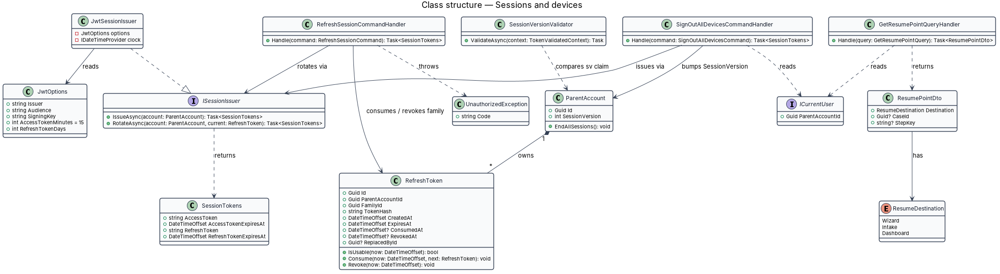
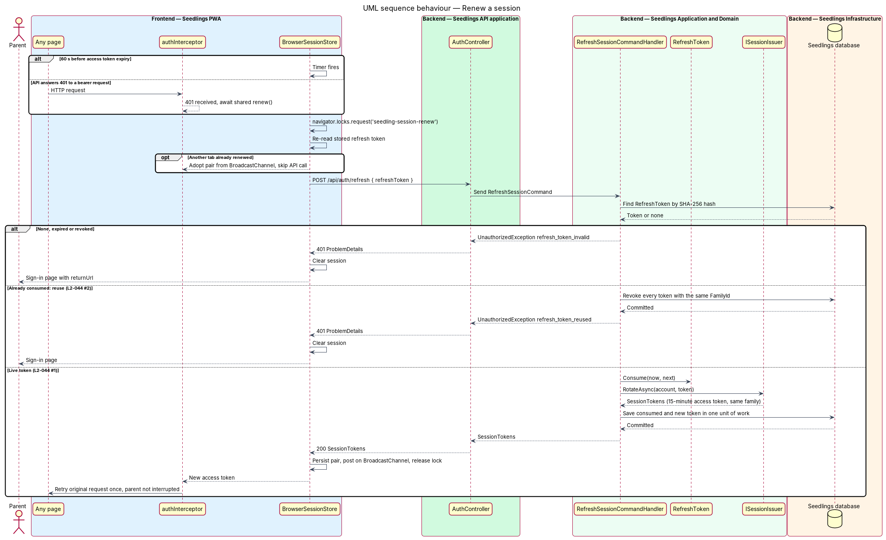
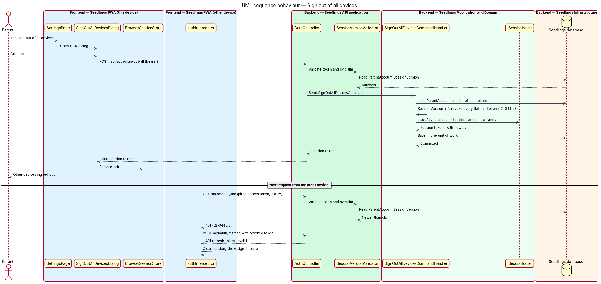
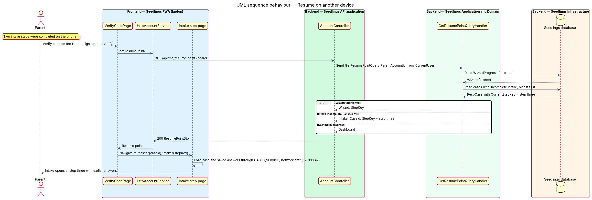

# Sessions and devices

## Overview

A parent uses Seedlings on more than one device: often a phone for photos of documents and a laptop
for reading forms. Each device holds its own session, and every session shows the same accounts,
cases and progress, because the server holds that state and devices only cache it.

This feature owns what happens after the sign-up-and-verify feature proves the parent's identity. It
issues sessions, renews them without interrupting the parent, detects a stolen refresh token, and
lets the parent sign out of every other device at once. It also tells a newly signed-in device where
the parent left off, so the intake resumes at the right step on a different device (`L2-008`).

Terms used below:

- **access token** — signed JSON Web Token (JWT) that authorizes API requests for 15 minutes
- **refresh token** — opaque random value that a device exchanges, once, for a new access token and
  a new refresh token
- **rotation** — replacement of a refresh token by a new one on every use
- **token family** — chain of refresh tokens that descend from one sign-in on one device, identified
  by `FamilyId`
- **reuse** — presentation of a refresh token that has already been exchanged; a signal that the
  token was copied
- **session version** — integer on `ParentAccount`, carried in every access token as the `sv` claim,
  that invalidates all outstanding access tokens when it changes
- **resume point** — the screen at which a signed-in parent continues: a wizard step, an intake
  step of one case, or the dashboard

## Description

### Frontend

The slice lives in the `api` library and the `seedling` application. It implements
`docs/mocks/pages/sign-in.html` (the Keep me signed in on this device checkbox) and
`docs/mocks/pages/settings.html` (the Sign out row). The settings mock has no Sign out of all devices
control and no confirmation dialog yet; that mock update is `<TO SUPPLY>` and precedes implementation
of slice 4.

- **`SESSION_STORE` / `SessionStore` / `BrowserSessionStore`**
  (`frontend/projects/api/src/lib/auth/session-store.ts`) — holds the access token in memory and
  exposes `isSignedIn` and `accessTokenExpiresAt` as signals. It persists the refresh token in
  IndexedDB when the parent ticks Keep me signed in on this device, and in `sessionStorage`
  otherwise. `renew()` exchanges the refresh token for a new pair.
- **Renewal timing** — `BrowserSessionStore` renews 60 seconds before `accessTokenExpiresAt`, so a
  request rarely meets an expired token (`L2-044` criterion 1).
- **Single renewal across tabs** — `renew()` runs inside `navigator.locks.request('seedling-session-renew')`.
  Inside the lock it re-reads the stored refresh token; when another tab already renewed, it adopts
  that pair instead of presenting the spent token. New pairs are announced on a `BroadcastChannel`
  named `seedling-session`. Without this guard, two tabs renewing at once would trip reuse detection
  and sign the parent out.
- **`authInterceptor`** (`frontend/projects/api/src/lib/auth/auth.interceptor.ts`) — attaches
  `Authorization: Bearer`. On a `401` from any endpoint other than `/api/auth/*`, it awaits one shared
  `renew()` and retries the request once. A second `401`, or a failed renewal, clears the store and
  routes to the sign-in page with the original URL as `returnUrl`.
- **`require-auth.guard.ts`** — admits a route when the store holds a session or renews one from a
  stored refresh token; otherwise it redirects to sign-in.
- **`AUTH_SERVICE`** (from sign-up-and-verify) gains `refresh`, `signOut` and `signOutAllDevices`.
  **`ACCOUNT_SERVICE` / `AccountService` / `HttpAccountService`** provides `getResumePoint()`.
- **`SettingsPage`** (`app-settings`, `pages/settings/settings.page.ts`) — the Sign out row calls
  `signOut`. The Sign out of all devices row opens **`SignOutAllDevicesDialog`**
  (`app/dialogs/sign-out-all-devices/`, CDK Dialog) and calls `signOutAllDevices` on confirmation.
- **Freshness** — case and progress reads go to the network first. The service worker data group for
  `/api/**` uses the `freshness` strategy, and the device store serves the last known copy only when
  offline (owned by web-experience/offline-status-and-queue). A change made on one device therefore
  shows on another the next time the case loads (`L2-008` criterion 2).

### API

| Method and route | Auth | Body | Success | Errors |
|---|---|---|---|---|
| `POST /api/auth/refresh` | refresh token only | `{ refreshToken }` | `200` `SessionTokens` | `401` `refresh_token_invalid`, `401` `refresh_token_reused` |
| `POST /api/auth/sign-out` | bearer | `{ refreshToken }` | `204` | — |
| `POST /api/auth/sign-out-all` | bearer | `{}` | `200` `SessionTokens` for the calling device | — |
| `GET /api/me/resume-point` | bearer | — | `200` `{ destination, caseId?, stepKey? }` | — |

`POST /api/auth/refresh` carries `[AllowAnonymous]` because the refresh token is its credential; the
design treats it as part of sign-in, one of the anonymous exceptions in `L2-045`. `SessionTokens` is
`{ accessToken, accessTokenExpiresAt, refreshToken, refreshTokenExpiresAt }`.

### Application and domain

- **`ISessionIssuer`** (Application port) and **`JwtSessionIssuer`**
  (`Seedling.Infrastructure/Authentication/`) — `IssueAsync(account)` starts a new token family.
  The access token is HMAC-SHA256 signed with `SEEDLING_JWT_SIGNING_KEY` and carries `sub`
  (`ParentAccountId`), `sv` (session version) and `role`. Issuer, audience and lifetime come from
  the existing `Seedling:Jwt` settings, where `AccessTokenMinutes` is 15. The refresh token is
  32 random bytes; only its SHA-256 hash is stored. The refresh-token lifetime is `<TO SUPPLY>`.
- **`RefreshSessionCommand`** and **`RefreshSessionCommandHandler`** — looks the token up by hash.
  An unknown, expired or revoked token yields `refresh_token_invalid`. A consumed token is reuse: the
  handler revokes every token in its family, commits, and yields `refresh_token_reused`
  (`L2-044` criterion 2). A live token is consumed and replaced by a new token in the same family.
- **`RefreshToken`** (domain entity) — `Consume(now)`, `Revoke(now)` and `IsUsable(now)` hold the
  rotation rules.
- **`SignOutCommand`** — revokes the family of the presented refresh token.
- **`SignOutAllDevicesCommand`** and handler — increments `ParentAccount.SessionVersion`, revokes
  every refresh token the parent holds, and issues a new session for the calling device, all in one
  unit of work (`L2-044` criterion 3).
- **`GetResumePointQuery`** and handler — reads `WizardProgress.CurrentStepKey` while the wizard is
  unfinished, otherwise the first `RespCase` whose intake is incomplete and its `CurrentStepKey`,
  otherwise the dashboard (`L2-008` criterion 1). Onboarding/stop-and-resume and
  intake/complete-intake-steps write those fields; this query only reads them.
- **`UnauthorizedException`** (`Seedling.Application.Exceptions`) — new exception carrying a `code`.
  `ExceptionHandlingMiddleware` gains one branch that maps it to `401` ProblemDetails.

### API host

- **`SessionVersionValidator`** (`Seedling.Api/Authentication/`) — runs in
  `JwtBearerEvents.OnTokenValidated`. It compares the `sv` claim with the current
  `ParentAccount.SessionVersion` through a primary-key read and fails the authentication on a
  mismatch. Every other device therefore receives `401` on its next request after Sign out of all
  devices, even with an unexpired access token, and its refresh token is already revoked.
- **Concurrent edits** — `RespCase` carries a `RowVersion` concurrency token. A write based on a
  stale copy yields `409` with code `case_changed`, and the PWA reloads the case.

### Data

| Entity | Fields used here |
|---|---|
| `RefreshToken` | `Id`, `ParentAccountId`, `FamilyId`, `TokenHash` (unique), `CreatedAt`, `ExpiresAt`, `ConsumedAt`, `RevokedAt`, `ReplacedById` |
| `ParentAccount` | `Id`, `SessionVersion` |
| `WizardProgress` | `ParentAccountId`, `CurrentStepKey`, `CompletedSteps` (read only) |
| `RespCase` | `Id`, `ParentAccountId`, `CurrentStepKey`, `RowVersion` (read only, apart from the concurrency token) |

`RefreshToken` carries indexes on `FamilyId` and on `ParentAccountId`. The purge period for expired
and revoked tokens is `<TO SUPPLY>`.

### Decisions to record

AGENTS.md requires an ADR before the auth flow changes. An ADR (number `<TO SUPPLY>`) should record
three choices made here: refresh tokens travel in the response body because the PWA and the API sit
on different origins, refresh tokens rotate with family revocation on reuse, and access tokens are
checked against the session version on every request.

### Implementation slices

1. **Issue a session** — `JwtSessionIssuer`, JWT bearer registration and the fallback policy in
   `Program.cs`, and `SESSION_STORE` holding the pair. Prerequisite for every other slice.
2. **Silent renewal** — `POST /api/auth/refresh`, rotation, `authInterceptor` retry, timed renewal
   and the cross-tab lock. Covers `L2-044` criterion 1.
3. **Reuse detection** — family revocation on a consumed token. Covers `L2-044` criterion 2.
4. **Sign out of all devices** — mock update, `SignOutAllDevicesDialog`, session version check.
   Covers `L2-044` criterion 3.
5. **Resume on another device** — `GET /api/me/resume-point` and post-sign-in navigation. Covers
   `L2-008` criterion 1.
6. **Fresh case on the second device** — network-first reads and the `case_changed` conflict.
   Covers `L2-008` criterion 2.

## Requirements

| L2 ID | Refines (L1) | Requirement |
|-------|--------------|-------------|
| `L2-008` | `L1-005` | A signed-in parent shall see the same cases and progress on any device. |
| `L2-044` | `L1-005` | Sessions shall use short-lived access tokens with rotating refresh tokens, and shall be revocable. |

## Diagrams

### System context

Sessions involve only the parent and Seedlings; no external system takes part in issuing or
renewing tokens.

### Containers

Each device runs its own copy of the PWA, with a device store for the refresh token. The Seedlings
API and the Seedlings database hold the authoritative sessions and progress.

### Components

`AuthController` handles refresh and sign-out, `AccountController` answers the resume point, and
`SessionVersionValidator` checks every bearer token against the account's session version.

### Class structure

`ParentAccount` owns many `RefreshToken` rows grouped by `FamilyId`. The refresh handler applies
rotation on the entity, and `JwtSessionIssuer` realizes `ISessionIssuer`.

### Behaviour — renew a session

The PWA renews under a cross-tab lock. The API rotates a live token, and revokes the whole family
when a spent token comes back.

### Behaviour — sign out of all devices

The calling device keeps a fresh session. Every other device fails the session version check on its
next request and cannot renew.

### Behaviour — resume on another device

After sign-in on a second device, the PWA asks for the resume point and opens the step the parent
reached on the first device.

