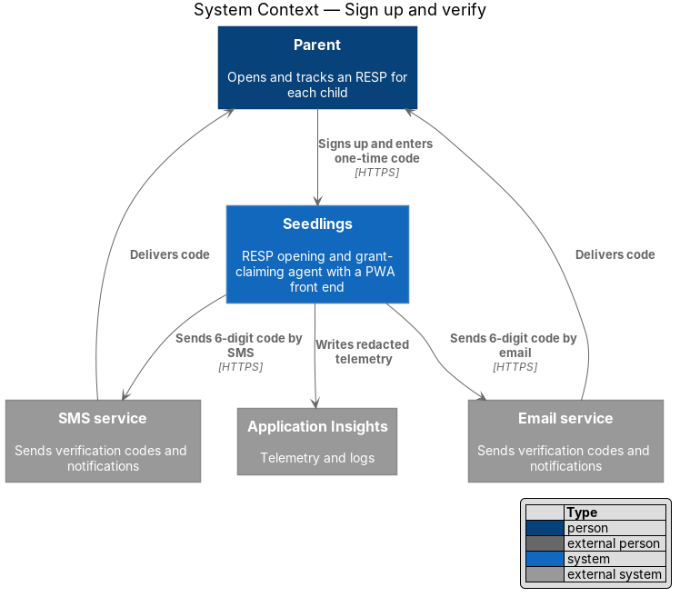
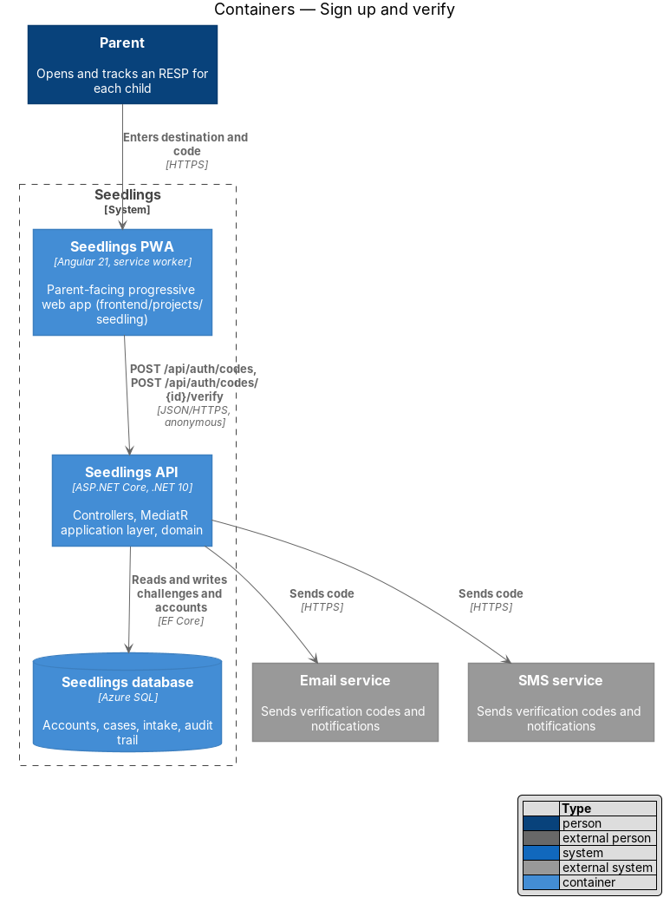
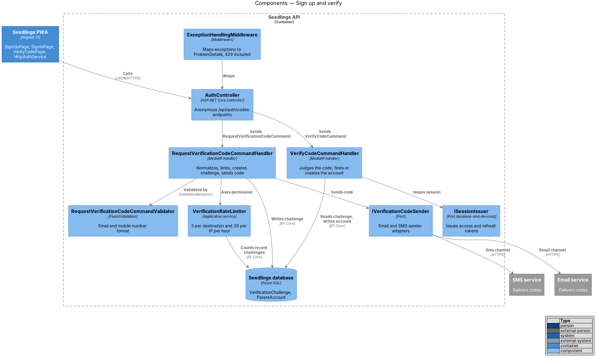
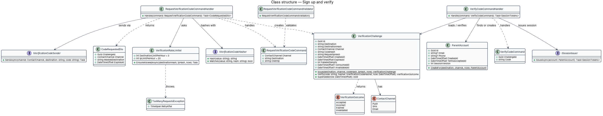
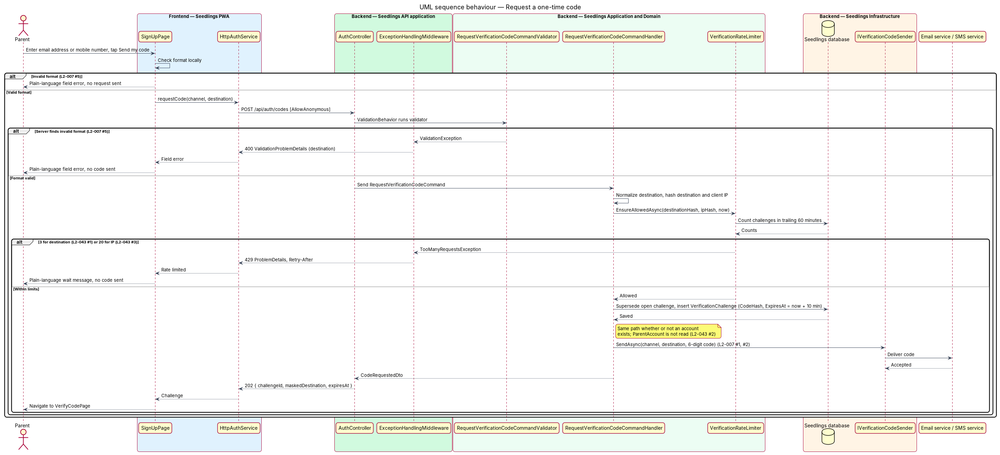
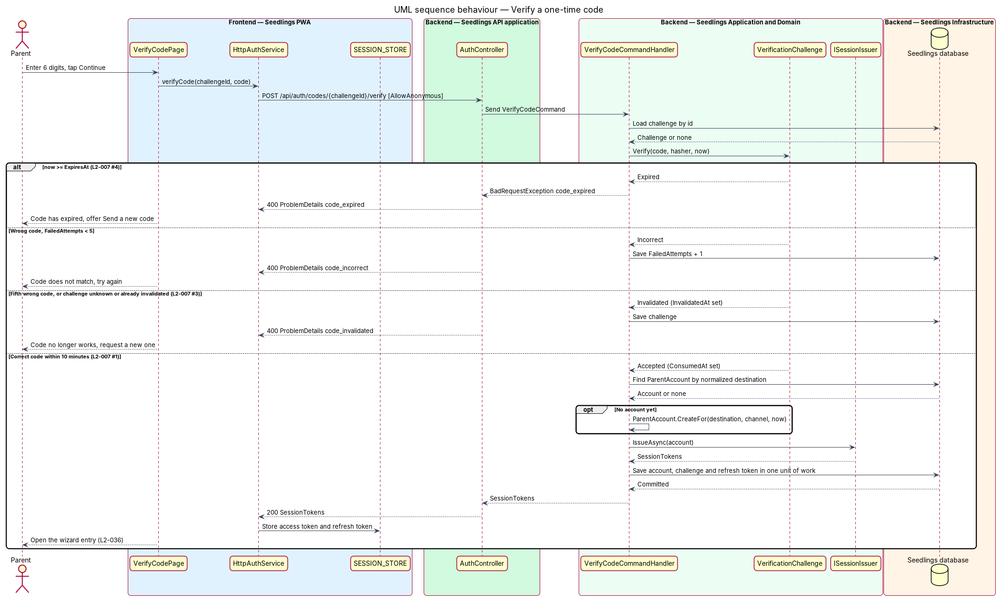

# Sign up and verify

## Overview

Seedlings is an installable progressive web app (PWA) through which a parent asks an agent to open a
Registered Education Savings Plan (RESP) for each child and to claim the Canada Learning Bond (CLB)
and the Canada Education Savings Grant (CESG). Every case belongs to a parent account, so the first
thing a parent does is prove control of an email address or a mobile number.

This feature is the front door of the identity-and-access subsystem. It has no passwords. The parent
enters an email address or a mobile number, receives a 6-digit one-time code, and enters it. A correct
code within 10 minutes creates the account (or signs in to the existing one) and starts a session.
The sessions-and-devices feature owns everything after that first session is issued.

The same flow serves both the sign-up screen and the sign-in screen. The API does not distinguish
them, which is how the response to a known address stays identical to the response to a new address
(`L2-043`). The flow is also rate limited per address and per IP address, so it cannot be used to
flood a parent with messages or to guess codes.

Terms used below:

- **verification challenge** — one issued one-time code, bound to one destination, with an expiry and
  a count of failed attempts
- **destination** — the normalized email address or mobile number a code is sent to
- **channel** — the delivery route of a code, either `Email` or `Sms`
- **one-time code** — 6-digit decimal number, valid for 10 minutes, accepted at most once
- **session** — the pair of a short-lived access token and a rotating refresh token, issued after a
  successful verification

## Description

### Frontend

The slice lives in the `seedling` application and implements three mocks: `docs/mocks/pages/sign-up.html`,
`docs/mocks/pages/sign-in.html` and `docs/mocks/pages/verify-code.html`.

- **`SignUpPage`** (`app-sign-up`, `frontend/projects/seedling/src/app/pages/sign-up/sign-up.page.ts`)
  — offers the Email and Mobile number segments, one destination field, the terms checkbox and the
  Send my code button. It validates the format locally and sends no request while the format is
  invalid (`L2-007` criterion 5).
- **`SignInPage`** (`app-sign-in`, `pages/sign-in/sign-in.page.ts`) — the same request with sign-in
  copy and the Keep me signed in on this device checkbox. The checkbox value passes to the session
  store as the `persist` flag described in the sessions-and-devices design.
- **`VerifyCodePage`** (`app-verify-code`, `pages/verify-code/verify-code.page.ts`) — shows the
  masked destination, six digit inputs, the Continue button and the send-a-new-code control. It maps
  each error `code` in the ProblemDetails body to plain-language copy: `code_incorrect`,
  `code_expired` (with the send-a-new-code action, `L2-007` criterion 4) and `code_invalidated`.
  On success it hands the tokens to `SESSION_STORE` and navigates to the resume point defined in the
  sessions-and-devices design. A new account resumes at the wizard entry owned by
  onboarding/start-wizard (`L2-036`).
- **`AUTH_SERVICE` / `AuthService` / `HttpAuthService`** (`frontend/projects/api/src/lib/services/auth.service.ts`)
  — `requestCode(channel, destination)` and `verifyCode(challengeId, code)`. Pages inject the token;
  `app.config.ts` binds the class.
- **`require-anonymous.guard.ts`** (`frontend/projects/api/src/lib/auth/`) — keeps a signed-in parent
  off the three screens and sends them to the dashboard.
- **Design-system components** — `sl-segments` (`Segments`), `sl-field` (`Field`), `sl-otp`
  (`Otp`, six digit inputs with `aria-label="Digit n of 6"` as in the mock) and `sl-button`
  (`Button`), all from `frontend/projects/components`. The pages keep the mock's BEM classes
  (`auth`, `segments__tab`, `otp__digit`) so e2e page objects anchor on them.

### API

Both endpoints sit on `AuthController` (`backend/src/Seedling.Api/Controllers/AuthController.cs`), carry
`[AllowAnonymous]` and dispatch one MediatR command each. The controller holds no rules.

| Method and route | Body | Success | Errors |
|---|---|---|---|
| `POST /api/auth/codes` | `{ channel, destination }` | `202` `{ challengeId, channel, maskedDestination, expiresAt }` | `400` validation, `429` rate limit |
| `POST /api/auth/codes/{challengeId}/verify` | `{ code }` | `200` `SessionTokens` | `400` with `code` = `code_incorrect`, `code_expired` or `code_invalidated` |

The `202` response for a known destination has the same status, headers and body shape as the
response for a new destination, and the handler runs the same code path for both (`L2-043`
criterion 2). An unknown or foreign `challengeId` returns `code_invalidated`, not `404`, so
challenge identifiers cannot be probed.

### Application and domain

- **`RequestVerificationCodeCommand`** (`Channel`, `Destination`, `ClientIp`) and
  **`RequestVerificationCodeCommandValidator`** (FluentValidation, run by the existing
  `ValidationBehavior`) — the validator rejects a malformed email address or a mobile number that does
  not normalize to a 10-digit North American number. The `400` `ValidationProblemDetails` carries one
  plain-language message keyed on `destination`. Whether non-Canadian numbers are accepted is
  `<TO SUPPLY>`.
- **`RequestVerificationCodeCommandHandler`** — normalizes the destination (email trimmed and
  lower-cased, mobile number in E.164 form), asks `VerificationRateLimiter` for permission, supersedes
  any open challenge for the same destination, creates a `VerificationChallenge`, and calls
  `IVerificationCodeSender`. It runs the same path whether or not a `ParentAccount` exists for the
  destination; it never reads `ParentAccount` at all.
- **`VerificationRateLimiter`** — counts `VerificationChallenge` rows created in the trailing 60
  minutes. Three rows for the same `DestinationHash` (`L2-043` criterion 1) or 20 rows for the same
  `RequestIpHash` (`L2-043` criterion 3) block the request with `TooManyRequestsException`. Counting
  rows in the database keeps the limit correct when the API runs on more than one instance.
- **`VerifyCodeCommand`** (`ChallengeId`, `Code`) and **`VerifyCodeCommandHandler`** — loads the
  challenge and lets the entity judge the attempt. A correct code finds the `ParentAccount` by
  destination or creates it (`L2-007` criterion 1), then calls `ISessionIssuer.IssueAsync` from the
  sessions-and-devices design. Account creation and challenge consumption commit in one unit of work.
- **`VerificationChallenge`** (domain entity) — `Verify(code, hasher, now)` returns `Accepted`,
  `Incorrect`, `Expired` or `Invalidated`. It rejects any attempt at or after `ExpiresAt` (10 minutes
  after creation, `L2-007` criterion 4). It increments `FailedAttempts` on a wrong code and sets
  `InvalidatedAt` on the fifth failure (`L2-007` criterion 3).
- **`IVerificationCodeHasher`** — HMAC-SHA256 over the code with a server key, so a database read
  alone does not reveal codes. The key's configuration name and rotation policy are `<TO SUPPLY>`.
  The same hasher produces `DestinationHash` and `RequestIpHash`.
- **`TooManyRequestsException`** (`Seedling.Application.Exceptions`) — new exception. The existing
  `ExceptionHandlingMiddleware` gains one branch that maps it to `429` ProblemDetails with a
  `Retry-After` header.

### Infrastructure

- **`IVerificationCodeSender`** port, implemented by `EmailVerificationCodeSender`
  (`Seedling.Infrastructure/Email/`) and `SmsVerificationCodeSender` (`Seedling.Infrastructure/Sms/`).
  Both providers are `<TO SUPPLY>`. The message text and the language selection rule are
  `<TO SUPPLY>`.
- **Client IP** — the API reads the client address after `ForwardedHeaders` processing, because App
  Service terminates TLS in front of it.
- **Logging** — destinations and codes are never written to logs (`L2-047`); log entries carry the
  challenge identifier only.

### Data

| Entity | Fields used here |
|---|---|
| `VerificationChallenge` | `Id`, `Destination`, `DestinationHash`, `Channel`, `CodeHash`, `RequestIpHash`, `CreatedAt`, `ExpiresAt`, `FailedAttempts`, `ConsumedAt`, `InvalidatedAt` |
| `ParentAccount` | `Id`, `Email?`, `Phone?`, `CreatedAt`, `TermsAcceptedAt` (unique indexes on `Email` and `Phone`) |

`VerificationChallenge` carries an index on (`DestinationHash`, `CreatedAt`) and on (`RequestIpHash`,
`CreatedAt`) for the rate-limit counts. The retention period for spent challenges is `<TO SUPPLY>`.
The resend countdown shown on the verify-code mock has no stated duration in the specifications; its
value is `<TO SUPPLY>`.

### Implementation slices

1. **Request a code by email** — `POST /api/auth/codes` with the email channel, a fake
   `IVerificationCodeSender` in tests, and `SignUpPage`. Covers `L2-007` criteria 1 (send) and 5.
2. **Verify and create the account** — `POST /api/auth/codes/{id}/verify`, account creation, session
   issue, and `VerifyCodePage`. Covers `L2-007` criterion 1 (create within 10 minutes).
3. **Expiry and attempt limit** — the `Expired` and `Invalidated` outcomes and their copy. Covers
   `L2-007` criteria 3 and 4.
4. **Mobile channel** — E.164 normalization and `SmsVerificationCodeSender`. Covers `L2-007`
   criterion 2.
5. **Identical response for known addresses** — an existing account follows the same path, and
   verification signs in to it; `SignInPage` reuses the flow. Covers `L2-043` criterion 2.
6. **Rate limits** — `VerificationRateLimiter`, `TooManyRequestsException` and the `429` mapping.
   Covers `L2-043` criteria 1 and 3.

## Requirements

| L2 ID | Refines (L1) | Requirement |
|-------|--------------|-------------|
| `L2-007` | `L1-005` | A parent shall sign up with an email address or a mobile number and verify it with a one-time code. |
| `L2-043` | `L1-005` | Sending and checking one-time codes shall be rate limited and shall not reveal whether an account exists. |

## Diagrams

### System context

The parent signs up through Seedlings, which delivers the one-time code through the email service or
the SMS service, depending on the channel the parent picks.

### Containers

The PWA calls two anonymous endpoints on the Seedlings API. The API stores challenges and accounts in
the Seedlings database and hands codes to the external senders.

### Components

`AuthController` dispatches two commands. The request handler consults `VerificationRateLimiter` before
any code is created, and the verify handler delegates session creation to `ISessionIssuer`.

### Class structure

`VerificationChallenge` owns the verification rules and returns a `VerificationOutcome`. Both handlers
depend on `IVerificationCodeHasher`, and only the verify handler touches `ParentAccount`.

### Behaviour — request a code

Format validation runs first, so an invalid destination sends nothing. The rate limiter runs next,
and the handler takes the same path for known and new destinations.

### Behaviour — verify a code

The challenge judges the attempt: expired, incorrect, invalidated on the fifth failure, or accepted.
Only an accepted code creates or loads the account and issues a session.

