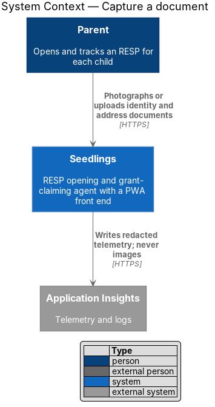
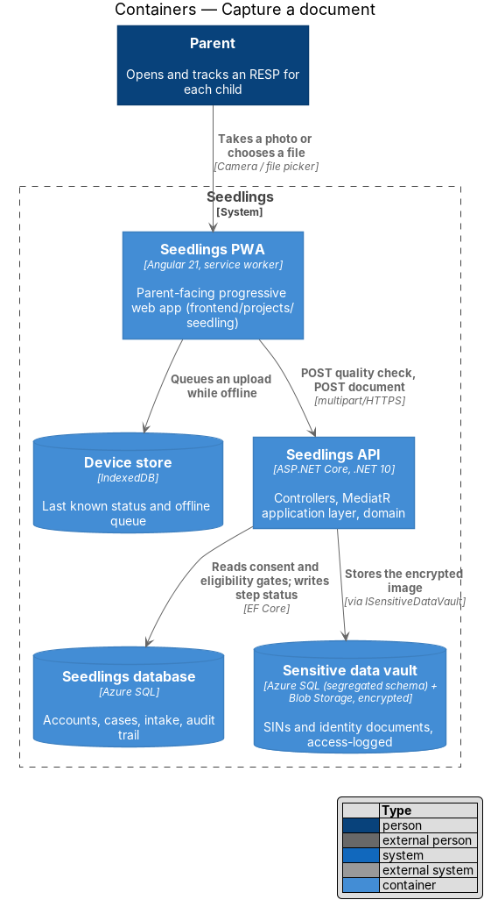
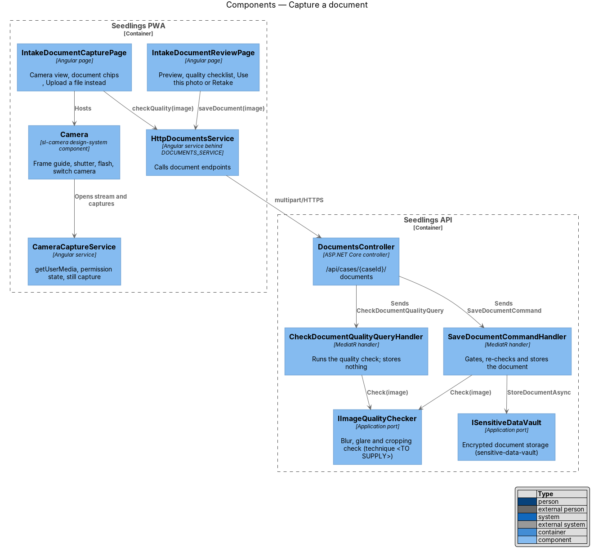
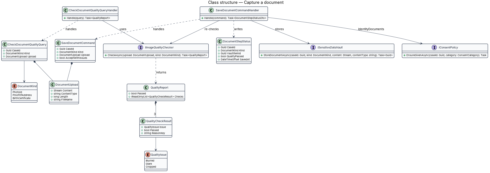
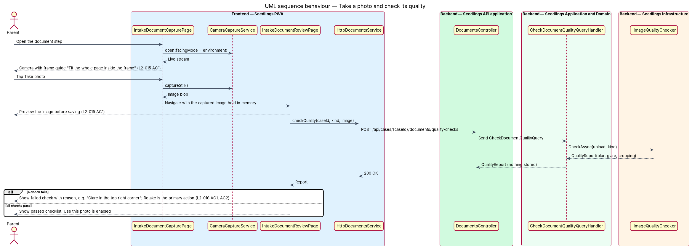
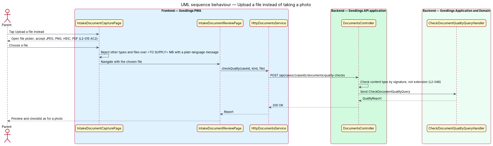
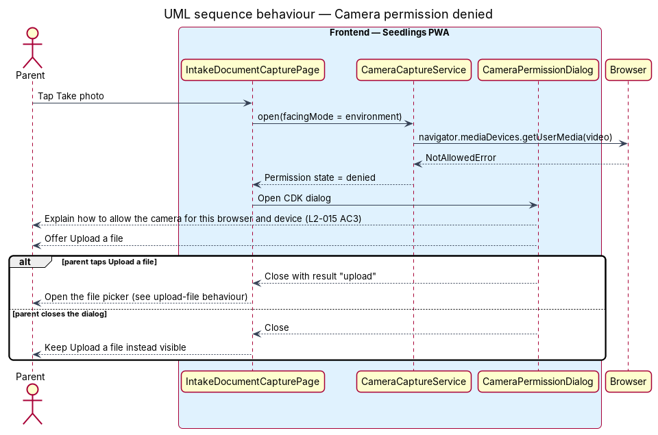
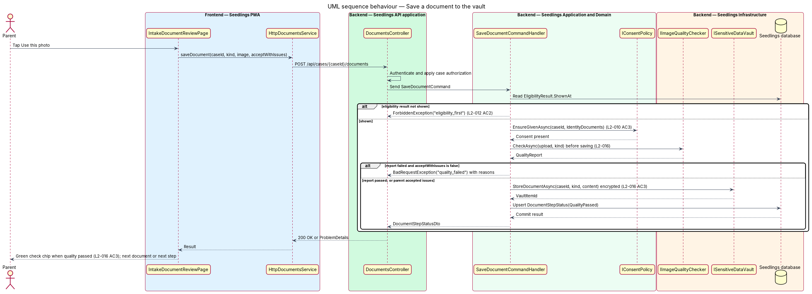

# Capture a document

## Overview

To open a Registered Education Savings Plan (RESP), the RESP provider confirms the parent's identity
and address from documents. Seedlings collects those documents as photos or files at the end of the
intake, after the answer steps in [complete-intake-steps](../complete-intake-steps/README.md). The
mocks number these screens "Your details · 9 of 10" (capture) and "10 of 10" (review).

This feature lets the parent photograph a document with the device camera or choose a file, checks
the image for blur, glare and cropping before it is saved, and asks for a retake with the reason
stated when a check fails. A saved document goes, encrypted, to the
[sensitive data vault](../../privacy-and-security/sensitive-data-vault/README.md); this design does
not redesign that store.

- **document kind** — type of document a step asks for, such as photo ID or proof of address
- **frame guide** — outline drawn over the camera view that shows where the document should sit
- **quality check** — automatic test of one image for blur, glare and cropping
- **quality report** — result of a quality check: one pass or fail per issue, each with a plain-language reason
- **retake** — new capture of the same document after a failed check

The mocks show two documents: a photo ID (a driver's licence) and a proof of address (a utility,
phone or bank statement from the last 3 months). L2-015 AC1 refers to a birth certificate step that
no mock shows; whether the birth certificate is a required capture is `<TO SUPPLY>`. Capture
behaves the same for every kind.

## Description

### Frontend

- **`IntakeDocumentCapturePage`** (`app-intake-document-capture`,
  `frontend/projects/seedling/src/app/pages/intake-document-capture/`) implements
  `intake.document-capture.html`. It shows the document title and lede, the camera, one chip per
  required document (green check when saved, camera icon when outstanding) and "Upload a file
  instead". The file input accepts `image/jpeg`, `image/png`, `image/heic`, `image/heif` and
  `application/pdf`.
- **`IntakeDocumentReviewPage`** (`app-intake-document-review`) implements
  `intake.document-review.html`. It previews the captured image, requests the quality report and
  lists each check with a pass or fail icon. When a check fails, "Retake photo" is the primary
  action and the failed check names the reason.
- **`Camera`** (`sl-camera`, `frontend/projects/components/src/lib/camera/`) is a new design-system
  component. It renders the video stream, the frame guide, the hint text, and the flash, shutter and
  switch-camera buttons with the mock's BEM classes and accessible names ("Take photo", "Turn on the
  flash", "Switch camera").
- **`QualityChecklist`** (`sl-quality-checklist`) renders the mock's `quality` list with
  `quality__item--pass` and `quality__item--fail` states.
- **`CameraCaptureService`** (`app/shared/camera/`) wraps `navigator.mediaDevices.getUserMedia`
  with `facingMode: "environment"`, exposes the permission state as a signal and captures a still
  frame to a `Blob`. A `NotAllowedError` sets the state to `denied`.
- **`CameraPermissionDialog`** (`app/dialogs/camera-permission/`) is a CDK dialog. It explains how to
  allow the camera and offers "Upload a file". The per-browser instructions text is `<TO SUPPLY>`.
- **`CapturedDocumentStore`** (`app/shared/camera/`) holds the captured image in memory between the
  capture and review pages. Images are not written to the device store, except as queued uploads
  owned by [offline-status-and-queue](../../web-experience/offline-status-and-queue/README.md).
- **`DocumentsService`** interface, **`DOCUMENTS_SERVICE`** token and **`HttpDocumentsService`**
  (`frontend/projects/api/src/lib/services/documents/`) post the image as `multipart/form-data`.

### Backend

- **`DocumentKind`** (`Seedling.Domain/Enums/`) has `PhotoId`, `ProofOfAddress` and
  `BirthCertificate` (pending the `<TO SUPPLY>` decision above).
- **`DocumentsController`** (`Seedling.Api/Controllers/`) exposes the endpoints below with
  authentication and [case-authorization](../../identity-and-access/case-authorization/README.md).
  It checks the content type from the file signature and the size limit before dispatch
  ([input-validation](../../privacy-and-security/input-validation/README.md)). The size limit is
  `<TO SUPPLY>`.
- **`IImageQualityChecker`** (`Seedling.Application/Abstractions/`) returns a **`QualityReport`**
  with one **`QualityCheckResult`** per **`QualityIssue`** (`Blurred`, `Glare`, `Cropped`) and a
  reason resource key. The implementation lives in `Seedling.Infrastructure/ImageQuality/`. The
  detection technique and its thresholds are `<TO SUPPLY>`, as is how a PDF or HEIC file is rendered
  for checking.
- **`CheckDocumentQualityQuery`** / **`CheckDocumentQualityQueryHandler`** run the checker and return
  the report. They store nothing, so the image is checked before it is saved (L2-016).
- **`SaveDocumentCommand`** / **`SaveDocumentCommandHandler`** carry `CaseId`, `Kind`, the upload and
  `AcceptWithIssues`. The handler:
  1. rejects with `403` code `eligibility_first` until the case's eligibility result has been shown (L2-012);
  2. calls `IConsentPolicy.EnsureGivenAsync(caseId, IdentityDocuments)` ([give-consent](../give-consent/README.md));
  3. re-runs the quality check, because the API does not trust a report held by the client;
  4. rejects a failed image with `400` code `quality_failed` unless `AcceptWithIssues` is true;
  5. stores the image through `ISensitiveDataVault.StoreDocumentAsync`, which encrypts it, logs the access and returns a vault item id;
  6. upserts **`DocumentStepStatus`** (`CaseId`, `Kind`, `VaultItemId`, `QualityPassed`, `SavedAt`) in the Seedlings database.
- Retention and deletion 30 days after the account opens belong to
  [document-retention](../../privacy-and-security/document-retention/README.md).

The review mock offers "Use this photo" beside "Retake photo" even when glare is found. The design
keeps that choice: an image saved with a failed check records `QualityPassed = false`, shows a
warning chip instead of the green check, and is visible to the agent and reviewer. Whether such an
image should route the case to a human reviewer is `<TO SUPPLY>`.

### API

| Method and path | Body | Result |
|---|---|---|
| `POST /api/cases/{caseId}/documents/quality-checks` | multipart: `kind`, `file` | `200` `QualityReport` |
| `POST /api/cases/{caseId}/documents` | multipart: `kind`, `file`, `acceptWithIssues` | `200` `DocumentStepStatusDto`; `400` `quality_failed`; `403` `eligibility_first` or `consent_required` |
| `GET /api/cases/{caseId}/documents` | none | `200` list of `DocumentStepStatusDto` (no image content) |

Re-posting a document for the same kind replaces the vault item and returns the new status, so a
retry does not duplicate it.

### Implementation slices

1. **Upload a file** — file picker with the four accepted types, `SaveDocumentCommand` through the
   vault port, green check chip; covers L2-015 AC2 and L2-016 AC3.
2. **Take a photo** — `sl-camera`, `CameraCaptureService`, preview on the review page; covers L2-015 AC1.
3. **Camera permission denied** — `CameraPermissionDialog` with the upload alternative; covers L2-015 AC3.
4. **Quality check and retake** — `IImageQualityChecker` port with a `<TO SUPPLY>` implementation,
   quality-check endpoint, checklist with reasons; covers L2-016 AC1 and AC2.
5. **Gates** — eligibility-first and consent checks on save; covers the document parts of L2-012 AC2
   and L2-010 AC3.

## Requirements

| L2 ID | Refines (L1) | Requirement |
|-------|--------------|-------------|
| `L2-015` | `L1-009` | Documents shall be captured through the device camera or the file picker. |
| `L2-016` | `L1-009` | Each captured image shall be checked for blur, glare and cropping before it is saved. |

## Diagrams

### System context

The parent supplies documents to Seedlings. No document leaves Seedlings in this feature, and
telemetry never carries image content.

### Containers

The PWA posts images to the API, which reads its gates from the Seedlings database and stores each
accepted image, encrypted, in the sensitive data vault.

### Components

Two pages share `HttpDocumentsService`. In the API, one handler only checks quality and the other
gates, re-checks and stores through the vault port.

### Class structure

A `QualityReport` holds three `QualityCheckResult` entries, one per `QualityIssue`.
`SaveDocumentCommandHandler` depends on the consent, quality and vault ports and writes
`DocumentStepStatus`.

### Behaviour — take a photo and check it

The camera opens with a frame guide, the capture is previewed, and the quality report decides
whether Retake or Use this photo is the primary action.

### Behaviour — upload a file

The file picker accepts JPEG, PNG, HEIC and PDF. The API checks the real content type before
checking quality.

### Behaviour — camera permission denied

A denied camera opens a dialog that explains how to allow it and offers Upload a file instead.

### Behaviour — save a document

The save re-runs the quality check, then stores the image encrypted in the vault and shows a green
check when every check passed.

