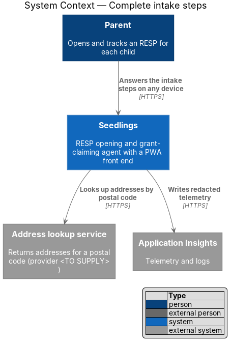
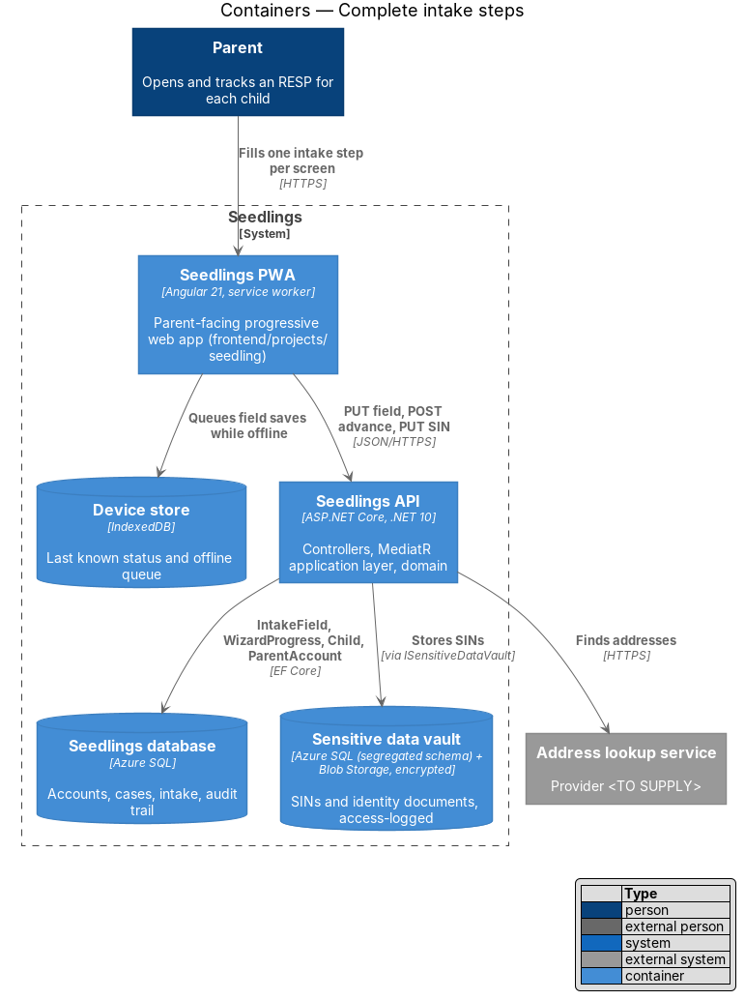
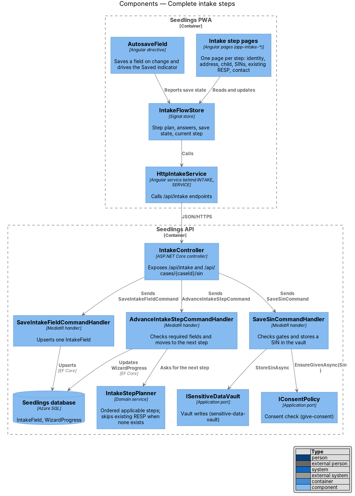
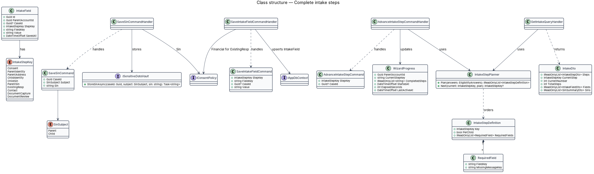
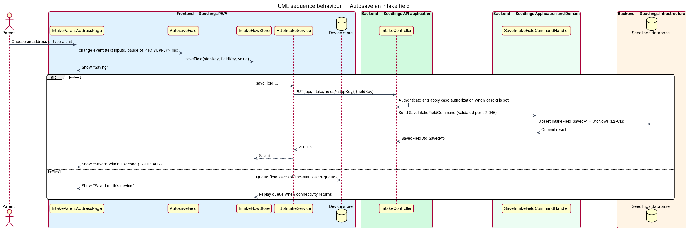
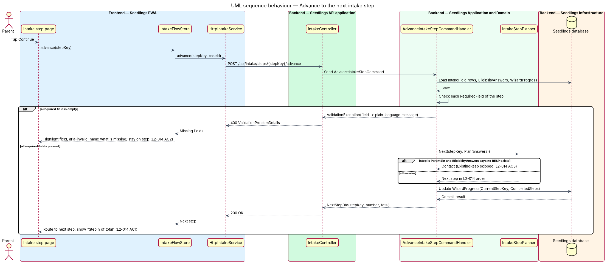
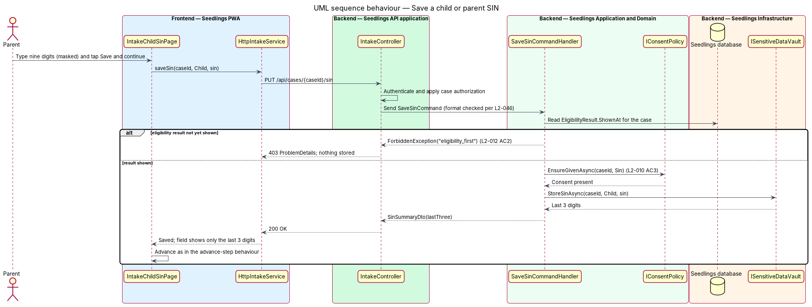
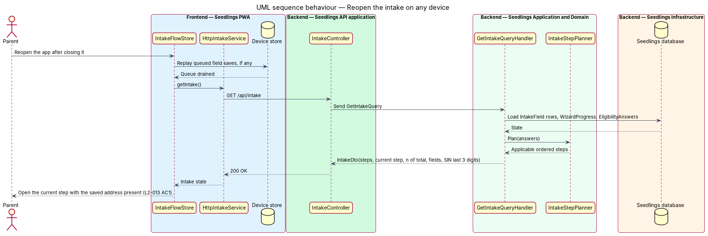

# Complete intake steps

## Overview

Seedlings opens a Registered Education Savings Plan (RESP) for each child and claims the Canada
Learning Bond (CLB) and Canada Education Savings Grant (CESG). After the onboarding wizard shows the
eligibility result, the parent continues into the intake. The intake collects the details that the
RESP provider and Employment and Social Development Canada (ESDC) need, one step per screen, within
the same roadmap as the wizard ([wizard-roadmap](../../onboarding/wizard-roadmap/README.md)).

This feature covers the answer steps of the intake. Each field saves as soon as it changes, so a
parent can close the app and find the answer present on any device. Each step checks its required
fields before it advances, and the existing-RESP step drops out when the parent already said no RESP
exists.

- **intake** — ordered sequence of steps that collects the details needed to open an RESP and claim the bond
- **intake step** — one screen of the intake with its own fields and required fields
- **intake field** — one saved, non-sensitive answer on an intake step, such as a postal code
- **step plan** — ordered list of intake steps that apply to the parent, after skips
- **autosave** — save of a single field triggered by its change, without a separate save action

The mocks number the intake "Your details · n of 10". This feature owns steps 2 to 8. Step 1 is
[give-consent](../give-consent/README.md); steps 9 and 10 are
[capture-document](../capture-document/README.md).

| # | Step key | Mock | Collects |
|---|---|---|---|
| 1 | `Consent` | `intake.consent.html` | Consent (give-consent) |
| 2 | `ParentIdentity` | `intake.parent-identity.html` | Legal first, middle and last name, date of birth |
| 3 | `ParentAddress` | `intake.parent-address.html` | Postal code, chosen address or manual address, unit |
| 4 | `ChildIdentity` | `intake.child-identity.html` | Confirms the child's legal name, date of birth, province of birth, relationship, who the child lives with; repeats per child |
| 5 | `ChildSin` | `intake.child-sin.html` | Child SIN, masked; repeats per child |
| 6 | `ParentSin` | `intake.parent-sin.html` | Parent SIN, masked |
| 7 | `ExistingResp` | `intake.existing-resp.html` | Whether an RESP exists, who holds it, its name and number |
| 8 | `Contact` | `intake.contact.html` | Preferred contact channel: push, SMS or email |
| 9–10 | `DocumentCapture`, `DocumentReview` | `intake.document-*.html` | Documents (capture-document) |

## Description

### Frontend

- **Intake step pages** (`frontend/projects/seedling/src/app/pages/intake-*/`), one routed page per
  mock: `IntakeParentIdentityPage` (`app-intake-parent-identity`), `IntakeParentAddressPage`,
  `IntakeChildIdentityPage`, `IntakeChildSinPage`, `IntakeParentSinPage`, `IntakeExistingRespPage`
  and `IntakeContactPage`. Routes are `/intake/<step>`; per-child steps take `/intake/<step>/:caseId`.
  Each page shows the step eyebrow (for example "Your details · 4 of 10 · Maya"), the roadmap bar
  and the `sl-roadmap` aside from wizard-roadmap, and a Continue action.
- **`IntakeFlowStore`** (`app/shared/intake/intake-flow.store.ts`) is a signal store holding the
  step plan, the current step, `currentNumber` and `totalSteps`, saved field values and per-field
  save state. It loads from `GET /api/intake` on entry.
- **`AutosaveField`** (`[appAutosave]`, `app/shared/intake/autosave-field.directive.ts`) binds a
  form control to a field key. It saves on the control's `change` event. Text inputs also save after
  typing pauses; the pause length is `<TO SUPPLY>`. While offline the save goes to the device-store
  queue owned by [offline-status-and-queue](../../web-experience/offline-status-and-queue/README.md).
- **`SaveStatus`** (`sl-save-status`, `frontend/projects/components/src/lib/save-status/`) is a new
  design-system component that announces "Saving", "Saved" or "Saved on this device" through an
  `aria-live="polite"` region.
- **`Field`** (`sl-field`) renders the label, hint and error message. A failed advance sets
  `aria-invalid="true"` on each missing control and shows the server's plain-language message.
- **`EditChildDetailDialog`** (`app/dialogs/edit-child-detail/`) is the CDK dialog that each Edit
  button on the child-identity step opens; edits to name, date of birth and relationship update the
  `Child` record through [add-child](../../eligibility/add-child/README.md), and the province of
  birth and living arrangement save as intake fields.
- **`MaskedInput`** (`sl-masked-input`) renders the SIN input as `type="password"` with a Show
  toggle, as in the mocks. After saving it shows only the last 3 digits
  ([sensitive-data-vault](../../privacy-and-security/sensitive-data-vault/README.md), L2-032).
- **`IntakeService`** interface, **`INTAKE_SERVICE`** token and **`HttpIntakeService`**
  (`frontend/projects/api/src/lib/services/intake/`) wrap the endpoints below.

### Backend

- **`IntakeField`** (`Seedling.Domain/Entities/`) holds `Id`, `ParentAccountId`, `CaseId`,
  `StepKey`, `FieldKey`, `Value` and `SavedAt`. `CaseId` is null for parent-level steps (identity,
  address, contact) and set for per-child steps (child identity, existing RESP). A unique index on
  (`ParentAccountId`, `CaseId`, `StepKey`, `FieldKey`) makes each save an upsert. SINs are never
  intake fields.
- **`IntakeStepKey`** (`Seedling.Domain/Enums/`) lists the ten steps in L2-014 order.
- **`IntakeStepCatalog`** (`Seedling.Application/Intake/`) defines each **`IntakeStepDefinition`**:
  its key, whether it repeats per child, and its **`RequiredField`** list with a message resource key
  per field, such as "Enter your legal last name".
- **`IntakeStepPlanner`** (`Seedling.Domain/Services/`) is a deterministic domain service.
  `Plan(answers)` returns the applicable steps in L2-014 order and omits `ExistingResp` when
  `EligibilityAnswers` records that no RESP exists. `Next(current, plan)` returns the following step.
  The total shown to the parent is the count of the plan, so a skip lowers the total by 1.
- **`IntakeController`** (`Seedling.Api/Controllers/`) exposes the endpoints below. All require
  authentication; per-case routes apply [case-authorization](../../identity-and-access/case-authorization/README.md).
- **`SaveIntakeFieldCommand`** / **`SaveIntakeFieldCommandHandler`** validate the value
  ([input-validation](../../privacy-and-security/input-validation/README.md)) and upsert the field
  with `SavedAt` from `IDateTimeProvider`. For `ExistingResp` fields the handler first calls
  `IConsentPolicy.EnsureGivenAsync(caseId, Financial)`.
- **`AdvanceIntakeStepCommand`** / **`AdvanceIntakeStepCommandHandler`** check each required field
  of the step. A missing field raises the existing `ValidationException`, which
  `ExceptionHandlingMiddleware` turns into `400` `ValidationProblemDetails` keyed by field. On
  success the handler asks the planner for the next step and updates `WizardProgress`
  (`CurrentStepKey`, `CompletedSteps`, `LastActiveAt`), which
  [stop-and-resume](../../onboarding/stop-and-resume/README.md) reads. Advancing `Contact` also
  copies the chosen channel to `ParentAccount.ContactChannel`
  ([notification-channels](../../account-care/notification-channels/README.md)).
- **`SaveSinCommand`** / **`SaveSinCommandHandler`** carry `CaseId`, `Subject` (`SinSubject {Parent,
  Child}`) and `Sin`. The handler rejects the SIN with `403` code `eligibility_first` until the
  case's `EligibilityResult.ShownAt` is set (L2-012), calls `IConsentPolicy.EnsureGivenAsync(caseId,
  Sin)` (L2-010), then stores the SIN through `ISensitiveDataVault`. The vault design owns
  encryption, access logging and masking. A parent SIN is stored once against the parent account and
  linked to each case.
- **`GetIntakeQuery`** / **`GetIntakeQueryHandler`** return `IntakeDto`: the step plan, current step,
  `CurrentNumber`, `TotalSteps`, saved fields and the last 3 digits of each stored SIN.
- **`IAddressLookup`** (`Seedling.Application/Abstractions/`) with an implementation in
  `Seedling.Infrastructure/AddressLookup/` serves the Find button on the address step. The lookup
  provider is `<TO SUPPLY>`; manual entry ("My address isn't listed") works without it.

### API

| Method and path | Body | Result |
|---|---|---|
| `GET /api/intake` | none | `200` `IntakeDto` |
| `PUT /api/intake/fields/{stepKey}/{fieldKey}` | `{ caseId?, value }` | `200` `{ savedAt }`; `400` validation; `403` `consent_required` |
| `POST /api/intake/steps/{stepKey}/advance` | `{ caseId? }` | `200` `{ stepKey, number, total }`; `400` missing fields |
| `PUT /api/cases/{caseId}/sin` | `{ subject, sin }` | `200` `{ lastThree }`; `403` `eligibility_first` or `consent_required` |
| `GET /api/intake/addresses?postalCode=` | none | `200` address list |

The "Saved" indicator appears within 1 second while online (L2-013 AC2). The API response time
budget that supports it belongs to [performance-budget](../../web-experience/performance-budget/README.md).

### Implementation slices

1. **Autosave one field** — `IntakeField`, `PUT` field endpoint, `AutosaveField`, `SaveStatus` on the
   parent-identity step; covers L2-013 AC2.
2. **Reopen with answers intact** — `GET /api/intake`, `IntakeFlowStore` hydration; covers L2-013 AC1.
3. **Progress indicator** — `IntakeStepPlanner.Plan`, step number and total on every page; covers L2-014 AC1.
4. **Required fields block Next** — `IntakeStepCatalog`, advance endpoint, field highlighting; covers L2-014 AC2.
5. **Remaining answer steps in order** — address, child identity with `EditChildDetailDialog`,
   existing RESP, contact; extends L2-014 AC1 and AC2 to every step.
6. **Save SINs** — `SaveSinCommand` through the vault port with the L2-012 and L2-010 gates; covers
   the SIN steps of L2-014.
7. **Skip existing RESP** — planner skip after the parent SIN step; covers L2-014 AC3.

## Requirements

| L2 ID | Refines (L1) | Requirement |
|-------|--------------|-------------|
| `L2-013` | `L1-008` | Every intake field shall save on change. |
| `L2-014` | `L1-008` | The intake shall collect, in order: parent identity, parent address, child identity, child SIN, parent SIN, existing RESP details if any, and preferred contact channel. |

## Diagrams

### System context

The parent answers the intake through Seedlings. The only external call specific to this feature is
the address lookup by postal code, whose provider is `<TO SUPPLY>`.

### Containers

The PWA saves fields to the API, or to the device store while offline. The API keeps intake fields
in the Seedlings database and SINs in the sensitive data vault.

### Components

Step pages share `IntakeFlowStore` and the `AutosaveField` directive. In the API, three handlers
save fields, advance steps and save SINs, and `IntakeStepPlanner` decides the step order.

### Class structure

`IntakeField` rows hold non-sensitive answers per step. `IntakeStepPlanner` orders
`IntakeStepDefinition` entries, and `SaveSinCommandHandler` depends on the consent and vault ports.

### Behaviour — autosave a field

A change saves the single field and shows "Saved" within 1 second while online. Offline, the save
waits in the device store and replays when connectivity returns.

### Behaviour — advance to the next step

Continue fails with a named, highlighted field when a required value is empty. Otherwise the planner
returns the next step, skipping the existing-RESP step when no RESP exists.

### Behaviour — save a SIN

The API stores a SIN only after the eligibility result has been shown and `Sin` consent exists. The
page then shows only the last 3 digits.

### Behaviour — reopen the intake

On reopening, the PWA drains any queued saves, then loads the intake state and opens the current
step with earlier answers present.

