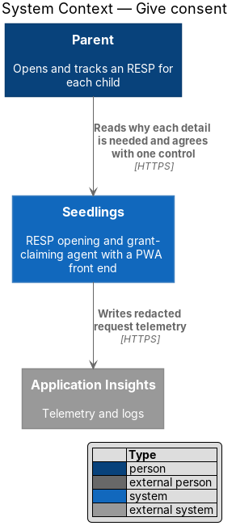
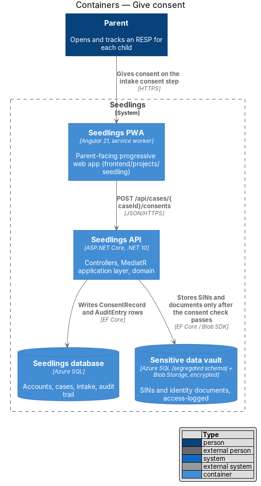
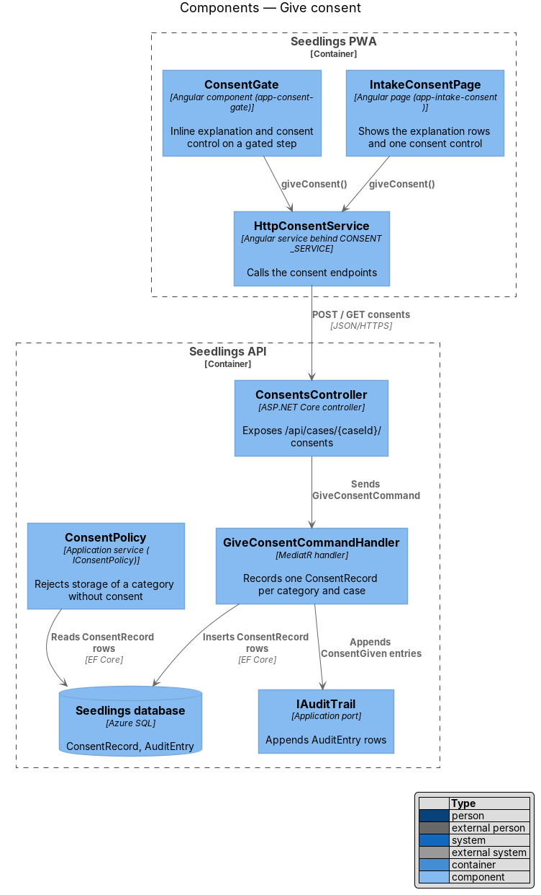
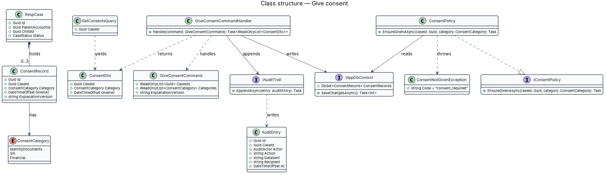
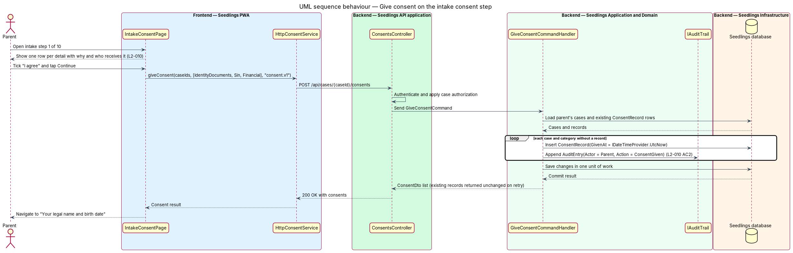
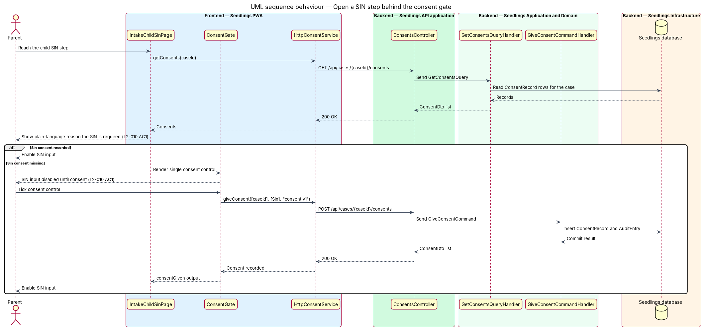
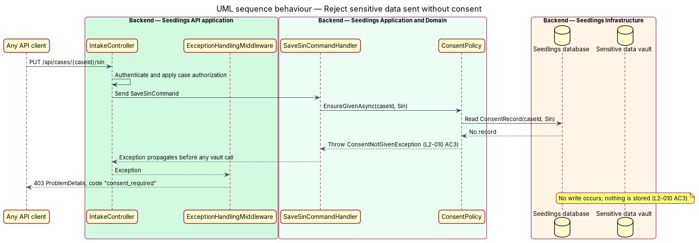

# Give consent

## Overview

Seedlings opens a Registered Education Savings Plan (RESP) for each child and claims the Canada
Learning Bond (CLB) and Canada Education Savings Grant (CESG) on the family's behalf. To do that, the
RESP provider and Employment and Social Development Canada (ESDC) need private details: Social
Insurance Numbers (SINs), identity documents and, where one exists, details of an existing RESP.

This feature obtains the parent's explicit consent before Seedlings asks for any of those details. It
is the first step of the intake ("Your details · 1 of 10"), immediately after the onboarding wizard
has explained in general terms that private details follow (`wizard.consent.html`, owned by
[start-wizard](../../onboarding/start-wizard/README.md)). The consent step lists each detail, why it
is needed and who receives it, then offers one agreement control. The API refuses to store a
category of sensitive data for a case that has no consent for that category.

- **consent category** — group of sensitive data covered by one consent: `IdentityDocuments`, `Sin` or `Financial`
- **consent record** — stored fact that the parent consented to one category for one case, with the time and the explanation shown
- **explanation version** — identifier of the explanation text the parent read when consenting
- **consent gate** — inline explanation and consent control shown on a step whose category has no consent yet

The mock `intake.consent.html` shows one agreement covering every category ("One agreement covers it
all"). L2-010 asks for consent per category with a single control. The design reconciles the two:
the single control on the consent step records one consent record per category, and a later step
whose category still lacks consent (for example, a child added after the agreement) shows the
consent gate for that one category.

## Description

### Frontend

- **`IntakeConsentPage`** (`app-intake-consent`, `frontend/projects/seedling/src/app/pages/intake-consent/`)
  implements `intake.consent.html`. It renders the five explanation rows from the mock (SINs, legal
  names and dates of birth, home address, photos of ID and a bill, any existing RESP), the "I agree"
  control and the privacy-notice link. Continue stays disabled until the control is ticked. On
  Continue it calls `giveConsent` for all three categories and every open case of the parent, then
  routes to `intake-parent-identity`.
- **`ConsentGate`** (`app-consent-gate`, `app/shared/consent-gate/`) takes a `caseId` and a
  `category` input. It shows the plain-language reason for that category and one consent control,
  and emits `consentGiven` once the API confirms. Gated pages
  ([complete-intake-steps](../complete-intake-steps/README.md) SIN and existing-RESP steps,
  [capture-document](../capture-document/README.md)) keep their inputs disabled until it emits.
- **`Check`** (`sl-check`, `frontend/projects/components/src/lib/check/`) is the design-system
  checkbox card that renders the mock's `check card card--sand` markup with a real `<input type="checkbox">`.
- **`ConsentService`** interface, **`CONSENT_SERVICE`** token and **`HttpConsentService`**
  (`frontend/projects/api/src/lib/services/consent/`) wrap `GET` and `POST
  /api/cases/{caseId}/consents`.

### Backend

- **`ConsentRecord`** (`Seedling.Domain/Entities/`) holds `Id`, `CaseId`, `Category`, `GivenAt` and
  `ExplanationVersion`. A unique index on (`CaseId`, `Category`) keeps at most one record per
  category and case.
- **`ConsentCategory`** (`Seedling.Domain/Enums/`) has the values `IdentityDocuments`, `Sin` and `Financial`.
- **`ConsentsController`** (`Seedling.Api/Controllers/`) exposes `GET /api/cases/{caseId}/consents`
  and `POST /api/cases/{caseId}/consents`. Both require authentication and apply
  [case-authorization](../../identity-and-access/case-authorization/README.md); the route `caseId`
  and every `CaseIds` entry in the body shall belong to the signed-in parent.
- **`GiveConsentCommand`** carries `CaseIds`, `Categories` and `ExplanationVersion`.
  **`GiveConsentCommandValidator`** (FluentValidation) requires at least one case and one category.
- **`GiveConsentCommandHandler`** inserts a `ConsentRecord` for each case and category that has
  none, stamping `GivenAt` from `IDateTimeProvider`. For each inserted record it appends an
  `AuditEntry` (`Actor = Parent`, `Action = ConsentGiven`) through `IAuditTrail`, so the consent and
  its timestamp appear in the case audit trail ([audit-trail](../../privacy-and-security/audit-trail/README.md)).
  Re-posting is idempotent: existing records are returned unchanged and no duplicate audit entry is
  written.
- **`GetConsentsQuery`** / **`GetConsentsQueryHandler`** return the `ConsentDto` list for one case.
- **`IConsentPolicy`** (`Seedling.Application/Abstractions/`) and **`ConsentPolicy`**
  (`Seedling.Application/Consent/`) expose `EnsureGivenAsync(caseId, category)`. It throws
  **`ConsentNotGivenException`**, which `ExceptionHandlingMiddleware` maps to `403` `ProblemDetails`
  with code `consent_required`. Every handler that stores a sensitive category calls it before
  touching the [sensitive data vault](../../privacy-and-security/sensitive-data-vault/README.md):
  `SaveSinCommandHandler` (`Sin`), `SaveIntakeFieldCommandHandler` for the existing-RESP fields
  (`Financial`) and `SaveDocumentCommandHandler` (`IdentityDocuments`).

### Data and API

| Method and path | Body | Result |
|---|---|---|
| `GET /api/cases/{caseId}/consents` | none | `200` with `ConsentDto[]` |
| `POST /api/cases/{caseId}/consents` | `{ caseIds, categories, explanationVersion }` | `200` with `ConsentDto[]`; `400` on validation; `404` for a case outside the tenant |

The explanation text and its version key live in the PWA's language resources so English and French
share one version. The versioning scheme beyond the initial `consent.v1` is `<TO SUPPLY>`. Withdrawal
of consent, which the mock places in Settings, is outside L2-010 and
`<TO SUPPLY>`.

### Implementation slices

1. **Record consent from the consent step** — `ConsentRecord`, `GiveConsentCommand`, `POST` endpoint,
   `IntakeConsentPage`; covers L2-010 AC2 (consent and timestamp in the audit trail).
2. **Reject storage without consent** — `IConsentPolicy` and its call from `SaveSinCommandHandler`;
   covers L2-010 AC3. Extended to documents and existing-RESP fields as those slices land.
3. **Consent gate on the SIN step** — `GET` endpoint, `ConsentGate`, disabled input until consent;
   covers L2-010 AC1.

## Requirements

| L2 ID | Refines (L1) | Requirement |
|-------|--------------|-------------|
| `L2-010` | `L1-006` | Before each category of sensitive data (identity documents, SINs, financial information) is requested, the parent shall see why it is needed and give consent with a single control. |

## Diagrams

### System context

The parent gives consent through Seedlings; no third party is contacted at this step, and only
redacted telemetry leaves the system.

### Containers

The PWA posts the consent to the API, which writes consent and audit rows to the Seedlings database.
The API writes to the sensitive data vault only after the consent check passes.

### Components

`IntakeConsentPage` and `ConsentGate` both call `HttpConsentService`. Inside the API,
`GiveConsentCommandHandler` records consent and audit entries, and `ConsentPolicy` reads the same
records to guard storage.

### Class structure

A `RespCase` holds at most one `ConsentRecord` per `ConsentCategory`. `ConsentPolicy` realizes
`IConsentPolicy` and throws `ConsentNotGivenException` when a record is missing.

### Behaviour — give consent on the consent step

One tick records a consent per category and case, each with an audit entry, in one unit of work. A
retry returns the existing records.

### Behaviour — SIN step behind the consent gate

The SIN step always shows why the SIN is required. When no `Sin` consent exists for the case, the
input stays disabled until the parent uses the single consent control (L2-010 AC1).

### Behaviour — reject sensitive data sent without consent

A SIN that reaches the API for a case without `Sin` consent fails the policy check before any vault
call. The API answers `403` with code `consent_required` and stores nothing (L2-010 AC3).

