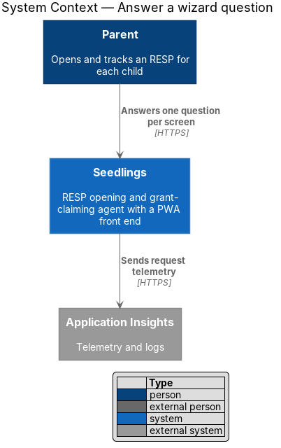
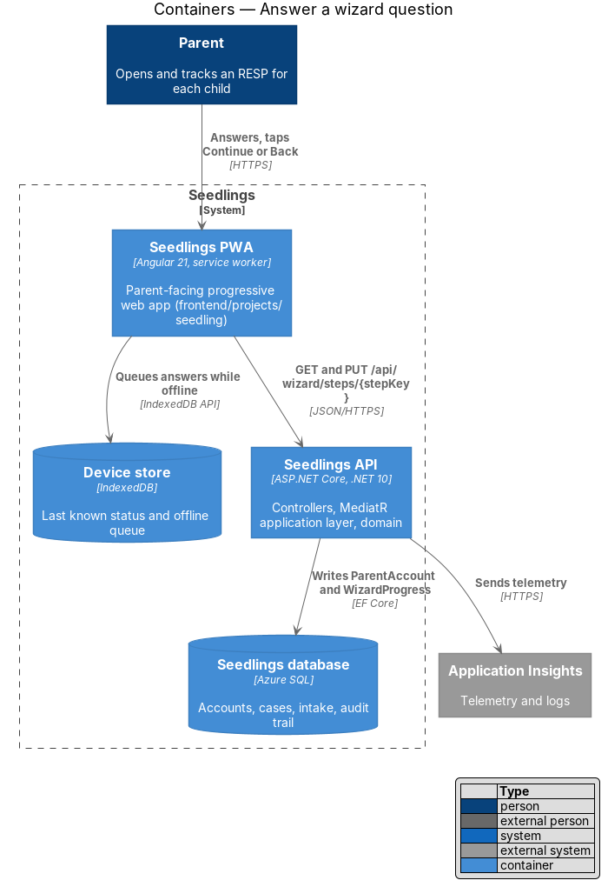
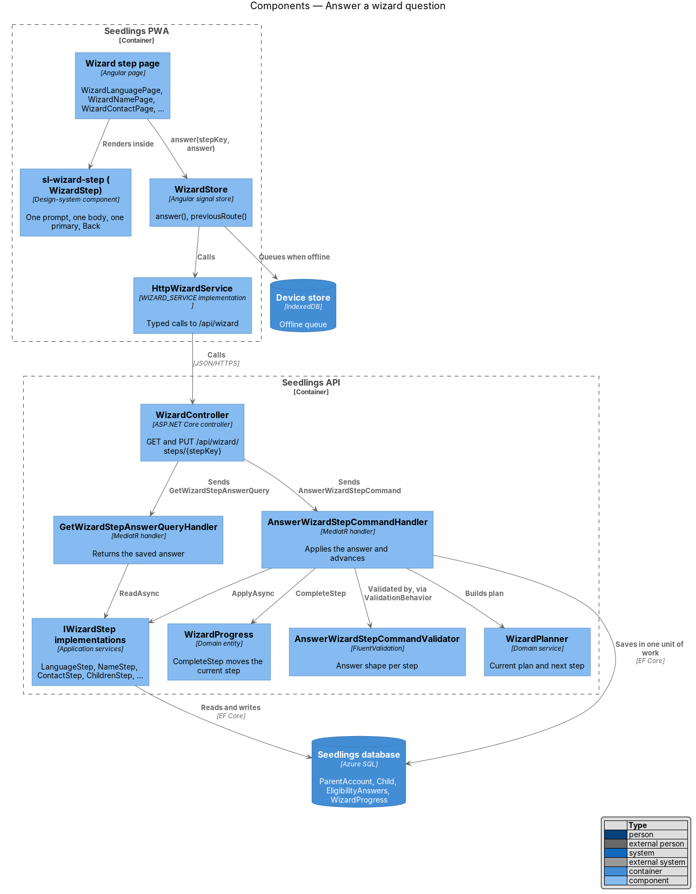
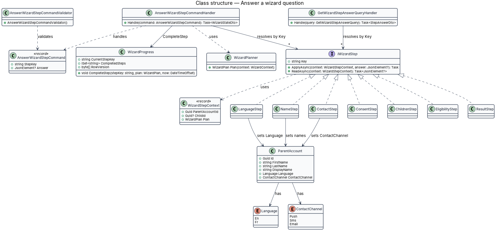
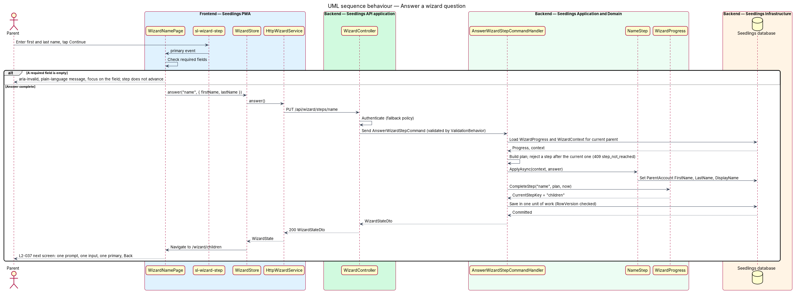
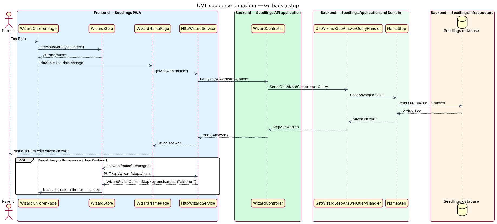

# Answer a wizard question

## Overview

Seedlings is an installable progressive web app (PWA) that works as the interface to an agent. The
agent opens a Registered Education Savings Plan (RESP) for each child of a parent and claims the
Canada Learning Bond (CLB) and the Canada Education Savings Grant (CESG) for the family. New parents
reach the agent through the onboarding wizard described in the
[start the onboarding wizard](../start-wizard/README.md) design.

This feature defines what one wizard screen is and what happens when the parent answers it. Every
wizard screen asks exactly one question or requests exactly one item, offers one primary action and
a Back control, and keeps its prompt and helper text to 40 words or fewer (L2-037). The rule exists
because the wizard is meant for a parent with no technical background (L1-021): one decision per
screen keeps the reading load low on a 320 px phone and with a screen reader.

When the parent taps the primary action, the PWA sends the answer to the Seedlings API. The API
validates it, stores it where it belongs, marks the step complete and returns the next step. The
roadmap and time figures that update after each answer are specified in the
[wizard roadmap](../wizard-roadmap/README.md) design; saving the place for a later visit is
specified in the [stop and resume](../stop-and-resume/README.md) design.

Terms used in this design:

- **wizard screen** — one routed page of the wizard holding one prompt, one input or choice, one primary action and a Back control
- **prompt** — the screen's question or request, rendered as its only level-1 heading
- **helper text** — text on a wizard screen that explains the prompt: the lede under the heading and any step note
- **primary action** — the single filled button that submits the answer, labelled Next, Continue or a specific verb such as "Start my claim"
- **step answer** — the value the parent submits on a wizard screen, such as a language or a contact channel
- **owned step** — wizard step whose data another design stores, such as the children step (add-child) or the eligibility questions (check-eligibility)

The screens follow the wizard mocks in `docs/mocks/pages/`: `wizard.language.html`,
`wizard.name.html`, `wizard.children.html`, `wizard.eligibility.html` ("Question 3 of 6"),
`wizard.result.html`, `wizard.contact.html`, `wizard.consent.html` and `wizard.roadmap.html`.

## Description

The slice runs from a step page in the PWA, through the `sl-wizard-step` design-system component and
the `WizardStore`, to `PUT /api/wizard/steps/{stepKey}` on `WizardController`, and on to an
`AnswerWizardStepCommandHandler` that applies the answer through one `IWizardStep` per step key and
advances `WizardProgress`. The wizard model (`WizardStepCatalog`, `WizardPlanner`, `WizardPlan`,
`WizardProgress`, `WizardStateDto`) is introduced by the [start-wizard](../start-wizard/README.md)
design and reused here.

### Screen contract

Each wizard screen has this anatomy, which keeps the mocks' BEM class names so the e2e locators and
the visual specs stay in parity:

| Part | Mock class | Count | Notes |
|---|---|---|---|
| Back control | `back-link` | 1 | "Back"; "Previous question" between eligibility questions; "Change my answers" on the result |
| Eyebrow | `step__eyebrow` | 0 or 1 | "Step 2 of 5", or "Step 4 of 5 · Question 3 of 6" |
| Prompt | `step__title` (`h1`) | 1 | The only `h1`; `aria-labelledby` target of the step `section` |
| Lede | `step__lede` | 0 or 1 | Helper text |
| Body | `step__body` | 1 | One input, one input group or one choice set |
| Step note | `step__note` | 0 or more | Helper text |
| Primary action | `btn--primary` inside `actions` | 1 | Submits the answer |
| Secondary action | `btn--secondary` inside `actions` | 0 or 1 | Only on "What comes next" ("Finish later") |

**One input or one item.** An input group that answers one question counts as one input: first and
last name on the name step, and day, month and year on a date of birth. The children step adds one
child at a time; the add-child form, the list of children added and its secondary "Add" button are
specified by the [add-child](../../eligibility/add-child/README.md) design. The result and consent
screens request no input; their one item is the acknowledgement carried by the primary action.

**40-word limit (L2-037 criterion 2).** The count covers the prompt and all helper text: the
`step__title`, the `step__lede` and every `step__note`. It excludes choice labels, field labels, the
eyebrow and button labels. Measured on the mocks, the prompt and lede of every screen are within
40 words, and three screens exceed the limit once their step note is added:

| Mock | Prompt | Lede | Notes | Total |
|---|---|---|---|---|
| `wizard.consent.html` | 7 | 30 | 17 | 54 |
| `wizard.eligibility.html` | 9 | 18 | 15 | 42 |
| `wizard.roadmap.html` | 6 | 23 | 13 | 42 |

Those three screens should have their copy trimmed in the mocks and in the copy resources before the
slice that enforces the limit. Whether the step note counts as helper text is `<TO SUPPLY>` for
product confirmation; the design counts it, because the note explains the prompt. The copy and its
French translation follow the
[language and reading level](../../web-experience/language-and-reading-level/README.md) design.

### Frontend

- **`sl-wizard-step`** (`WizardStep`, `frontend/projects/components/src/lib/wizard-step/`) —
  design-system component that renders the screen contract. Inputs: `eyebrow`, `prompt`, `lede`,
  `backLabel`, `primaryLabel`, `secondaryLabel`, `busy`. Outputs: `back`, `primary`, `secondary`.
  Slots: the default slot for the body and a `[stepNote]` slot. It renders one `h1` and one primary
  button, so a page cannot add a second primary action through the component. It disables the
  primary button and sets `aria-busy` while `busy` is true. It has a story folder
  `frontend/projects/components/stories/src/WizardStep/` and a perf-test scenario.
- **Step pages** (`frontend/projects/seedling/src/app/pages/wizard-<step>/`) — `WizardLanguagePage`,
  `WizardNamePage`, `WizardContactPage`, `WizardConsentPage` and `WizardNextPage` hold a typed
  reactive form for their one answer and render it inside `sl-wizard-step`. Each page has its
  `.page.ts`, `.html`, `.scss` and `.spec.ts`. `WizardChildrenPage`, `WizardEligibilityPage` and
  `WizardResultPage` use the same component and follow the add-child and check-eligibility designs.
- **Client validation** — each page checks its required answer before sending. An empty or invalid
  field gets `aria-invalid="true"`, a plain-language message linked by `aria-describedby`, and focus.
  The step does not advance.
- **`WizardStore.answer(stepKey, answer)`**
  (`frontend/projects/seedling/src/app/shared/wizard/wizard-store.ts`) — sets `busy`, calls
  `WIZARD_SERVICE.answer`, stores the returned `WizardState` and navigates to the route of
  `currentStepKey`. A `400` maps `ProblemDetails.errors` to the matching fields. A `409` reloads the
  state and navigates to the current step.
- **`WizardStore.previousRoute(stepKey)`** — the route of the step before `stepKey` in the plan. Back
  navigates there without a call that changes data. Saved answers stay as they are, and each page
  reads its saved answer with `WIZARD_SERVICE.getAnswer(stepKey)` on open.
- **Focus** — after each navigation the step page moves focus to the prompt `h1`, as the
  [accessible screens](../../web-experience/accessible-screens/README.md) design specifies.
- **Offline** — when the device is offline, `WizardStore.answer` hands the request to the offline
  queue from the [offline status and queue](../../web-experience/offline-status-and-queue/README.md)
  design and advances on the cached plan. On reconnect the queued request is sent and the server
  state replaces the local one.

### Backend

- **`WizardController`** (`Seedling.Api/Controllers/`) — adds `PUT /api/wizard/steps/{stepKey}`. It
  requires authentication through the fallback policy and sends `AnswerWizardStepCommand`.
- **`AnswerWizardStepCommand`** (`Seedling.Application/Onboarding/AnswerWizardStep/`) — `StepKey`
  (planned step key, including a child id for per-child steps) and `Answer` (`JsonElement?`).
- **`AnswerWizardStepCommandValidator`** — FluentValidation rules run by the existing
  `ValidationBehavior`: `StepKey` is present and names a catalog key; the answer shape matches the
  step. Field limits follow the [input validation](../../privacy-and-security/input-validation/README.md)
  design. Messages are plain language, for example "Enter your first name."
- **`AnswerWizardStepCommandHandler`** — in order:
  1. loads `WizardProgress` for the current parent; none answers `409 wizard_not_started`;
  2. reads the `WizardContext` and builds the `WizardPlan`;
  3. rejects a step after the current step with `409 step_not_reached`, which backs the roadmap rule
     that an upcoming step stays closed (L2-038 criterion 5);
  4. resolves the `IWizardStep` for the catalog key and calls `ApplyAsync`;
  5. calls `WizardProgress.CompleteStep(stepKey, plan, now)`;
  6. saves in one unit of work and returns the `WizardStateDto`.
- **`IWizardStep`** (`Seedling.Application/Onboarding/Steps/`) — one implementation per catalog key,
  registered in DI and resolved by `Key`. `ApplyAsync(WizardStepContext context, JsonElement? answer)`
  either stores the answer or checks that the owning design has the data the step needs:

| Implementation | Step key | Effect |
|---|---|---|
| `LanguageStep` | `language` | Sets `ParentAccount.Language` (`En` or `Fr`) |
| `NameStep` | `name` | Sets `ParentAccount.FirstName`, `LastName` and `DisplayName` |
| `ChildrenStep` | `children` | Checks that at least 1 `Child` exists; children are added through the add-child design |
| `EligibilityStep` | `eligibility` | Checks that all 6 eligibility answers exist (check-eligibility design) |
| `ResultStep` | `result` | Checks that `EligibilityResult.ShownAt` is set (check-eligibility design) |
| `ContactStep` | `contact` | Sets `ParentAccount.ContactChannel`; SMS needs a phone and email needs an address on the account |
| `ConsentStep` | `consent` | Records that the explanation was read; `ConsentRecord` rows are created by the [give-consent](../../intake/give-consent/README.md) design |
| `NextStep` | `next` | No data |

  Each implementation also has `ReadAsync(WizardStepContext context)`, which returns the saved
  answer so a screen opened through Back, the roadmap or a resume shows it.
- **`GetWizardStepAnswerQuery`** / **`GetWizardStepAnswerQueryHandler`**
  (`Seedling.Application/Onboarding/GetWizardStepAnswer/`) — resolves the `IWizardStep` for the key
  and returns `ReadAsync`. A step after the current step answers `409 step_not_reached`.
- The intake, document and review steps report completion through the same endpoint with an
  `IWizardStep` implementation that lives in the owning design's folder; the rule each applies, such
  as the required fields of L2-014 criterion 2, is specified there.
- **`WizardProgress.CompleteStep(stepKey, plan, now)`** (`Seedling.Domain/Entities/`) — adds the key
  to `CompletedSteps`. When the key is the current step, it moves `CurrentStepKey` to the next planned
  step that is not complete. When the key is an earlier step being reviewed, `CurrentStepKey` stays
  where it was, so the parent returns to the furthest step reached. Completed keys that are no longer
  in the plan, for example after the existing-RESP answer changes, are ignored. The elapsed-time
  update on the same call is specified in the [wizard roadmap](../wizard-roadmap/README.md) design.
- **Concurrency** — `WizardProgress.RowVersion` is a concurrency token. Two devices answering at the
  same moment cause one `DbUpdateConcurrencyException`, which `ExceptionHandlingMiddleware` returns
  as `409 wizard_changed`; the PWA reloads the state.
- **Idempotency** — sending the same answer for the same step twice leaves the same stored values
  and the same progress, so a retry from the offline queue is safe.
- **`ParentAccount`** — gains `FirstName` and `LastName` for this feature. `DisplayName` is set to
  `FirstName`, which the mocks use in "Good news, Jordan".

### API

| Method and path | Body | Success | Errors |
|---|---|---|---|
| `GET /api/wizard/steps/{stepKey}` | none | `200 { "answer": { ... } }`, empty when not yet answered | `401`, `409 step_not_reached` |
| `PUT /api/wizard/steps/{stepKey}` | `{ "answer": { ... } }` or `{}` for a step with no input | `200 WizardStateDto` with the new `currentStepKey` | `400` invalid answer (`ProblemDetails.errors` by field), `401`, `409 wizard_not_started`, `409 step_not_reached`, `409 wizard_changed`, `409 step_incomplete` when an owned step lacks its data |

Answer bodies: `language` `{ "language": "En" }`; `name` `{ "firstName": "Jordan", "lastName": "Lee" }`;
`contact` `{ "channel": "Push" }`. Errors are RFC 7807 `ProblemDetails`.

### Tests

- API integration tests in `backend/tests/Seedling.Api.Tests/Onboarding/AnswerWizardStepTests.cs`:
  language and name stored and the step advanced; empty first name answers `400` with the field
  error and no advance; an upcoming step answers `409 step_not_reached`; children step without a
  child answers `409 step_incomplete`; reviewing an earlier step keeps `CurrentStepKey`; a repeated
  answer is idempotent.
- Playwright spec `e2e/tests/wizard-one-question.spec.ts` with the page object
  `e2e/pages/wizard-step.page.ts`: for each wizard route, one prompt, one body, one primary action and
  one Back control (L2-037 criterion 1), and at most 40 words in the prompt and helper text (L2-037
  criterion 2); an empty required field is highlighted with a message and the step does not advance.

### Implementation slices

1. **Screen contract** — `sl-wizard-step`, `WizardLanguagePage`, `LanguageStep`,
   `PUT /api/wizard/steps/{stepKey}`; covers L2-037 criterion 1 on the language screen.
2. **Remaining setup screens** — `WizardNamePage`, `WizardContactPage`, `WizardConsentPage`,
   `WizardNextPage` and their `IWizardStep` implementations; covers L2-037 criterion 1 on each.
3. **Owned steps** — `ChildrenStep`, `EligibilityStep`, `ResultStep` checks wired to the add-child
   and check-eligibility designs; covers L2-037 criterion 1 on those screens.
4. **Validation and errors** — client and server validation, `400` mapping, `409` handling.
5. **40-word limit** — trim the three mocks above, then the word-count acceptance test; covers L2-037
   criterion 2.

## Requirements

| L2 ID | Refines (L1) | Requirement |
|-------|--------------|-------------|
| `L2-037` | `L1-021` | Each wizard screen shall ask exactly one question or request exactly one item, with one primary action. |

Acceptance criteria from `docs/specs/L2.md`:

- **L2-037.1** Given any wizard screen, when it renders, then it shall contain one prompt, one input
  or choice, one Next or Continue control and a Back control.
- **L2-037.2** Given any wizard screen, when its text is counted, then the prompt and any helper text
  shall total no more than 40 words.

## Diagrams

### System context

The parent answers wizard questions in Seedlings. The slice reaches no external system beyond
telemetry.

### Containers

The PWA sends each answer to the Seedlings API, or to the device store's offline queue when the
device is offline. The API stores the answer and the progress in the Seedlings database.

### Components

The step page renders `sl-wizard-step` and submits through `WizardStore`. In the API, the handler
picks the `IWizardStep` for the step key and then advances `WizardProgress`.

### Class structure

`AnswerWizardStepCommandHandler` depends on the validator, the planner and the `IWizardStep`
implementations. Each implementation either writes `ParentAccount` or checks data owned by another
design. `WizardProgress.CompleteStep` moves the current step.

### Behaviour — answer a question

The page checks the answer, the API validates it, applies it through the step's `IWizardStep` and
advances the progress, and the PWA opens the next step. An invalid answer is highlighted and the step
does not advance.

### Behaviour — go back

Back opens the previous step of the plan without a call that changes data. The previous step reads
its saved answer, and a changed answer is sent as a review of an earlier step.

