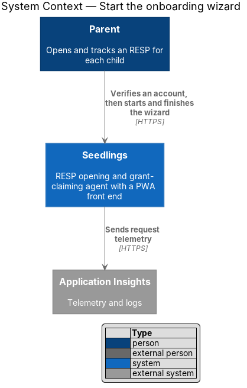
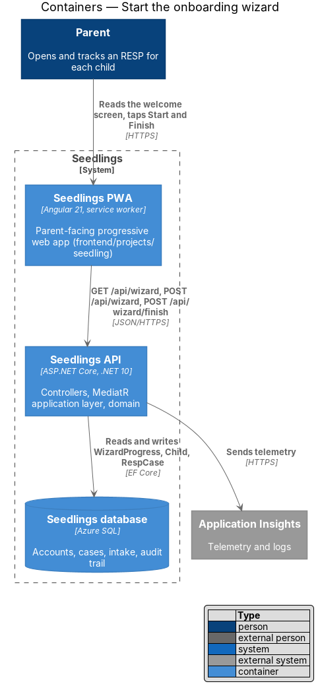
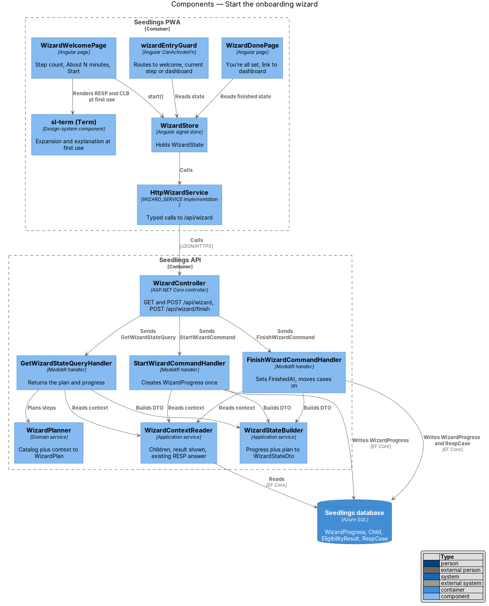
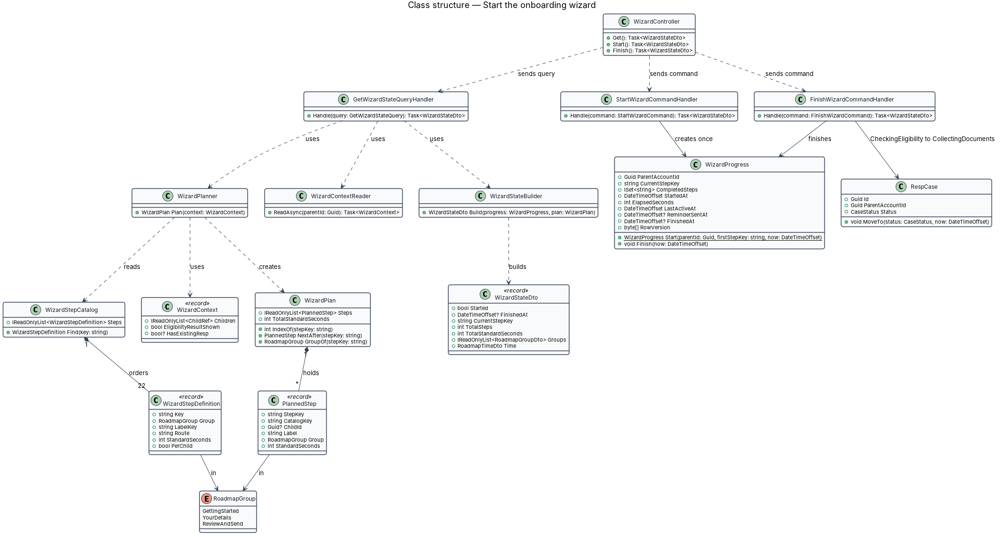
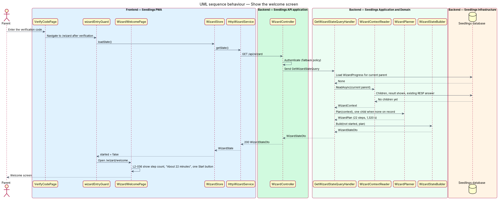
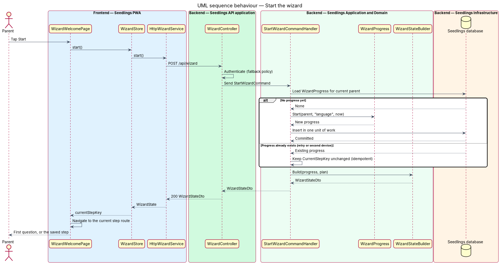
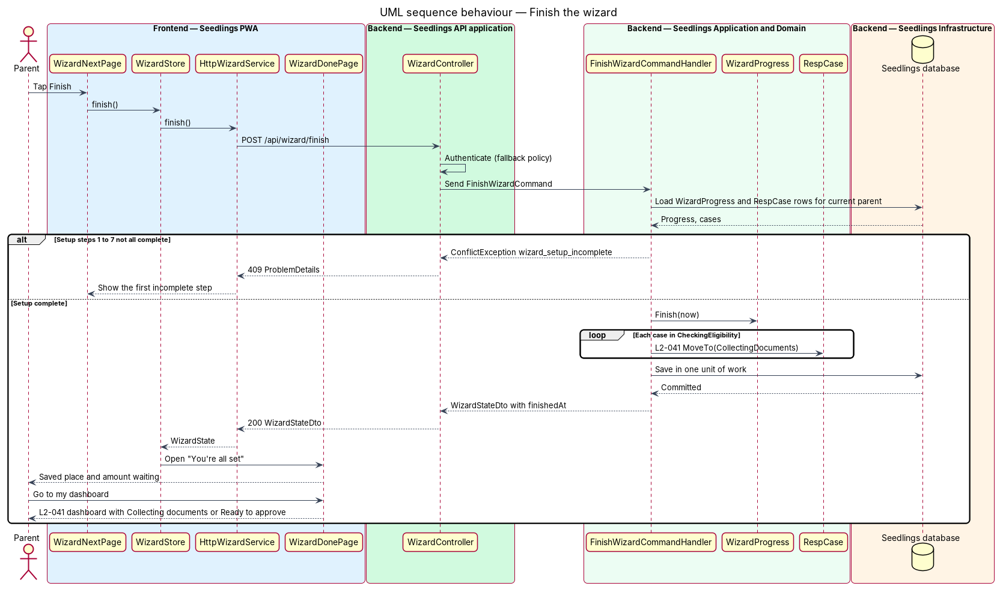
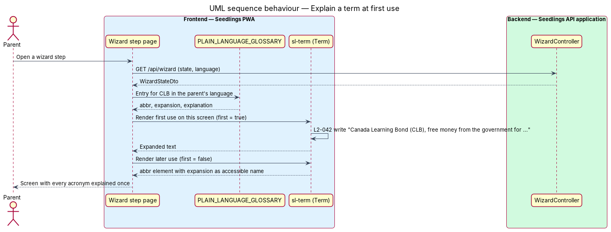

# Start the onboarding wizard

## Overview

Seedlings is an installable progressive web app (PWA) that works as the interface to an agent. The
agent opens a Registered Education Savings Plan (RESP) for each child of a parent and claims the
Canada Learning Bond (CLB) and the Canada Education Savings Grant (CESG) for the family.

The onboarding wizard is the primary path into the app (L1-021). It opens straight after the parent
verifies a new account and walks the parent through one short question per screen until the
account, the children, the language, the contact preference and the eligibility result are set up.
It then hands off, inside the same roadmap, to the intake steps that collect identity details and
documents, and to the review steps that send the claim.

This feature covers three things: the entry into the wizard with its welcome screen and total time
estimate (L2-036), the fixed order of the wizard's own steps and the hand-off to intake (L2-041), and
the plain-language rule for every wizard screen (L2-042). It also introduces the wizard model that
the three sibling designs build on:

- [Answer a wizard question](../answer-wizard-question/README.md) — one question per screen (L2-037)
- [Wizard roadmap](../wizard-roadmap/README.md) — roadmap, time spent and time remaining (L2-038, L2-039)
- [Stop and resume](../stop-and-resume/README.md) — leave at any step, resume on any device (L2-040)

Terms used in this design:

- **wizard** — ordered sequence of single-question screens that takes a newly verified parent from account creation to a claim ready to start
- **wizard step** — one screen of the wizard, identified by a stable step key such as `language` or `child-sin`
- **setup steps** — wizard steps owned by onboarding: language, parent name, children, eligibility questions, eligibility result, contact preference, consent explanation and "What comes next"
- **roadmap group** — named run of consecutive steps shown together in the roadmap: "Getting started", "Your details", "Review and send"
- **standard estimate** — fixed time, in seconds, that one wizard step is expected to take; the sum of standard estimates is the expected total time
- **wizard plan** — ordered list of the steps a given parent will see, derived from the step catalog, the number of children and the answers so far
- **wizard progress** — per-parent record of the current step, the completed steps and the time spent
- **glossary term** — acronym or financial term that the wizard expands or explains at first use on a screen

The screens are specified by `docs/mocks/pages/wizard.welcome.html` (welcome),
`wizard.language.html`, `wizard.name.html`, `wizard.children.html`, `wizard.eligibility.html`,
`wizard.result.html`, `wizard.contact.html`, `wizard.consent.html`, `wizard.roadmap.html` ("What
comes next") and `wizard.done.html` ("You're all set").

## Description

The slice runs from the verification screen of the PWA, through a wizard shell and its welcome page,
to a `WizardController` in the Seedlings API, MediatR handlers in the application layer, a
deterministic wizard planner in the domain, and one `WizardProgress` row per parent in the Seedlings
database. The code base holds only scaffolding today (`IAppDbContext`, `AppDbContext`,
`ValidationBehavior`, `IDateTimeProvider`, `ExceptionHandlingMiddleware`); every type below is
introduced by this design unless it names that scaffolding.

### Step catalog and standard estimates

`WizardStepCatalog` is the single ordered list of wizard steps. Each entry is a
`WizardStepDefinition` with a step key, a roadmap group, a label key, a route, a standard estimate,
a per-child flag and the design that owns the step. The standard estimates below are the values the
mocks state in the roadmap (`roadmap__mins`).

| # | Step key | Roadmap label | Group | Standard estimate | Per child | Owning design |
|---|---|---|---|---|---|---|
| 1 | `language` | Language | Getting started | 30 s | no | this design |
| 2 | `name` | Your name | Getting started | 30 s | no | this design |
| 3 | `children` | Your children | Getting started | 60 s | no | [add-child](../../eligibility/add-child/README.md) |
| 4 | `eligibility` | Eligibility questions | Getting started | 120 s | no | [check-eligibility](../../eligibility/check-eligibility/README.md) |
| 5 | `result` | What they can get | Getting started | 30 s | no | [check-eligibility](../../eligibility/check-eligibility/README.md) |
| 6 | `contact` | How to reach you | Getting started | 30 s | no | this design |
| 7 | `consent` | Consent | Getting started | 30 s | no | this design, with [give-consent](../../intake/give-consent/README.md) |
| 8 | `next` | What comes next | Getting started | 30 s | no | this design |
| 9 | `intake-consent` | Why we need your details | Your details | 60 s | no | [give-consent](../../intake/give-consent/README.md) |
| 10 | `parent-identity` | About you | Your details | 60 s | no | [complete-intake-steps](../../intake/complete-intake-steps/README.md) |
| 11 | `parent-address` | Your address | Your details | 60 s | no | [complete-intake-steps](../../intake/complete-intake-steps/README.md) |
| 12 | `child-identity` | {child}'s details | Your details | 30 s | yes | [complete-intake-steps](../../intake/complete-intake-steps/README.md) |
| 13 | `child-sin` | {child}'s SIN | Your details | 60 s | yes | [complete-intake-steps](../../intake/complete-intake-steps/README.md) |
| 14 | `parent-sin` | Your SIN | Your details | 60 s | no | [complete-intake-steps](../../intake/complete-intake-steps/README.md) |
| 15 | `existing-resp` | Existing RESP | Your details | 60 s | no | [complete-intake-steps](../../intake/complete-intake-steps/README.md) |
| 16 | `intake-contact` | How to reach you | Your details | 30 s | no | [complete-intake-steps](../../intake/complete-intake-steps/README.md) |
| 17 | `document-capture` | Photos of documents | Your details | 180 s | no | [capture-document](../../intake/capture-document/README.md) |
| 18 | `document-review` | Check the photos | Your details | 60 s | no | [capture-document](../../intake/capture-document/README.md) |
| 19 | `provider` | Your RESP provider | Review and send | 60 s | no | [select-provider](../../case-agent/select-provider/README.md) |
| 20 | `form-review` | Check the forms | Review and send | 120 s | no | [prefill-forms](../../case-agent/prefill-forms/README.md) |
| 21 | `plan` | Choose a plan | Review and send | 60 s | no | [select-plan](../../billing/select-plan/README.md) |
| 22 | `approve` | Approve and send | Review and send | 60 s | no | [approve-and-submit](../../case-agent/approve-and-submit/README.md) |

Steps 9 to 18 follow the intake order of L2-014, which the
[complete intake steps](../../intake/complete-intake-steps/README.md) design specifies; this design
only places them in the roadmap. With one child the plan has 22 steps and 1,320 s (22 minutes) of
standard estimates, which matches the mocks: 6 minutes for "Getting started", 11 for "Your details"
and 5 for "Review and send". Each extra child adds steps 12 and 13 again, 90 s per child.

### Wizard plan

`WizardPlanner` (`Seedling.Domain/Services/Wizard/`) builds a `WizardPlan` from the catalog and a
`WizardContext`. The context carries the parent's children (id and first name), whether the
eligibility result has been shown, and the answer to the "RESP already exists" eligibility question.
The planner applies three rules:

1. **Progressive reveal (L2-041 criterion 1).** Before the eligibility result has been shown, the
   plan holds steps 1 to 5 only, matching the "Step n of 5" mocks. From the result screen on, the
   plan holds every group, so the roadmap extends to the intake, document and review steps.
2. **Per-child expansion (L2-036 criterion 2).** Steps flagged per child appear once per child, in
   the order the children were added. The planned step key is the catalog key plus the child id
   (`child-sin:3f2a…`), and the label substitutes the child's first name.
3. **Skip the existing RESP step.** When the parent answered that no RESP exists, the plan omits
   `existing-resp`, as L2-014 criterion 3 requires. The intake design owns that rule; the planner
   only reflects it so that the roadmap and the time remaining agree with the steps shown.

When no child is on record, the planner counts one child. The welcome screen appears before the
children step, so at that moment the number of children is not yet known. How the welcome screen
meets L2-036 criterion 2 for a parent who will add 2 children is `<TO SUPPLY>`: the options are a
question on the welcome screen, or showing the welcome estimate again after the children step. Until
that is decided, the estimate on the welcome screen counts the children on record, with a minimum of
one, and the roadmap total updates as soon as the children step completes.

`WizardPlan` exposes `Steps`, `TotalStandardSeconds`, `IndexOf(stepKey)`, `NextAfter(stepKey)`,
`GroupOf(stepKey)` and `GroupCounts`. It is a value computed on each request and is not stored.

### Wizard progress

`WizardProgress` (`Seedling.Domain/Entities/`) is the shared domain entity from the architecture
brief, one row per `ParentAccount`:

- `ParentAccountId` (key), `CurrentStepKey`, `CompletedSteps` (set of planned step keys),
  `StartedAt`, `ElapsedSeconds`, `LastActiveAt`, `ReminderSentAt?`, `FinishedAt?` and a `RowVersion`
  concurrency token.
- `Start(parentAccountId, firstStepKey, now)` creates the row with `CurrentStepKey = "language"`.
- `Finish(now)` sets `FinishedAt` once; a second call leaves the first value in place.

The answer, resume and reminder behaviour on this entity is specified by the sibling designs.

### Backend

- **`WizardController`** (`Seedling.Api/Controllers/`) — exposes the `/api/wizard` endpoints for all
  four onboarding designs. It requires authentication through the fallback policy, reads nothing
  itself and only sends MediatR requests.
- **`GetWizardStateQuery`** / **`GetWizardStateQueryHandler`**
  (`Seedling.Application/Onboarding/GetWizardState/`) — loads the current parent's
  `WizardProgress`, reads the `WizardContext`, asks `WizardPlanner` for the plan and returns a
  `WizardStateDto`. When no progress exists it returns the not-started state: the full plan for one
  child or the children on record, `TotalSteps`, `TotalStandardSeconds` and `Started = false`. The
  welcome screen reads its step count and time from this query.
- **`StartWizardCommand`** / **`StartWizardCommandHandler`**
  (`Seedling.Application/Onboarding/StartWizard/`) — creates `WizardProgress` for the current parent.
  The command is idempotent: when a row already exists, the handler returns the existing state
  unchanged and does not reset the current step.
- **`FinishWizardCommand`** / **`FinishWizardCommandHandler`**
  (`Seedling.Application/Onboarding/FinishWizard/`) — runs when the parent taps Finish. It rejects the
  request with `ConflictException("wizard_setup_incomplete")` until steps 1 to 7 are complete. It then
  calls `WizardProgress.Finish(now)` and, for each of the parent's `RespCase` rows still in
  `CheckingEligibility`, applies the `CollectingDocuments` transition. A case whose intake and
  documents are already complete has been moved to `ReadyToApprove` by the intake design, and
  `FinishWizard` leaves it as it is. Both outcomes satisfy L2-041 criterion 2. The case status
  transitions themselves belong to the [case status dashboard](../../case-agent/case-status-dashboard/README.md)
  design.
- **`WizardContextReader`** (`Seedling.Application/Onboarding/Common/`) — reads the children, the
  eligibility-result-shown flag and the existing-RESP answer through `IAppDbContext`, always scoped
  to the current parent.
- **`WizardStateBuilder`** (`Seedling.Application/Onboarding/Common/`) — turns a `WizardProgress`
  and a `WizardPlan` into a `WizardStateDto`. The roadmap statuses and times inside that DTO are
  specified in the [wizard roadmap](../wizard-roadmap/README.md) design.
- **`ICurrentParent`** — the current parent's account id from the access token, specified by the
  [case authorization](../../identity-and-access/case-authorization/README.md) design. Every query
  in this slice filters on it, so a parent never reads another parent's progress.
- **`IDateTimeProvider`** — the existing clock in `Seedling.Application/Common/`, read for
  `StartedAt` and `FinishedAt` so tests can pin time.

### Frontend

- **Entry after verification.** The verify-code page from the
  [sign-up and verify](../../identity-and-access/sign-up-and-verify/README.md) design navigates to
  `/wizard` after a successful verification. `wizardEntryGuard`
  (`frontend/projects/seedling/src/app/shared/wizard/wizard-entry.guard.ts`) reads the wizard state:
  not started opens `/wizard/welcome`; started with an open journey resumes on the current step, as
  the [stop and resume](../stop-and-resume/README.md) design specifies; otherwise it opens
  `/dashboard`.
- **`WizardWelcomePage`** (`app-wizard-welcome`, `pages/wizard-welcome/`) — implements
  `wizard.welcome.html`. It shows what Seedlings will do, the step count and "About N minutes" from
  `WizardState.totalSteps` and `WizardState.totalStandardSeconds`, and a single Start button
  (L2-036 criterion 1). The "Sign in" link in the mock's flow bar is replaced by "Finish later" once
  the parent is signed in. Start calls `WizardStore.start()` and navigates to `/wizard/language`.
- **`WizardShell`** (`app-wizard-shell`, `app/shell/wizard-shell/`) — chrome for every wizard route:
  the flow bar with the Seedlings brand and "Finish later", the roadmap from the
  [wizard roadmap](../wizard-roadmap/README.md) design and a `router-outlet` for the step page.
- **Step pages** — one page per setup step under `frontend/projects/seedling/src/app/pages/`, each
  split into `.page.ts`, `.html`, `.scss` and `.spec.ts`: `WizardLanguagePage`, `WizardNamePage`,
  `WizardContactPage`, `WizardConsentPage`, `WizardNextPage` (mock `wizard.roadmap.html`) and
  `WizardDonePage`. The children, eligibility and result pages (`WizardChildrenPage`,
  `WizardEligibilityPage`, `WizardResultPage`) render inside the same shell and follow the add-child
  and check-eligibility designs. The screen contract that every step page follows is specified in the
  [answer a wizard question](../answer-wizard-question/README.md) design.
- **Hand-off to intake.** "Continue now" on the "What comes next" step navigates to the
  `intake-consent` route. The intake pages render inside `WizardShell`, so the roadmap stays the same
  journey (L2-041 criterion 1).
- **Finish.** "Finish later" on the "What comes next" step calls `WizardStore.finish()`, which sends
  `POST /api/wizard/finish` and shows `WizardDonePage` ("You're all set, Jordan") with the place where
  the parent will pick up and the amount waiting to be claimed. Its primary action lands on
  `/dashboard`. The dashboard shows each child's case status. L2-041 criterion 2 names the control
  "Finish" and the landing screen "the dashboard"; the mock labels the control "Finish later" and
  places the done screen before the dashboard. Which wording and order is final is `<TO SUPPLY>`; the
  design keeps the mock until the requirement or the mock changes.
- **`WIZARD_SERVICE`** / **`WizardService`** (`frontend/projects/api/src/lib/services/wizard.service.ts`)
  — injection token and interface with `getState()`, `start()`, `getAnswer(stepKey)`, `answer(stepKey, answer)`,
  `resume()` and `finish()`. **`HttpWizardService`** implements it over `API_BASE_URL`;
  `app.config.ts` binds the two. Models `WizardState`, `RoadmapGroup`, `RoadmapStep` and
  `RoadmapTime` live in `frontend/projects/api/src/lib/models/wizard.ts`.
- **`WizardStore`** (`frontend/projects/seedling/src/app/shared/wizard/wizard-store.ts`) — root
  signal store holding the current `WizardState`. Pages and the shell read its signals; only the store
  calls `WIZARD_SERVICE`.

### Plain language (L2-042)

Every wizard screen expands each acronym and explains each financial term at its first use on that
screen. First use is counted per screen, not per journey, because a parent may resume on any step
(L2-040) and would otherwise meet a bare acronym.

- **`sl-term`** (`Term`, `frontend/projects/components/src/lib/term/`) — design-system component with
  inputs `abbr`, `expansion`, `explanation` and `first`. With `first` set it renders "expansion
  (abbr), explanation"; otherwise it renders an `<abbr>` with the expansion as its accessible name.
- **`PLAIN_LANGUAGE_GLOSSARY`** (`frontend/projects/seedling/src/app/shared/plain-language/glossary.ts`)
  — the entries the pages pass to `sl-term`, in English and French:

| Term | First-use text (English) | Source |
|---|---|---|
| CLB | Canada Learning Bond (CLB), free money from the government for your child's education | L2-042 criterion 1 |
| RESP | Registered Education Savings Plan (RESP), plus a one-line explanation | L2-042 criterion 2; explanation text `<TO SUPPLY>` |
| CESG | Canada Education Savings Grant (CESG), which adds 20% or more to what is saved | `wizard.result.html` |
| SIN | Social Insurance Number (SIN) | `wizard.consent.html` |
| SDE 0093 | government grant form; one-line explanation `<TO SUPPLY>` | `wizard.welcome.html` |

French glossary text is `<TO SUPPLY>` and follows the
[language and reading level](../../web-experience/language-and-reading-level/README.md) design.
The welcome mock uses "RESP" and "SDE 0093" without an expansion, and the consent mock uses "RESP"
without one. The pages render those first uses through `sl-term`, and the mocks should be updated to
match.

### Welcome estimate and the mock

`wizard.welcome.html` shows "8 short steps" and "About 7 minutes", which describe the "Getting
started" group only; the catalog gives that group 360 s (6 minutes). L2-036 asks for the total
number of steps and the total expected time, and criterion 2 counts the per-child intake steps, so
the design shows the whole plan: 22 steps and about 22 minutes for one child. The mock chips should
be updated to the computed values. Minutes are rounded to the nearest whole minute, as the
[wizard roadmap](../wizard-roadmap/README.md) design specifies.

### Data

`WizardProgress` is a new table in the Seedlings database, configured by
`WizardProgressConfiguration` under `Seedling.Infrastructure/Persistence/Configurations/`.
`ParentAccountId` is the primary key and a foreign key to `ParentAccount`. `CompletedSteps` is
stored as a JSON array of step keys. `RowVersion` is a SQL Server `rowversion`. `IAppDbContext` gains
`DbSet<WizardProgress> WizardProgress`. The migration is applied by `seedling migrate`, never at API
startup. The table holds no SIN, document or other vault data.

### API

| Method and path | Body | Success | Errors |
|---|---|---|---|
| `GET /api/wizard` | none | `200 WizardStateDto` (not-started state when no progress exists) | `401` |
| `POST /api/wizard` | none | `200 WizardStateDto`; a repeated call returns the existing state | `401` |
| `POST /api/wizard/finish` | none | `200 WizardStateDto` with `finishedAt` | `401`, `409 wizard_setup_incomplete` |

`WizardStateDto` holds `started`, `finishedAt`, `currentStepKey`, `totalSteps`,
`totalStandardSeconds`, `groups` (each with its steps, labels, routes, statuses and standard
minutes) and `time` (spent and remaining). Errors are RFC 7807 `ProblemDetails` from
`ExceptionHandlingMiddleware`. The answer and resume endpoints are listed in the sibling designs.

### Tests

- API integration tests in `backend/tests/Seedling.Api.Tests/Onboarding/` on in-memory SQLite:
  not-started state with step count and total; idempotent start; per-child totals for 2 children;
  finish moving a `CheckingEligibility` case to `CollectingDocuments`; finish before setup is complete
  answering `409`; another parent's progress never returned.
- Playwright specs in `e2e/tests/wizard-start.spec.ts` with page objects
  `e2e/pages/wizard-welcome.page.ts` and `e2e/pages/wizard-done.page.ts`: verification lands on the
  welcome screen with the step count, "About N minutes" and one Start button; Finish lands on the
  dashboard with the case status and the "all set" message; first use of CLB and RESP on each wizard
  screen carries the expansion.

### Implementation slices

1. **Not-started state and welcome screen** — `WizardStepCatalog`, `WizardPlanner` (one child),
   `GetWizardStateQuery`, `WizardWelcomePage`, `wizardEntryGuard`; covers L2-036 criterion 1.
2. **Start is idempotent** — `WizardProgress`, `StartWizardCommand`, migration; Start opens
   `/wizard/language`; covers the entry half of L2-041.
3. **Per-child estimate** — per-child expansion in `WizardPlanner` and `WizardContextReader`; covers
   L2-036 criterion 2 for children on record. The welcome-screen behaviour before the children step
   waits on the `<TO SUPPLY>` decision above.
4. **Progressive reveal and hand-off** — the plan extends at the result step; "Continue now" opens
   the intake route inside `WizardShell`; covers L2-041 criterion 1.
5. **Finish** — `FinishWizardCommand`, `WizardDonePage`, dashboard landing with the case in
   Collecting documents or Ready to approve; covers L2-041 criterion 2.
6. **Plain language** — `sl-term`, `PLAIN_LANGUAGE_GLOSSARY`, first use per screen; covers L2-042
   criteria 1 and 2.

## Requirements

| L2 ID | Refines (L1) | Requirement |
|-------|--------------|-------------|
| `L2-036` | `L1-021` | Immediately after verification, the wizard shall open with a welcome screen stating what Seedlings will do, the total number of steps and the total expected time in minutes. |
| `L2-041` | `L1-021` | The wizard shall cover, in order: language, parent name, child or children, eligibility questions, eligibility result, contact preference and consent, then hand off to the intake steps in L2-014 within the same roadmap. |
| `L2-042` | `L1-021` | Wizard copy shall use no acronym without its expansion on first use and no financial term without a one-line explanation. |

Acceptance criteria from `docs/specs/L2.md`:

- **L2-036.1** Given a parent has just verified their account, when the next screen loads, then it
  shall show the step count, the expected total time (for example "About 20 minutes") and a single
  Start button.
- **L2-036.2** Given the parent has two children to add, when the estimate is shown, then it shall
  include the per-child steps for both children.
- **L2-041.1** Given a parent completes the wizard's setup steps, when they reach the eligibility
  result, then the roadmap shall extend to show the remaining intake and document steps as part of the
  same journey.
- **L2-041.2** Given the last step completes, when the parent taps Finish, then they shall land on
  the dashboard with the child's case in Ready to approve or Collecting documents status and a short
  "You're all set" message.
- **L2-042.1** Given the term CLB appears, when it is first shown, then it shall be written as
  "Canada Learning Bond (CLB), free money from the government for your child's education".
- **L2-042.2** Given the term RESP appears, when it is first shown, then it shall be written with its
  expansion, Registered Education Savings Plan, and a one-line explanation.

## Diagrams

### System context

The parent starts the wizard in Seedlings straight after verifying an account. In this slice
Seedlings talks to no external system; telemetry goes to Application Insights.

### Containers

The PWA reads the wizard state from the Seedlings API, which keeps one `WizardProgress` row per
parent in the Seedlings database.

### Components

Inside the API, `WizardController` sends the state query and the start and finish commands. The
handlers share `WizardContextReader`, `WizardPlanner` and `WizardStateBuilder`, so every endpoint
returns the same plan.

### Class structure

`WizardPlanner` turns the `WizardStepCatalog` and a `WizardContext` into a `WizardPlan` of
`PlannedStep` entries. `WizardProgress` records the parent's place in that plan, and
`WizardStateBuilder` combines the two into the `WizardStateDto` the PWA reads.

### Behaviour — show the welcome screen

After verification the entry guard reads the not-started state. The welcome page shows the step
count and the expected total from the plan, with one Start button (L2-036).

### Behaviour — start the wizard

Start creates the parent's progress once; a repeated call returns the existing progress, so a retry
or a second device never resets the place.

### Behaviour — finish the wizard

Finish checks the setup steps, records `FinishedAt` and moves each case still checking eligibility to
Collecting documents, then the PWA shows the "all set" screen and the dashboard (L2-041 criterion 2).

### Behaviour — explain a term at first use

Each step page passes glossary entries to `sl-term`, which writes the expansion and the one-line
explanation at the first use on the screen (L2-042).

