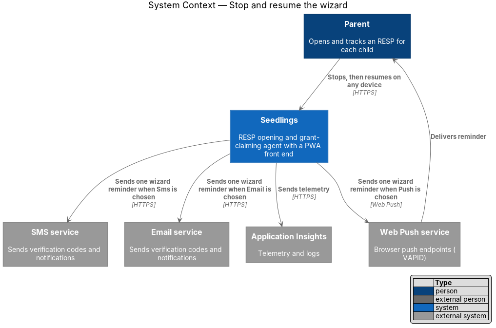
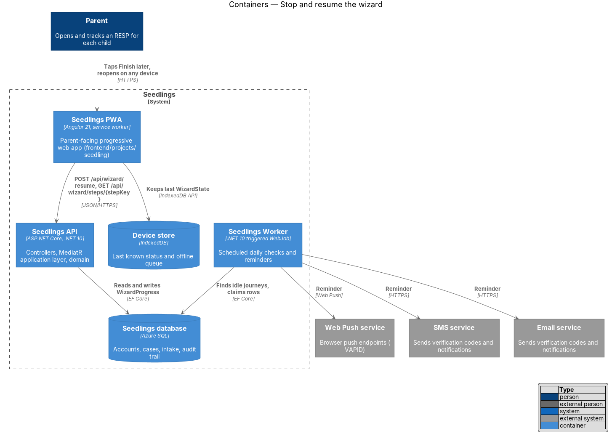
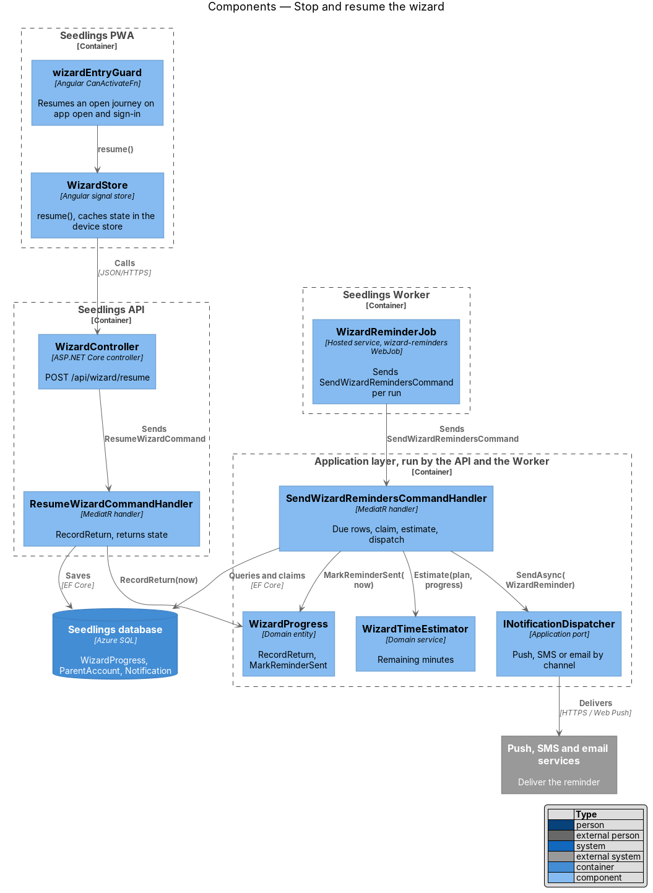
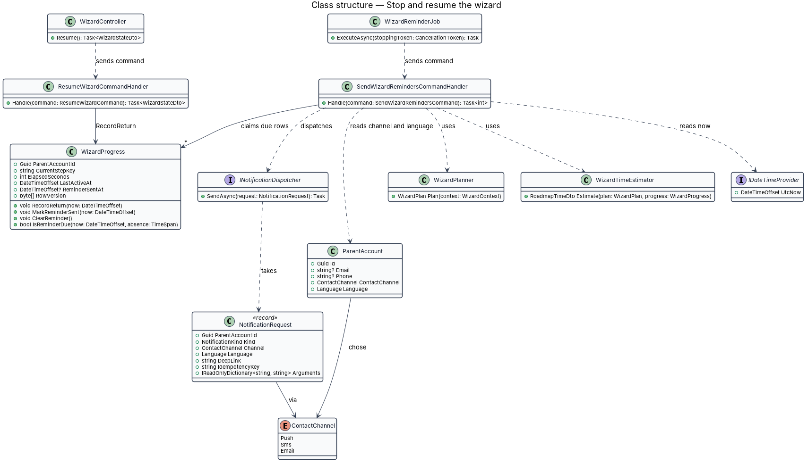
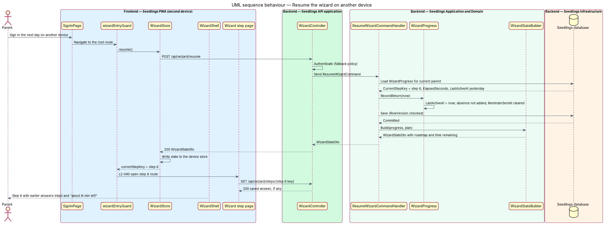
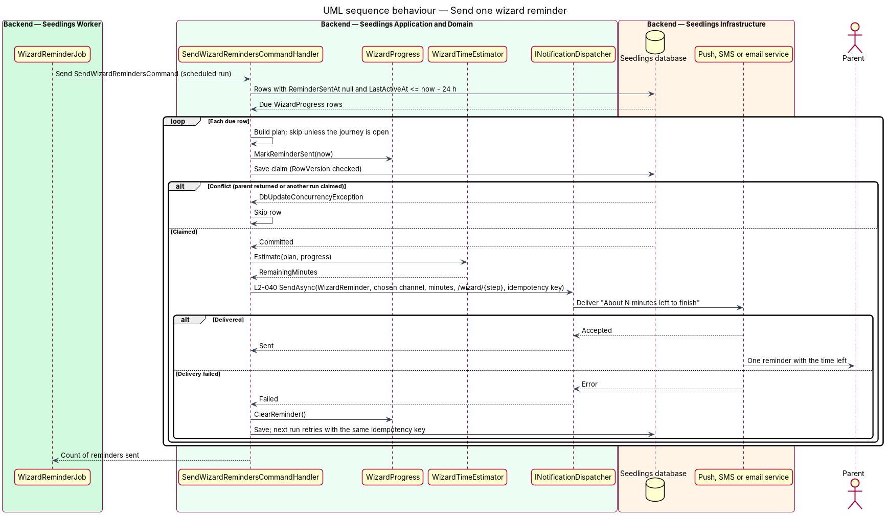

# Stop and resume the wizard

## Overview

Seedlings is an installable progressive web app (PWA) that works as the interface to an agent. The
agent opens a Registered Education Savings Plan (RESP) for each child of a parent and claims the
Canada Learning Bond (CLB) and the Canada Education Savings Grant (CESG) for the family. New parents
go through the onboarding wizard described in the [start the onboarding wizard](../start-wizard/README.md)
design. With the intake and review steps it hands off to, the journey takes about 22 minutes for one
child.

A parent rarely has 22 free minutes and every document at hand. L1-021 therefore asks that a parent
can stop at any point and resume later exactly where they left off. This feature covers that
behaviour (L2-040). The parent leaves the wizard at any step, by "Finish later" or by closing the app.
On return, on the same device or another one, the wizard opens on the same step with earlier answers
intact and the roadmap showing the time remaining. A parent who does not return within 24 hours gets
exactly one reminder through the channel they chose, stating the time left to finish.

Terms used in this design:

- **stop** — leaving the wizard before the journey is complete, by "Finish later" or by closing the app
- **return** — the parent's next authenticated opening of the PWA after a stop, on any device
- **absence** — the interval between the parent's last wizard activity and their return
- **wizard reminder** — single notification sent after 24 hours of absence that names the time left and links to the saved step
- **open journey** — wizard plan with at least one incomplete step in the "Getting started" or "Your details" group, the steps that need the parent

The mocks are `docs/mocks/pages/wizard.done.html` ("Your place is saved … We'll send a reminder
tomorrow evening") and the "Finish later" control in the flow bar of every wizard and intake mock.
`wizard.roadmap.html` states "Stop any time. We'll save your place and remind you by app
notification."

## Description

The slice has two halves. Resume runs from the PWA's entry guard, through
`POST /api/wizard/resume` on `WizardController`, to `ResumeWizardCommandHandler` and the
`WizardProgress` row. The reminder runs from a triggered WebJob in the Seedlings Worker, through
`SendWizardRemindersCommandHandler`, to the `INotificationDispatcher` of the
[notification channels](../../account-care/notification-channels/README.md) design. The wizard model
(`WizardProgress`, `WizardPlanner`, `WizardStateBuilder`) comes from the start-wizard design.

### Why the place survives a device change

Nothing about the parent's place lives only on the device. Every answer is stored by the API when the
parent taps the primary action, as the [answer a wizard question](../answer-wizard-question/README.md)
design specifies. Intake fields save on change under L2-013, as the
[complete intake steps](../../intake/complete-intake-steps/README.md) design specifies.
`WizardProgress.CurrentStepKey` names the step to reopen. Stopping therefore needs no request of its
own: "Finish later" navigates to `/dashboard`, and closing the app loses only an answer not yet
submitted on the screen in view. The device keeps a copy of the last `WizardState` in the device
store so that the shell and the roadmap render offline, as the
[offline status and queue](../../web-experience/offline-status-and-queue/README.md) design specifies.

### Resume

- **`wizardEntryGuard`** (`frontend/projects/seedling/src/app/shared/wizard/wizard-entry.guard.ts`,
  start-wizard design) — runs on the root route after the app opens and after sign-in on a new device
  ([sessions and devices](../../identity-and-access/sessions-and-devices/README.md)). When the
  journey is open, it calls `WizardStore.resume()` and navigates to the route of `currentStepKey`.
  When the journey is complete, it opens `/dashboard`.
- **`WizardStore.resume()`** — sends `POST /api/wizard/resume`, stores the returned `WizardState` and
  writes it to the device store. The step page then loads its saved answer with
  `GET /api/wizard/steps/{stepKey}`, and the shell renders the roadmap with the time remaining from
  the same state (L2-040 criterion 1).
- **Dashboard entry** — after "Finish later" the dashboard shows a "Continue setting up" entry that
  calls the same `resume()`. Its placement on the dashboard follows the
  [case status dashboard](../../case-agent/case-status-dashboard/README.md) design; its copy is
  `<TO SUPPLY>`.
- **`ResumeWizardCommand`** / **`ResumeWizardCommandHandler`**
  (`Seedling.Application/Onboarding/ResumeWizard/`) — loads the current parent's `WizardProgress`; none
  answers `409 wizard_not_started`. It calls `WizardProgress.RecordReturn(now)` and saves. It returns
  the `WizardStateDto`. A repeated call within the same visit changes nothing that the parent sees.
- **`WizardProgress.RecordReturn(now)`** (`Seedling.Domain/Entities/`) — sets `LastActiveAt = now`
  without adding the absence to `ElapsedSeconds`, so time spent counts active time only (L2-039, the
  [wizard roadmap](../wizard-roadmap/README.md) design). It clears `ReminderSentAt`, so a later
  absence of 24 hours gets its own single reminder. Whether reminders also stop after a set number of
  absences is `<TO SUPPLY>`.
- **Two devices at once** — both devices read the same row. The `RowVersion` concurrency token turns
  a simultaneous write into `409 wizard_changed`, and the losing device reloads the state.

### Reminder

- **`wizard-reminders` WebJob** (`backend/deploy/webjobs/wizard-reminders/`) — `run.sh`,
  `settings.job` and `README.md`, published beside the API from the same build. `settings.job` holds
  the schedule as a cron expression. The run interval is `<TO SUPPLY>`; a reminder goes out at most one
  interval after the 24-hour mark.
- **`WizardReminderJob`** (`Seedling.Worker/`) — hosted service registered in `Program.cs`. It reads
  `Seedling:WizardReminders:Schedule`, honours `RunOnceThenExit` as the Worker scaffold describes, and
  sends one `SendWizardRemindersCommand` per run.
- **`SendWizardRemindersCommand`** / **`SendWizardRemindersCommandHandler`**
  (`Seedling.Application/Onboarding/SendWizardReminders/`) — selects `WizardProgress` rows with
  `ReminderSentAt` null and `LastActiveAt` at or before `now − 24 h`. The query reads in pages; the
  page size is `<TO SUPPLY>`. For each row:
  1. builds the plan and skips the row unless the journey is open;
  2. claims the row with `WizardProgress.MarkReminderSent(now)` and saves; a `RowVersion` conflict
     means another run or a return got there first, and the row is skipped;
  3. computes `RemainingMinutes` with `WizardTimeEstimator` (wizard-roadmap design);
  4. calls `INotificationDispatcher.SendAsync` with kind `WizardReminder`, the parent's channel and
     language, the remaining minutes, the deep link `/wizard/{currentStepKey}` and the idempotency key
     `wizard-reminder:{parentAccountId}:{LastActiveAt}`;
  5. on a dispatch failure, clears `ReminderSentAt` so the next run retries; the idempotency key stops
     a provider-side duplicate.

  Claim-then-send with the idempotency key gives exactly one reminder per absence (L2-040
  criterion 2). A Worker crash between the claim and the send leaves the absence with no reminder; the
  job logs the claim so that case shows in Application Insights.
- **Channel** — the reminder goes through `ParentAccount.ContactChannel`, the channel chosen on the
  contact step. A parent who stops before the contact step has chosen no channel; for that parent the
  design uses the channel of the verified destination, `Email` or `Sms`. Product confirmation of that
  fallback is `<TO SUPPLY>`. Push delivery needs a push subscription, which the notification channels
  design manages; with none, the dispatcher falls back as that design specifies.
- **Content** — "About {N} minutes left to finish setting up Seedlings. Pick up where you left off."
  with the deep link. Final English and French copy is `<TO SUPPLY>` and follows the
  [language and reading level](../../web-experience/language-and-reading-level/README.md) design. The
  notification carries no name of a child, no amount and no other personal data beyond the time left.
  The log entries carry the parent account id only, as the
  [log redaction](../../privacy-and-security/log-redaction/README.md) design specifies.
- **Timing and the mock** — `wizard.done.html` says "We'll send a reminder tomorrow evening", which
  implies a time-of-day window; L2-040 states 24 hours. The design follows L2-040. Any quiet-hours
  window, and the mock wording, are `<TO SUPPLY>`.

### Data

`WizardProgress` (start-wizard design) uses `LastActiveAt` and `ReminderSentAt` for this feature. An
index on `(ReminderSentAt, LastActiveAt)` serves the reminder query. Each reminder sent is a
`Notification` row written by the dispatcher.

### API

| Method and path | Body | Success | Errors |
|---|---|---|---|
| `POST /api/wizard/resume` | none | `200 WizardStateDto` with `currentStepKey`, roadmap and time | `401`, `409 wizard_not_started`, `409 wizard_changed` |

The endpoint requires authentication through the fallback policy and is scoped to the current
parent. Errors are RFC 7807 `ProblemDetails`.

### Tests

- API integration tests in `backend/tests/Seedling.Api.Tests/Onboarding/ResumeWizardTests.cs`: a
  parent who answered 5 steps and then signs in with a new refresh token on a second client resumes
  on step 6 with the saved answers and the time remaining; the absence is not counted as time spent.
- Application tests in `backend/tests/Seedling.Application.Tests/Onboarding/SendWizardRemindersTests.cs`
  with a pinned `IDateTimeProvider` and a fake `INotificationDispatcher`: no reminder at 23 hours;
  one reminder at 24 hours with the remaining minutes and the chosen channel; no second reminder on
  the next run; a new reminder after a return and a new 24-hour absence; no reminder for a journey
  that is not open; a failed dispatch retried on the next run.
- Playwright spec `e2e/tests/wizard-resume.spec.ts` with page objects `e2e/pages/wizard-step.page.ts`
  and `e2e/pages/roadmap.page.ts`: answer through step 5, open a second browser context, sign in,
  land on step 6 with earlier answers on Back and the time remaining in the roadmap.

### Implementation slices

1. **Resume on the same device** — `ResumeWizardCommand`, `RecordReturn`, `wizardEntryGuard` resume
   path; covers the same-device part of L2-040 criterion 1.
2. **Resume on another device** — sign-in on a second client lands on the saved step with answers
   intact and the roadmap time; covers L2-040 criterion 1.
3. **Finish later** — flow-bar "Finish later" to the dashboard and the "Continue setting up" entry.
4. **One reminder after 24 hours** — `SendWizardRemindersCommand`, claim-then-send, idempotency key;
   covers L2-040 criterion 2 in application tests.
5. **Scheduled delivery** — `WizardReminderJob`, the `wizard-reminders` WebJob and its
   `settings.job`; runs criterion 2 end to end against the fake dispatcher.

## Requirements

| L2 ID | Refines (L1) | Requirement |
|-------|--------------|-------------|
| `L2-040` | `L1-021` | The parent shall be able to leave the wizard at any step and resume at the same step on any device. |

Acceptance criteria from `docs/specs/L2.md`:

- **L2-040.1** Given a parent closes the app on step 6, when they return the next day on another
  device, then the wizard shall open on step 6 with earlier answers intact and the roadmap showing
  time remaining.
- **L2-040.2** Given a parent leaves mid-wizard, when 24 hours pass without their return, then
  exactly one reminder shall be sent through their chosen channel stating the time left to finish.

## Diagrams

### System context

The parent resumes the wizard in Seedlings on any device. Seedlings sends the single reminder through
the push, SMS or email service that matches the parent's chosen channel.

### Containers

The PWA resumes through the Seedlings API and keeps the last state in the device store. The
Seedlings Worker runs the reminder job against the same database and sends through the notification
services.

### Components

`ResumeWizardCommandHandler` records the return. `WizardReminderJob` sends
`SendWizardRemindersCommand`, whose handler claims each due row, computes the time left and calls
`INotificationDispatcher`.

### Class structure

Both handlers act on `WizardProgress` through `RecordReturn` and `MarkReminderSent`. The reminder
handler depends on the planner, the time estimator and the dispatcher, and reads the parent's
`ContactChannel` and `Language`.

### Behaviour — resume on another device

After sign-in on a second device, the entry guard calls resume. The API records the return without
counting the absence, and the PWA opens the saved step with its answer and the time remaining
(L2-040 criterion 1).

### Behaviour — send one reminder

The Worker finds journeys idle for 24 hours with no reminder sent. It claims each row, then sends one
reminder with the time left through the parent's channel (L2-040 criterion 2).

