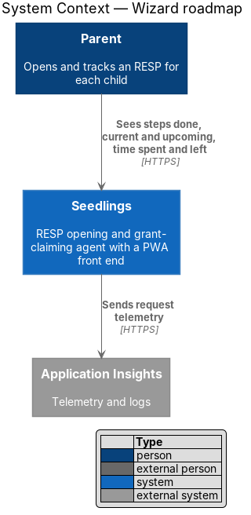
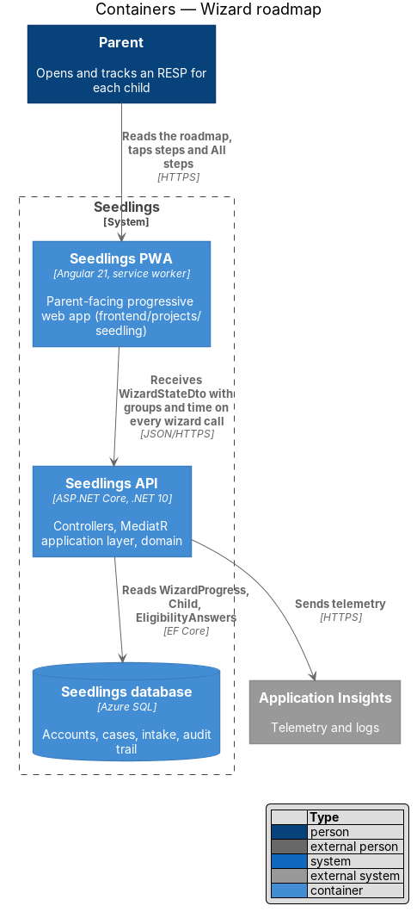
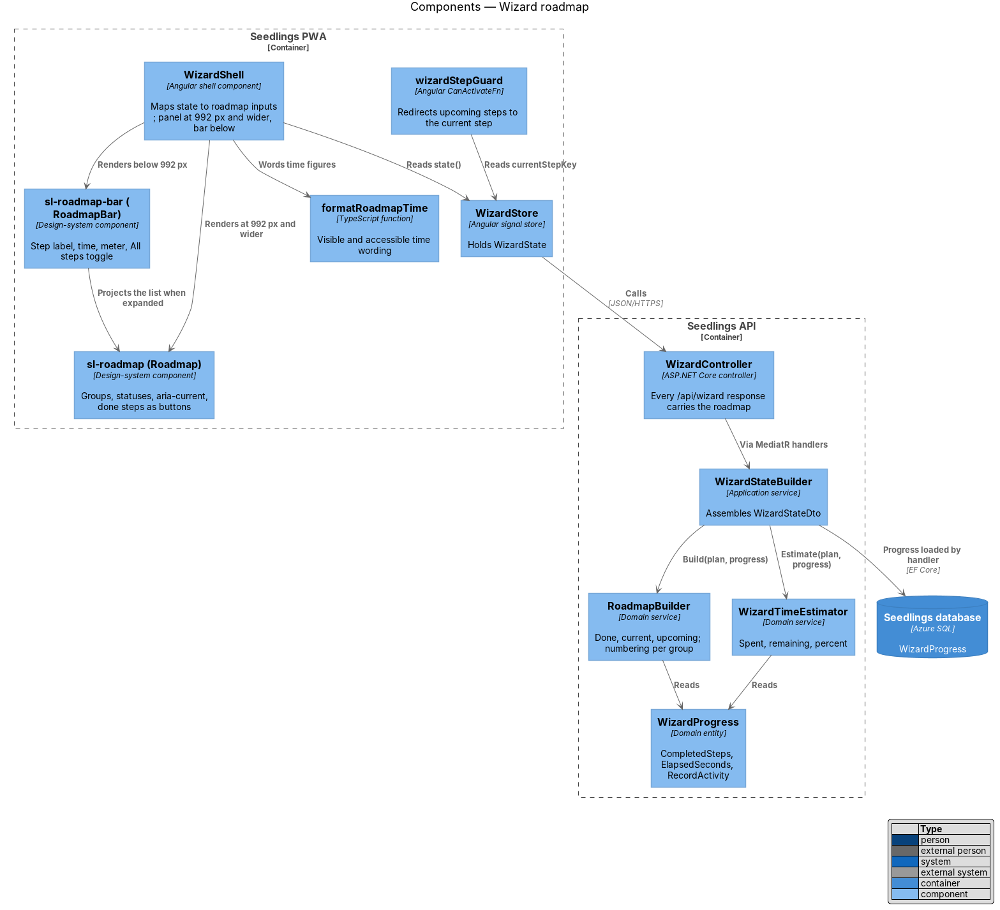
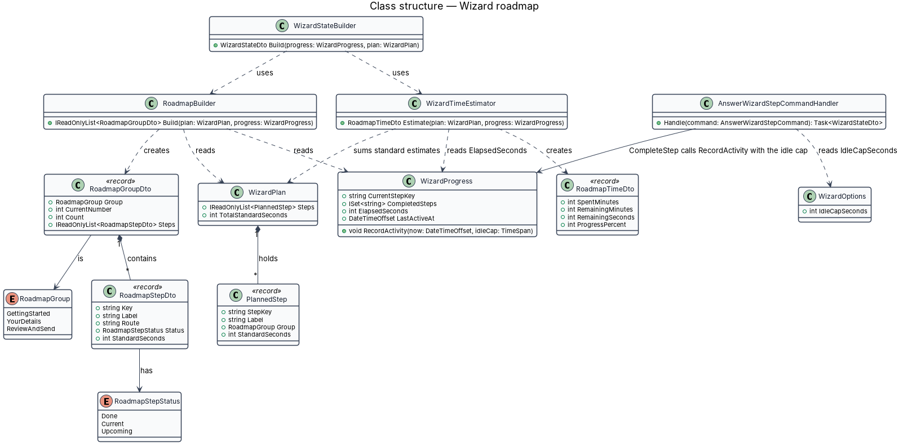
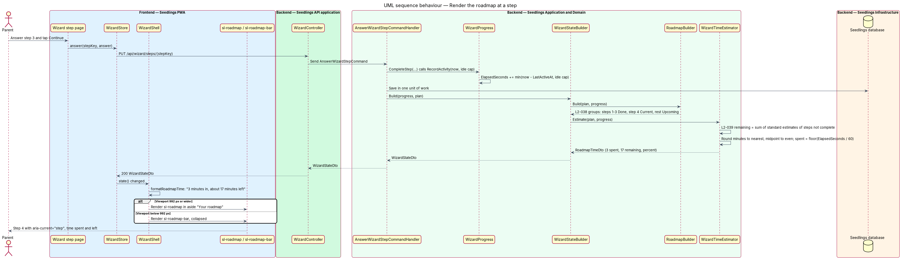
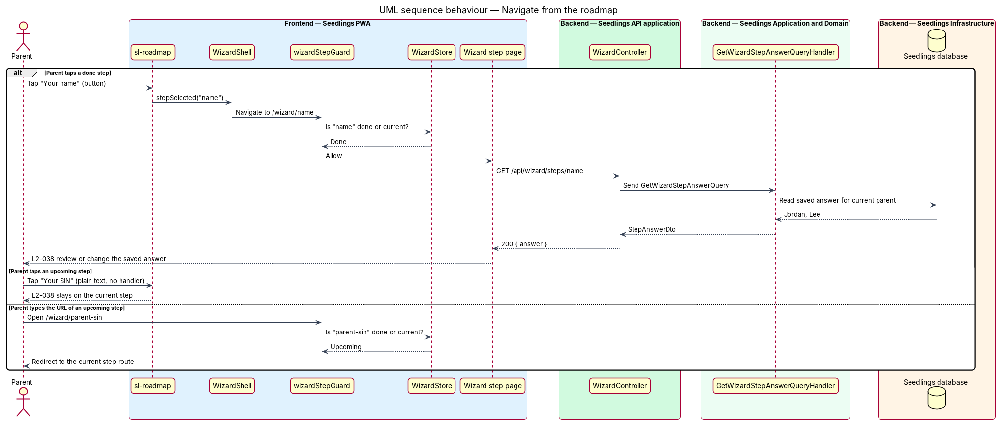
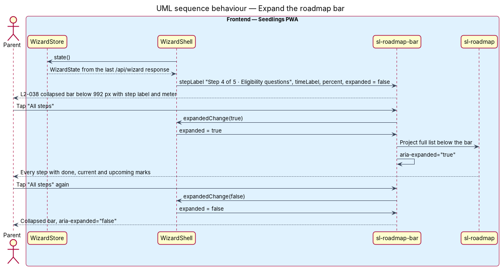

# Wizard roadmap

## Overview

Seedlings is an installable progressive web app (PWA) that works as the interface to an agent. The
agent opens a Registered Education Savings Plan (RESP) for each child of a parent and claims the
Canada Learning Bond (CLB) and the Canada Education Savings Grant (CESG) for the family. New parents
go through the onboarding wizard described in the [start the onboarding wizard](../start-wizard/README.md)
design, one question per screen as the [answer a wizard question](../answer-wizard-question/README.md)
design specifies.

This feature is the roadmap that sits beside every wizard screen. It lists every step of the
journey, marks the steps done, highlights the current step and names the steps still to come
(L2-038). It also shows how much time the parent has spent and how much is left, recalculated at each
step (L2-039). L1-021 asks for the roadmap so that a parent always knows where they are and how long
the rest will take, and can stop at a sensible point. The roadmap stays the same journey after the
hand-off to the intake and review steps, because those steps render inside the same wizard shell.

Terms used in this design:

- **roadmap** — ordered list of all wizard steps, grouped, with a status per step and the time figures for the journey
- **roadmap panel** — form of the roadmap shown as a persistent side panel beside the question, at 992 px and wider
- **roadmap bar** — compact form of the roadmap shown above the question below 992 px: current step label, time figures, progress meter and an "All steps" toggle
- **step status** — one of done (the step is complete), current (the step on screen) or upcoming (not yet reached)
- **time spent** — active time the parent has spent in the wizard, excluding time away
- **time remaining** — sum of the standard estimates of every planned step that is not complete, including the current step
- **standard estimate** — fixed time per step from the step catalog in the start-wizard design

The roadmap appears in every wizard and intake mock under `docs/mocks/pages/`: the panel is
`aside.flow__aside > .roadmap`, and the bar is `.roadmap-bar`. `wizard.roadmap.html` shows the full
journey with 7 steps done and the current step "What comes next".

## Description

The slice runs from two design-system components in the PWA, `sl-roadmap` and `sl-roadmap-bar`,
rendered by the wizard shell from the `WizardState`, back to two domain services in the API that
derive the statuses and time figures from `WizardProgress` and the `WizardPlan`. The roadmap has no
endpoint of its own: every wizard response (`GET /api/wizard`, `POST /api/wizard`,
`PUT /api/wizard/steps/{stepKey}`, `POST /api/wizard/resume`) carries it in `WizardStateDto`, so the
figures are always recalculated on the server at each step.

### Statuses and numbering

`RoadmapBuilder` (`Seedling.Domain/Services/Wizard/`) assigns each planned step a `RoadmapStepStatus`:

- **Done** — the step key is in `WizardProgress.CompletedSteps`.
- **Current** — the step key equals `WizardProgress.CurrentStepKey`.
- **Upcoming** — every other planned step.

A completed step that the parent reopens for review stays Done; the screen on display is shown by the
route, and `CurrentStepKey` still names the furthest step reached. Steps are grouped by
`RoadmapGroup` ("Getting started", "Your details", "Review and send"). The bar label "Step n of m"
counts within the current step's group, which matches every mock: "Step 4 of 5 · Eligibility
questions" before the result, "Step 8 of 8 · What comes next" after it, and "Step 4 of 10 · Maya's
details" in the intake. Before the eligibility result is shown the plan holds only the first 5
steps, and the roadmap footnote reads "More steps appear once we know what your children can get."
From the result step on, all three groups appear (L2-041 criterion 1, start-wizard design).

### Time figures

`WizardTimeEstimator` (`Seedling.Domain/Services/Wizard/`) computes the figures in `RoadmapTimeDto`:

- **`RemainingSeconds`** = the sum of `StandardSeconds` of every planned step not in
  `CompletedSteps`, including the current step. It never uses the parent's pace (L2-039 criterion 2).
- **`RemainingMinutes`** = `RemainingSeconds / 60` rounded to the nearest whole minute, midpoint to
  even (`Math.Round(x, MidpointRounding.ToEven)`, the .NET default). That rule reproduces every
  value in the mocks:

| Mock | Steps not complete (standard minutes) | Sum | Shown |
|---|---|---|---|
| `wizard.language.html` | ½ + ½ + 1 + 2 + ½ | 4.5 | about 4 min |
| `wizard.children.html` | 1 + 2 + ½ | 3.5 | about 4 min |
| `wizard.eligibility.html` | 2 + ½ | 2.5 | about 2 min |
| `wizard.result.html` | ½ + ½ + ½ + ½ + 11 + 5 | 18 | about 18 min |
| `wizard.contact.html` | ½ + ½ + ½ + 11 + 5 | 17.5 | about 18 min |
| `wizard.roadmap.html` | ½ + 11 + 5 | 16.5 | about 16 min |
| `intake.child-sin.html` | 1 + 1 + 1 + ½ + 3 + 1 + 5 | 12.5 | about 12 min |

- **`ProgressPercent`** = the standard seconds of completed steps divided by the plan total, rounded
  to the nearest whole percent. It matches the mocks' meters: 11% on the name step (30 of 270 s), 18%
  on the result step (240 of 1,320 s) and 25% on "What comes next" (330 of 1,320 s).
- **`SpentMinutes`** = `WizardProgress.ElapsedSeconds / 60`, rounded down. Zero renders as "Just
  started".

`ElapsedSeconds` counts active time only. `WizardProgress.RecordActivity(now, idleCap)` adds
`min(now − LastActiveAt, idleCap)` and then sets `LastActiveAt = now`. `CompleteStep` calls it on
each answer. A return after an absence resets `LastActiveAt` without adding the absence, as the
[stop and resume](../stop-and-resume/README.md) design specifies. The idle cap, the longest gap
counted as time on one step, is `<TO SUPPLY>`; it is read from configuration key
`Seedling:Wizard:IdleCapSeconds`. With that rule, three steps answered in 3 minutes of a 20-minute
plan give `SpentMinutes = 3` and `RemainingMinutes = 17` on step 4 (L2-039 criterion 1).

### Wording

The API returns numbers; the PWA words them in the parent's language. `formatRoadmapTime`
(`frontend/projects/seedling/src/app/shared/wizard/roadmap-time.ts`) produces two forms:

- the visible form from the mocks, "3 min in · about 17 min left", in the bar and the panel;
- the accessible name of the time element, "3 minutes in, about 17 minutes left", the wording of
  L2-039 criterion 1.

Which of the two is the visible text is `<TO SUPPLY>`: the acceptance criterion and the mocks
disagree. The design keeps the mock's short form on screen and the criterion's full form as the
accessible name. French wording is `<TO SUPPLY>` and follows the
[language and reading level](../../web-experience/language-and-reading-level/README.md) design.
Per-step standard minutes render as "½ min" for 30 s and "N min" otherwise.

### Frontend

- **`sl-roadmap`** (`Roadmap`, `frontend/projects/components/src/lib/roadmap/`) — the panel and the
  expanded list. Inputs: `groups` (title and steps, each with `key`, `label`, `status`,
  `minutesLabel`), `timeLabel`, `timeAccessibleLabel`, `progressPercent`, `footnote`. Output:
  `stepSelected(key)`. It keeps the mock's classes: `roadmap__step--done`, `roadmap__step--current`,
  `roadmap__step--todo`, the visually hidden "Done:" and "Current step:" prefixes, and
  `aria-current="step"` on the current item (L2-038 criterion 1). A done step's label is a `button`
  that emits `stepSelected` (criterion 4). The current and upcoming labels are plain text with no
  focus stop and no handler, so a tap leaves the parent on the current step (criterion 5). The
  `progress` element carries `aria-label="Overall progress, N%"`.
- **`sl-roadmap-bar`** (`RoadmapBar`, `frontend/projects/components/src/lib/roadmap-bar/`) — the bar.
  Inputs: `stepLabel` ("Step 4 of 5 · Eligibility questions"), `timeLabel`, `progressPercent`,
  `expanded`. Output: `expandedChange`. The "All steps" toggle is a `button` with `aria-expanded`
  and `aria-controls` pointing at the list. Expanded, it shows the list through content projection
  of `sl-roadmap` below the bar, in the page flow (criterion 2). It is a disclosure, not a menu or a
  modal, so it uses no CDK overlay. Each component has a story folder under
  `frontend/projects/components/stories/src/` and a perf-test scenario.
- **Breakpoints** — `WizardShell` renders the bar below 992 px and the panel inside
  `aside.flow__aside` with `aria-label="Your roadmap"` at 992 px and wider (criteria 2 and 3). The
  breakpoint is the large tier of `components/src/lib/styles/_breakpoints.scss`. The mock CSS opens
  the panel at `64rem` (1,024 px); the mock should move to 992 px to match L2-038 and the L2-004
  tiers. Between 576 px and 991 px L2-038 states no form; the design shows the bar there too, as the
  mock does.
- **`WizardShell`** (`app-wizard-shell`, `frontend/projects/seedling/src/app/shell/wizard-shell/`) —
  maps `WizardStore.state()` to the inputs of both components through `computed()` signals. On
  `stepSelected(key)` it navigates to the step's route. The step page then loads the saved answer, as
  the answer-a-wizard-question design specifies. It collapses the bar after each navigation.
- **`wizardStepGuard`** (`frontend/projects/seedling/src/app/shared/wizard/wizard-step.guard.ts`) —
  `CanActivateFn` on every wizard route. A route for an upcoming step redirects to the current step,
  so a typed URL cannot skip ahead either. The API enforces the same rule with `409 step_not_reached`.

### Backend

- **`RoadmapBuilder`** — `Build(plan, progress)` returns the groups with statuses, the group-relative
  numbering and the footnote key.
- **`WizardTimeEstimator`** — `Estimate(plan, progress)` returns `RoadmapTimeDto` with
  `SpentMinutes`, `RemainingMinutes`, `RemainingSeconds` and `ProgressPercent`.
- **`WizardStateBuilder`** (start-wizard design) — calls both services and places the result in
  `WizardStateDto.Groups` and `WizardStateDto.Time`.
- **`WizardOptions`** (`Seedling.Application/Onboarding/Common/`) — bound from `Seedling:Wizard`;
  holds `IdleCapSeconds`.

### Tests

- Domain and API tests in `backend/tests/Seedling.Application.Tests/Onboarding/` and
  `backend/tests/Seedling.Api.Tests/Onboarding/`: statuses on step 4 of 12; remaining time as the sum
  of standard estimates for a fast parent and a slow parent; the mock values in the table above;
  three steps in 3 minutes of 20 giving 3 and 17; absence time not counted.
- Playwright spec `e2e/tests/wizard-roadmap.spec.ts` with page object `e2e/pages/roadmap.page.ts`:
  steps 1 to 3 done, step 4 current with `aria-current="step"`, later steps upcoming with names;
  bar collapsed at 375 px and expanded on tap; panel at 1,280 px; tapping a done step opens it;
  tapping an upcoming step stays put; "3 minutes in, about 17 minutes left" after three timed steps.
  Visual parity with the mocks' `.roadmap` and `.roadmap-bar` regions runs in `e2e/tests/visual/`.

### Implementation slices

1. **Statuses** — `RoadmapBuilder`, `sl-roadmap` panel at 992 px and wider; covers L2-038 criteria 1
   and 3.
2. **Bar and toggle** — `sl-roadmap-bar` below 992 px with the "All steps" disclosure; covers L2-038
   criterion 2.
3. **Navigate from the roadmap** — done steps as buttons, upcoming steps inert, `wizardStepGuard`;
   covers L2-038 criteria 4 and 5.
4. **Time remaining** — `WizardTimeEstimator` remaining and percent; covers L2-039 criterion 2.
5. **Time spent** — `RecordActivity`, `IdleCapSeconds`, `formatRoadmapTime`; covers L2-039
   criterion 1.

## Requirements

| L2 ID | Refines (L1) | Requirement |
|-------|--------------|-------------|
| `L2-038` | `L1-021` | Every wizard screen shall show a roadmap of all steps with the current step highlighted, completed steps marked and upcoming steps visible. |
| `L2-039` | `L1-021` | The roadmap shall show the time spent so far and the estimated time remaining, updated at each step. |

Acceptance criteria from `docs/specs/L2.md`:

- **L2-038.1** Given the parent is on step 4 of 12, when the screen renders, then the roadmap shall
  show steps 1 to 3 as done, step 4 as current (`aria-current="step"`), and steps 5 to 12 as upcoming
  with their names.
- **L2-038.2** Given a viewport width below 576 px, when the roadmap renders, then it shall collapse
  to a progress bar with the step label and expand to the full list on tap.
- **L2-038.3** Given a viewport width of 992 px or more, when the roadmap renders, then it shall be
  shown as a persistent side panel beside the question.
- **L2-038.4** Given a completed step is tapped in the roadmap, when the tap is handled, then the
  parent shall be taken to that step to review or change their answer.
- **L2-038.5** Given an upcoming step is tapped in the roadmap, when the tap is handled, then the
  parent shall stay on the current step.
- **L2-039.1** Given a parent has completed three steps in 3 minutes of a 20-minute estimate, when
  they reach step 4, then the roadmap shall show "3 minutes in, about 17 minutes left".
- **L2-039.2** Given the parent is faster or slower than the estimate, when the remaining time is
  recalculated, then it shall be the sum of the remaining steps' standard estimates, not a projection
  of the parent's pace.

## Diagrams

### System context

The parent sees the roadmap on every wizard screen of Seedlings. The slice reaches no external
system beyond telemetry.

### Containers

The PWA renders the roadmap from the wizard state that the Seedlings API returns with every wizard
response. The API derives it from `WizardProgress` in the Seedlings database.

### Components

`WizardShell` maps the state to `sl-roadmap` and `sl-roadmap-bar`. In the API, `WizardStateBuilder`
calls `RoadmapBuilder` for statuses and `WizardTimeEstimator` for the time figures.

### Class structure

`RoadmapBuilder` and `WizardTimeEstimator` read a `WizardPlan` and a `WizardProgress` and produce
`RoadmapGroupDto` and `RoadmapTimeDto`. Each `RoadmapStepDto` carries one `RoadmapStepStatus`. The
answer handler reads the idle cap from `WizardOptions` and passes it to `WizardProgress`, so the
domain entity takes no dependency on configuration.

### Behaviour — render the roadmap at a step

After an answer, the API recomputes statuses and time from the standard estimates and the active
time (L2-038, L2-039). The shell renders the panel or the bar by viewport width.

### Behaviour — navigate from the roadmap

A tap on a done step opens that step with its saved answer. A tap on an upcoming step does nothing,
and a typed URL for an upcoming step is redirected to the current step.

### Behaviour — expand the roadmap bar

Below 992 px the bar shows the step label, the time and the meter. The "All steps" toggle expands the
full list in place and collapses it again (L2-038 criterion 2).

