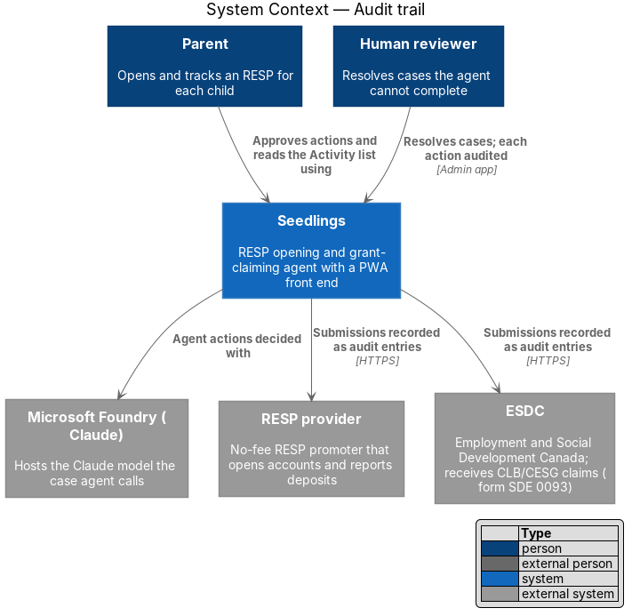
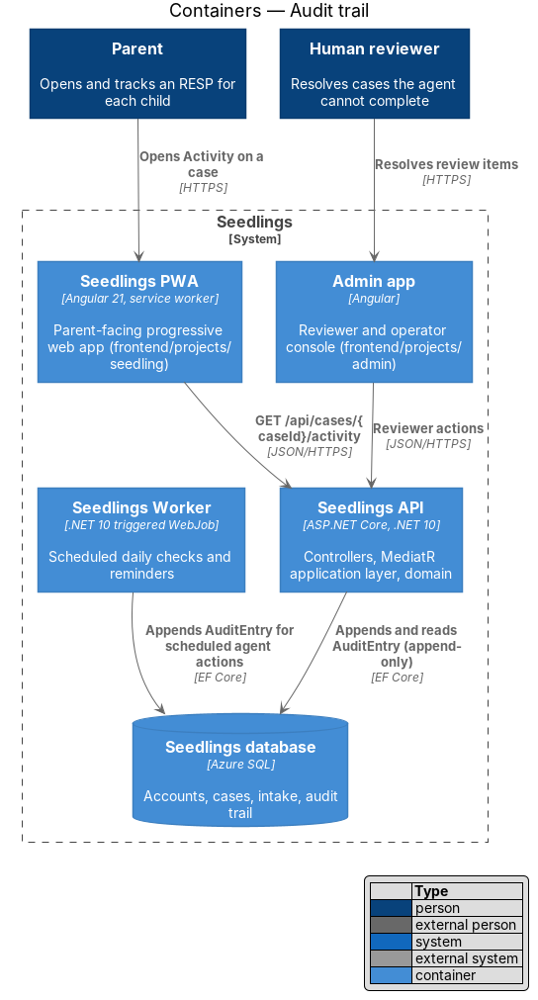
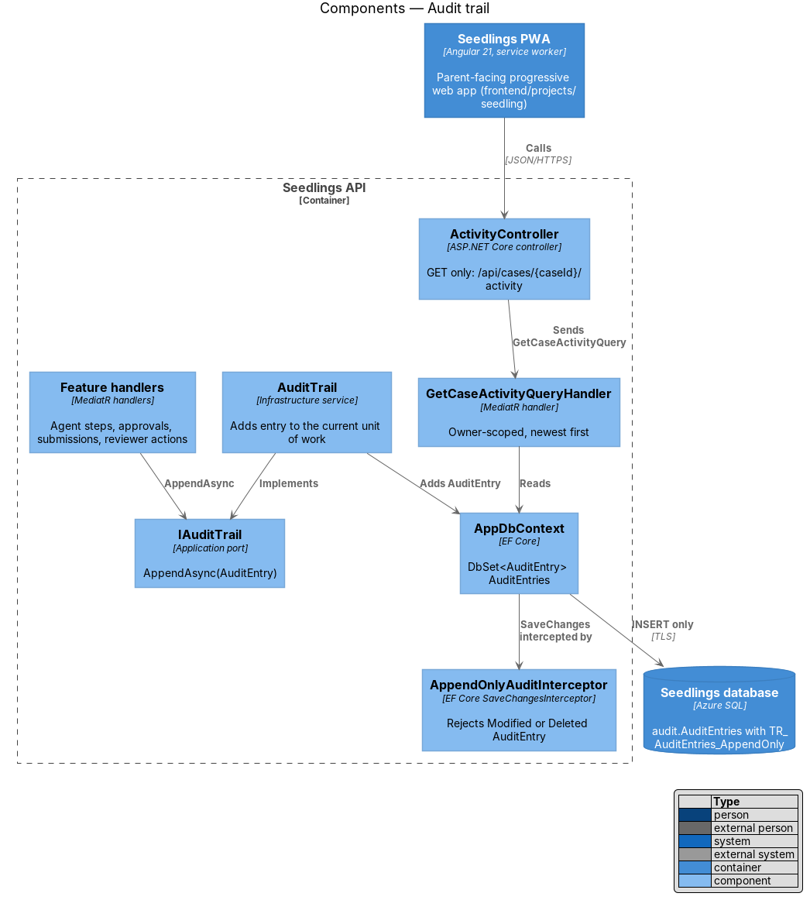
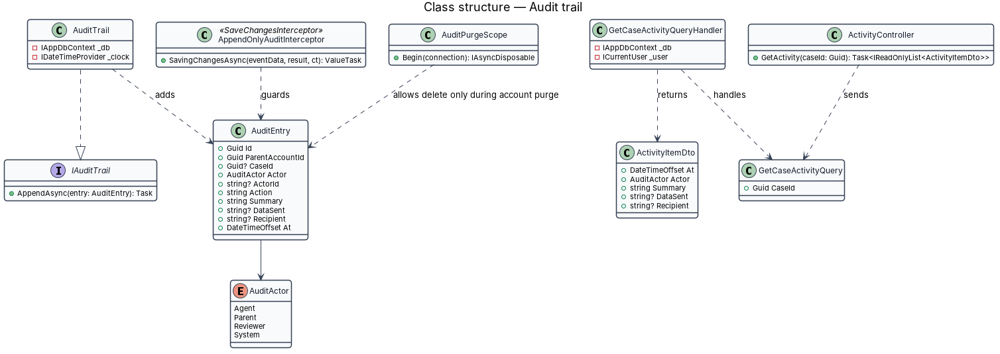
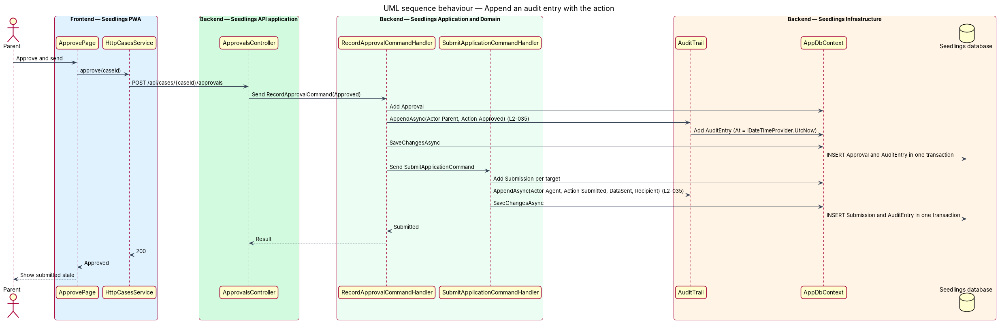
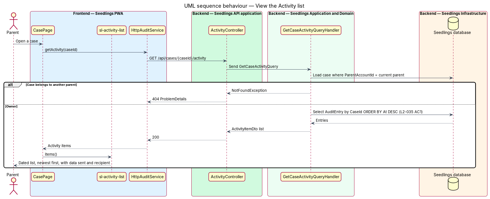
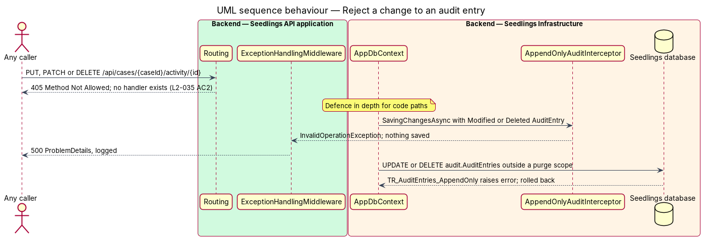

# Audit trail

## Overview

Seedlings acts for the parent: an agent selects a provider, fills in forms and, after the parent
approves, sends personal data to the RESP provider and to Employment and Social Development Canada
(ESDC). A parent who delegates that much needs to see exactly what was done, when, and with which
data sent to whom. The L1 privacy requirement (`L1-020`) asks that every agent action, parent
approval and third-party submission be logged with a timestamp the parent can see for their own
case.

Terms used below:

- **audit entry** — one immutable record of an action on a case: who acted, what the action was, what data was sent, to which recipient, and when
- **audit trail** — the append-only sequence of audit entries for all cases, stored in `audit.AuditEntries`
- **Activity list** — the card on the case screen that shows a case's audit entries to the parent, newest first
- **append-only** — property of a table whose rows may be inserted and read but never updated or deleted through the application

The audit trail is a cross-cutting service. Features across the system write to it through the
`IAuditTrail` port: `intake/give-consent`, `case-agent/approve-and-submit`,
`case-agent/human-review-handoff`, `privacy-and-security/document-retention` and others. This design
owns the port, the storage, the immutability guarantees and the parent-facing read.

## Description

### Data

- **`AuditEntry`** (`Seedling.Domain/Entities`) — `Id`, `ParentAccountId`, `CaseId` (empty for
  account-level actions such as a retention choice), `Actor` (`AuditActor {Agent, Parent, Reviewer,
  System}`), `ActorId`, `Action` (a stable key such as `ConsentGiven`, `ProviderSelected`,
  `FormsPrefilled`, `Approved`, `Submitted`, `DocumentsDeleted`), `Summary` (the plain-language line
  shown to the parent), `DataSent` (the list of field names sent, never field values such as a SIN),
  `Recipient` (for example the provider name or "ESDC"), `At`.
- The table lives in the `audit` schema with a clustered index on `(CaseId, At)` to serve the
  newest-first read.
- `Summary` is written in English and French according to the language keys of
  `web-experience/language-and-reading-level`; the storage of both forms is `<TO SUPPLY>`.

### Backend

- **`IAuditTrail`** (`Seedling.Application/Abstractions`) — `AppendAsync(AuditEntry entry)`, the
  signature the intake designs already use. The implementation adds the entry to the current
  `IAppDbContext`; it does not save. The calling handler's `SaveChangesAsync` commits the action
  and its audit entry in one transaction, so an action is never recorded without its entry or the
  reverse.
- **`AuditTrail`** (`Seedling.Infrastructure/Audit/`) — implements the port and stamps `At` from
  `IDateTimeProvider.UtcNow` when the caller leaves it empty.
- **`AppendOnlyAuditInterceptor`** (`Seedling.Infrastructure/Audit/`) — an EF Core
  `SaveChangesInterceptor` registered on `AppDbContext`. It throws `InvalidOperationException` when
  the change tracker holds an `AuditEntry` in state `Modified` or `Deleted`. The exception reaches
  `ExceptionHandlingMiddleware` as an unhandled error and nothing is saved.
- **`TR_AuditEntries_AppendOnly`** — a SQL Server `INSTEAD OF UPDATE, DELETE` trigger created by
  the migration. It raises an error unless `SESSION_CONTEXT(N'seedling.purge')` is `1`. This guards
  the table even against raw SQL and against the administrator login that `main.bicep` currently
  puts in the connection string.
- **`AuditPurgeScope`** — sets that session-context flag on the connection for the duration of an
  account purge (`data-export-and-deletion`). It is the only purge path, and only `AccountPurger`
  uses it. Whether audit entries shall outlive an account deletion is `<TO SUPPLY>`.
- **`ActivityController`** — `GET /api/cases/{caseId}/activity` only. No `PUT`, `PATCH` or `DELETE`
  route exists, so ASP.NET Core answers `405 Method Not Allowed` to any change attempt on
  `/api/cases/{caseId}/activity/{id}` (L2-035 criterion 2).
- **`GetCaseActivityQuery`** / **`GetCaseActivityQueryHandler`** — loads the case for the current
  parent (`404` for another parent's case, `L2-045`), then returns `ActivityItemDto` rows (`At`,
  `Actor`, `Summary`, `DataSent`, `Recipient`) ordered by `At` descending (L2-035 criterion 1).
  Paging is `<TO SUPPLY>`; the expected number of entries per case is not stated.
- **Admin app** — reviewers see the same entries for a queued case. Reviewer actions are written
  with `Actor = Reviewer` and the reviewer's id.

### Frontend

- **`CasePage`** (`docs/mocks/pages/case.html`) — the "Activity" card, whose lede states that the list
  holds every action by Seedlings and the parent on the claim, newest first.
- **`sl-activity-list`** (`ActivityList`, `frontend/projects/components`) — renders the mock's
  `activity`, `activity__item`, `activity__who` (`activity__who--you` for the parent),
  `activity__text` and `activity__time` classes. Each item can expand to show the data sent and the
  recipient; the mock shows only the summary line, so the expanded layout is `<TO SUPPLY>` in the
  mock.
- **`AUDIT_SERVICE`** / `AuditService` / `HttpAuditService` (`frontend/projects/api`) —
  `getActivity(caseId)`.
- Summaries and recipient names are bound with interpolation, never `innerHTML`
  (`input-validation`, L2-046 criterion 4).

### Implementation slices

1. **Append with the action** — `AuditEntry`, `IAuditTrail`, `AuditTrail`, migration; first writer
   is `RecordApprovalCommandHandler`. Covers L2-035 for parent approvals.
2. **Activity read** — `ActivityController`, `GetCaseActivityQueryHandler`, `sl-activity-list` on
   `CasePage`. Covers L2-035 criterion 1.
3. **Reject change through the API** — the `405` behaviour for `PUT`, `PATCH` and `DELETE`. Covers
   L2-035 criterion 2.
4. **Immutability in depth** — `AppendOnlyAuditInterceptor`, `TR_AuditEntries_AppendOnly` and
   `AuditPurgeScope`; the trigger test runs as a `[SqlServerFact]`.
5. **Agent and submission writers** — audit calls in the case-agent handlers with `DataSent` and
   `Recipient`. Covers L2-035 for agent actions and third-party submissions.

## Requirements

| L2 ID | Refines (L1) | Requirement |
|-------|--------------|-------------|
| `L2-035` | `L1-020` | Every agent action, parent approval and third-party submission shall be logged and visible to the parent. |

## Diagrams

### System context

The parent reads the Activity list. Agent actions decided with Claude, reviewer actions, and
submissions to the provider and ESDC each produce audit entries.

### Containers

The API and the Worker both append audit entries to the Seedlings database. The PWA reads them for
the parent; the admin app shows them to reviewers.

### Components

Feature handlers append through `IAuditTrail`. `AppDbContext` saves through
`AppendOnlyAuditInterceptor`, and `ActivityController` exposes a read-only route.

### Class structure

`AuditTrail` implements the port and adds `AuditEntry` rows. The interceptor and the purge scope
guard those rows; the query handler maps them to `ActivityItemDto`.

### Behaviour — append an audit entry with the action

An approval and the submission that follows each commit their own audit entry in the same
transaction as the action, with the data sent and the recipient for the submission.

### Behaviour — view the Activity list

The handler checks that the case belongs to the current parent and returns its entries newest
first. Another parent's case answers `404`.

### Behaviour — reject a change to an audit entry

No route accepts a change, so the API answers `405`. Inside the system, the interceptor and the
database trigger reject any update or delete outside the purge scope.

