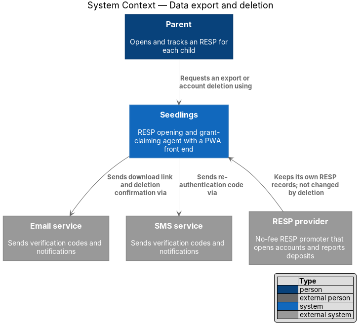
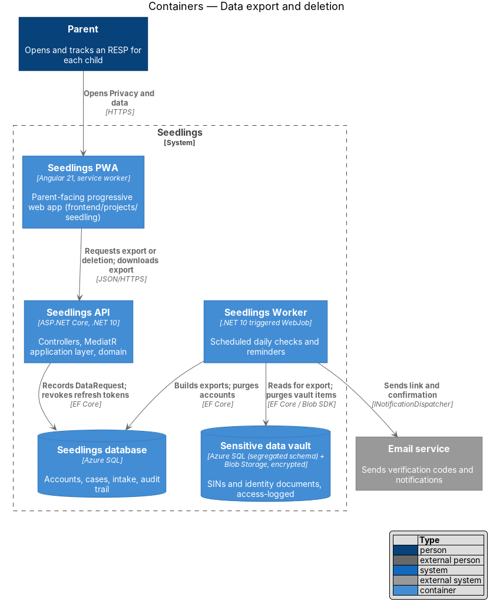
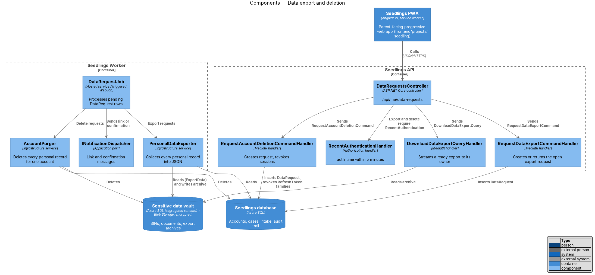
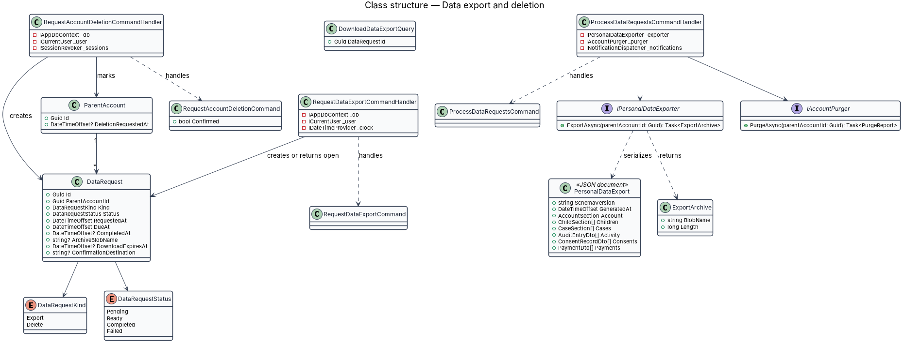
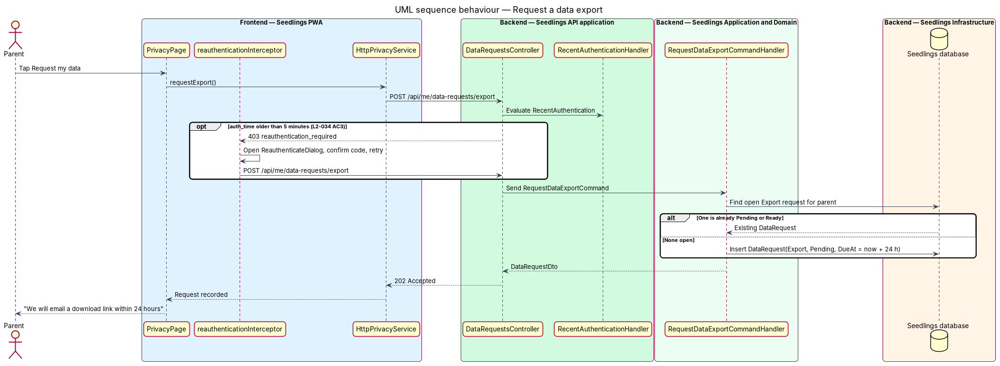
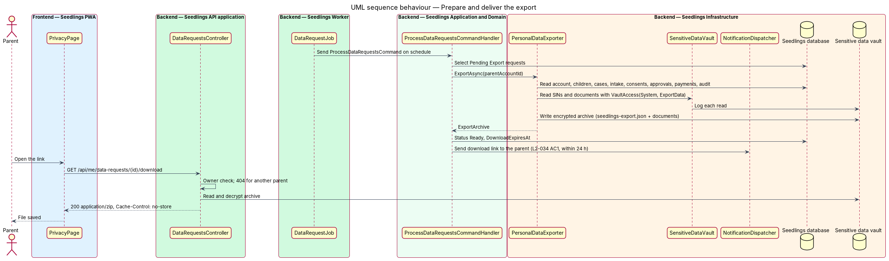
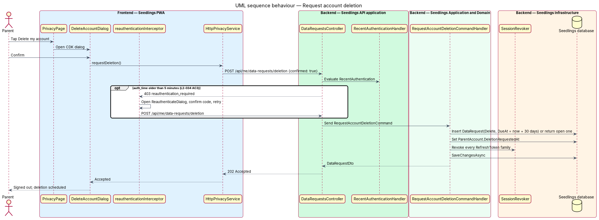
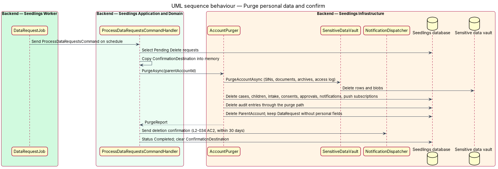

# Data export and deletion

## Overview

Canada's Personal Information Protection and Electronic Documents Act (PIPEDA) gives an individual
the right to see the personal information an organization holds about them. The L1 privacy
requirement (`L1-020`) turns that into three controls on the Privacy and data screen: the parent can
view their data, export it, and delete their account with all personal data.

Terms used below:

- **data request** — one recorded parent request to export or to delete, held as a `DataRequest` row with a due date
- **export archive** — downloadable file holding the parent's personal data as JSON, prepared by the Worker and stored encrypted in the vault
- **account purge** — removal of every personal record of one parent account, its children and its cases, from the Seedlings database and the vault
- **purge path** — the one code path allowed to delete append-only rows (audit entries and vault access log entries), active only during an account purge

Both actions need a fresh re-authentication when the parent last proved their identity more than 5
minutes ago, using the `RecentAuthentication` policy and the C-02 dialog defined in
`sensitive-data-vault`. Deletion removes Seedlings' data only. The RESP at the provider, any money
in it, and the records held by the provider and ESDC are not affected, as the mock states.

## Description

### Frontend

- **`PrivacyPage`** (`app-privacy`, `docs/mocks/pages/privacy.html`) — the "Export my data" card
  with the "Request my data" button, and the "Delete my account" card with the danger button. The
  page shows the state of an open export request (requested, ready to download).
- **`DeleteAccountDialog`** (`frontend/projects/seedling/src/app/dialogs/delete-account/`) — CDK
  dialog that states what is deleted and asks for confirmation. The mock shows no confirmation
  screen; its wording is `<TO SUPPLY>` in the mock.
- **`PRIVACY_SERVICE`** / `HttpPrivacyService` — `requestExport()`, `getDataRequests()`,
  `downloadExport(id)`, `requestDeletion()`.
- **`reauthenticationInterceptor`** and **`ReauthenticateDialog`** — reused from
  `sensitive-data-vault` (L2-034 criterion 3).
- After a deletion request is accepted, the PWA clears its session store and its IndexedDB device
  store, then returns to the landing page.

### Backend

- **`DataRequest`** — `Id`, `ParentAccountId`, `Kind` (`Export`, `Delete`), `Status` (`Pending`,
  `Ready`, `Completed`, `Failed`), `RequestedAt`, `DueAt`, `CompletedAt`, `ArchiveBlobName`,
  `DownloadExpiresAt`, `ConfirmationDestination`. `DueAt` is `RequestedAt` + 24 hours for an
  export and `RequestedAt` + 30 days for a deletion.
- **`DataRequestsController`** — every action requires the `RecentAuthentication` policy.
  - `POST /api/me/data-requests/export` → `202` with `DataRequestDto`.
  - `GET /api/me/data-requests` → the parent's requests.
  - `GET /api/me/data-requests/{id}/download` → the archive, `Cache-Control: no-store`; `404` for
    another parent's request or an expired one.
  - `POST /api/me/data-requests/deletion` with `{ "confirmed": true }` → `202`.
- **`RequestDataExportCommandHandler`** — returns the open `Pending` or `Ready` export request when
  one exists; otherwise inserts a new one. A retry therefore creates no duplicate, as `AGENTS.md`
  prescribes for create endpoints.
- **`RequestAccountDeletionCommandHandler`** — inserts a `Delete` request (or returns the open one),
  sets `ParentAccount.DeletionRequestedAt`, copies the current contact address into
  `ConfirmationDestination`, and revokes every refresh-token family through `ISessionRevoker`
  (`identity-and-access/sessions-and-devices`). From that point sign-in for the account is refused.
- **`ProcessDataRequestsCommand`** / **`ProcessDataRequestsCommandHandler`** — processes `Pending`
  requests in `DueAt` order and marks each `Completed` or `Failed`. A `Failed` request is retried
  on the next run.
- **`IPersonalDataExporter`** / **`PersonalDataExporter`** (`Seedling.Infrastructure/Privacy/`) —
  builds `seedlings-export.json` (`PersonalDataExport`: `SchemaVersion`, `GeneratedAt`, account,
  children, cases with intake fields, eligibility results, consents, approvals, submissions,
  deposits, life changes, notifications, payments without card data, and the case activity from
  the audit trail). Vault reads use `VaultAccess(System, "data-request", ExportData)`. The archive
  is encrypted with `IFieldProtector` and stored in the vault container.
- **Export format** — `L2-034` asks for a downloadable JSON file; the mock describes a ZIP of the
  parent's answers, forms, documents and activity log. The design produces a ZIP holding
  `seedlings-export.json` and a `documents/` folder. Whether that satisfies `L2-034` criterion 1,
  or the JSON file is offered on its own, is `<TO SUPPLY>`. Whether SINs appear in full or masked
  in the export is `<TO SUPPLY>`. The download link lifetime (`DownloadExpiresAt`) is `<TO SUPPLY>`.
- **`IAccountPurger`** / **`AccountPurger`** — deletes, in one transaction per store: vault SINs,
  documents, export archives and access-log rows (`ISensitiveDataVault.PurgeAccountAsync`); then
  cases, children, intake fields, wizard progress, consents, approvals, submissions, review items,
  deposits, life changes, notifications, push subscriptions, refresh tokens, verification
  challenges and the `ParentAccount`. Audit entries are deleted through the purge path described in
  `audit-trail`. The `DataRequest` row is kept with its personal fields cleared as evidence that the
  request was honoured.
- **Records with an open retention question** — whether audit entries and payment records are kept
  after deletion for legal or accounting reasons is `<TO SUPPLY>`; the design deletes both until a
  rule is given. A grace period between request and purge is `<TO SUPPLY>`; the design purges on
  the next run.
- **Backups and logs** — Azure SQL point-in-time restore keeps deleted rows for 7 days
  (`main.bicep`), and Log Analytics keeps 30 days. Both end within the 30 days of `L2-034`
  criterion 2. `log-redaction` keeps SINs, codes and documents out of logs.
- **Notifications** — after an export is ready, `INotificationDispatcher` emails the download link
  (L2-034 criterion 1). After a purge, it sends the confirmation to `ConfirmationDestination`, then
  clears that field (L2-034 criterion 2).
- **`DataRequestJob`** (`Seedling.Worker`) — hosted service that sends
  `ProcessDataRequestsCommand`; WebJob `backend/deploy/webjobs/data-requests/`. Its cron expression
  is `<TO SUPPLY>`. The interval shall be short enough that a request is processed within 24 hours,
  for example hourly.

### Implementation slices

1. **Re-authentication gate** — `DataRequestsController` with the `RecentAuthentication` policy on
   both actions. Covers L2-034 criterion 3.
2. **Record an export request** — `DataRequest`, `RequestDataExportCommandHandler`, the button on
   `PrivacyPage`; idempotent re-post.
3. **Build and deliver the export** — `PersonalDataExporter`, `DataRequestJob`, download endpoint
   and email link. Covers L2-034 criterion 1.
4. **Record a deletion request** — `DeleteAccountDialog`, `RequestAccountDeletionCommandHandler`,
   session revocation.
5. **Purge and confirm** — `AccountPurger`, the purge path, the confirmation message. Covers L2-034
   criterion 2.

## Requirements

| L2 ID | Refines (L1) | Requirement |
|-------|--------------|-------------|
| `L2-034` | `L1-020` | The parent shall view, export and delete their data from settings. |

## Diagrams

### System context

The parent asks Seedlings for an export or a deletion. The email service carries the download link
and the confirmation. The RESP provider keeps its own records, which a deletion does not change.

### Containers

The API records each request and revokes sessions at once. The Worker does the slow work: it builds
the export from the database and the vault, and purges both stores for a deletion.

### Components

`DataRequestsController` applies the `RecentAuthentication` policy before either command handler
runs. In the Worker, `DataRequestJob` hands export requests to `PersonalDataExporter` and deletion
requests to `AccountPurger`.

### Class structure

`DataRequest` tracks each request through its statuses. The processing handler depends on the
exporter and purger ports; the exporter serializes a `PersonalDataExport` into an `ExportArchive`.

### Behaviour — request a data export

A stale authentication sends the parent through the C-02 dialog first. The handler then returns the
open export request or records a new one due within 24 hours.

### Behaviour — prepare and deliver the export

The Worker collects every personal record, logs each vault read with purpose `ExportData`, stores
the encrypted archive and emails a link. The parent downloads it through an owner-checked endpoint.

### Behaviour — request account deletion

After confirmation in `DeleteAccountDialog` and, when needed, re-authentication, the handler records
the request and revokes every session, so each device is signed out.

### Behaviour — purge personal data and confirm

The Worker purges the vault and the database for the account, keeps a stripped `DataRequest` as
evidence, and sends the confirmation that `L2-034` criterion 2 requires.

