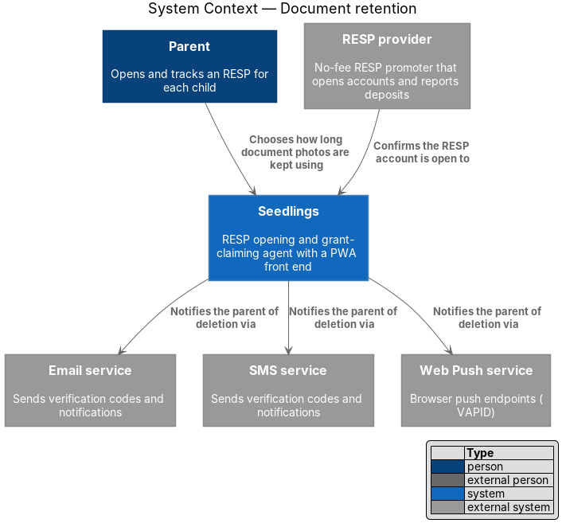
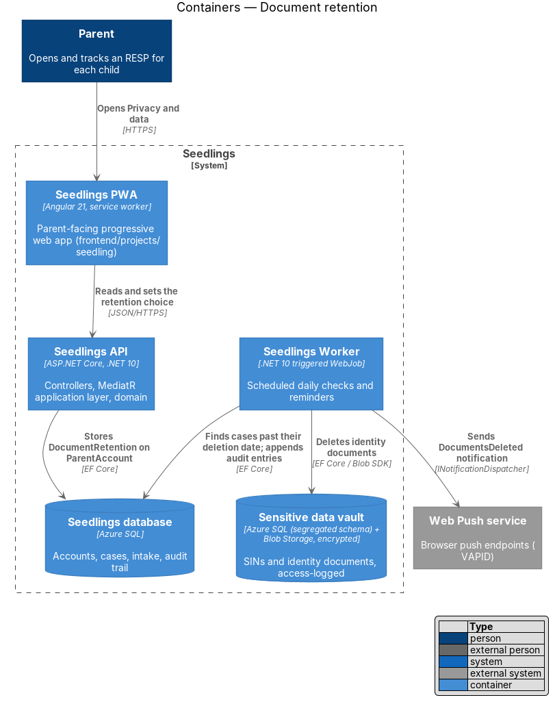
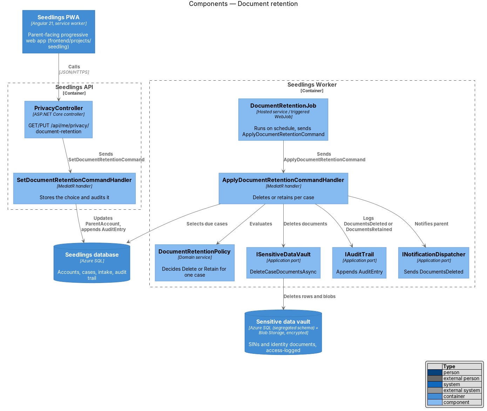
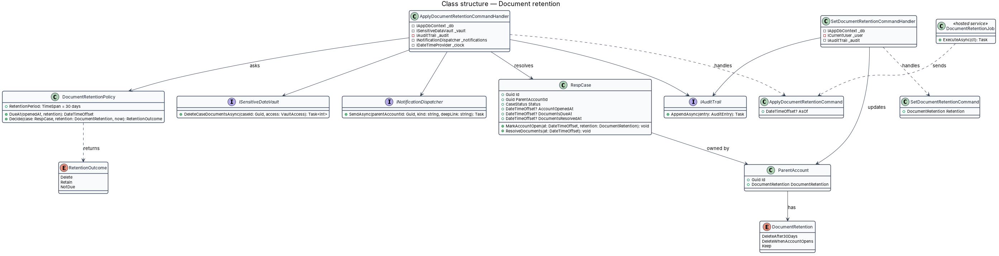
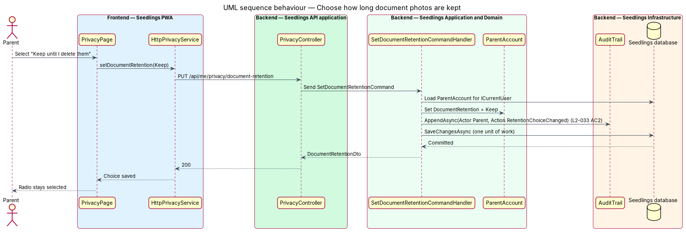
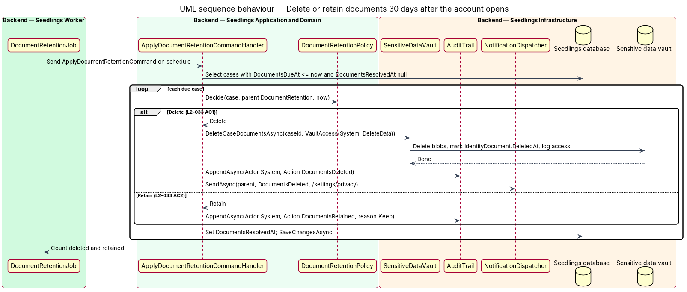

# Document retention

## Overview

During intake the parent photographs identity documents, such as a child's birth certificate, so
the RESP provider can verify the child and the parent. Once the provider confirms the account is
open, Seedlings has no further routine need for those photographs. Keeping them longer only adds
risk. The L1 data-protection requirement (`L1-019`) therefore deletes them after the account opens,
unless the parent chooses to keep them, for example to reuse them for another child.

Terms used below:

- **retention choice** — the parent's setting for how long document photos are kept, held on `ParentAccount.DocumentRetention`
- **account-open date** — the instant the case reaches `CaseStatus.AccountOpen` because the provider confirmed the account (`case-agent/track-submission`)
- **deletion due date** — the account-open date plus the retention period of 30 days, stored per case as `RespCase.DocumentsDueAt`
- **retention run** — one execution of the scheduled job that deletes or retains the documents of every case whose deletion due date has passed

The feature sits in the privacy-and-security subsystem. It reads the case status set by the case
agent, deletes vault items through the `sensitive-data-vault` port, writes to the `audit-trail`, and
notifies the parent through `account-care/notification-channels`.

## Description

### Frontend

- **`PrivacyPage`** (`frontend/projects/seedling/src/app/pages/privacy/privacy.page.ts`, selector
  `app-privacy`) — implements `docs/mocks/pages/privacy.html`. The "Document photos" card is a
  radio group of three `sl-choice` options inside a `fieldset` with the visually hidden legend "How
  long to keep document photos". A change saves immediately; the page holds no form.
- **`PRIVACY_SERVICE`** / `PrivacyService` / `HttpPrivacyService` (`frontend/projects/api`) —
  `getDocumentRetention()` and `setDocumentRetention(retention)`. The same service carries the
  export and deletion calls of `data-export-and-deletion`.

**Mock and requirement alignment.** The mock labels the options "Delete 30 days after a claim is
sent", "Delete as soon as a claim is sent" and "Keep until I delete them". `L2-033` counts the 30
days from the provider's confirmation that the account is open. The design follows `L2-033` and
maps the three mock values (`30`, `now`, `keep`) to `DeleteAfter30Days`, `DeleteWhenAccountOpens`
and `Keep`. The final option wording is `<TO SUPPLY>` and should be corrected in the mock before
implementation. The "Keep until I delete them" option implies a later manual delete of kept
documents; that action has no requirement and is `<TO SUPPLY>`.

### Backend

- **`DocumentRetention`** enum (`Seedling.Domain/Enums`) — `DeleteAfter30Days` (default),
  `DeleteWhenAccountOpens`, `Keep`.
- **`ParentAccount.DocumentRetention`** — the parent's choice. It applies to every case of the
  parent, as the mock places it in account settings.
- **`RespCase`** gains `AccountOpenedAt`, `DocumentsDueAt` and `DocumentsResolvedAt`. The
  transition to `AccountOpen` (owned by `case-agent/track-submission`) calls
  `RespCase.MarkAccountOpen(at, retention)`, which sets `DocumentsDueAt` from
  `DocumentRetentionPolicy.DueAt`.
- **`DocumentRetentionPolicy`** (`Seedling.Domain`) — deterministic domain service. The retention
  period is 30 days. `Decide(case, retention, now)` returns `NotDue`, `Delete` or `Retain`;
  `Keep` yields `Retain`.
- **`PrivacyController`** — `GET /api/me/privacy/document-retention` and
  `PUT /api/me/privacy/document-retention` with body `{ "retention": "Keep" }`. An unknown value
  answers `400` through `ValidationBehavior`.
- **`SetDocumentRetentionCommand`** / **`SetDocumentRetentionCommandHandler`** — update the current
  parent's account and append an `AuditEntry` (`Actor = Parent`, `Action = RetentionChoiceChanged`)
  in the same unit of work. Setting the current value again succeeds without a second entry.
- **`ApplyDocumentRetentionCommand`** / **`ApplyDocumentRetentionCommandHandler`** — select cases
  with `DocumentsDueAt <= now` and `DocumentsResolvedAt` empty. For each case:
  - `Delete`: call `ISensitiveDataVault.DeleteCaseDocumentsAsync(caseId,
    VaultAccess(System, "document-retention", DeleteData))`, append `AuditEntry` (`Actor = System`,
    `Action = DocumentsDeleted`), and send a `DocumentsDeleted` notification with a deep link to
    `/settings/privacy` (L2-033 criterion 1).
  - `Retain`: append `AuditEntry` (`Actor = System`, `Action = DocumentsRetained`, reason `Keep`)
    (L2-033 criterion 2).
  - Set `DocumentsResolvedAt` and save, so a re-run neither deletes twice nor logs twice.
- **`ISensitiveDataVault.DeleteCaseDocumentsAsync`** — deletes each blob, sets
  `IdentityDocument.DeletedAt`, and writes one access-log entry per document. Blob soft delete
  stays disabled on the vault container so a deleted photo is not recoverable from storage. Azure
  SQL point-in-time restore keeps document metadata, not document bytes, for 7 days.
- **`DocumentRetentionJob`** (`Seedling.Worker`) — hosted service that sends
  `ApplyDocumentRetentionCommand`. It reads its schedule from `Seedling:DocumentRetention:Schedule`
  and honours `RunOnceThenExit`, as `Seedling.Worker/Program.cs` prescribes. It ships as the
  triggered WebJob `backend/deploy/webjobs/document-retention/` (`run.sh`, `settings.job`,
  `README.md`). The cron expression is `<TO SUPPLY>`; it should run at least once a day so a
  deletion happens on its due date.

### Implementation slices

1. **Retention choice** — enum, `ParentAccount.DocumentRetention`, `PrivacyController`, the radio
   group on `PrivacyPage`, and the `RetentionChoiceChanged` audit entry.
2. **Deletion due date** — `RespCase.MarkAccountOpen` and `DocumentRetentionPolicy.DueAt`; an API
   test confirms the date is 30 days after the account opens.
3. **Delete and notify** — `ApplyDocumentRetentionCommandHandler` delete branch, the vault call and
   the notification. Covers L2-033 criterion 1.
4. **Retain and log** — the `Keep` branch and its audit entry. Covers L2-033 criterion 2.
5. **Scheduled run** — `DocumentRetentionJob` and its WebJob folder.

## Requirements

| L2 ID | Refines (L1) | Requirement |
|-------|--------------|-------------|
| `L2-033` | `L1-019` | Identity documents shall be deleted 30 days after the provider confirms the account is open unless the parent opts to keep them. |

## Diagrams

### System context

The provider's confirmation that the account is open starts the 30-day clock. Seedlings tells the
parent through their notification channel when the photos are deleted.

### Containers

The PWA and the API record the parent's choice. The Worker applies it on schedule: it deletes from
the vault, writes the audit trail and sends the notification.

### Components

`PrivacyController` and `SetDocumentRetentionCommandHandler` store the choice. In the Worker,
`DocumentRetentionJob` sends the command whose handler asks `DocumentRetentionPolicy` for a decision
per case and calls the vault, the audit trail and the notification dispatcher.

### Class structure

The parent's `DocumentRetention` and the case's `DocumentsDueAt` feed `DocumentRetentionPolicy`.
`ApplyDocumentRetentionCommandHandler` acts on the decision through three application ports.

### Behaviour — choose how long document photos are kept

Selecting an option saves it at once and appends a `RetentionChoiceChanged` entry in the same unit
of work, so the choice is logged as `L2-033` criterion 2 requires.

### Behaviour — delete or retain 30 days after the account opens

Each retention run handles every due case once. The `Delete` branch removes the documents and
notifies the parent; the `Retain` branch logs the parent's choice. Both mark the case resolved.

