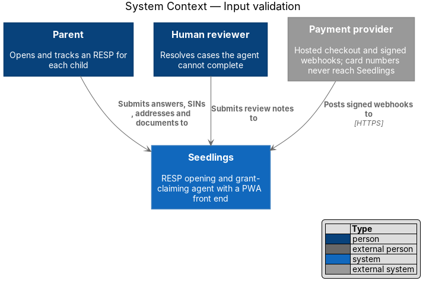
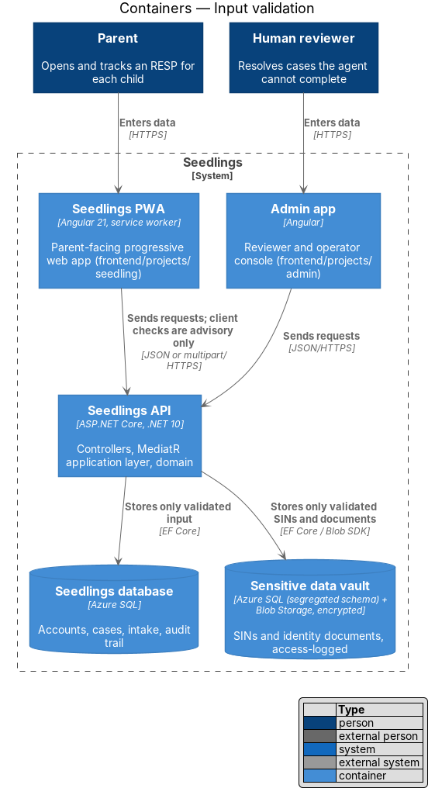
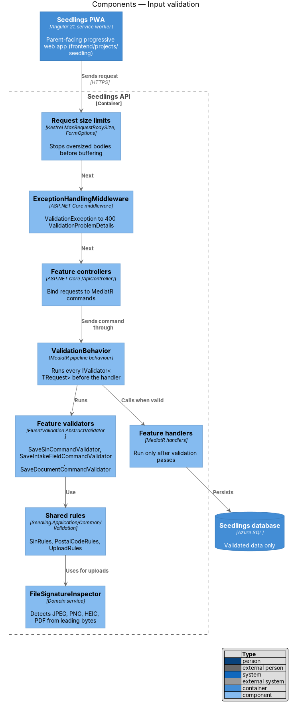
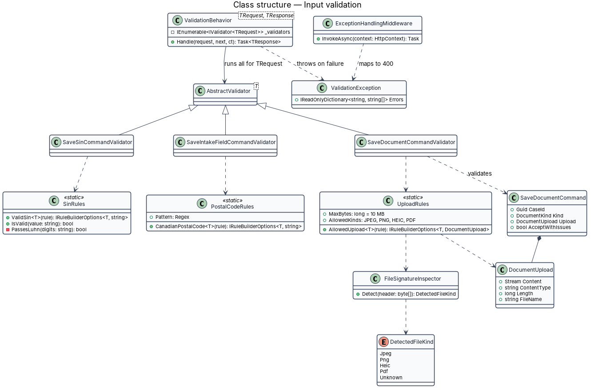
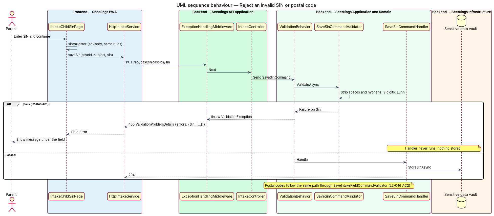
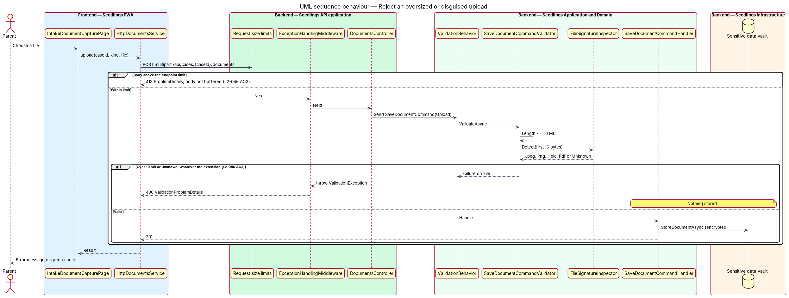
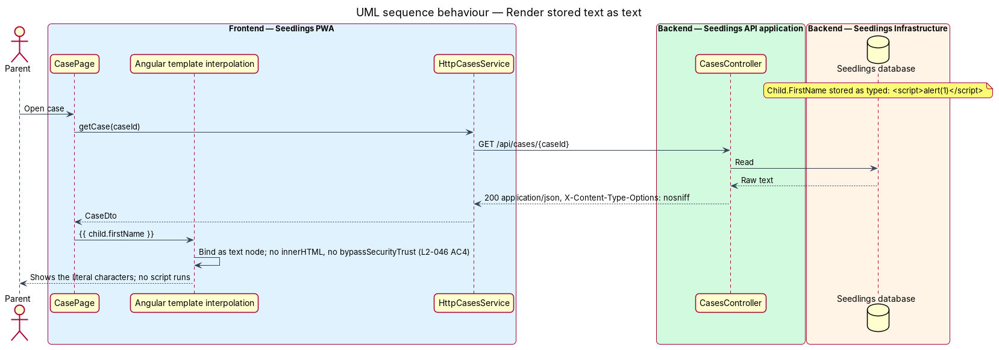

# Input validation

## Overview

Seedlings accepts input from parents, reviewers and one external system (the payment provider's
webhook). Client-side checks in the PWA help the parent correct mistakes early, but a client can be
bypassed: any HTTP tool can send any body to the API. The L1 data-protection requirement (`L1-019`)
therefore asks that every external input be validated on the server.

Terms used below:

- **server-side validation** — checks the API applies to a request before any handler logic runs or any data is stored
- **field error** — one entry in the `errors` map of an RFC 7807 `ValidationProblemDetails` response, keyed by the request property name
- **Luhn check** — the mod-10 checksum that every valid SIN satisfies
- **file signature** — the fixed leading bytes that identify a file format regardless of its name or declared type
- **output encoding** — rendering stored text as literal characters, so markup in it is shown and never run

The feature is cross-cutting. It builds on the scaffold's `ValidationBehavior` and
`ExceptionHandlingMiddleware` and gives every feature a shared set of rules for the inputs that
`L2-046` names: SINs, Canadian postal codes, uploaded documents, and free text.

## Description

### What the scaffold already provides

- **`ValidationBehavior<TRequest, TResponse>`** (`Seedling.Application/Behaviors/`) — a MediatR
  pipeline behaviour registered in `AddApplication`. It runs every `IValidator<TRequest>` found by
  `AddValidatorsFromAssembly`, groups failures by `PropertyName`, and throws the application's
  `ValidationException`. The handler does not run, so nothing is stored.
- **`ExceptionHandlingMiddleware`** (`Seedling.Api/Middleware/`) — maps `ValidationException` to
  `400` with `ValidationProblemDetails` and content type `application/problem+json`.
- **`[ApiController]`** model binding — malformed JSON or a wrong type answers `400` with
  `ValidationProblemDetails` before the controller runs.

The design keeps all three and adds the rules below. Every command and query with external input
has a validator; a command without one is a review finding, not an architecture test.

### Shared rules (`Seedling.Application/Common/Validation/`)

- **`SinRules.ValidSin()`** — a FluentValidation rule extension. It removes spaces and hyphens,
  then requires exactly 9 digits and a passing Luhn check. A failure adds a field error on the SIN
  property (L2-046 criterion 1). `SaveSinCommandValidator` (intake) and the SIN field validator of
  `case-agent/prefill-forms` use it. The rule never echoes the submitted value in its message.
- **`PostalCodeRules.CanadianPostalCode()`** — matches the Canadian format letter-digit-letter,
  optional space, digit-letter-digit, case-insensitive, excluding the letters D, F, I, O, Q and U,
  and W and Z in the first position:
  `^[ABCEGHJ-NPRSTVXY]\d[ABCEGHJ-NPRSTV-Z] ?\d[ABCEGHJ-NPRSTV-Z]\d$` (L2-046 criterion 2).
  `SaveIntakeFieldCommandValidator` applies it to the address step and
  `ReportLifeChangeCommandValidator` to an address change.
- **`UploadRules.AllowedUpload()`** — applies to the `DocumentUpload` carried by
  `SaveDocumentCommand` (`intake/capture-document`). It requires `Length` of at most 10 MB
  (10,485,760 bytes) and a detected kind of JPEG, PNG, HEIC or PDF. The detected kind comes from
  `FileSignatureInspector`; the file name and the declared content type are ignored
  (L2-046 criterion 3).
- **`FileSignatureInspector`** — reads the first 16 bytes: JPEG `FF D8 FF`; PNG
  `89 50 4E 47 0D 0A 1A 0A`; PDF `25 50 44 46 2D` (`%PDF-`); HEIC an ISO base media `ftyp` box at
  offset 4 with brand `heic`, `heix`, `hevc`, `hevx`, `mif1` or `msf1`. Anything else is `Unknown`.
- **Free-text rules** — each text field has a maximum length set by its feature. Text is stored as
  entered; the server does not strip markup, because output encoding (below) makes it inert.

### Request limits

- `DocumentsController.Save` carries `[RequestSizeLimit]` and `[RequestFormLimits]` so Kestrel
  stops reading a body that exceeds the upload limit plus multipart overhead and answers `413`. The
  overhead allowance is `<TO SUPPLY>`. The body is never written to the vault, so nothing is stored.
- Every other endpoint keeps the Kestrel default maximum body size.

### Output encoding (L2-046 criterion 4)

- **PWA and admin app** — templates bind user text with interpolation (`{{ }}`) or property
  bindings, which Angular renders as text nodes. `[innerHTML]` and `DomSanitizer.bypassSecurityTrust*`
  are not used with any user-supplied value; review enforces this rule.
- **API** — responses are `application/json`. `X-Content-Type-Options: nosniff` is already a
  global header of the Static Web Apps and is added to API responses, so a browser never sniffs JSON
  as HTML.
- **Emails and notifications** — templates HTML-encode every inserted value.
- A `Content-Security-Policy` header for the static apps, as a second layer, is `<TO SUPPLY>`.

### Frontend

- `frontend/projects/seedling/src/app/shared/validators/` holds `sinValidator`,
  `postalCodeValidator` and an upload pre-check that mirror the server rules for early feedback.
  The server remains the authority.
- Pages map the `errors` of a `400` response onto the matching field with `aria-invalid="true"`
  and the field's error text, as in the mocks.

### Tests

API integration tests in `Seedling.Api.Tests` post each criterion's invalid input and assert the
`400` field error, and for SINs and uploads also assert that the vault holds no new row. A
Playwright test stores `<script>` text in a child's name and asserts it appears as literal text on
the case screen.

### Implementation slices

1. **SIN rule** — `SinRules` in `SaveSinCommandValidator`; covers L2-046 criterion 1.
2. **Postal code rule** — `PostalCodeRules` in the address validators; covers L2-046 criterion 2.
3. **Upload size and type** — `UploadRules`, `FileSignatureInspector`, request limits; covers
   L2-046 criterion 3.
4. **Text rendered as text** — the Playwright check and the `nosniff` header on the API; covers
   L2-046 criterion 4.

## Requirements

| L2 ID | Refines (L1) | Requirement |
|-------|--------------|-------------|
| `L2-046` | `L1-019` | Every input shall be validated on the server, whatever the client has already checked. |

## Diagrams

### System context

Parents, reviewers and the payment provider's webhook are the three sources of external input that
Seedlings validates.

### Containers

The PWA and the admin app check input for early feedback only. The API validates every request
before anything reaches the database or the vault.

### Components

Request size limits stop oversized bodies first. `ValidationBehavior` then runs the feature
validators, which use the shared rules and `FileSignatureInspector`. Handlers run only when every
validator passes.

### Class structure

The scaffold's `ValidationBehavior` runs `AbstractValidator<T>` subclasses and throws
`ValidationException`, which `ExceptionHandlingMiddleware` maps to `400`. The validators delegate to
the static rule classes.

### Behaviour — reject an invalid SIN or postal code

A SIN that is not 9 digits or fails the Luhn check produces a `400` with a field error, and the
handler never runs. A postal code follows the same path through its own validator.

### Behaviour — reject an oversized or disguised upload

An upload over the request limit is cut off with `413`. Within the limit, a file over 10 MB or with
an unrecognized signature is rejected with `400` whatever its extension, and nothing is stored.

### Behaviour — render stored text as text

Text containing markup is stored as entered and returned as JSON. Angular interpolation renders it
as a text node, so the characters are shown and no script runs.

