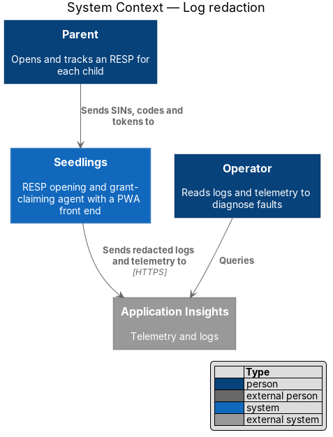
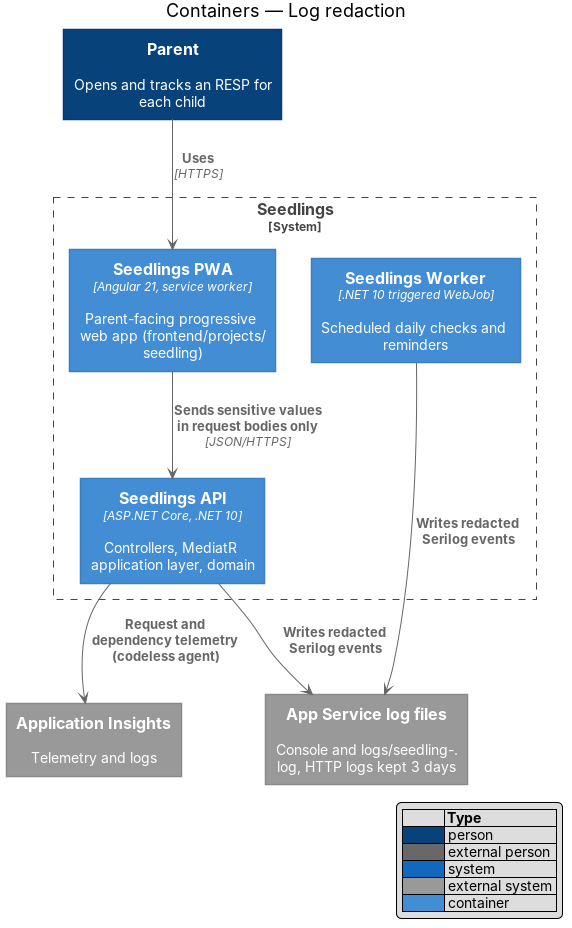
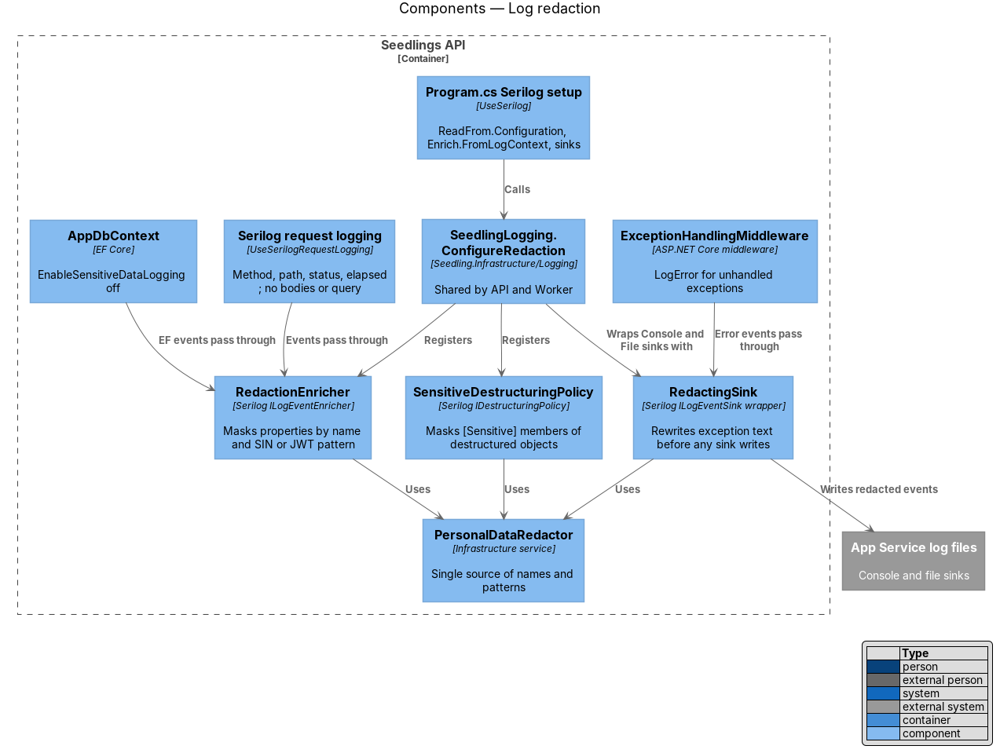
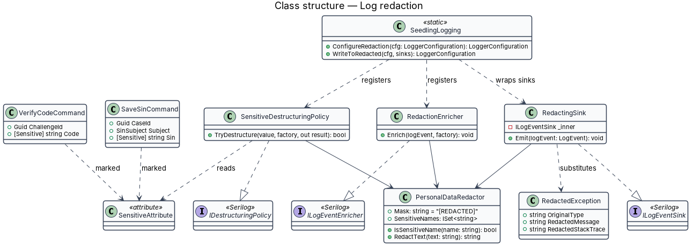
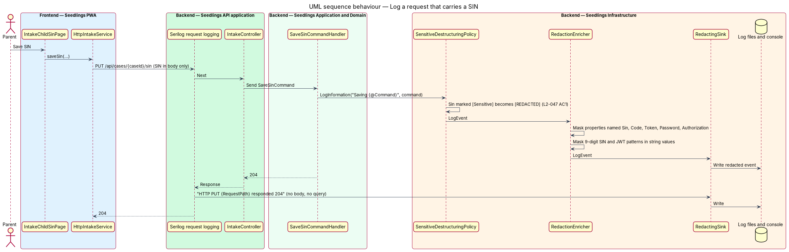
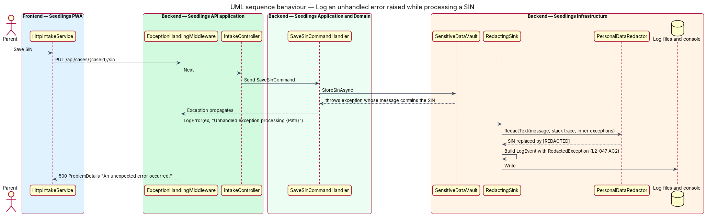

# Log redaction

## Overview

Logs and telemetry exist to diagnose faults. They are read by operators, kept for days, copied into
Log Analytics, and protected less tightly than the sensitive data vault. A SIN, a one-time code or a
token written into a log line would escape every control the vault applies. The L1 data-protection
requirement (`L1-019`) therefore forbids writing any secret or personal information to logs in
plaintext, and `L2-047` names the values that shall never appear.

Terms used below:

- **sensitive value** — a SIN, a one-time verification code, an access or refresh token, a card detail, or the content of a document
- **redaction** — replacement of a sensitive value by the fixed marker `[REDACTED]` before a log event reaches any sink
- **sink** — a Serilog destination that writes log events, such as the console or a rolling file
- **destructuring** — Serilog's capture of an object's properties when a message template uses `{@Name}`
- **telemetry** — request and dependency records that the Application Insights agent collects outside Serilog

The feature is cross-cutting. It extends the Serilog setup in the API's `Program.cs`, applies the
same setup to the Worker, and sets rules for request logging, EF Core and telemetry.

## Description

### What the scaffold already provides

- **`Program.cs`** creates a bootstrap logger (`WriteTo.Console()`), then calls
  `builder.Host.UseSerilog(...)` with `ReadFrom.Configuration`, `ReadFrom.Services`,
  `Enrich.FromLogContext()`, `WriteTo.Console()` and
  `WriteTo.File("logs/seedling-.log", rollingInterval: RollingInterval.Day)`, with
  `preserveStaticLogger: true`.
- **`app.UseSerilogRequestLogging()`** sits outside `ExceptionHandlingMiddleware`, so handled
  statuses are logged. Its event records method, path, status and elapsed time. It records no
  body, no headers and no query string.
- **`ExceptionHandlingMiddleware`** logs unhandled exceptions with
  `LogError(ex, "Unhandled exception processing {Path}", ...)`. That call passes the raw exception,
  whose message or inner exceptions may hold a submitted value.
- **`ConnectionStringSanitizer`** (`Seedling.Cli/Database/`) already strips passwords from
  connection strings before the CLI logs them, and stays as it is.
- **`main.bicep`** sends codeless Application Insights telemetry
  (`ApplicationInsightsAgent_EXTENSION_VERSION ~3`), writes App Service HTTP logs to the file system
  for 3 days, and keeps Log Analytics data for 30 days.

### What the feature adds (`Seedling.Infrastructure/Logging/`)

- **`SensitiveAttribute`** (`Seedling.Application/Common/`) — marks a property as a sensitive value.
  It is applied to `SaveSinCommand.Sin`, the code property of the verification commands, token
  properties, and the content of `DocumentUpload`.
- **`PersonalDataRedactor`** — the single list of sensitive property names (`Sin`, `Code`, `Otp`,
  `Token`, `AccessToken`, `RefreshToken`, `Password`, `Authorization`, `CardNumber`, `Content`,
  case-insensitive) and of text patterns: a 9-digit SIN with optional spaces or hyphens, and a JSON
  Web Token (`eyJ` followed by two dot-separated base64url segments). `RedactText` replaces each
  match by `[REDACTED]`. The length of a one-time code is set by
  `identity-and-access/sign-up-and-verify` and is `<TO SUPPLY>` here; codes are redacted by
  property name, not by pattern, so ordinary numbers stay readable.
- **`SensitiveDestructuringPolicy`** — a Serilog `IDestructuringPolicy`. When an object is
  destructured, each property with `[Sensitive]` becomes `[REDACTED]` (L2-047 criterion 1).
- **`RedactionEnricher`** — a Serilog `ILogEventEnricher` that replaces the value of any event
  property whose name is sensitive, and runs `RedactText` over every string property value. Because
  Serilog renders the message from those properties, the rendered text is redacted too.
- **`RedactingSink`** — wraps each real sink. When an event carries an exception, it builds a new
  `LogEvent` whose exception is a `RedactedException`: the original type name, and the message,
  stack trace and inner-exception messages passed through `RedactText` (L2-047 criterion 2). Serilog
  exposes a log event's exception as read-only, so the substitution happens here rather than in an
  enricher.
- **`SeedlingLogging.ConfigureRedaction(LoggerConfiguration)`** — registers the policy and the
  enricher, and wraps the console and file sinks with `RedactingSink`. `Program.cs` calls it inside
  `UseSerilog`; `Seedling.Worker/Program.cs`, which today uses the default host logging, adopts the
  same Serilog setup through it. The bootstrap logger writes only start-up and fatal events, and
  also passes through `RedactingSink`.

### Rules for the other log paths

- **Request bodies and query strings** — the API does not enable ASP.NET Core `HttpLogging` or any
  body logging. Sensitive values travel only in request bodies or the `Authorization` header, never
  in a path or query string, because App Service HTTP logs and Application Insights request
  telemetry record URLs.
- **EF Core** — `EnableSensitiveDataLogging()` stays off outside tests, so SQL parameter values are
  never logged.
- **Application Insights** — the codeless agent records requests and dependencies. Whether it also
  captures SQL command text, and whether log events reach Application Insights through Serilog, is
  `<TO SUPPLY>`. Any Serilog sink added for Application Insights is wrapped by `RedactingSink`.
- **Front end** — the PWA and the admin app send no client logs or telemetry today. A future client
  telemetry channel is `<TO SUPPLY>` and shall apply the same rules.
- **Vault access log and audit trail** — these are records, not logs. They hold actors, purposes
  and field names, never sensitive values (`sensitive-data-vault`, `audit-trail`).

### Tests

`Seedling.Api.Tests` replaces the sinks with an in-memory sink wrapped by `RedactingSink`. One test
posts a valid SIN and a verification code and asserts that no captured event, including the request
event, contains either value. A second test uses a test double of `ISensitiveDataVault` that throws
an exception whose message contains the posted SIN, and asserts that the logged error does not
contain it. The in-memory sink package is `<TO SUPPLY>` in `Directory.Packages.props`.

### Implementation slices

1. **Redaction of destructured commands and named properties** — `SensitiveAttribute`,
   `PersonalDataRedactor`, `SensitiveDestructuringPolicy`, `RedactionEnricher`; covers L2-047
   criterion 1.
2. **Redaction of exceptions** — `RedactingSink` and `RedactedException`; covers L2-047 criterion 2.
3. **Worker logging** — `SeedlingLogging.ConfigureRedaction` in `Seedling.Worker`.
4. **Telemetry review** — confirm the Application Insights settings marked `<TO SUPPLY>` and record
   the result in `main.bicep`.

## Requirements

| L2 ID | Refines (L1) | Requirement |
|-------|--------------|-------------|
| `L2-047` | `L1-019` | No SIN, one-time code, token, card detail or document content shall be written to application logs or telemetry. |

## Diagrams

### System context

Parents send sensitive values to Seedlings. Only redacted logs and telemetry reach Application
Insights, where operators read them.

### Containers

The API and the Worker write redacted Serilog events to the App Service log files. The PWA keeps
sensitive values in request bodies, out of the URLs that HTTP logs and telemetry record.

### Components

`Program.cs` calls `SeedlingLogging.ConfigureRedaction`, which registers the destructuring policy
and the enricher and wraps every sink. Request logging, `ExceptionHandlingMiddleware` and EF Core
events all pass through the same components.

### Class structure

The three Serilog extension points share one `PersonalDataRedactor`. Commands mark sensitive
properties with `SensitiveAttribute`, which the destructuring policy reads.

### Behaviour — log a request that carries a SIN

The handler logs the destructured command; the policy and the enricher replace the SIN before the
sink writes. The request event records only method, path and status.

### Behaviour — log an unhandled error raised while processing a SIN

An exception whose message contains the SIN reaches `ExceptionHandlingMiddleware`. `RedactingSink`
substitutes a `RedactedException` before writing, and the client receives a generic `500`.

