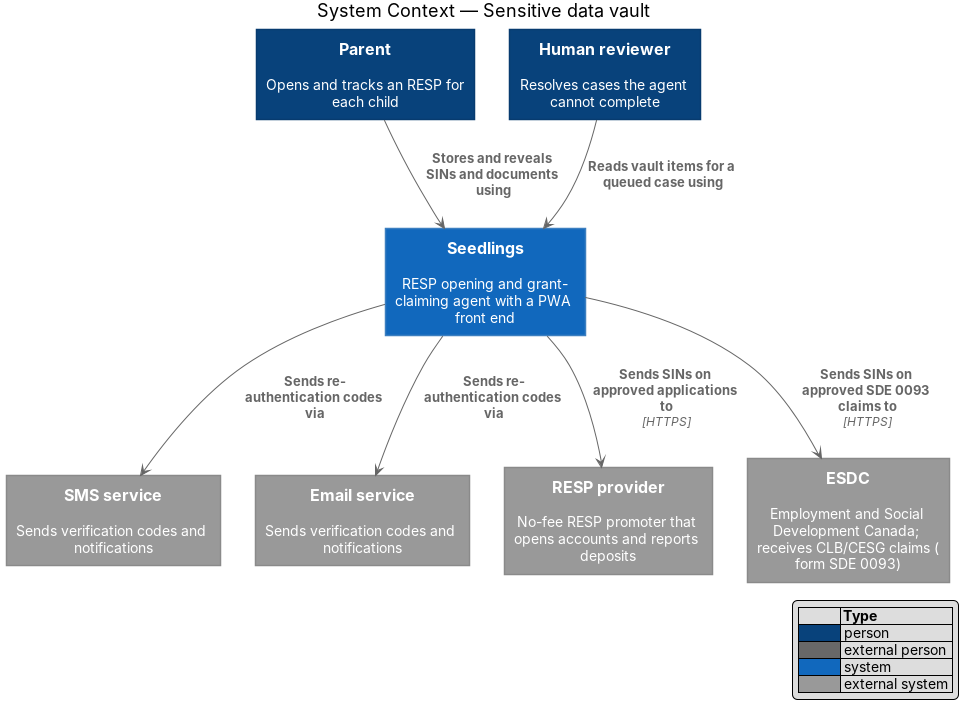
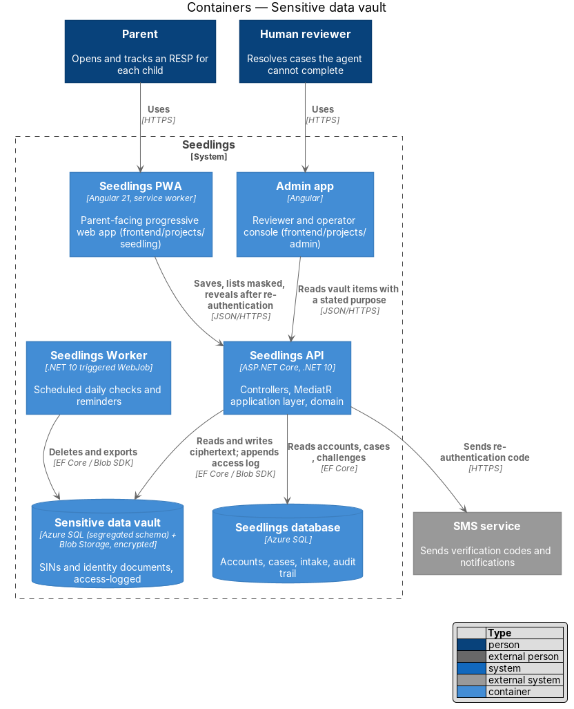
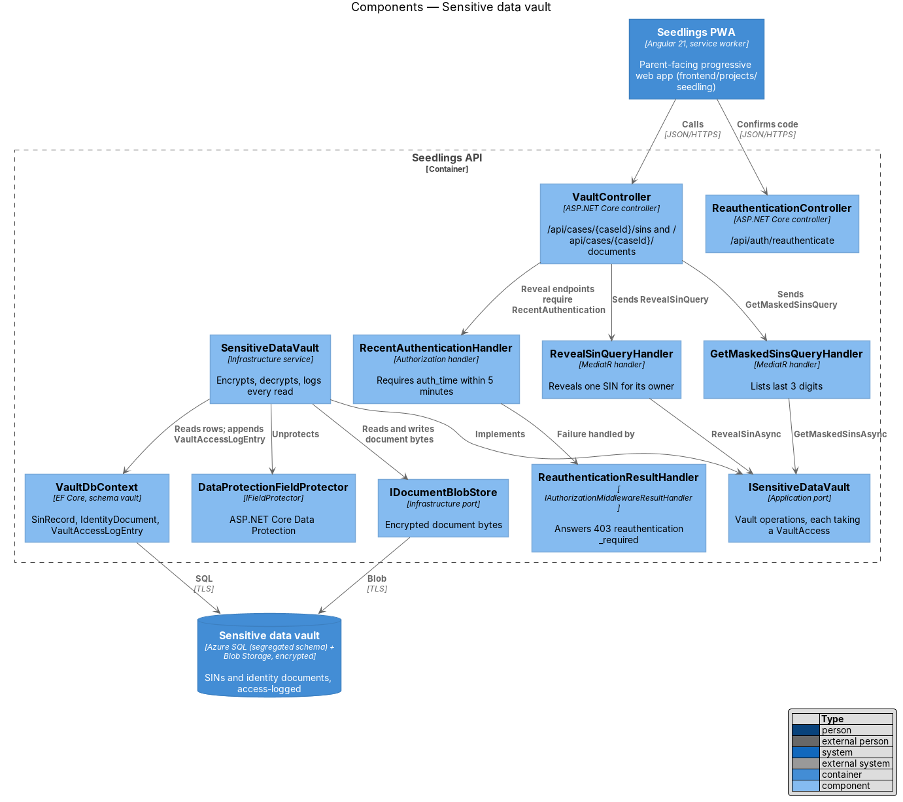
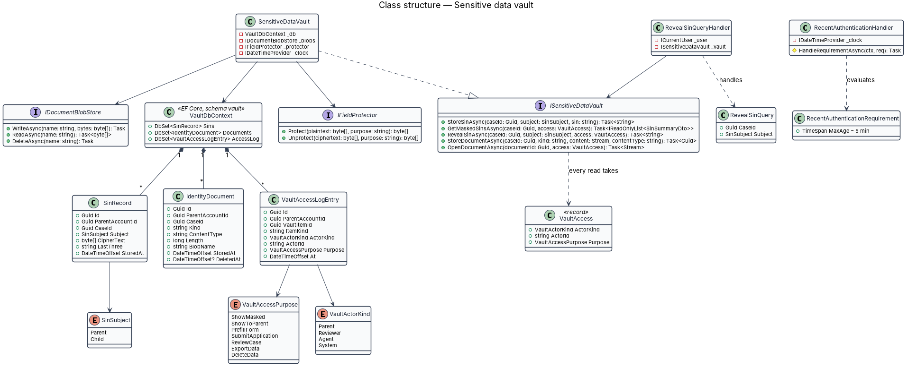
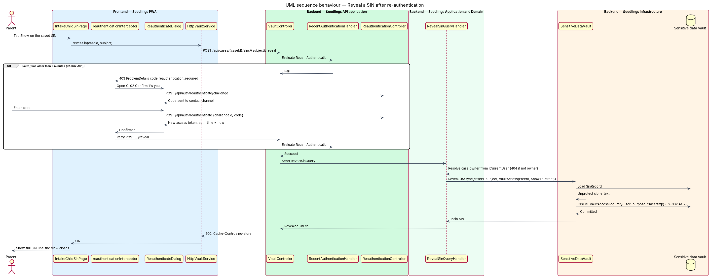
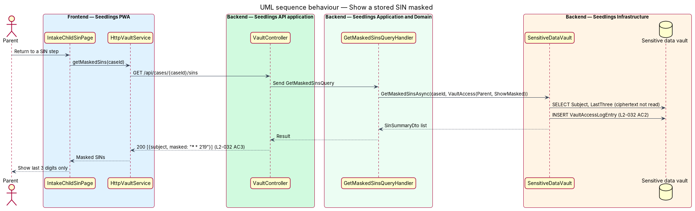
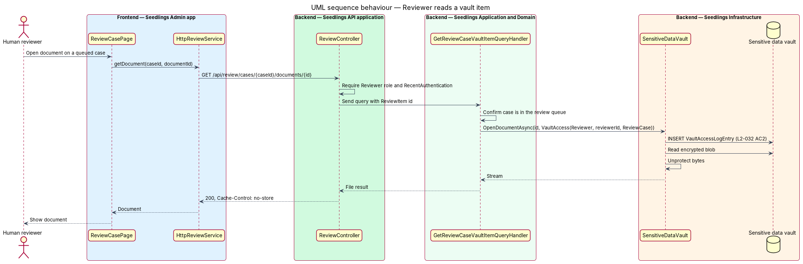

# Sensitive data vault

## Overview

To open an RESP and claim the CLB and CESG, Seedlings collects the SIN of the parent and of each
child, and photographs of identity documents such as a birth certificate. These items carry a
higher risk than other personal data: a leaked SIN enables identity theft. The L1 data-protection
requirement (`L1-019`) therefore keeps them apart from the rest of the data, logs every read, and
shows them only after the parent proves again who they are.

Terms used below:

- **sensitive data vault** — segregated store for SINs and identity documents, reachable only through one application port, with every read logged
- **vault item** — one stored SIN (`SinRecord`) or one stored identity document (`IdentityDocument`)
- **access log** — append-only list of `VaultAccessLogEntry` rows recording who read which vault item, for what purpose, and when
- **re-authentication** — fresh proof of identity by a one-time code, required when the last authentication is more than 5 minutes old
- **auth time** — the `auth_time` claim in the access token; the instant the parent last proved their identity with a code
- **masked SIN** — a SIN shown with only its last 3 digits visible

The vault sits in the privacy-and-security subsystem. The intake features write into it
(`intake/complete-intake-steps` stores SINs; `intake/capture-document` stores documents), the case
agent reads from it to pre-fill and submit forms, a human reviewer reads from it for a queued case
(`L2-045` criterion 3), and the retention and deletion features remove items from it.

## Description

### Data

The vault is the `vault` schema inside the Azure SQL database, mapped by its own EF Core context,
plus one private Blob Storage container for document bytes. The Seedlings database is on the Basic
tier in `main.bicep`, so a separate database is not used. A dedicated SQL principal with rights on
the `vault` schema only is `<TO SUPPLY>`; today the API connects with the server administrator
login from `sqlConnectionString`.

- **`SinRecord`** — `Id`, `ParentAccountId`, `CaseId`, `Subject` (`SinSubject {Parent, Child}`),
  `CipherText`, `LastThree`, `StoredAt`. `LastThree` is kept in clear so the masked form needs no
  decryption. One row exists per case and subject; saving again replaces the ciphertext.
- **`IdentityDocument`** — `Id`, `ParentAccountId`, `CaseId`, `Kind`, `ContentType`, `Length`,
  `BlobName`, `StoredAt`, `DeletedAt`. The blob holds Data Protection ciphertext, not the original
  file.
- **`VaultAccessLogEntry`** — `Id`, `ParentAccountId`, `VaultItemId`, `ItemKind`, `ActorKind`
  (`Parent`, `Reviewer`, `Agent`, `System`), `ActorId`, `Purpose`, `At`. The purposes are
  `ShowMasked`, `ShowToParent`, `PrefillForm`, `SubmitApplication`, `ReviewCase`, `ExportData` and
  `DeleteData`. The table is append-only, enforced the same way as the audit trail
  (`audit-trail`).

### Backend

- **`ISensitiveDataVault`** (`Seedling.Application/Abstractions`) — the only port that touches
  vault data. `StoreSinAsync(caseId, subject, sin)` returns the masked form, as the intake design
  already uses it. Every read method takes a `VaultAccess` record (`ActorKind`, `ActorId`,
  `Purpose`), so a caller cannot read without stating a purpose:
  `GetMaskedSinsAsync`, `RevealSinAsync`, `OpenDocumentAsync`. Deletion methods
  (`DeleteCaseDocumentsAsync`, `PurgeAccountAsync`) are listed in `document-retention` and
  `data-export-and-deletion`.
- **`SensitiveDataVault`** (`Seedling.Infrastructure/Vault/`) — implements the port. Each read
  appends a `VaultAccessLogEntry` with the actor, the purpose and `IDateTimeProvider.UtcNow` in the
  same `VaultDbContext.SaveChangesAsync` call that completes the read, so a read with no log entry
  cannot succeed (L2-032 criterion 2).
- **`VaultDbContext`** (`Seedling.Infrastructure/Vault/`) — EF Core context with default schema
  `vault` and sets `Sins`, `Documents` and `AccessLog`. It is registered only for
  `SensitiveDataVault`; `IAppDbContext` exposes none of these sets.
- **`IFieldProtector`** / **`DataProtectionFieldProtector`** — encrypt and decrypt with ASP.NET Core
  Data Protection using the purposes `Seedling.Vault.Sin.v1` and `Seedling.Vault.Document.v1`.
  Key ring location and protection are described in `transport-and-storage-encryption`; the
  key-encryption key and rotation policy are `<TO SUPPLY>`.
- **`IDocumentBlobStore`** / **`BlobDocumentStore`** — write, read and delete encrypted blobs in
  the private container. The container name is `<TO SUPPLY>`. Development and tests use a
  file-system implementation rooted at `Seedling:Storage:Directory`.
- **`RecentAuthenticationRequirement`** / **`RecentAuthenticationHandler`**
  (`Seedling.Api/Authentication/`) — an authorization policy named `RecentAuthentication`. It
  succeeds when `IDateTimeProvider.UtcNow - auth_time` is at most 5 minutes (L2-032 criterion 1).
- **`ReauthenticationResultHandler`** — an `IAuthorizationMiddlewareResultHandler` that turns a
  failed `RecentAuthentication` policy into `403` `ProblemDetails` with `code` =
  `reauthentication_required`. The status matches `case-agent/prefill-forms` and stays distinct
  from the `401` that triggers a token refresh in `identity-and-access/sessions-and-devices`.
- **`ReauthenticationController`** — `POST /api/auth/reauthenticate/challenge` sends a code to the
  parent's contact channel through the verification challenge of
  `identity-and-access/sign-up-and-verify`, with the same rate limits (`L2-043`).
  `POST /api/auth/reauthenticate` checks the code and returns a new access token whose `auth_time`
  is now.
- **`VaultController`** — `GET /api/cases/{caseId}/sins` returns `SinSummaryDto` rows with the
  masked SIN only (L2-032 criterion 3). `POST /api/cases/{caseId}/sins/{subject}/reveal` and
  `GET /api/cases/{caseId}/documents/{documentId}/content` carry `[Authorize(Policy =
  "RecentAuthentication")]`. Both send `Cache-Control: no-store`. A case owned by another parent
  answers `404` (`L2-045`).
- **`GetMaskedSinsQueryHandler`**, **`RevealSinQueryHandler`**, **`OpenDocumentQueryHandler`** —
  MediatR handlers that resolve the case owner through `ICurrentUser`
  (`identity-and-access/case-authorization`) and call the port with
  `VaultAccess(Parent, parentId, purpose)`.
- **Reviewer reads** — the admin app reads through `ReviewController` with the reviewer role, the
  `RecentAuthentication` policy and `VaultAccess(Reviewer, reviewerId, ReviewCase)`. The handler
  admits a read only for a case with an open `ReviewItem`.

### Frontend

- **`VAULT_SERVICE`** / `VaultService` / `HttpVaultService` (`frontend/projects/api`) —
  `getMaskedSins(caseId)`, `revealSin(caseId, subject)`, `openDocument(caseId, documentId)`.
- **`reauthenticationInterceptor`** (`frontend/projects/api/src/lib/auth/`) — on a `403` whose
  `code` is `reauthentication_required`, asks the `REAUTHENTICATION_PROMPT` token to confirm the
  parent, then retries the request once. A cancelled prompt rejects the original call.
- **`REAUTHENTICATION_PROMPT`** — injection token bound in `app.config.ts` to an implementation that
  opens `ReauthenticateDialog`.
- **`ReauthenticateDialog`** (`frontend/projects/seedling/src/app/dialogs/reauthenticate/`) — the
  CDK dialog from mock C-02 "Confirm it's you" in `docs/mocks/pages/system-states.html`. It
  requests a challenge, accepts the code (`autocomplete="one-time-code"`) and stores the returned
  token. The mock's "Use Face ID instead" option is `<TO SUPPLY>`: no requirement covers WebAuthn.
- **SIN steps** — `IntakeChildSinPage` and the parent SIN page (`docs/mocks/pages/intake.child-sin.html`,
  `intake.parent-sin.html`) show the stored SIN masked and reveal it through `revealSin`. The full
  value lives only in a component signal and is cleared when the view is destroyed.

### Implementation slices

1. **Vault schema and SIN storage** — `VaultDbContext`, `SinRecord`, `DataProtectionFieldProtector`,
   `StoreSinAsync`; the masked list. Covers L2-032 criterion 3.
2. **Access log on every read** — `VaultAccessLogEntry` and the `VaultAccess` argument on each read
   method. Covers L2-032 criterion 2.
3. **Recent-authentication policy** — `auth_time`, `RecentAuthenticationHandler`,
   `ReauthenticationResultHandler`, the reveal endpoint. Covers L2-032 criterion 1 at the API.
4. **Re-authentication dialog** — `ReauthenticationController`, `reauthenticationInterceptor`,
   `ReauthenticateDialog`. Covers L2-032 criterion 1 end to end in Playwright.
5. **Documents in the vault** — `IdentityDocument`, `BlobDocumentStore`, the content endpoint with
   the policy and the log. Covers L2-032 criteria 1 and 2 for documents.
6. **Reviewer reads** — the review endpoint and `ReviewCase` purpose. Covers L2-032 criterion 2 for
   reviewers together with `L2-045` criterion 3.

## Requirements

| L2 ID | Refines (L1) | Requirement |
|-------|--------------|-------------|
| `L2-032` | `L1-019` | SINs and identity documents shall be stored in a separate store with per-access logging and shown only after re-authentication. |

## Diagrams

### System context

The parent and the reviewer read vault items through Seedlings. Re-authentication codes go out
through the SMS and email services, and SINs leave the system only on approved submissions to the
provider and ESDC.

### Containers

The PWA and the admin app reach the vault only through the Seedlings API. The Worker reaches it to
delete and export. No front end connects to the vault directly.

### Components

`VaultController` guards the reveal endpoints with the `RecentAuthentication` policy. The handlers
call `ISensitiveDataVault`, whose implementation decrypts through `DataProtectionFieldProtector` and
appends to the access log through `VaultDbContext`.

### Class structure

`SensitiveDataVault` composes the vault context, the blob store and the field protector. Every read
method on `ISensitiveDataVault` takes a `VaultAccess`, which becomes a `VaultAccessLogEntry`.

### Behaviour — reveal a SIN after re-authentication

When the parent's `auth_time` is more than 5 minutes old, the API answers `403`
`reauthentication_required`. The interceptor opens the C-02 dialog, the parent confirms a code, and
the retried request reveals the SIN and writes one access-log entry.

### Behaviour — show a stored SIN masked

Outside the re-authenticated view, the API returns only the last 3 digits. The ciphertext is not
read, but the access is still logged with purpose `ShowMasked`.

### Behaviour — reviewer reads a vault item

A reviewer opens a document on a queued case in the admin app. The access log records the reviewer
and the `ReviewCase` purpose before the decrypted bytes are returned.

