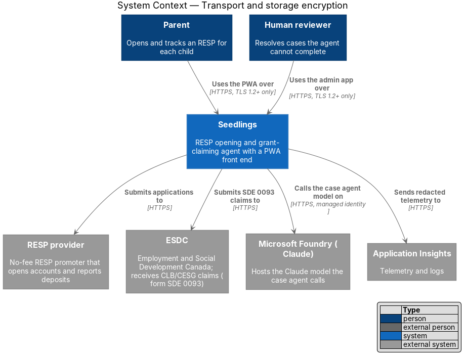
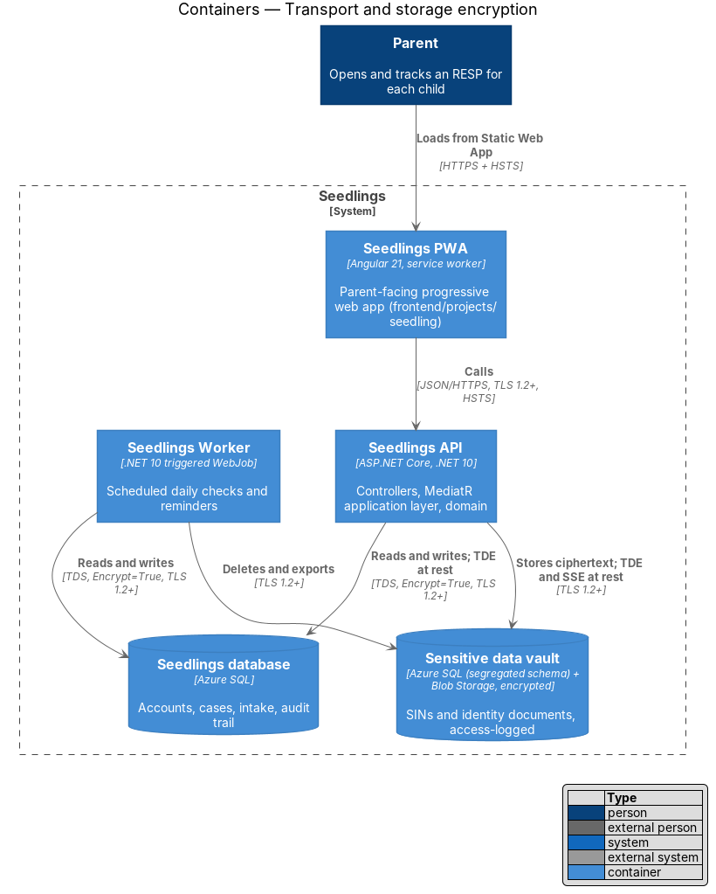
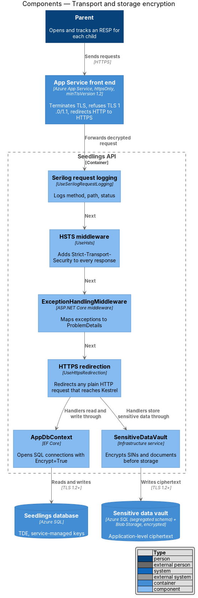
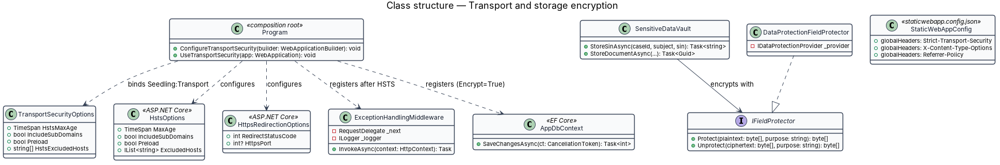
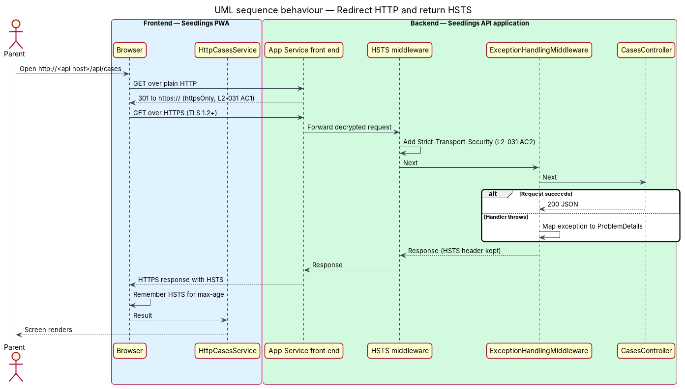
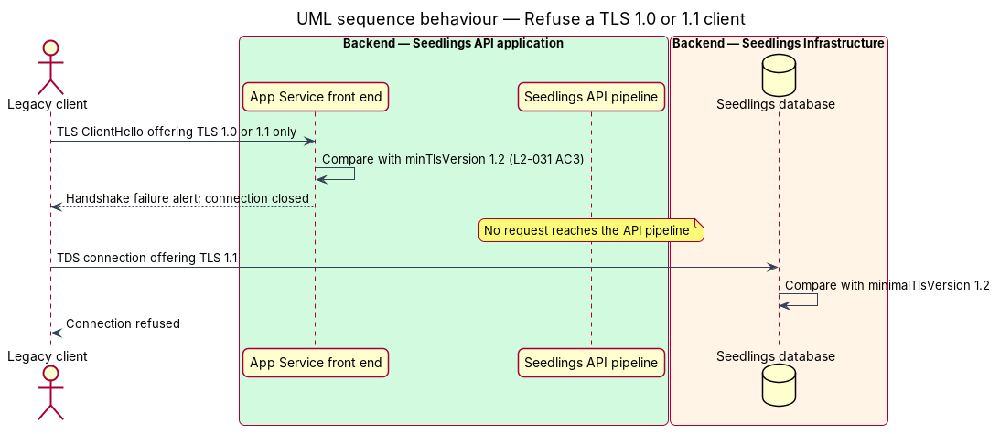
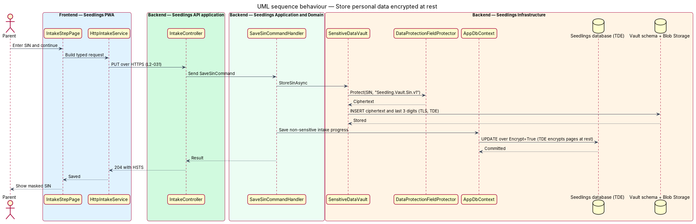

# Transport and storage encryption

## Overview

Seedlings is an installable progressive web app (PWA) through which a parent lets an agent open a
Registered Education Savings Plan (RESP) for a child and claim the Canada Learning Bond (CLB) and the
Canada Education Savings Grant (CESG). To do that work the system holds personal data: names, dates
of birth, addresses, contact details, Social Insurance Numbers (SINs) and photographs of identity
documents.

This feature makes every hop that carries that data encrypted, and every place that stores it
encrypted. It is the foundation the rest of the privacy-and-security subsystem builds on: the
sensitive data vault adds application-level encryption for SINs and documents on top of it, and
the log-redaction feature keeps the same data out of logs.

Terms used below:

- **transport encryption** — protection of data between two processes by Transport Layer Security (TLS)
- **encryption at rest** — protection of data written to disk, so that a copied disk or backup file is unreadable without the key
- **HSTS** — HTTP Strict Transport Security; a response header that tells a browser to use only HTTPS for the host for a stated period
- **TDE** — Transparent Data Encryption; Azure SQL encryption of database pages, logs and backups at rest
- **front end** — Azure App Service component that terminates TLS before a request reaches the Seedlings API process

Most of the controls are platform settings owned by `eng/infra/main.bicep`. The rest are a small
number of lines in the API's `Program.cs` and the Static Web App configuration. The feature has no
screen of its own; the parent sees its effect as the padlock in the browser.

## Description

### What the scaffold already provides

`eng/infra/main.bicep` already sets the following, and the design keeps each one:

| Resource | Setting | Effect |
|----------|---------|--------|
| API Web App (`Microsoft.Web/sites`) | `httpsOnly: true` | The App Service front end answers any plain HTTP request with a redirect to HTTPS (L2-031 criterion 1). |
| API Web App `siteConfig` | `minTlsVersion: '1.2'` | The front end refuses TLS 1.0 and TLS 1.1 handshakes (L2-031 criterion 3). |
| API Web App `siteConfig` | `ftpsState: 'Disabled'` | No FTP or FTPS deployment channel exists. |
| Azure SQL server | `minimalTlsVersion: '1.2'` | The database refuses clients that offer less than TLS 1.2. |
| `sqlConnectionString` | `Encrypt=True;TrustServerCertificate=False` | The API, the CLI and the Worker open encrypted connections and validate the server certificate. |
| Foundry access | managed identity (`agentsAuth = 'ManagedIdentity'`) | Calls to Claude in Microsoft Foundry travel over HTTPS with an Entra token; no key is copied by hand. |

`Program.cs` already calls `app.UseHttpsRedirection()`. Behind App Service the front end performs
the redirect, so this call covers any other host, such as a developer machine.

### What the feature adds

**API (`backend/src/Seedling.Api/Program.cs`)**

- **HSTS middleware** — `builder.Services.AddHsts(...)` bound from a new `Seedling:Transport`
  configuration section (`TransportSecurityOptions`: `HstsMaxAge`, `IncludeSubDomains`, `Preload`,
  `HstsExcludedHosts`). `app.UseHsts()` is placed directly after `UseSerilogRequestLogging()` and
  before `ExceptionHandlingMiddleware`. The middleware writes the header before the rest of the
  pipeline runs, so error responses written by `ExceptionHandlingMiddleware` also carry it
  (L2-031 criterion 2). `ExceptionHandlingMiddleware` does not clear response headers, and the
  design keeps it that way.
- **Excluded hosts** — ASP.NET Core excludes `localhost` from HSTS by default. The API tests run
  through `WebApplicationFactory` on `localhost`, so the test host clears `HstsExcludedHosts` to
  observe the header. Production keeps the empty list.
- **HSTS values** — `max-age` is `<TO SUPPLY>` (the ASP.NET Core default is 30 days);
  `includeSubDomains` and `preload` are `<TO SUPPLY>` until the custom domains in
  `appCustomDomain` and `adminCustomDomain` are fixed.

**Static Web Apps (`frontend/projects/<app>/public/staticwebapp.config.json`)**

- The `seedling` and `admin` applications add `"Strict-Transport-Security"` to `globalHeaders`, beside
  the existing `X-Content-Type-Options` and `Referrer-Policy`. Azure Static Web Apps serves only
  HTTPS and redirects HTTP to HTTPS. The header value matches the API's `<TO SUPPLY>` policy.

**Storage at rest**

- **Seedlings database** — Azure SQL Database enables TDE with service-managed keys by default.
  The template does not disable it. Customer-managed keys are `<TO SUPPLY>`.
- **Sensitive data vault** — SINs and document bytes are encrypted by the application before they
  reach storage (see `sensitive-data-vault`). `DataProtectionFieldProtector` implements
  `IFieldProtector` with ASP.NET Core Data Protection. The key ring persists under
  `Seedling__Storage__Directory` (`/home/data`, the plan's persistent share named in `main.bicep`).
  How the key ring is itself protected at rest (for example a key-encryption key in Azure Key
  Vault) is `<TO SUPPLY>`: `main.bicep` declares no Key Vault today.
- **Blob Storage** — the vault's document container sits in Azure Storage, which encrypts all data
  at rest with Microsoft-managed keys. `main.bicep` declares no storage account yet; adding one
  with `minimumTlsVersion: 'TLS1_2'`, `supportsHttpsTrafficOnly: true` and
  `allowBlobPublicAccess: false` is part of this feature. Its name and redundancy are `<TO SUPPLY>`.
- **Device store** — the PWA keeps only the last known case status and the offline queue in
  IndexedDB (see `web-experience/offline-status-and-queue`). It never writes a SIN, a document or a
  token to IndexedDB, so no personal data of the vault class rests on the device.
- **Logs and telemetry** — Log Analytics and Application Insights encrypt stored data at rest. The
  log-redaction feature keeps SINs, codes, tokens and documents out of them.

**Verification**

- Criteria 1 and 2 are tested in `Seedling.Api.Tests` with `WebApplicationFactory`: a request to
  `http://` expects a redirect to `https://`, and every response, including a `404` and a `500`,
  expects `Strict-Transport-Security`.
- Criterion 3 depends on the App Service front end, which the in-process test host does not run. A
  post-deployment step in `.github/workflows/deploy.yml` attempts a TLS 1.1 handshake against the API
  and app host names with `curl --tls-max 1.1` and fails the run when the handshake succeeds.

### Implementation slices

1. **HSTS on every API response** — `AddHsts`/`UseHsts` placement and the `Seedling:Transport`
   options; covers L2-031 criterion 2 for the API.
2. **HTTP to HTTPS redirect** — keep `httpsOnly` and `UseHttpsRedirection`, with an API test for the
   redirect; covers L2-031 criterion 1.
3. **HSTS on the static apps** — the `globalHeaders` entry for `seedling` and `admin`; covers
   L2-031 criterion 2 for the PWA and the admin app.
4. **Legacy TLS refusal check** — the post-deployment handshake check; covers L2-031 criterion 3.
5. **Storage account for the vault** — the Blob Storage resource with HTTPS-only and TLS 1.2; covers
   the at-rest clause of L2-031 for documents (the vault design consumes it).

## Requirements

| L2 ID | Refines (L1) | Requirement |
|-------|--------------|-------------|
| `L2-031` | `L1-019` | All traffic shall use TLS 1.2 or higher and all stored personal data shall be encrypted at rest. |

## Diagrams

### System context

Every channel into and out of Seedlings is HTTPS. The parent and the reviewer reach it only over TLS
1.2 or higher, and the outbound calls to the provider, ESDC, Foundry and Application Insights use
HTTPS as well.

### Containers

The container view labels each connection with its protocol and each store with its at-rest
protection: TDE for the Seedlings database, and application-level ciphertext plus TDE and storage
service encryption for the vault.

### Components

The App Service front end terminates TLS and enforces the minimum version before the API pipeline
runs. Inside the API, the HSTS middleware sits ahead of `ExceptionHandlingMiddleware` so that error
responses also carry the header.

### Class structure

`Program` binds `TransportSecurityOptions` into the ASP.NET Core `HstsOptions` and registers the
middleware order. `SensitiveDataVault` encrypts through the `IFieldProtector` port, which
`DataProtectionFieldProtector` implements.

### Behaviour — redirect HTTP and return HSTS

A plain HTTP request is redirected by the front end. The HTTPS request that follows passes through
the HSTS middleware, so both the success and the `ProblemDetails` error branch return the header.

### Behaviour — refuse a TLS 1.0 or 1.1 client

The front end compares the client's offered versions with `minTlsVersion` and closes the handshake.
No request reaches the API pipeline. Azure SQL applies the same rule through `minimalTlsVersion`.

### Behaviour — store personal data encrypted at rest

A SIN saved during intake is encrypted by the vault before it is written. The non-sensitive intake
progress is written through `AppDbContext` to the TDE-protected database.

