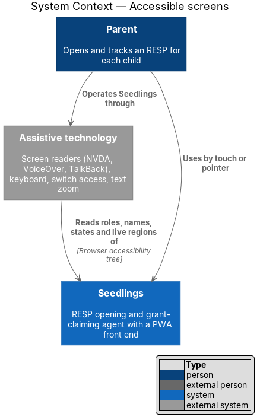
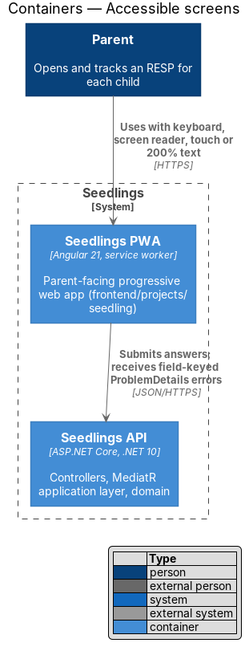
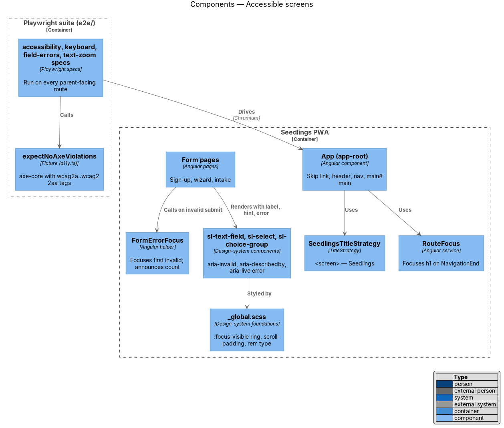
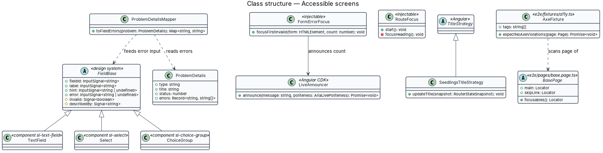
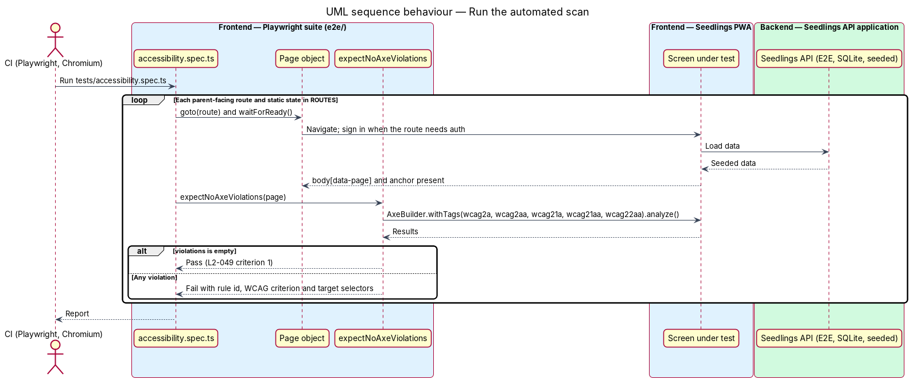
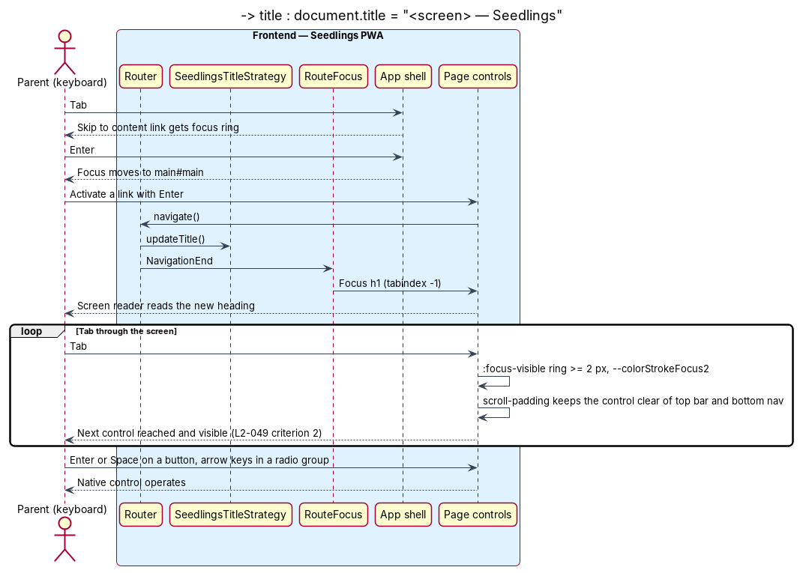
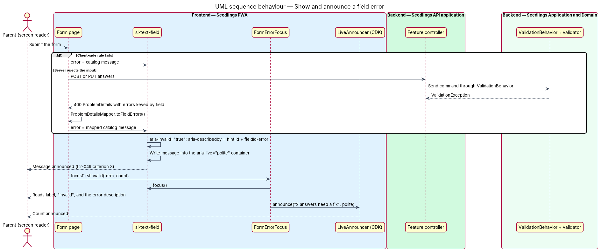
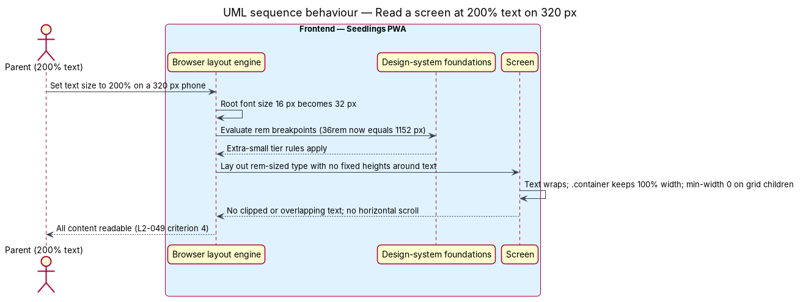

# Accessible screens

## Overview

Seedlings is an installable progressive web app (PWA) through which a parent opens a Registered
Education Savings Plan (RESP) for each child and claims the Canada Learning Bond (CLB) and Canada
Education Savings Grant (CESG). The grants matter most to low-income families, and some of those
parents use a screen reader, a keyboard, a switch device or large text. This feature makes every
parent-facing screen meet WCAG 2.2 Level AA and proves it on every build.

The feature sits in the web-experience subsystem. It is a cross-cutting quality rather than a
screen. The design system (`frontend/projects/components`) carries most of it, because every
screen is composed from `sl-*` components. The app shell carries the rest: landmarks, page titles
and focus on navigation. The admin app is not parent-facing and is out of scope.

Terms used in this design:

- **WCAG 2.2 Level AA** — the A and AA success criteria of the W3C Web Content Accessibility
  Guidelines, version 2.2
- **automated accessibility scan** — run of the axe-core rules engine against a rendered screen,
  reporting each rule a screen breaks
- **violation** — one axe-core rule result of type `violations` tagged with a WCAG A or AA criterion
- **focus indicator** — visible outline drawn around the element that has keyboard focus
- **accessible name** — text a screen reader announces for a control, from its label, content or
  `aria-label`
- **live region** — element whose content changes a screen reader announces without moving focus
  (`aria-live`, `role="status"`, `role="alert"`)
- **text zoom** — enlarging text alone, to 200% here, while the viewport width stays the same

The mocks set the accessible baseline and the e2e locators depend on it: a skip link to
`main#main`, `aria-label="Primary"` navigation with `aria-current="page"`, `aria-pressed` on
segment buttons, `role="status"` on the offline banner, `role="alert"` on error banners, and
visually hidden step labels in the roadmap. `docs/mocks/styles/app.css` defines the field error
style `.field__error`, but no mock page shows a field in its error state. That mock is
`<TO SUPPLY>`, for `sign-up.html` or an intake page, before implementation of slice 3.

## Description

### Frontend — app shell

- **Skip link and landmarks** — `app.html` already renders `<a class="app-skip-link" href="#main">`
  and `<main id="main">`. The shell adds the `header` and `nav` landmarks of the mock, with
  `aria-label="Primary"` on each navigation.
- **`SeedlingsTitleStrategy`** — extends Angular's `TitleStrategy` in
  `frontend/projects/seedling/src/app/shell/`. It sets `document.title` to
  "<screen title> — Seedlings", the pattern the mocks use, with the screen title from the
  language-and-reading-level catalogs.
- **`RouteFocus`** — injectable service in the same folder. On each `NavigationEnd` it moves focus
  to the routed page's `h1`, which carries `tabindex="-1"`. A screen reader then reads the new
  screen's heading, and the next Tab continues from the top of the content.
- **Focus not obscured** — the sticky top bar and the bottom navigation would cover a focused
  control near the edge. `_global.scss` sets `scroll-padding-top` and `scroll-padding-bottom` on
  `html` to the bar heights, so the browser scrolls the focused element clear of both (WCAG 2.4.11).

### Frontend — design-system rules

- **Focus indicator** — `_global.scss` keeps the mock rule
  `:focus-visible { outline: var(--strokeWidthThick) solid var(--colorStrokeFocus2); outline-offset: 2px; }`.
  A component may replace the outline only with an indicator of equal size and contrast, as `.input`
  does with its `box-shadow` ring. No component sets `outline: none` without a replacement
  (`L2-049` criterion 2).
- **Native controls first** — buttons are `<button>`, links are `<a href>`, and choices are native
  radio and checkbox inputs inside `.choice` labels. Each is reachable with Tab and operable with
  Enter or Space without extra script.
- **Field components** — `sl-text-field` (class `TextField`), `sl-select` (class `Select`) and
  `sl-choice-group` (class `ChoiceGroup`) take the inputs `label`, `hint` and `error`. When `error()`
  is set, the component behaves as follows (`L2-049` criterion 3):
  - The control gets `aria-invalid="true"`.
  - The control's `aria-describedby` lists the hint id and the error id `<fieldId>-error`.
  - The `.field__error` element sits inside a container with `aria-live="polite"`. The container is
    always in the DOM, so a screen reader announces the message when it appears.
  - The warning icon is `aria-hidden="true"`; the message text carries the meaning, not the colour
    alone.
- **Submit with errors** — the page calls `FormErrorFocus.focusFirstInvalid()`. That helper, in
  `frontend/projects/seedling/src/app/shared/`, moves focus to the first invalid control. It also
  announces a count, such as "2 answers need a fix", through the CDK `LiveAnnouncer`.
- **Server errors** — a `ProblemDetails` response with an `errors` map (privacy-and-security/input-validation)
  is mapped by field key onto the same `error` inputs, so server-side and client-side errors behave
  the same way.
- **Dialogs and menus** — CDK `Dialog` and `Overlay` provide the focus trap, Escape to close, focus
  return to the trigger, and `aria-labelledby` to the dialog title.
- **Motion and contrast** — the existing `tokens/themes/reducedMotion.ts` applies under
  `prefers-reduced-motion: reduce`. Colour pairs follow the contrast notes in
  `docs/mocks/styles/tokens.css` and `docs/design-system/`; components read colour by role token,
  never by hex value.
- **Text zoom and reflow** — breakpoints are in `rem` (responsive-layout), type sizes are in `rem`,
  and containers set no fixed heights around text. At 200% text on a 320 px viewport, the layout
  takes the extra-small tier and text wraps rather than clips or overlaps (`L2-049` criterion 4).

### Backend

No new endpoint. The design depends on the input-validation design returning field-keyed
`ProblemDetails.errors`, so the PWA can mark the right control invalid.

### Tests

- **Automated scan** (`L2-049` criterion 1) — `e2e/package.json` adds `@axe-core/playwright`. The
  version is pinned at implementation and is `<TO SUPPLY>`. `e2e/fixtures/a11y.ts` exposes
  `expectNoAxeViolations(page)`, which runs `AxeBuilder` with the tags `wcag2a`, `wcag2aa`,
  `wcag21a`, `wcag21aa` and `wcag22aa` and fails on any violation. `e2e/tests/accessibility.spec.ts`
  visits every parent-facing route in `e2e/fixtures/routes.ts` and each static state: open dialogs,
  the offline banner, the empty dashboard and a field error. A new screen joins the scan by being
  added to `ROUTES`.
- **Keyboard** (`L2-049` criterion 2) — `e2e/tests/keyboard.spec.ts` presses Tab through each
  screen. It records `document.activeElement` at each step and expects every enabled interactive
  element of the page object's `focusables()` to be reached. At each stop it reads the computed
  `outline-style`, `outline-width` and `box-shadow`, and expects a visible indicator of at least
  2 px. Feature specs cover operation of each control with Enter and Space.
- **Field errors** (`L2-049` criterion 3) — `e2e/tests/field-errors.spec.ts` submits the sign-up
  form empty. It expects `aria-invalid="true"` on the field and an `aria-describedby` that resolves
  to the message. It also expects the message inside an `aria-live` container and focus on the
  first invalid field.
- **Text zoom** (`L2-049` criterion 4) — `e2e/audit/text-zoom.audit.spec.ts` runs at 320 px and sets
  `document.documentElement.style.fontSize = '200%'`. On each route it expects no horizontal
  overflow and no element whose `scrollHeight` or `scrollWidth` exceeds its client box under
  `overflow: hidden`. It also expects no two text boxes in the same flow to intersect.
- **Manual check** — automated rules cover part of WCAG 2.2. A manual pass with NVDA and Chrome on
  Windows, VoiceOver and Safari on iOS, and TalkBack and Chrome on Android covers the rest. The
  cadence of that pass is `<TO SUPPLY>`.
- Mocks and the design system get no tests of their own, per `AGENTS.md`; these specs run against
  the Angular app.

### Implementation slices

1. **Scan harness** — `@axe-core/playwright`, `expectNoAxeViolations` and the route loop over the
   screens that exist. Covers `L2-049` criterion 1 and grows with each new screen.
2. **Keyboard and focus** — focus indicator rules, `RouteFocus`, `scroll-padding`, and the keyboard
   spec. Covers `L2-049` criterion 2.
3. **Field errors** — the error mock, the `aria-invalid` and `aria-describedby` wiring in the field
   components, `FormErrorFocus`, and the field-error spec. Covers `L2-049` criterion 3.
4. **Text zoom** — the 200% audit at 320 px and any reflow fixes it finds. Covers `L2-049`
   criterion 4.

## Requirements

| L2 ID | Refines (L1) | Requirement |
|-------|--------------|-------------|
| `L2-049` | `L1-022` | Every parent-facing screen shall meet WCAG 2.2 Level AA. |

## Diagrams

### System context

The parent reaches Seedlings with a screen reader, a keyboard, touch or enlarged text. Assistive
technology sits between the parent and the browser; Seedlings has no external dependency for
this feature.

### Containers

The PWA renders every accessible screen. The Seedlings API contributes field-keyed `ProblemDetails`
errors, which the PWA attaches to the right control.

### Components

The shell manages titles, focus on navigation and landmarks. The design-system field components own
the error semantics. The Playwright fixtures scan and walk each screen.

### Class structure

`TextField`, `Select` and `ChoiceGroup` share the `FieldBase` inputs that drive `aria-invalid` and
`aria-describedby`. `FormErrorFocus` uses the CDK `LiveAnnouncer`.

### Behaviour — run the automated scan

For each parent-facing route, the spec renders the screen and runs axe-core with the WCAG 2.2 A and
AA tags. Any violation fails the run (`L2-049` criterion 1).

### Behaviour — operate a screen by keyboard

After navigation, focus lands on the screen heading. Tab then reaches each control in order with a
visible indicator, and the scroll padding keeps it clear of the bars (`L2-049` criterion 2).

### Behaviour — show and announce a field error

A rejected answer marks the control `aria-invalid="true"` and links the message through
`aria-describedby`. The live region and the focus move make a screen reader announce it
(`L2-049` criterion 3).

### Behaviour — read a screen at 200% text on 320 px

Rem-based breakpoints and type move the layout to the extra-small tier, and text wraps without loss
or overlap (`L2-049` criterion 4).

