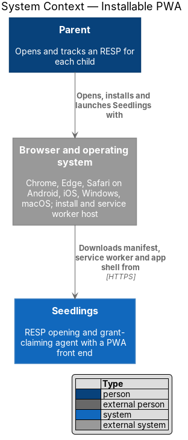
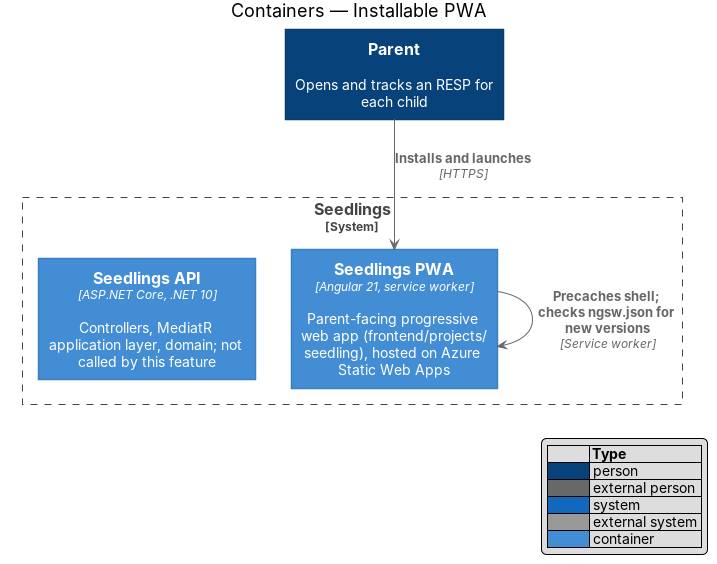
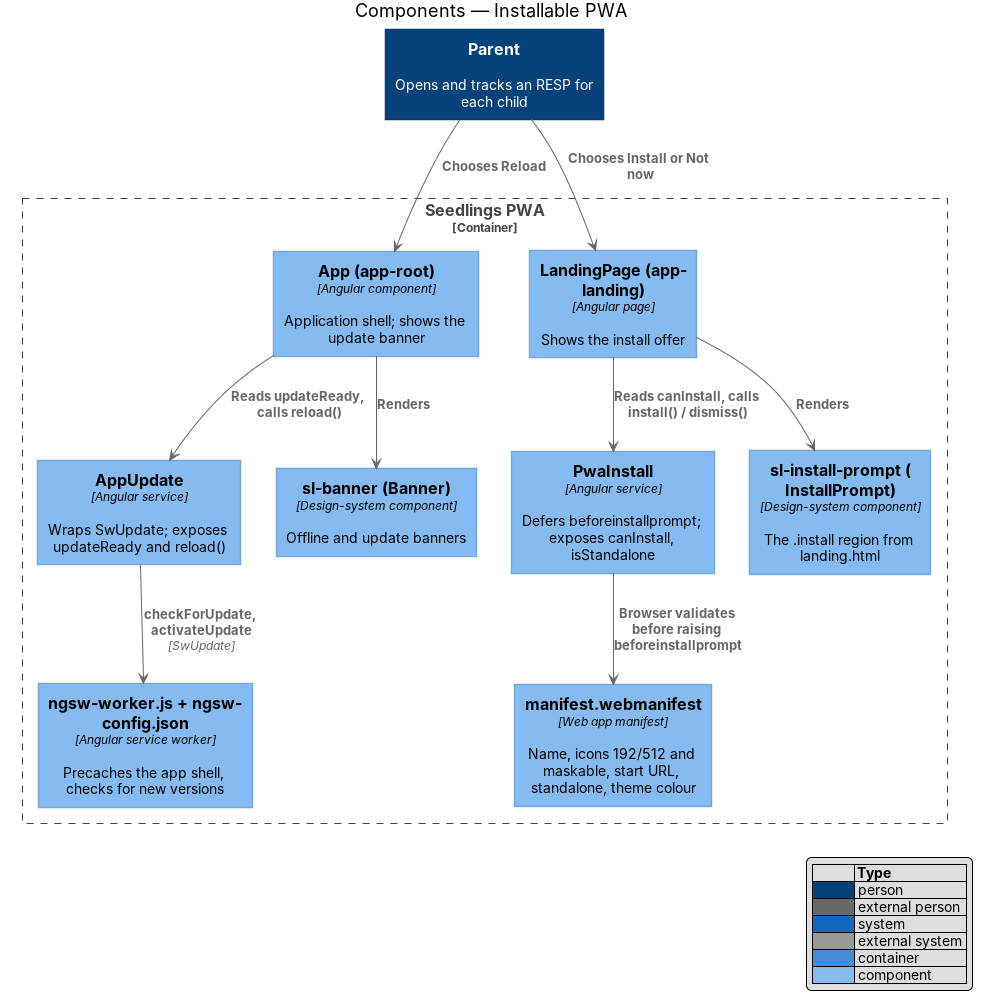
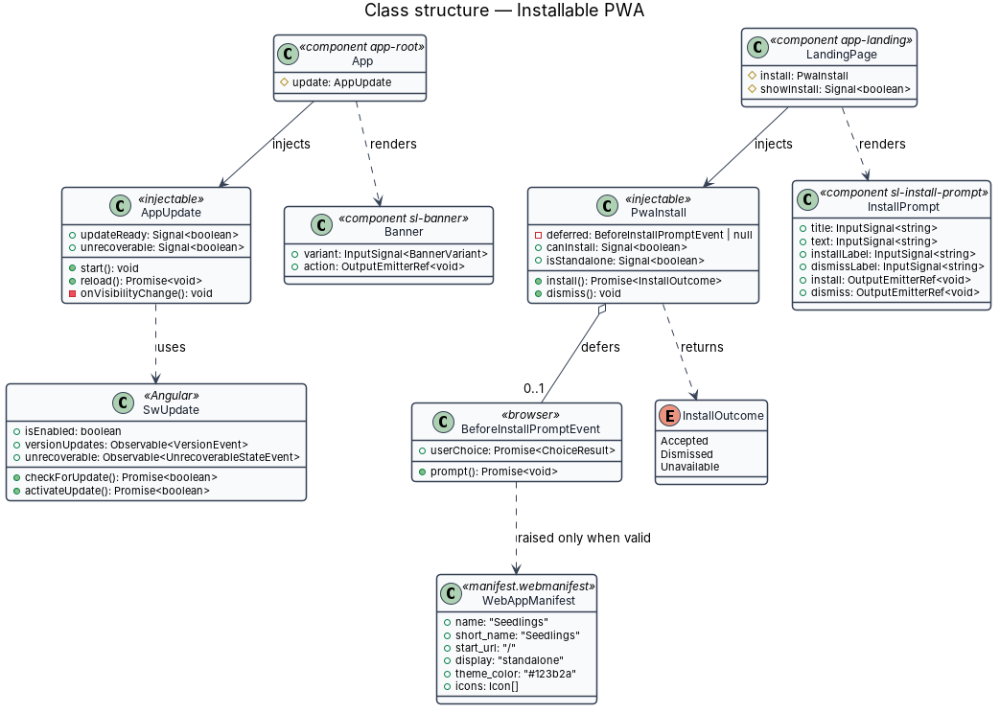
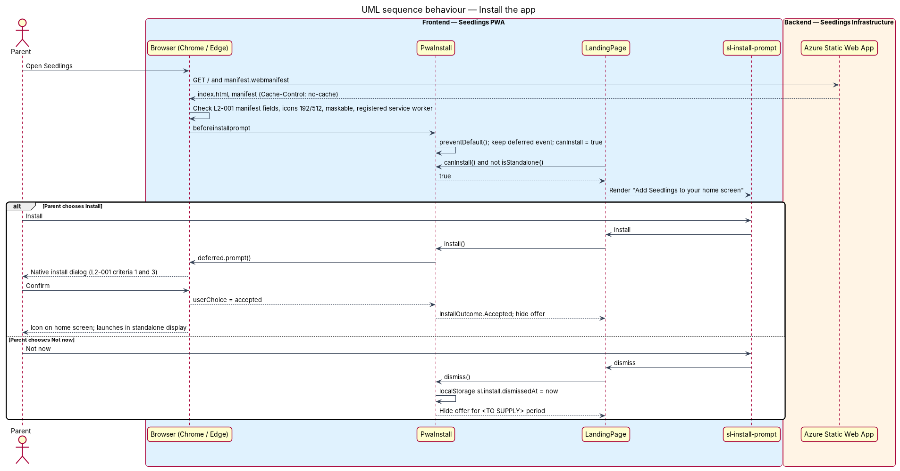
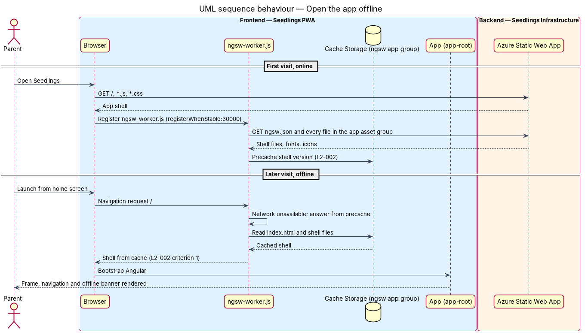
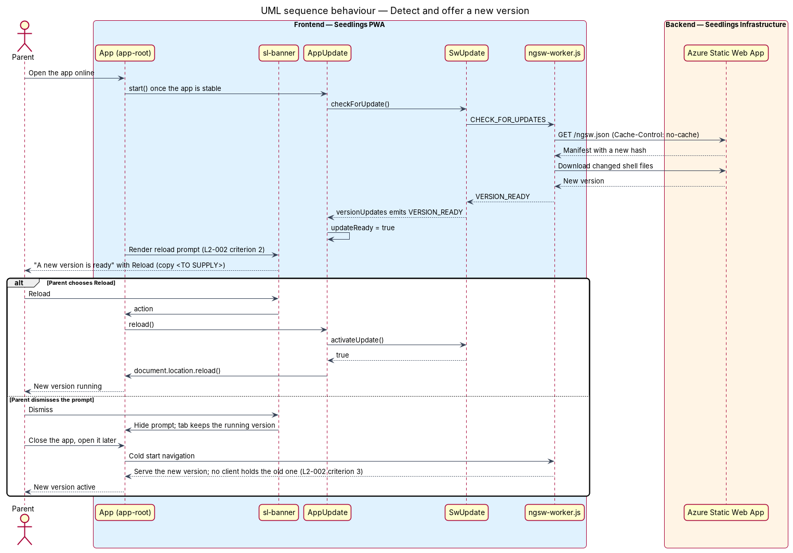

# Installable PWA

## Overview

Seedlings is an installable progressive web app (PWA) through which a parent opens a Registered
Education Savings Plan (RESP) for a child and claims the Canada Learning Bond (CLB) and Canada
Education Savings Grant (CESG). The parent reaches the product from a browser link and, from then
on, from an icon on the home screen. This feature makes that second path possible and keeps the
installed copy current.

The feature sits in the web-experience subsystem, which owns the qualities every screen shares:
installability, offline tolerance, layout, language, accessibility and speed. It is frontend-only.
No Seedlings API endpoint participates; the Azure Static Web App that hosts the PWA serves every
file involved.

Terms used in this design:

- **progressive web app (PWA)** — web application that a browser can install and run in its own
  window, with its own icon, from a manifest and a service worker
- **web app manifest** — JSON file that names the app, lists its icons and tells the browser how to
  launch it (`manifest.webmanifest`)
- **service worker** — script the browser runs between the page and the network, able to answer
  requests from a local cache
- **app shell** — the HTML, JavaScript, CSS, fonts and icons needed to draw the Seedlings frame and
  route to a screen, without any parent data
- **precache** — copy of the app shell the service worker downloads at install time, before it is
  requested
- **version** — one deployed build of the PWA, identified by the hash manifest `ngsw.json` that the
  Angular service worker publishes with each build
- **install prompt** — browser offer to add the app to the home screen or desktop
- **standalone display** — launch mode in which the installed app opens without browser chrome
- **maskable icon** — icon with a safe zone that a platform may crop into its own icon shape

The landing mock `docs/mocks/pages/landing.html` shows the in-page install offer
(`.install` region, "Add Seedlings to your home screen", buttons "Not now" and "Install"). Every
app page copies the head of `docs/mocks/pages/_shell.html`, which carries the manifest link and the
theme colour.

## Description

### Frontend — what exists today

The scaffold already holds the core of this feature in `frontend/projects/seedling`:

- **`public/manifest.webmanifest`** — declares `name`, `short_name`, `id`, `start_url: "/"`,
  `scope: "/"`, `display: "standalone"`, `theme_color`, `background_color` and four icons: an SVG,
  `icons/icon-192.png`, `icons/icon-512.png` and `icons/icon-maskable-512.png` with
  `purpose: "maskable"`.
- **`src/index.html`** — links the manifest, sets `<meta name="theme-color">`, an `apple-touch-icon`
  and `viewport-fit=cover`.
- **`ngsw-config.json`** — an `app` asset group with `installMode: "prefetch"` for `index.html`,
  the manifest, `*.css` and `*.js`; an `assets` group, lazy with `updateMode: "prefetch"`, for
  images and fonts; and an `api` data group with the `freshness` strategy for `/api/**`.
- **`src/app/app.config.ts`** — calls `provideServiceWorker('ngsw-worker.js', …)` with
  `enabled: !isDevMode()` and `registrationStrategy: 'registerWhenStable:30000'`.
- **`public/staticwebapp.config.json`** — rewrites unknown paths to `/index.html` and serves
  `.webmanifest` as `application/manifest+json`.

### Frontend — changes this design makes

- **Manifest content.** `name` and `short_name` change from "Seedling" to "Seedlings", and
  `description` carries the product line. `theme_color` changes to Forest `#123b2a` and
  `background_color` to Cream `#fff6e9`, matching `docs/mocks/styles/tokens.css`. The
  `orientation: "portrait"` entry is removed. A portrait lock would stop the installed app from
  rotating, which the responsive-layout design (`L2-004`) relies on.
- **iOS launch.** `index.html` adds `<meta name="apple-mobile-web-app-title" content="Seedlings">`
  and an `apple-touch-icon` sized 180 px. Safari on iOS reads the manifest `display` value and these
  tags when the parent chooses Add to Home Screen (`L2-001` criterion 2).
- **Shell precache.** The `app` asset group gains the web fonts and `icons/**`, so the first offline
  launch draws the frame with the brand type and icon (`L2-002` criterion 1). The offline-status-and-queue
  design removes the `api` data group, so parent data never lands in the service worker cache.
- **Hosting headers.** `staticwebapp.config.json` adds `routes` entries that serve
  `/ngsw-worker.js`, `/ngsw.json`, `/index.html` and `/manifest.webmanifest` with
  `Cache-Control: no-cache`. The Static Web App edge then never hides a new version from the
  service worker's update check.
- **`AppUpdate`** — new injectable service in `src/app/shell/app-update.ts`. It wraps Angular's
  `SwUpdate`. It calls `checkForUpdate()` once the app is stable and again when the document
  becomes visible. It filters `versionUpdates` for `VERSION_READY` and exposes the signal
  `updateReady`. `reload()` calls `activateUpdate()` and then `document.location.reload()`.
  It also listens to `SwUpdate.unrecoverable` and offers the same reload.
- **`PwaInstall`** — new injectable service in `src/app/shell/pwa-install.ts`. It captures the
  `beforeinstallprompt` event that Chrome on Android and Edge or Chrome on Windows and macOS raise
  (`L2-001` criteria 1 and 3), calls `preventDefault()`, and keeps the event. It exposes the signals
  `canInstall` and `isStandalone` (from `matchMedia('(display-mode: standalone)')`). `install()`
  calls the saved event's `prompt()`. `dismiss()` records "Not now" in `localStorage` under
  `sl.install.dismissedAt`. The period before the offer returns is `<TO SUPPLY>`.
- **`sl-install-prompt`** (class `InstallPrompt`, `frontend/projects/components/src/lib/install-prompt/`)
  — design-system component rendering the mock's `.install` region with `role="region"` and the
  accessible name "Install Seedlings". Inputs: `title`, `text`, `installLabel`, `dismissLabel`.
  Outputs: `install`, `dismiss`. The landing page shows it when `PwaInstall.canInstall()` is true
  and the app is not already standalone.
- **`sl-banner`** (class `Banner`, shared with the offline banner `.banner`) — the app shell renders
  an update banner when `AppUpdate.updateReady()` is true. The banner text and its "Reload" action
  have no mock yet; the update-prompt mock is `<TO SUPPLY>` in `docs/mocks/pages/system-states.html`
  before implementation.
- **iOS install guidance.** Safari on iOS raises no `beforeinstallprompt`. The text that tells an iOS
  parent to use Share, then Add to Home Screen, has no mock; that variant is `<TO SUPPLY>`.

### Update behaviour

The Angular service worker compares the deployed `ngsw.json` hash with the cached one on each
check. When they differ, it downloads the new version in the background and emits `VERSION_READY`.
The shell then prompts the parent to reload (`L2-002` criterion 2). When the parent dismisses the
prompt, the open tab keeps the running version. The service worker serves the new version on the
next cold start of the app (`L2-002` criterion 3), because no client is then bound to the old one.

### Backend

None. The Seedlings API is not involved. The Static Web App defined in `eng/infra/main.bicep`
serves every file this feature touches.

### Tests

Playwright runs in Chromium only, against a production build served with its service worker.

- `e2e/tests/installable-pwa.spec.ts` with page object `e2e/pages/landing.page.ts`.
- Installability (`L2-001` criteria 1 and 3): the spec reads the manifest and checks the required
  fields, then calls the Chrome DevTools Protocol method `Page.getInstallabilityErrors` and expects
  an empty list. Chromium's installability rules are the ones Chrome and Edge apply.
- iOS launch (`L2-001` criterion 2) cannot run in Chromium. A manual check on an iOS device covers
  it; the device and iOS version are `<TO SUPPLY>`.
- Offline shell (`L2-002` criterion 1): load once online, wait for the service worker to control
  the page, call `context.setOffline(true)`, reload, and expect `main#main` to render.
- Update (`L2-002` criteria 2 and 3): the test server swaps the served build for a second build
  with a different hash, the spec reopens the app and expects the update banner, then dismisses
  it, closes the page, opens a new one and expects the new build's version marker.

### Implementation slices

1. **Manifest and iOS tags** — correct the manifest fields and icons, add the iOS meta tags, and
   prove installability with `Page.getInstallabilityErrors`. Covers `L2-001` criteria 1 and 3, and
   the manual check for criterion 2.
2. **Offline shell** — extend the `app` asset group, add the `Cache-Control` routes, and prove the
   shell loads offline. Covers `L2-002` criterion 1.
3. **Update prompt** — add `AppUpdate`, the shell's update banner and its mock. Covers `L2-002`
   criteria 2 and 3.
4. **In-page install offer** — add `PwaInstall` and `sl-install-prompt` on the landing page. Covers
   the install offer shown in `landing.html` for `L2-001` criteria 1 and 3.

## Requirements

| L2 ID | Refines (L1) | Requirement |
|-------|--------------|-------------|
| `L2-001` | `L1-001` | The app shall ship a web app manifest with name, short name, icons at 192 px and 512 px (including a maskable icon), start URL, `display: standalone` and a theme colour. |
| `L2-002` | `L1-001` | The service worker shall precache the app shell and serve it when the network is unavailable, and shall detect and offer new versions. |

## Diagrams

### System context

The parent installs and launches Seedlings from a browser. No external system takes part in
installing the app or updating it.

### Containers

The Seedlings PWA is the only container this feature changes. The Azure Static Web App serves the
manifest, the service worker and the shell files; the Seedlings API is not called.

### Components

Inside the PWA, `AppUpdate` and `PwaInstall` wrap the browser's service worker and install events.
The shell and the landing page render their state through `sl-banner` and `sl-install-prompt`.

### Class structure

`AppUpdate` depends on Angular's `SwUpdate`, and `PwaInstall` holds the deferred
`BeforeInstallPromptEvent`. The two design-system components carry only inputs and outputs.

### Behaviour — install the app

On Chromium browsers, `PwaInstall` defers the browser's install event. It replays the event when
the parent chooses Install, which satisfies `L2-001` criteria 1 and 3.

### Behaviour — open the app offline

After one online visit, the service worker answers the navigation and every shell file from its
precache, so the shell renders with no network (`L2-002` criterion 1).

### Behaviour — detect and offer a new version

The service worker finds a new `ngsw.json` hash and downloads the version. `AppUpdate` then shows
the reload prompt. A dismissed prompt leaves the new version to activate on the next cold start
(`L2-002` criteria 2 and 3).

