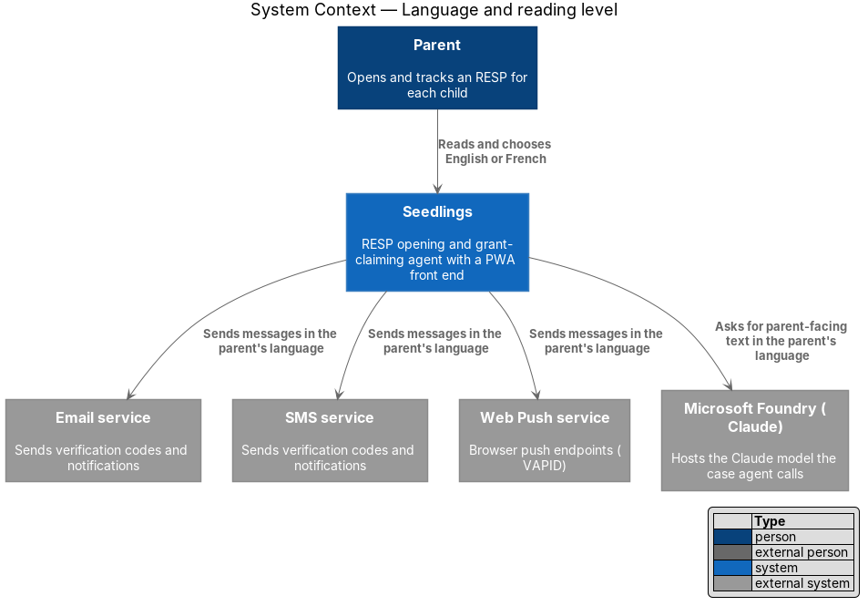
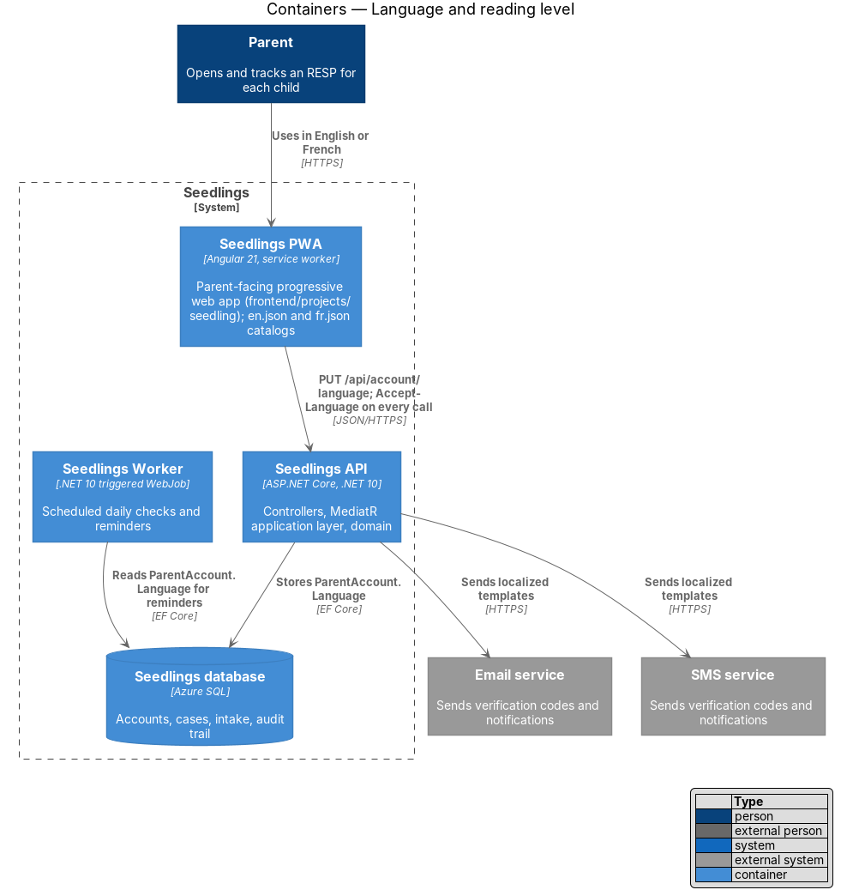
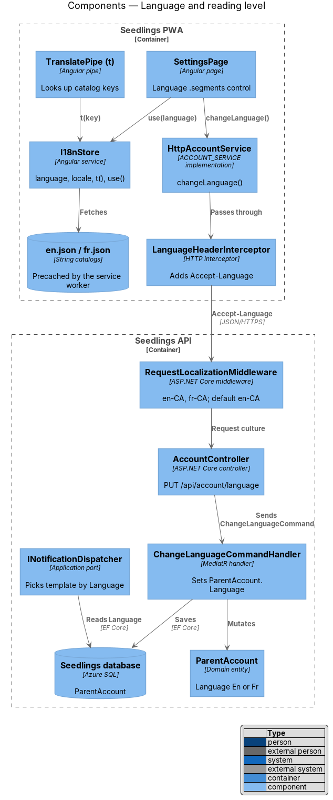
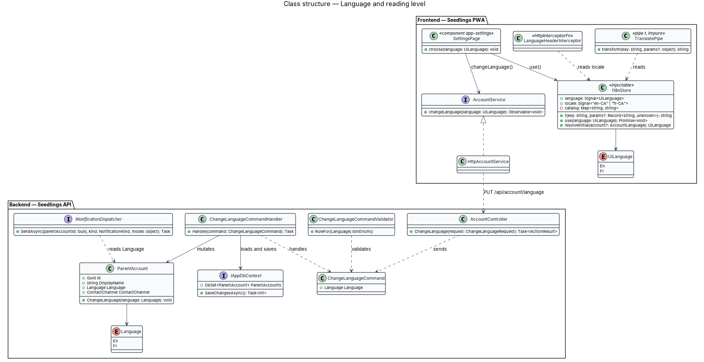
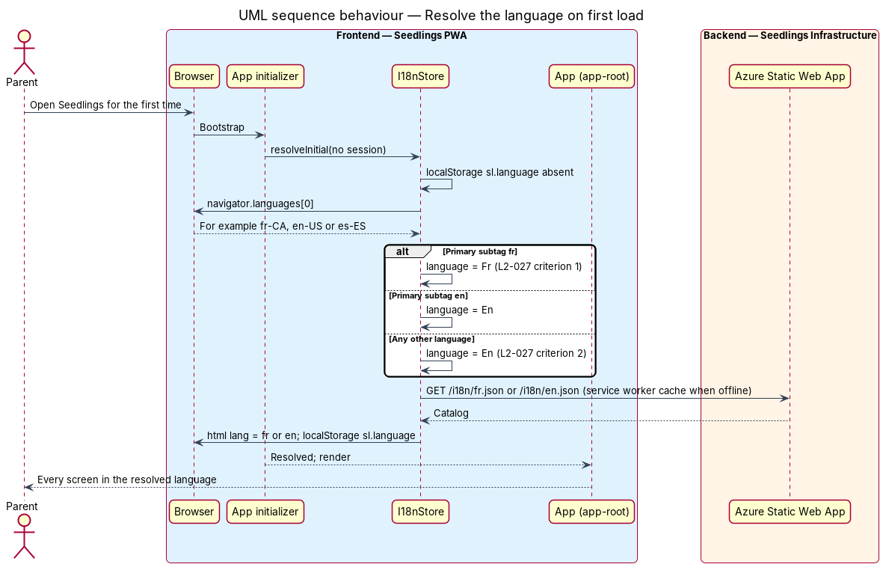
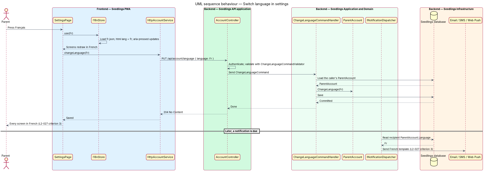
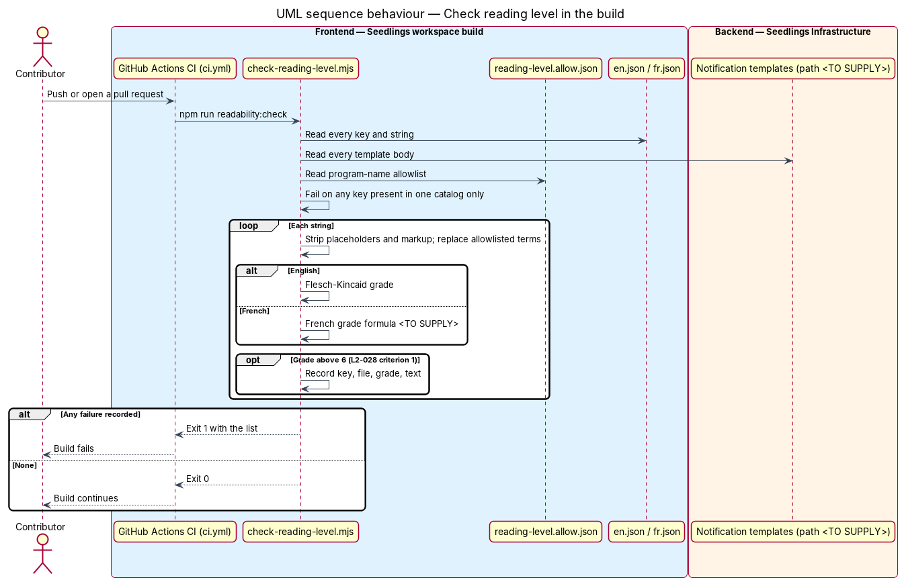

# Language and reading level

## Overview

Seedlings is an installable progressive web app (PWA) through which a parent opens a Registered
Education Savings Plan (RESP) for each child and claims the Canada Learning Bond (CLB) and Canada
Education Savings Grant (CESG). The families it serves include French speakers and parents who read
English or French as a second language. This feature gives every parent-facing word in both English
and French, picks the right one on first visit, lets the parent change it, and holds all copy to a
Grade 6 reading level.

The feature sits in the web-experience subsystem. It spans the PWA, where text is drawn, and the
Seedlings API, which stores the parent's choice and uses it for notifications and generated
documents. Two designs in other subsystems consume the stored language:
account-care/notification-channels sends notifications, and case-agent/prefill-forms produces
documents. The onboarding wizard's language step (onboarding/start-wizard) and its plain-language
rule (`L2-042`) use the same store and the same reading-level check.

Terms used in this design:

- **parent-facing text** — any word a parent reads: screen copy, labels, error messages,
  notifications and generated documents
- **language** — one of the two values of the `Language` enum, `En` or `Fr`
- **locale** — the formatting convention paired with a language: `en-CA` for `En`, `fr-CA` for `Fr`
- **string catalog** — JSON file mapping a stable key to the text for one language
  (`en.json`, `fr.json`)
- **browser language** — first entry of `navigator.languages`, for example `fr-CA`
- **reading level** — US school grade a reader needs to understand a text, estimated by a
  readability formula
- **readability check** — build step that scores every catalog string and fails the build when one
  scores above Grade 6

The mocks are `docs/mocks/pages/settings.html` (section `#language`, a `.segments` group with
"English" and "Français" using `aria-pressed`), `docs/mocks/pages/wizard.language.html` (radio
choice "Which language do you prefer?") and `docs/mocks/pages/landing.html` (a "Français" link in
the flow bar). No French rendering of any screen exists in the mocks; the French copy is
`<TO SUPPLY>`.

## Description

### Frontend — string catalogs and runtime switching

The design uses runtime catalogs rather than Angular's build-time `$localize`. A build per language
would need a server redirect on browser language, which Azure Static Web Apps does not offer. It
would also need a full reload to switch, and two service worker scopes.

- **Catalogs** — `frontend/projects/seedling/public/i18n/en.json` and `fr.json`. Keys are flat and
  dotted, for example `dashboard.greeting`. Values may hold named placeholders such as `{name}`.
  Plural forms use the suffixes `.one` and `.other`, chosen with `Intl.PluralRules`. The `app` asset
  group of `ngsw-config.json` precaches both files, so either language works offline.
- **`I18nStore`** — injectable service in `frontend/projects/seedling/src/app/shared/i18n/i18n-store.ts`.
  It exposes the signals `language` (`'En' | 'Fr'`) and `locale` (`'en-CA' | 'fr-CA'`). It offers
  `t(key, params?)` and `use(language)`. `use()` fetches the catalog, swaps it in, and sets
  `document.documentElement.lang` to `en` or `fr`. It also writes `localStorage` key `sl.language`.
- **Resolution order at start-up** — `provideAppInitializer` resolves the language before the first
  render, in this order:
  1. the signed-in parent's `ParentAccount.Language`, when a session exists;
  2. `localStorage` `sl.language`, when present;
  3. the browser language: a primary subtag of `fr` gives `Fr`, `en` gives `En`, and anything else
     gives `En` (`L2-027` criteria 1 and 2).
- **`TranslatePipe`** (`t`, `pure: false`) — reads `I18nStore.t()`. It is impure so that a language
  change redraws OnPush components in the zoneless app without a reload.
- **`LanguageHeaderInterceptor`** — functional HTTP interceptor that adds
  `Accept-Language: en-CA` or `fr-CA` to every API call. Anonymous calls such as sign-up then
  produce a verification message in the right language before an account exists.
- **Formats** — dates, numbers and currency use `Intl` formatters built from `I18nStore.locale()`.
  For example, 600 dollars renders as "$600" in `en-CA` and "600 $" in `fr-CA`.
- **Design-system components** — `sl-*` components hold no built-in copy. Every visible or
  accessible string, including the skip link and visually hidden labels, arrives as an input, and
  the pages pass translated text.
- **Server messages** — the PWA does not show `ProblemDetails.title` as written by the server. It
  maps the problem `type` and field error codes to catalog keys, so error text follows the chosen
  language.
- **Language settings** — `SettingsPage` (`app-settings`) renders the `.segments` group. A press
  calls `I18nStore.use()` at once and then `ACCOUNT_SERVICE.changeLanguage()`. When the device is
  offline, the change applies locally, and the offline-status-and-queue outbox sends it on
  reconnect.

### Backend — storing and using the language

- **`ParentAccount.Language`** (`Language { En, Fr }`) in `Seedling.Domain` holds the choice. It is
  set at sign-up from `Accept-Language`, through `RequestLocalizationMiddleware`, which supports
  `en-CA` and `fr-CA` and defaults to `en-CA`.
- **`AccountController`** in `Seedling.Api/Controllers/` exposes `PUT /api/account/language` with
  body `{ "language": "Fr" }`. It requires authentication, as every endpoint does by default. It
  sends `ChangeLanguageCommand` and returns `204 No Content`.
- **`ChangeLanguageCommand`**, **`ChangeLanguageCommandValidator`** (FluentValidation; the value
  shall be a defined `Language`) and **`ChangeLanguageCommandHandler`** live in
  `Seedling.Application/Account/`. The handler loads the current parent's `ParentAccount` through
  `IAppDbContext`, scoped to the caller. It sets `Language` and saves. A repeat with the same value
  is a no-op, so retries from the outbox are safe.
- **Notifications** — `INotificationDispatcher` (account-care/notification-channels) reads the
  recipient's `ParentAccount.Language` at send time. It picks the template for that language, so
  each notification after the change uses the new language (`L2-027` criterion 3).
- **Generated documents** — the prefill-forms design reads `ParentAccount.Language` when it renders
  a `PrefilledForm`. Whether each RESP provider's application form exists in French is
  `<TO SUPPLY>`. Form SDE 0093 is published by ESDC in both languages.
- **Agent text** — any parent-facing sentence the case agent writes passes the language to
  `ICaseAgent`, so `FoundryCaseAgent` asks Claude in Microsoft Foundry for text in that language.

### Build — reading-level check

- **`frontend/scripts/check-reading-level.mjs`**, run as `npm run readability:check` from
  `frontend/`. CI runs it in the "Frontend build and unit tests" job of
  `.github/workflows/ci.yml`, after "Design tokens up to date".
- **Inputs** — `en.json`, `fr.json`, and the backend notification templates. The template folder
  belongs to account-care/notification-channels and its path is `<TO SUPPLY>`.
- **Preparation** — the script strips placeholders such as `{name}` and markup. It replaces each
  term in `frontend/scripts/reading-level.allow.json` with a one-syllable stand-in. The allowlist
  covers program names a parent cannot avoid, such as "Registered Education Savings Plan"; its
  content is `<TO SUPPLY>`.
- **English score** — Flesch–Kincaid grade level:
  `0.39 × (words ÷ sentences) + 11.8 × (syllables ÷ words) − 15.59`.
- **French score** — the formula for a French Grade 6 equivalent is `<TO SUPPLY>`. The specs name no
  French readability measure.
- **Short strings** — readability formulas do not hold on labels of 1 to 3 words. The minimum word
  count below which a string is scored by a vocabulary list instead is `<TO SUPPLY>`.
- **Parity** — the script also fails when a key exists in one catalog but not the other, so no
  screen falls back to the other language.
- **Result** — a non-zero exit, listing key, file, grade and text for each failure, fails the build
  (`L2-028` criterion 1).

### Tests

- `e2e/tests/language.spec.ts`, with page objects `dashboard.page.ts` and `settings.page.ts`.
  Criterion 1 uses a Playwright context with `locale: 'fr-CA'` and expects French headings and
  `<html lang="fr">` on each visited screen. Criterion 2 uses `locale: 'es-ES'` and expects English.
  Criterion 3 switches to French in Settings and expects every later screen in French.
- `backend/tests/Seedling.Api.Tests` — `PUT /api/account/language` returns 204 and persists. A
  later notification send, through a test double of the email and SMS clients, uses the French
  template (`L2-027` criterion 3).
- The reading-level check is a build step, not a test. Its own logic gets unit tests under
  `frontend/scripts/` that score known sentences.

### Implementation slices

1. **Catalogs and default language** — `I18nStore`, `TranslatePipe`, the initializer and English
   and French catalogs for the first screens. Covers `L2-027` criteria 1 and 2.
2. **Switch in settings** — the `.segments` control, `PUT /api/account/language` and its handler.
   Covers `L2-027` criterion 3 for screens.
3. **Notifications and documents in the chosen language** — dispatcher and form rendering read
   `ParentAccount.Language`. Covers `L2-027` criterion 3 for notifications and generated documents.
4. **Readability check in CI** — the script, its allowlist and the CI step. Covers `L2-028`
   criterion 1.

## Requirements

| L2 ID | Refines (L1) | Requirement |
|-------|--------------|-------------|
| `L2-027` | `L1-017` | All parent-facing text shall be available in English and French, selectable in settings and defaulting to the browser language. |
| `L2-028` | `L1-017` | All parent-facing copy shall test at Grade 6 or below. |

## Diagrams

### System context

The parent reads Seedlings in English or French. The same choice governs the notifications that the
email, SMS and push services deliver.

### Containers

The PWA draws text from its catalogs and sends the choice to the API. The API stores it on the
parent account, where the notification and form flows read it.

### Components

`I18nStore` resolves and switches the language in the PWA. On the backend, `AccountController`
dispatches `ChangeLanguageCommand`, and the notification dispatcher reads the stored language.

### Class structure

`I18nStore` owns the active catalog and locale. `ChangeLanguageCommandHandler` mutates
`ParentAccount.Language`, which `INotificationDispatcher` reads.

### Behaviour — resolve the language on first load

With no session and no stored choice, the browser language decides. `fr-CA` gives French and any
language other than English or French gives English (`L2-027` criteria 1 and 2).

### Behaviour — switch language in settings

The PWA switches at once and saves the choice. Later notifications and generated documents read the
stored language (`L2-027` criterion 3).

### Behaviour — check reading level in the build

CI scores every catalog string and notification template. Any string above Grade 6, or a key
missing from one language, fails the build (`L2-028` criterion 1).

