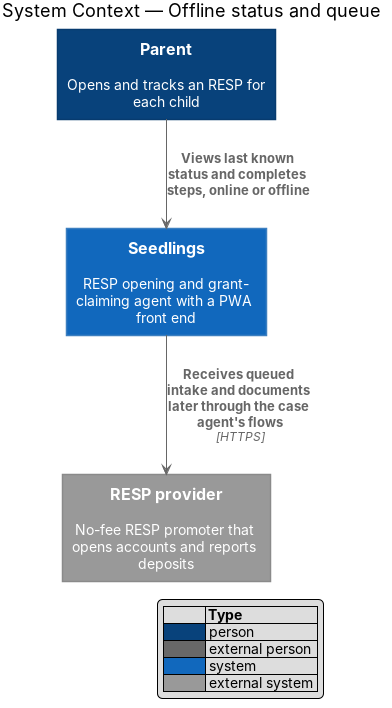
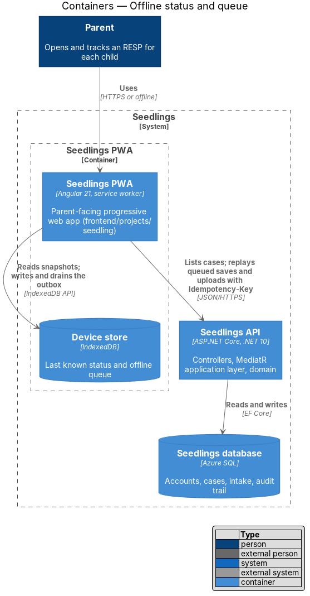
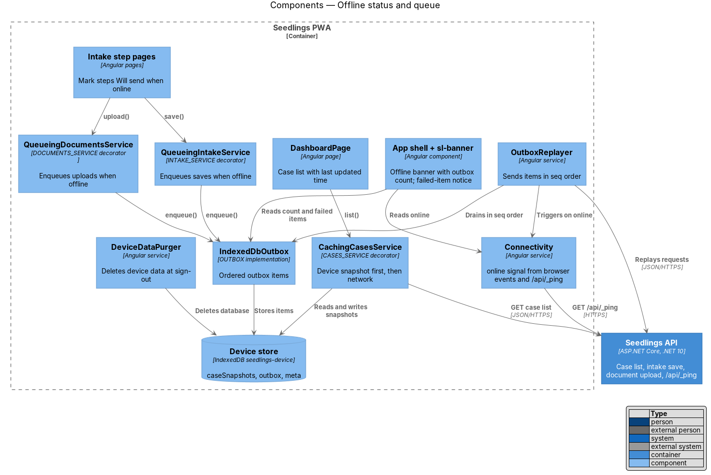
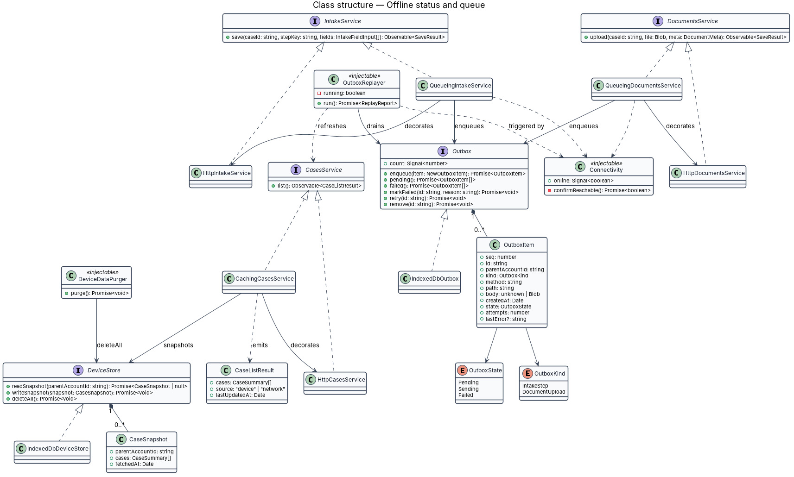
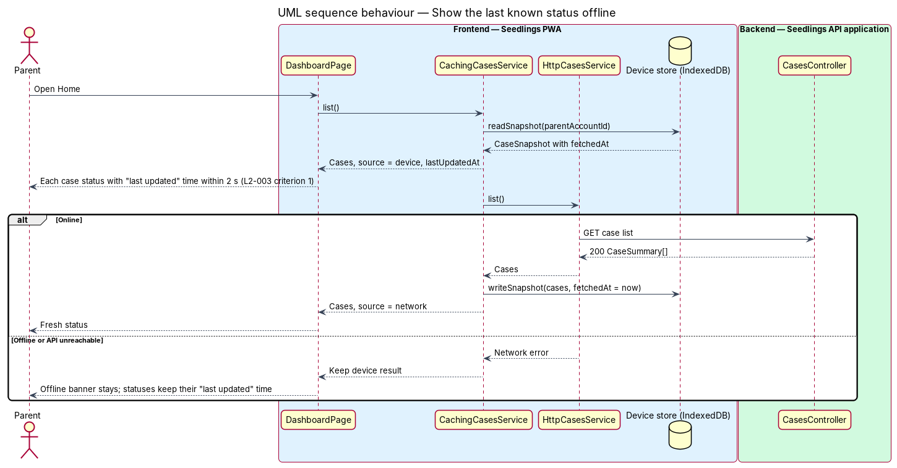
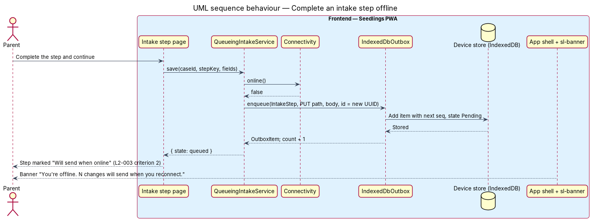
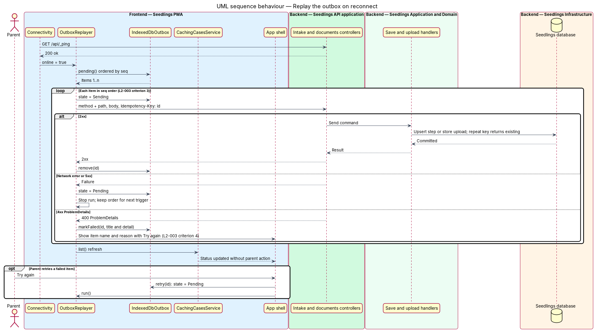
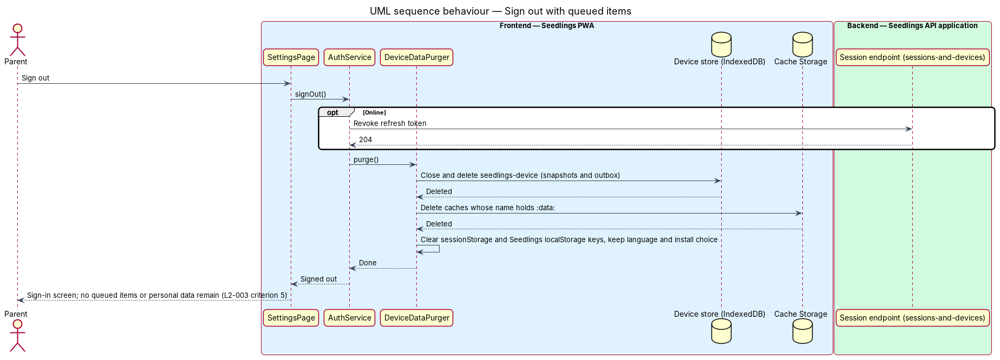

# Offline status and queue

## Overview

Seedlings is an installable progressive web app (PWA) through which a parent opens a Registered
Education Savings Plan (RESP) for each child and claims the Canada Learning Bond (CLB) and Canada
Education Savings Grant (CESG). Parents often use it on a phone, on transit or in places with weak
coverage. This feature keeps the app useful without a connection. It shows the last known status of
each case, it holds intake answers and document photos made offline, and it sends them on its own
once the connection returns.

The feature sits in the web-experience subsystem. It builds on the installable-pwa design, which
precaches the app shell, and on four designs owned by other subsystems:

- case-agent/case-status-dashboard owns the case list and the `CASES_SERVICE` token
- intake/complete-intake-steps owns intake saves and the `INTAKE_SERVICE` token
- intake/capture-document owns document uploads and the `DOCUMENTS_SERVICE` token
- identity-and-access/sessions-and-devices owns sign-out and the `AUTH_SERVICE` token

This design wraps those services. It does not change their endpoints.

Terms used in this design:

- **case** — one RESP application for one child, with a status from `CaseStatus`
- **case snapshot** — copy of the case list, as last received from the API, stored on the device
  with the time it was fetched
- **device store** — IndexedDB database `seedlings-device` that holds case snapshots and the outbox
  for the signed-in parent
- **outbox** — ordered list of intake saves and document uploads made while offline, waiting to be
  sent
- **outbox item** — one queued request, with a client-generated identifier, a sequence number, the
  HTTP method, path and body, and a state
- **replay** — sending outbox items to the API in sequence order once the connection returns
- **idempotency key** — client-generated identifier sent with a request so that the API treats a
  repeat of the same request as the original

The mocks are `docs/mocks/pages/dashboard.offline.html` (Home with the offline banner) and
specimen C-01 in `docs/mocks/pages/system-states.html`. The banner reads "You're offline. 2 changes
will send when you reconnect." and uses `role="status"`.

## Description

### Frontend — connectivity

- **`Connectivity`** — injectable service in `frontend/projects/seedling/src/app/shell/connectivity.ts`.
  It exposes the signal `online`. It starts from `navigator.onLine` and follows the window `online`
  and `offline` events. A browser can report online while the API is unreachable. On each `online`
  event the service confirms reachability with `GET /api/_ping`, the anonymous endpoint of the
  existing `PingController`, before it reports online.
- **Offline banner** — the app shell renders `sl-banner` (class `Banner`) with the `offline`
  variant under the top bar while `Connectivity.online()` is false. The banner text takes the
  outbox count, for example "2 changes will send when you reconnect". The class names
  `.banner.banner--offline` and `role="status"` follow the mock.

### Frontend — device store

The device store lives in the `api` library, which owns backend integration, under
`frontend/projects/api/src/lib/services/offline/`.

- **`DeviceStore`** interface and the **`DEVICE_STORE`** injection token. **`IndexedDbDeviceStore`**
  implements it over the IndexedDB database `seedlings-device`. It has three object stores:
  `caseSnapshots` keyed by `parentAccountId`, `outbox` keyed by an auto-increment `seq`, and `meta`.
- **`CaseSnapshot`** — `{ parentAccountId, cases: CaseSummary[], fetchedAt }`. `CaseSummary` is the
  dashboard's own model from case-status-dashboard.
- **`CachingCasesService`** implements the `CasesService` interface and decorates
  `HttpCasesService`. `list()` returns a signal-backed result in two steps. It first reads the
  snapshot from the device store and emits it with `source: 'device'` and `lastUpdatedAt`. It then
  calls the API and, on success, writes a new snapshot and emits `source: 'network'`. When the call
  fails for lack of a connection, the device result stays on screen. Reading IndexedDB first keeps
  the offline dashboard within the 2-second limit of `L2-003` criterion 1, whatever the network
  timeout.
- The dashboard labels a device result with the time it was last updated. The "Last updated" label
  has no mock yet; its placement and copy are `<TO SUPPLY>` in `dashboard.offline.html`.

### Frontend — outbox and replay

- **`OutboxItem`** — `{ seq, id, parentAccountId, kind, method, path, body, createdAt, state,
  attempts, lastError? }`. `kind` is `IntakeStep` or `DocumentUpload`. `id` is a UUID that doubles
  as the idempotency key. `body` is JSON for intake steps and a `Blob` with metadata for uploads.
  `state` is `Pending`, `Sending` or `Failed`.
- **`Outbox`** interface, **`OUTBOX`** token, and **`IndexedDbOutbox`** implementation. It offers
  `enqueue(item)`, `pending()`, `failed()`, `markFailed(id, reason)`, `retry(id)` and the signal
  `count`.
- **`QueueingIntakeService`** decorates `HttpIntakeService`, and **`QueueingDocumentsService`**
  decorates `HttpDocumentsService`. When `Connectivity.online()` is false, or the request fails
  with a network error, each one enqueues the request and returns `{ state: 'queued' }`. The intake
  page then marks the step "Will send when online" (`L2-003` criterion 2). That marker has no mock
  yet; it is `<TO SUPPLY>` in the intake step mocks.
- **`OutboxReplayer`** — injectable service in the `api` library. It runs on each transition of
  `Connectivity.online()` to true, at app start when online, and when the document becomes visible.
  It sends `Pending` items one at a time in ascending `seq` (`L2-003` criterion 3). Each request
  carries the header `Idempotency-Key: <id>`. Replay follows these rules:
  - A 2xx response removes the item, and the replayer refreshes the case list through
    `CASES_SERVICE`, so status updates without parent action.
  - A network error or a 5xx response stops the run and leaves the item `Pending` for the next
    trigger, so later items never overtake it. The back-off between runs is `<TO SUPPLY>`.
  - A 4xx response with a `ProblemDetails` body marks the item `Failed`, keeps the problem `title`
    and `detail` as `lastError`, and continues with the next item.
- **Failed item notice** — the shell lists each `Failed` item by its step or document name and the
  reason (`L2-003` criterion 4). A "Try again" action calls `Outbox.retry(id)` and then the replayer.
  Removing a failed item is also offered. The failed-item mock is `<TO SUPPLY>` in
  `system-states.html`.
- The outbox runs only while the app is open. The Background Sync API is not available in Safari on
  iOS, so the design does not depend on it.

### Frontend — sign-out purge

- **`DeviceDataPurger`** — service in the `api` library that the `AuthService.signOut()` flow of
  identity-and-access/sessions-and-devices calls before it resolves. It closes and deletes the
  `seedlings-device` database, clears `sessionStorage` and the Seedlings keys in `localStorage`
  except the language and install preferences, and deletes any Cache Storage entry whose name
  holds `:data:` (an Angular service worker data cache). Sign-out completes only after the purge,
  so no queued item or personal data stays on the device (`L2-003` criterion 5).
- **`ngsw-config.json`** — the `api` data group is removed. Personal API responses then live only in
  the device store, which the purger deletes. The service worker keeps only the shell.

### Sensitive data on the device

Queued document photos are identity documents. Whether queued photos are encrypted inside
IndexedDB, and whether the steps that collect a Social Insurance Number (SIN) may be queued
offline, are decisions for privacy-and-security/sensitive-data-vault. Both are `<TO SUPPLY>`.

### Backend

No new endpoint. Replay calls the endpoints that complete-intake-steps and capture-document
define. The design relies on two API behaviours, which those designs supply:

- An intake save is an upsert keyed by case, step and field, so a repeat returns the same result.
- A document upload accepts the `Idempotency-Key` header. A repeat with the same key returns the
  stored document rather than a duplicate, per the `AGENTS.md` rule on idempotent creates.

`PingController` (`GET /api/_ping`, anonymous) already exists and serves the reachability check.

### Tests

- `e2e/tests/offline-status-and-queue.spec.ts`, with page objects `dashboard.page.ts` and
  `intake-step.page.ts`. The specs use `context.setOffline(true)` and a production build with the
  service worker.
- Criterion 1: load the dashboard online, go offline, reopen, and expect each case status within
  2 seconds with its "last updated" time.
- Criterion 2: go offline, complete an intake step, and expect the "Will send when online" marker
  and the banner count.
- Criterion 3: queue two steps offline, go online, and expect the API to receive them in order and
  the dashboard to refresh.
- Criterion 4: make the API reject one queued upload with a `ProblemDetails` 400 and expect the
  item name, the reason and a working "Try again".
- Criterion 5: queue an item, sign out, and expect the `seedlings-device` database to be absent.

### Implementation slices

1. **Last known status** — `DeviceStore`, `CachingCasesService` and the "last updated" label.
   Covers `L2-003` criterion 1.
2. **Offline banner and connectivity** — `Connectivity` and the shell's offline banner with the
   outbox count. Supports criteria 1 and 2.
3. **Queue intake steps** — `Outbox` and `QueueingIntakeService` with the step marker. Covers
   criterion 2.
4. **Replay in order** — `OutboxReplayer` with the idempotency key and the case list refresh.
   Covers criterion 3.
5. **Queue uploads and report failures** — `QueueingDocumentsService`, the `Failed` state and
   "Try again". Covers criterion 4.
6. **Purge on sign-out** — `DeviceDataPurger` and removal of the `api` data group. Covers
   criterion 5.

## Requirements

| L2 ID | Refines (L1) | Requirement |
|-------|--------------|-------------|
| `L2-003` | `L1-003` | The last known case status shall be shown offline, and form inputs and document uploads made offline shall be queued locally and submitted automatically on reconnect. |

## Diagrams

### System context

The parent uses Seedlings with or without a connection. Only the Seedlings system takes part.
Queued work reaches external systems later, through the case agent's own flows.

### Containers

The PWA keeps case snapshots and the outbox in the device store, an IndexedDB database. It replays
the outbox to the Seedlings API, which writes to the Seedlings database.

### Components

Inside the PWA, decorators wrap the case, intake and document services from other features. The
replayer drains the outbox, and the purger clears the device store at sign-out.

### Class structure

`CachingCasesService`, `QueueingIntakeService` and `QueueingDocumentsService` implement the
interfaces of the services they decorate. `OutboxReplayer` depends on `Outbox` and `Connectivity`.

### Behaviour — show the last known status offline

The dashboard reads the case snapshot from IndexedDB before it calls the API. An offline parent
then sees each status and its time within 2 seconds (`L2-003` criterion 1).

### Behaviour — complete an intake step offline

The queueing decorator stores the step as an outbox item. The page marks the step "Will send when
online" (`L2-003` criterion 2).

### Behaviour — replay the outbox on reconnect

The replayer sends items in sequence order with an idempotency key and refreshes the case list. A
rejected item becomes `Failed` with its reason and can be retried (`L2-003` criteria 3 and 4).

### Behaviour — sign out with queued items

Sign-out waits for the purger. The purger deletes the device store and any service worker data
cache (`L2-003` criterion 5).

