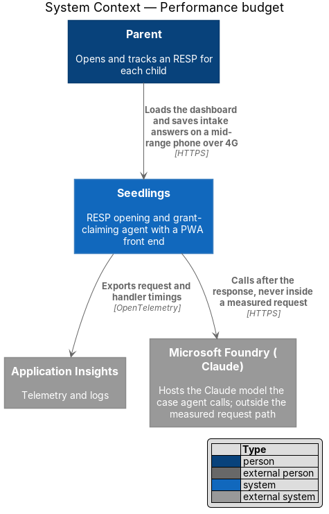
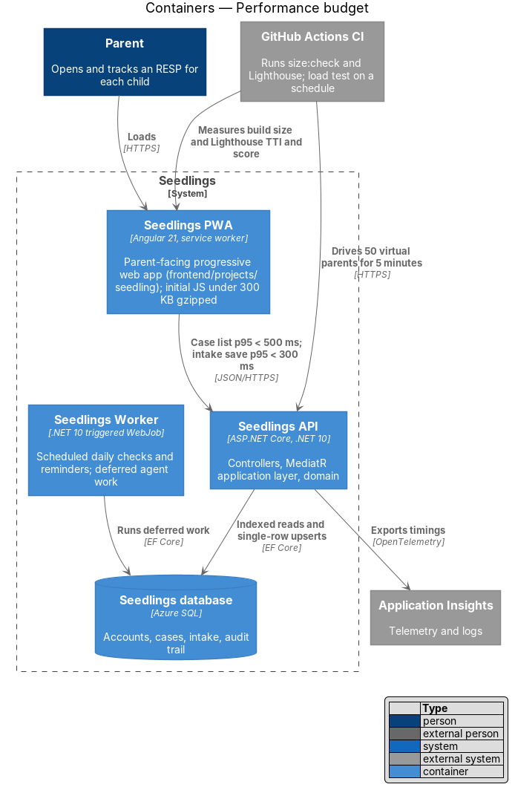
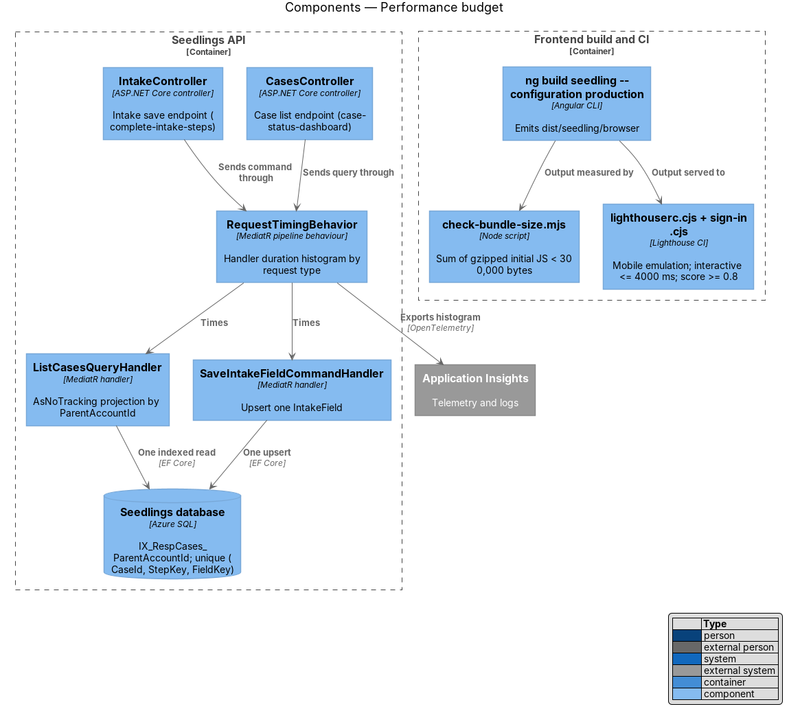
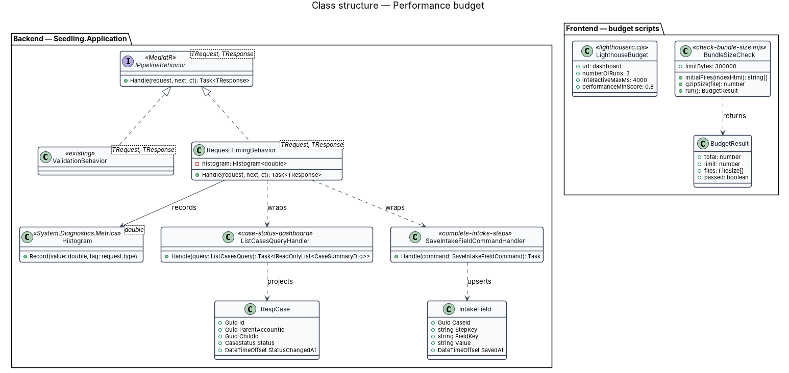
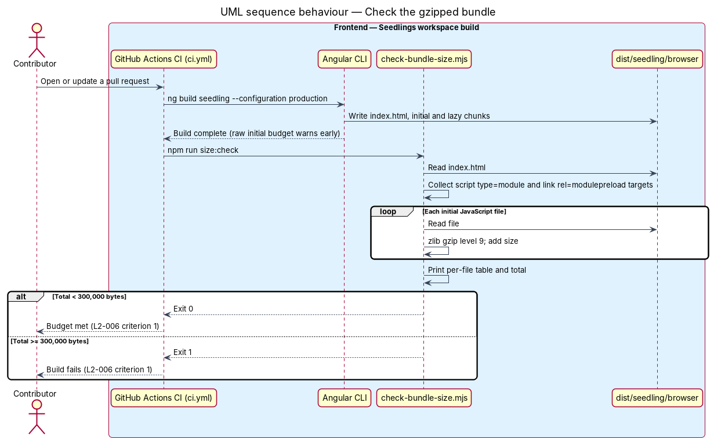
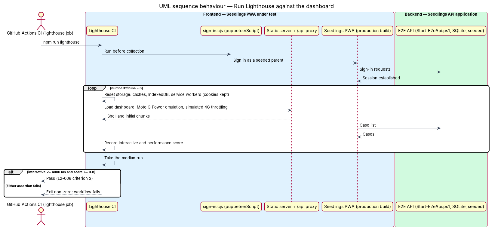
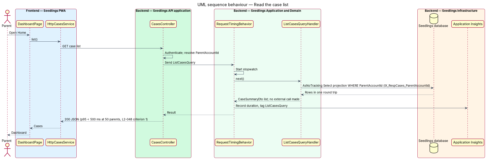
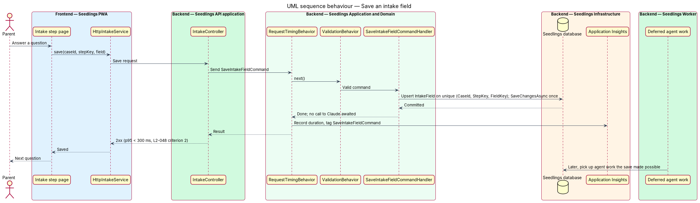
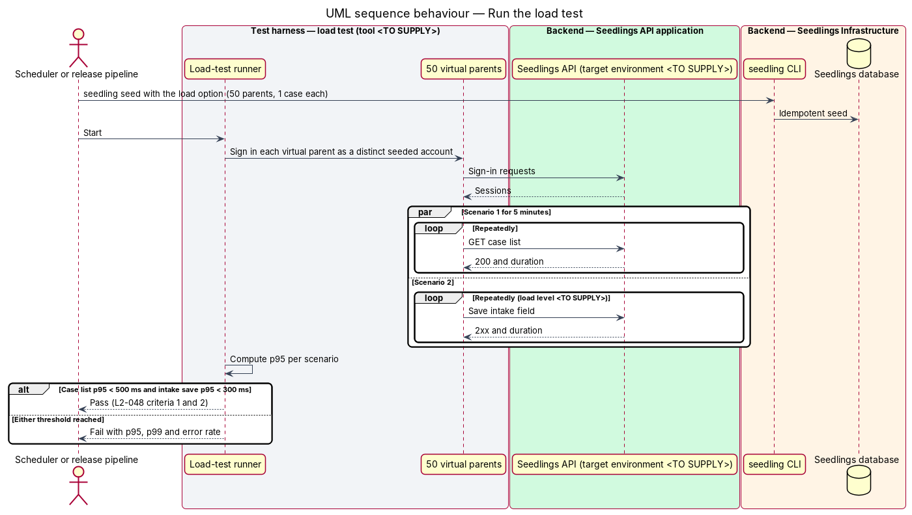

# Performance budget

## Overview

Seedlings is an installable progressive web app (PWA) through which a parent opens a Registered
Education Savings Plan (RESP) for each child and claims the Canada Learning Bond (CLB) and Canada
Education Savings Grant (CESG). Parents often use a mid-range Android phone on a mobile network. A
slow first screen or a save that hangs costs trust and finished applications. This feature sets
numeric budgets for the PWA and the API, and makes the build and a load test fail when a budget
is broken.

The feature sits in the web-experience subsystem. It has a frontend half (`L2-006`: download size
and time to interactive) and a backend half (`L2-048`: API response time). It owns no screen and
no endpoint. It sets limits on the dashboard from case-agent/case-status-dashboard and on the
intake save from intake/complete-intake-steps, and supplies the checks that enforce them.

Terms used in this design:

- **initial JavaScript** — the JavaScript files the browser downloads before the first screen can
  run: the entry module and every chunk it preloads, excluding lazy route chunks
- **gzipped size** — size of a file after gzip compression, the form in which it crosses the network
- **Time to Interactive (TTI)** — Lighthouse metric: time until the page has rendered and its main
  thread is quiet enough to respond to input
- **performance score** — Lighthouse's 0 to 100 summary of its weighted performance metrics
- **mobile emulation** — Lighthouse's default mobile settings: a Moto G Power screen and CPU slow-down,
  with simulated 4G network throttling
- **95th-percentile response time (p95)** — response time that 95% of requests meet or beat
- **case list** — the API read that returns the signed-in parent's cases for the dashboard
- **intake save** — the API write that stores one intake answer as an `IntakeField`

The budgets measure the dashboard, `docs/mocks/pages/dashboard.html`, and the intake steps,
`docs/mocks/pages/intake.*.html`.

## Description

### Frontend — bundle budget (L2-006 criterion 1)

- **What exists** — `frontend/angular.json` sets an `initial` budget for the `seedling` production
  build of `maximumWarning: 500kB` and `maximumError: 1MB`. Angular measures these on uncompressed
  files, so they cannot enforce a gzipped limit.
- **`frontend/scripts/check-bundle-size.mjs`**, run as `npm run size:check` — reads
  `dist/seedling/browser/index.html` after the production build. It collects every
  `<script type="module">` and `<link rel="modulepreload">` target, which is the initial JavaScript.
  It gzips each file with Node's `zlib` at level 9, sums the results and prints a per-file table.
  The script exits 1 when the sum is 300,000 bytes or more. The design reads "300 KB" as
  300 × 1,000 bytes, the stricter of the two readings.
- **CI** — `.github/workflows/ci.yml` runs `npm run size:check` straight after the existing step
  "ng build (production)", so a pull request over budget fails.
- **Angular budget** — the raw `initial` budget stays as an early warning in the editor and
  `ng build`. Its new values are set from the first measured ratio of raw to gzipped size and are
  `<TO SUPPLY>`.
- **Practices that keep the budget** — every route uses `loadComponent` so each page is a lazy
  chunk. Below-the-fold blocks use `@defer`. The app runs zoneless, so `zone.js` is not shipped. The
  French catalog loads only when French is in use (language-and-reading-level). No date or charting
  library enters the initial chunks.

### Frontend — Lighthouse budget (L2-006 criterion 2)

- **`@lhci/cli`** is added to `e2e/package.json`; its version is `<TO SUPPLY>`. The config file is
  `e2e/lighthouse/lighthouserc.cjs`, and `npm run lighthouse` runs it.
- **Collect** — the run uses Lighthouse's default mobile emulation (Moto G Power, simulated 4G
  throttling) with `numberOfRuns: 3`. It serves the production `seedling` build, service worker
  included, from a local static server that proxies `/api` to the E2E API from
  `eng/Start-E2eApi.ps1` (SQLite, seeded). The URL is the dashboard.
- **Signed-in cold load** — `e2e/lighthouse/sign-in.cjs` is a `puppeteerScript` that signs in a
  seeded parent before collection. Lighthouse's storage reset clears caches, IndexedDB and service
  workers but keeps cookies, so the run is a cold load with a live session. This holds if the
  session is cookie-based; the session mechanism belongs to identity-and-access/sessions-and-devices
  and is `<TO SUPPLY>` here.
- **Assert** — `interactive` with `maxNumericValue: 4000` and `categories:performance` with
  `minScore: 0.8`, both at level `error`, on the median run. Recent Lighthouse versions dropped TTI
  from the score but still report the `interactive` audit. If the pinned version no longer reports
  it, the replacement metric is `<TO SUPPLY>`.
- **CI** — a new `lighthouse` job in `.github/workflows/ci.yml` runs on Chromium after the frontend
  build and fails the workflow on any assertion error.

### Backend — fast paths (L2-048)

The two measured endpoints belong to other designs. This design sets the rules that keep them
inside budget:

- **Case list** — the `ListCasesQueryHandler` of case-agent/case-status-dashboard reads in one
  round trip. It uses `AsNoTracking()` and a `Select` projection to the dashboard DTO, scoped to the
  caller's `ParentAccountId`. The index `IX_RespCases_ParentAccountId` includes `Status`,
  `StatusChangedAt` and `ChildId`. The read calls no external system: not Microsoft Foundry, the
  RESP provider or ESDC.
- **Intake save** — the `SaveIntakeFieldCommandHandler` of intake/complete-intake-steps upserts one
  `IntakeField` through the unique index `(CaseId, StepKey, FieldKey)` and calls `SaveChangesAsync`
  once. Agent work that a save makes possible runs after the response, in the Seedlings Worker or a
  queued job. The request never awaits a call to Claude.
- **`RequestTimingBehavior<TRequest, TResponse>`** — new MediatR pipeline behaviour in
  `Seedling.Application/Behaviors/`, registered beside the existing `ValidationBehavior`. It records
  each handler's elapsed time as a histogram tagged with the request type name only, through
  `System.Diagnostics.Metrics`. The OpenTelemetry packages in `Directory.Packages.props`
  (`OpenTelemetry`, `Azure.Monitor.OpenTelemetry.Exporter`) export it to Application Insights. It
  logs no request content, in line with privacy-and-security/log-redaction.
- **Alerts** — `eng/infra/main.bicep` adds two `Microsoft.Insights/scheduledQueryRules`. One alerts
  when the case-list p95 reaches 500 ms, and one when the intake-save p95 reaches 300 ms. The
  evaluation window and the action group are `<TO SUPPLY>`.
- **Capacity** — `main.bicep` defaults to a Linux B1 App Service plan and an Azure SQL Basic
  database (5 DTU). Whether those defaults meet `L2-048` at 50 concurrent parents is unknown until
  the load test runs. The production SKUs are `<TO SUPPLY>`.

### Backend — load test (L2-048 criteria 1 and 2)

- **Profile** — 50 virtual users, each signed in as a distinct seeded parent, request the case list
  in a loop for 5 minutes. The run fails when the case-list p95 is 500 ms or more (criterion 1). A
  second scenario saves intake fields and fails when the save p95 is 300 ms or more (criterion 2).
  Criterion 2 states no load level; this design runs it at the same 50 users, and confirming that
  level is `<TO SUPPLY>`.
- **Data** — `seedling seed` gains an option that creates 50 parents with one child and one case
  each. Seeding is idempotent, as `AGENTS.md` requires. The option name is `<TO SUPPLY>`.
- **Tool, location and target** — the load-test tool, the folder that holds the scripts, and the
  environment the test runs against are all `<TO SUPPLY>`. The repository layout in `AGENTS.md`
  names no folder for API load tests, so adding one also updates that layout.

### Tests

- `L2-006` criterion 1 — `npm run size:check` in CI.
- `L2-006` criterion 2 — `npm run lighthouse` in the CI `lighthouse` job.
- `L2-048` criteria 1 and 2 — the load test, run on a schedule and before each release. The
  schedule is `<TO SUPPLY>`.
- Backend integration tests in `backend/tests/Seedling.Api.Tests` keep proving the case list and
  intake save behaviour. They run on SQLite in memory and do not measure time.

### Implementation slices

1. **Gzipped bundle gate** — `check-bundle-size.mjs`, the npm script and the CI step. Covers
   `L2-006` criterion 1.
2. **Lighthouse gate** — `lighthouserc.cjs`, the sign-in script and the CI job. Covers `L2-006`
   criterion 2.
3. **Handler timing and alerts** — `RequestTimingBehavior` and the two Bicep alert rules. Supports
   `L2-048` in production.
4. **Case-list load test** — seed option, scenario and threshold. Covers `L2-048` criterion 1.
5. **Intake-save load test** — second scenario and threshold. Covers `L2-048` criterion 2.

## Requirements

| L2 ID | Refines (L1) | Requirement |
|-------|--------------|-------------|
| `L2-006` | `L1-004` | The initial JavaScript bundle shall be under 300 KB gzipped, and the app shall be interactive within 4 seconds on a mid-range Android phone over 4G. |
| `L2-048` | `L1-004` | Parent-facing API reads shall be fast under expected load. |

## Diagrams

### System context

The parent's phone loads the PWA and calls the API. Application Insights receives the timings that
the alerts watch. The case list and intake save call no other external system in the request path.

### Containers

The size and Lighthouse checks run against the PWA build. The load test drives the Seedlings API,
which reads and writes the Seedlings database and exports timings to Application Insights.

### Components

`RequestTimingBehavior` wraps the two measured handlers in the API. The CI checks sit beside the
frontend build.

### Class structure

`RequestTimingBehavior` implements MediatR's `IPipelineBehavior` and records into a `Histogram`.
The two budget scripts each produce a result that decides the exit code.

### Behaviour — check the gzipped bundle

After the production build, the script gzips the initial JavaScript and fails at 300,000 bytes or
more (`L2-006` criterion 1).

### Behaviour — run Lighthouse against the dashboard

Lighthouse signs in, loads the dashboard cold under mobile emulation, and asserts TTI of 4 seconds
or less and a score of 80 or more (`L2-006` criterion 2).

### Behaviour — read the case list

The handler projects the parent's cases in one indexed, untracked query with no external call, and
the timing behaviour records its duration (`L2-048` criterion 1).

### Behaviour — save an intake field

The handler upserts one row and returns. Agent work runs after the response, so the save stays
within its budget (`L2-048` criterion 2).

### Behaviour — run the load test

Fifty virtual parents drive the case list for 5 minutes and save intake fields. The run fails when
either p95 reaches its limit (`L2-048` criteria 1 and 2).

