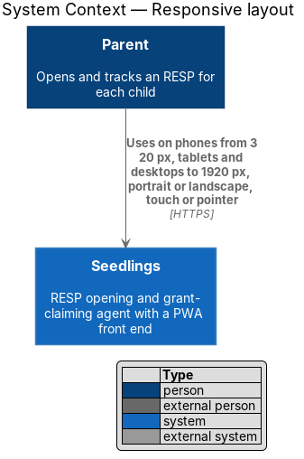
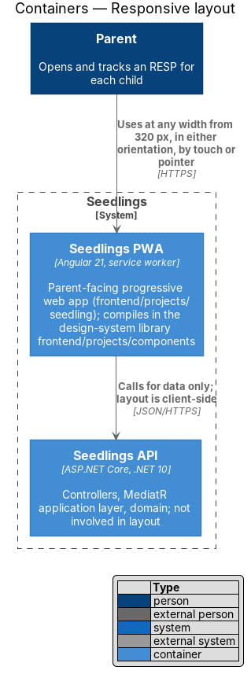
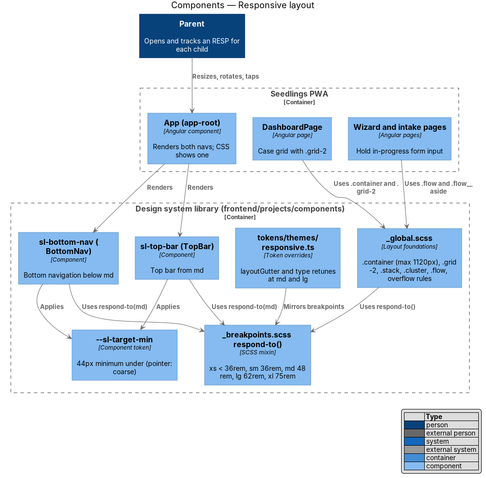
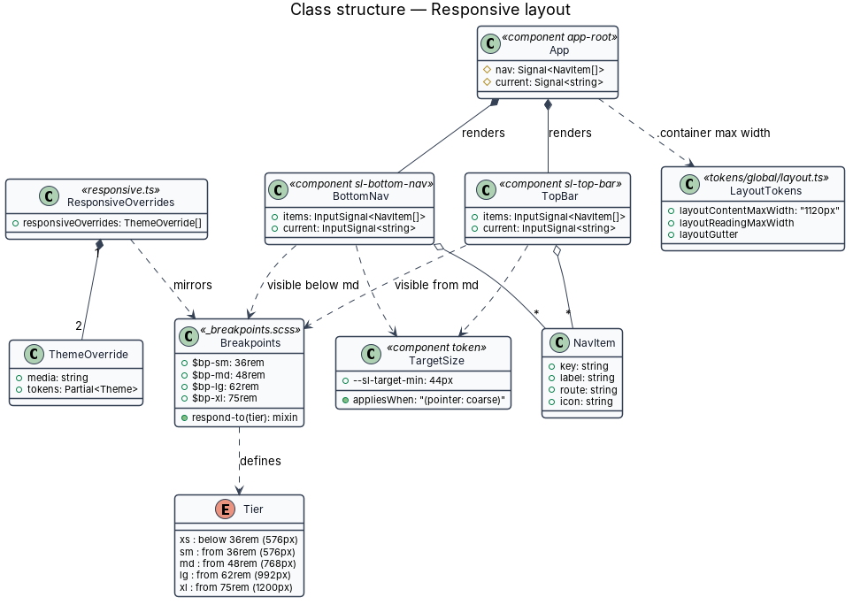
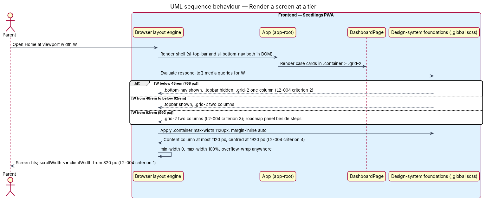
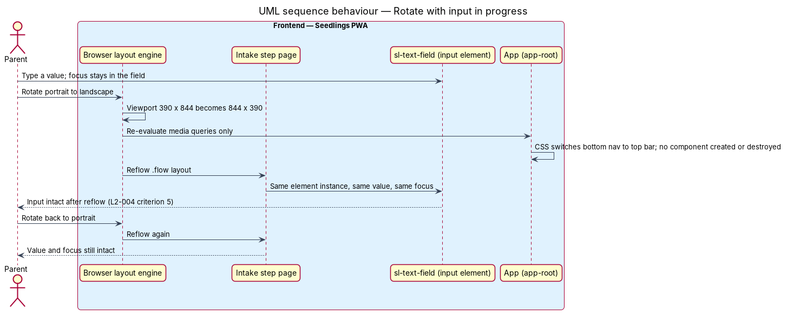
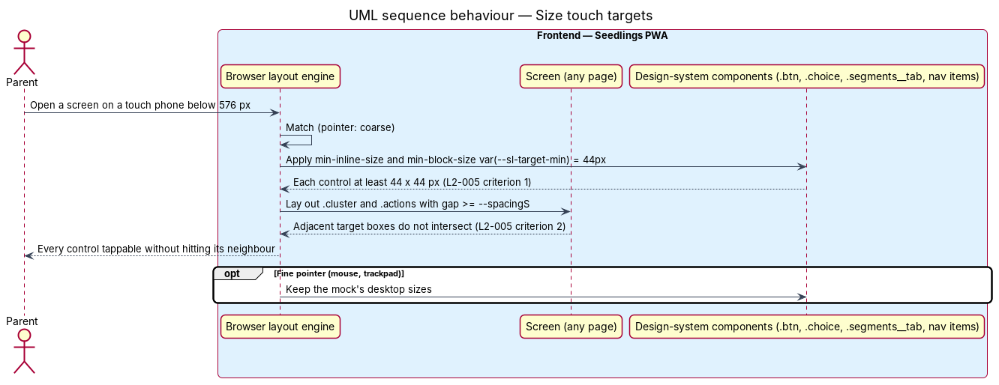

# Responsive layout

## Overview

Seedlings is an installable progressive web app (PWA) through which a parent opens a Registered
Education Savings Plan (RESP) for each child and claims the Canada Learning Bond (CLB) and Canada
Education Savings Grant (CESG). Most parents use it on a phone; others use a tablet or a desktop
browser. This feature makes every screen complete and usable from a 320 px phone to a 1920 px
desktop, in portrait and landscape, with controls large enough to tap.

The feature sits in the web-experience subsystem. It is frontend-only and lives mostly in the
design system, `frontend/projects/components`. The design system holds the breakpoints, the layout
foundations and the shell components. Every page in `frontend/projects/seedling` composes them
rather than writing its own media queries.

Terms used in this design:

- **viewport width** — width of the browser's layout area in CSS pixels
- **tier** — named viewport width range at which layouts change; the five tiers come from
  `docs/specs/L2.md`: extra small (below 576 px, from 320 px), small (576 px and up), medium
  (768 px and up), large (992 px and up) and extra large (1200 px and up, through 1920 px and wider)
- **breakpoint** — the lower edge of a tier, written in `rem` so it follows the parent's text size
- **horizontal scroll** — page width larger than the viewport, so the page scrolls sideways
- **content column** — the centred `.container` that holds a screen's content, at most
  `--layoutContentMaxWidth` wide
- **target area** — rectangle that receives a tap or click for one control
- **coarse pointer** — input whose precision is low, such as a finger, as reported by the CSS media
  feature `(pointer: coarse)`

The mocks are the layout source of truth: `docs/mocks/pages/dashboard.html` for the case grid and
`docs/mocks/pages/_shell.html` for the app shell. The app shell renders a bottom navigation bar on
narrow screens and a top bar on wide ones. Wizard and intake pages show a roadmap bar on narrow
screens and a roadmap panel beside the step on wide ones.

## Description

### Breakpoints — what exists and what changes

`frontend/projects/components/src/lib/styles/_breakpoints.scss` defines three breakpoints today:
`$bp-xsmall-max: 23.6875rem` (379 px), `$bp-tablet: 45rem` (720 px) and `$bp-desktop: 64rem`
(1024 px). The `respond-to()` mixin wraps them. `tokens/themes/responsive.ts` mirrors 45rem and
64rem for token overrides such as `layoutGutter`. The mocks use the same 720 px and 1024 px values.

These values do not match the tiers in `L2-004`. One case is a direct conflict. At 720 px to
767 px the mock's `.grid-2` shows two columns, but `L2-004` criterion 2 requires a single column
below 768 px. The design therefore realigns the scale to the five tiers:

| Tier | `respond-to()` key | Breakpoint | Pixels at 16 px root |
|------|--------------------|------------|----------------------|
| extra small | `xs` (max-width) | below `36rem` | 320 px to 575 px |
| small | `sm` | `36rem` | 576 px |
| medium | `md` | `48rem` | 768 px |
| large | `lg` | `62rem` | 992 px |
| extra large | `xl` | `75rem` | 1200 px |

- The bottom navigation gives way to the top bar at `md`. The `.grid-2` case grid becomes two
  columns at `md`, which keeps it single-column below 768 px and satisfies criteria 2 and 3.
- The wizard and intake roadmap panel opens beside the step at `lg`.
- `responsive.ts` moves its overrides to `48rem` and `62rem`. `npm run tokens` regenerates
  `_tokens.scss`.
- The mock CSS `docs/mocks/styles/app.css` moves its `45rem` and `64rem` queries to `48rem` and
  `62rem` in the same change, so the mocks and the app stay identical for the visual specs. That
  mock edit is a design-artifact change and comes before implementation.
- Breakpoints stay in `rem`. At 200% text size the tiers move with the text, which the
  accessible-screens design relies on.

### Layout foundations

- **`_global.scss`** holds the shared layout classes that the mocks use and the e2e locators
  depend on: `.container`, `.stack`, `.cluster`, `.grid-2`, `.grid-3`, `.narrow`, `.flow`,
  `.flow__step` and `.flow__aside`.
- **`.container`** caps width at `--layoutContentMaxWidth`, which is `1120px` in
  `tokens/global/layout.ts`, and centres with `margin-inline: auto`. At 1920 px the content column
  is then 1120 px wide and centred, within the 1200 px limit of `L2-004` criterion 4.
- **Overflow rules.** Grid and flex children take `min-width: 0`. `img` and `svg` take
  `max-width: 100%`. Long unbroken values such as e-mail addresses and account numbers take
  `overflow-wrap: anywhere`. Tables in `form-review.html` stack into label and value rows below
  `sm`. The `.segments` control scrolls inside its own box rather than widening the page. These
  rules keep 320 px free of horizontal scroll (`L2-004` criterion 1).

### Shell components

- **`sl-top-bar`** (class `TopBar`) and **`sl-bottom-nav`** (class `BottomNav`), in
  `frontend/projects/components/src/lib/`, render the mock's `.topbar` and `.bottom-nav` with
  `aria-label="Primary"`, `data-nav` and `aria-current="page"`.
- The app shell `App` (`app-root`) renders both. CSS alone shows one and hides the other at `md`.
  No component is created or destroyed when the viewport crosses a breakpoint.
- **Rule for every page and component.** A layout change across tiers shall use CSS only. A
  template shall not swap a subtree that holds form controls on a breakpoint. The CDK
  `BreakpointObserver` may drive presentation-only choices, such as an icon size, but not the
  presence of an input. On rotation the same input elements stay in the DOM with their values and
  focus (`L2-004` criterion 5). Intake autosave in intake/complete-intake-steps is a second
  safeguard, not the mechanism.
- **Manifest orientation.** The installable-pwa design removes `orientation: "portrait"` from
  `manifest.webmanifest`, so the installed app rotates.

### Touch and pointer targets

- A component-scoped token `--sl-target-min: 44px` sets the minimum target size.
- Under `@media (pointer: coarse)`, every interactive design-system component reaches at least
  44 by 44 px through `min-inline-size` and `min-block-size` on the element itself. This covers
  `.btn` in every size including `.btn--s`, `.btn--icon`, `.avatar` links, `.bottom-nav__item`,
  `.topbar__link`, `.segments__tab`, `.choice`, `.input` and `.select` (`L2-005` criterion 1).
- Checkboxes and radio buttons sit inside a `.choice` label, so the whole label is the target.
- Adjacent controls keep `gap` of at least `--spacingS` in `.cluster` and `.actions`. Target areas
  grow by size, not by negative-margin or pseudo-element overlays, so two targets never overlap
  (`L2-005` criterion 2).
- Text links inside running paragraphs (`.link`) cannot grow to 44 px without breaking the text
  line. Whether `L2-005` covers them, or whether they follow the WCAG 2.2 inline exception, is
  `<TO SUPPLY>`.

### Backend

None.

### Tests

The responsive audit already exists: `e2e/playwright.audit.config.ts` runs `audit/*.audit.spec.ts`
at 320, 390, 820, 1440 and 1920 px. It has no viewport in the small tier or at the large edge. The
design adds `small: 600 x 960` and `large: 1000 x 800`, so each of the five tiers has a width.

- `e2e/audit/responsive.audit.spec.ts` visits every route in `e2e/fixtures/routes.ts`. It asserts
  `document.documentElement.scrollWidth <= clientWidth` at each width (criterion 1). On the
  dashboard it reads the case grid's `grid-template-columns`: one track below 768 px, two or more
  at 992 px and up (criteria 2 and 3). At 1920 px it asserts the `.container` box is at most
  1200 px wide and centred (criterion 4).
- `e2e/tests/responsive-layout.spec.ts` covers criterion 5. It types into an intake field at
  390 x 844, swaps the viewport to 844 x 390 and back, and expects the value and focus to remain.
- `e2e/audit/touch-targets.audit.spec.ts` runs the 320 px and 390 px widths with `hasTouch: true`.
  It measures the bounding box of every `a`, `button`, `input`, `select`, `textarea` and
  `[role=button]` and expects at least 44 by 44 px. It also expects no two target boxes to
  intersect (`L2-005` criteria 1 and 2).
- Page objects own every locator; the specs hold none.

### Implementation slices

1. **Breakpoint scale** — realign `_breakpoints.scss`, `responsive.ts` and the mock CSS to the five
   tiers, and add the two audit viewports. Prepares `L2-004` criteria 2 and 3.
2. **No horizontal scroll at 320 px** — overflow rules and the audit's scroll-width assertion.
   Covers `L2-004` criterion 1.
3. **Dashboard columns and content width** — `.grid-2` at `md` and `.container` width assertions.
   Covers `L2-004` criteria 2, 3 and 4.
4. **Rotation keeps input** — CSS-only shell switching and the rotation spec. Covers `L2-004`
   criterion 5.
5. **Touch targets** — `--sl-target-min` under `(pointer: coarse)` and the touch-target audit.
   Covers `L2-005` criteria 1 and 2.

## Requirements

| L2 ID | Refines (L1) | Requirement |
|-------|--------------|-------------|
| `L2-004` | `L1-002` | Layouts shall adapt at the extra small, small, medium, large and extra large tiers with no horizontal scroll at any width from 320 px. |
| `L2-005` | `L1-002` | Every tappable control shall be at least 44 by 44 px on touch devices. |

## Diagrams

### System context

The parent uses Seedlings on a phone, a tablet or a desktop. The layout adapts inside the
Seedlings system; no external system takes part.

### Containers

The Seedlings PWA is the only container involved. The design-system library compiles into it and
supplies the breakpoints, foundations and shell components for every screen.

### Components

The design system owns the breakpoint mixin, the layout foundations, the touch-target token and the
two navigation components. The app shell and the pages use them and add no media queries.

### Class structure

`App` renders `TopBar` and `BottomNav` together, and CSS picks one per tier. `Breakpoints` and
`Tier` record the five tiers that the SCSS mixin and the token overrides share.

### Behaviour — render a screen at a tier

The browser applies the tier's media queries to the same DOM. The dashboard grid takes one column
below 768 px and two from 768 px. The content column stops at 1120 px (`L2-004` criteria 1 to 4).

### Behaviour — rotate with input in progress

Rotation changes only the viewport width. The same input elements keep their values and focus,
because no template depends on the breakpoint (`L2-004` criterion 5).

### Behaviour — size touch targets

Under a coarse pointer, each interactive component grows to at least 44 by 44 px, and the gap
between adjacent controls keeps their target areas apart (`L2-005` criteria 1 and 2).

